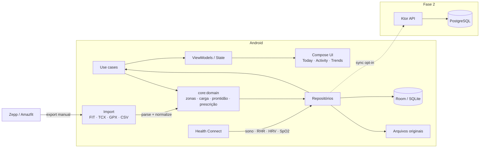
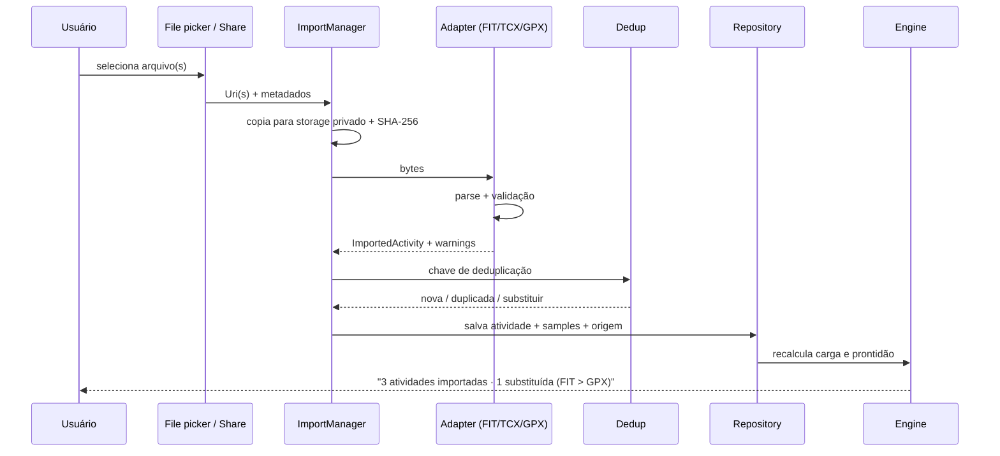

# ARCHITECTURE.md — MeuCoach

**Versão:** 1.2 · **Data:** 29/10/2026

## 1. Restrições e forças

- **Android nativo**, uso pessoal primeiro, mas com arquitetura multi-usuário preparada.
- **Local-first**: o app é útil sem rede e sem conta.
- **Dados de saúde**: sensíveis, alto custo de erro, exigem proveniência e explicabilidade.
- **Um desenvolvedor** (com agente), sem prazo, priorizando método e qualidade.
- **Backend futuro** em VPS com Dokploy (IONOS/EUA), sem dependência no MVP.
- **Design premium** com gráficos densos, mas legível e acessível.

## 2. Visão de sistema



## 3. Princípios arquiteturais

1. **O domínio não conhece Android.** `core:model` e `core:domain` são Kotlin/JVM puro. Isso permite testes rápidos, reuso no backend e evolução sem framework.
2. **A UI não calcula.** ViewModels expõem estado; regras ficam em use cases/domain.
3. **Toda entrada é um adapter.** FIT, TCX, GPX, CSV, Health Connect e futuramente Zepp implementam a mesma porta e produzem o modelo canônico.
4. **Proveniência é parte do dado.** `source`, `sourceId`, `importedAt`, `parserVersion`, `rawFileSha256`.
5. **Idempotência.** Importar o mesmo arquivo duas vezes não duplica atividade.
6. **Determinismo.** Mesmo perfil + mesmos dados + mesma versão do motor ⇒ mesma recomendação. Nada de aleatoriedade ou LLM no caminho crítico.
7. **Degradação graciosa.** Sem HRV, sem GPS, sem potência, sem sono: o app continua e declara a confiança.
8. **Offline é o caminho feliz.** Sync é uma camada opcional, com fila e resolução de conflito.

## 4. Módulos

| Módulo | Tipo | Responsabilidade | Pode depender de |
|---|---|---|---|
| `:app` | Android app | Entry point, navegação, DI, tema raiz | todos |
| `:core:model` | Kotlin JVM | Tipos e unidades (pace, distância, FC, atividade, zona) | nada |
| `:core:domain` | Kotlin JVM | Parsers, zonas, carga, prontidão, prescrição, regras, evidências | `:core:model` |
| `:core:data` | Android library | Room, repositórios, import, Health Connect, DataStore, WorkManager | `:core:model`, `:core:domain` |
| `:core:designsystem` | Android library | Tokens, tema, componentes, gráficos | Compose |
| `:core:testing` | Android library | Fixtures, fakes, test rules | `:core:model`, `:core:domain` |
| `:feature:today` | Android library | Tela Hoje | design system, data, domain |
| `:feature:activity` | Android library | Detalhe da atividade | design system, data, domain |
| `:feature:trends` | Android library | Tendências | design system, data, domain |
| `:feature:import` | Android library | Importação | design system, data, domain |
| `:feature:onboarding` | Android library | Perfil e calibração | design system, data, domain |
| `:feature:settings` | Android library | Dados, privacidade, fontes | design system, data |

**Regra de dependência:** features nunca dependem umas das outras; compartilham `core`. `domain` não importa `android.*`, Room, Compose ou Hilt.

## 5. Fluxo de importação



### 5.1 Parsers

| Formato | Implementação | Campos canônicos | Observações |
|---|---|---|---|
| **FIT** | Parser próprio, subconjunto do protocolo FIT | file_id, record, lap, session, event, device_info, developer fields | Fonte canônica; valida CRC; lê little/big endian e timestamps comprimidos |
| **TCX** | XML DOM (`javax.xml`) | Activity, Lap, Trackpoint, HR, cadência, posição, altitude, velocidade, potência por extensão | Cadência de corrida normalizada; lap inferido quando ausente |
| **GPX** | XML DOM | trkpt, ele, time, extensões `hr`, `cad`, `speed`, `power` | Sem laps nem esporte explícito; usar como último recurso |
| **CSV diário** | Parser de cabeçalho validado | sono, RHR, HRV, SpO2 | Template do app; futuro export Zepp |
| **Health Connect** | `androidx.health.connect` | SleepSession, RestingHeartRate, HRV rMSSD, SpO2, ExerciseSession | Sincronização incremental por `lastSync` |

O parser FIT é o componente de maior risco. Estratégia: implementar o subconjunto usado pelo Amazfit Balance, validar contra os arquivos reais e contra o `fitdecode` (Python) em testes de referência. Fixtures reais são sanitizadas antes de entrar no repo.

**Status (29/10/2026):** FIT implementado em `core:domain/src/main/kotlin/com/meucoach/core/domain/parser/fit/` (`FitParser`, `FitReader`, `FitCursor`, `FitCrc`). Cobre headers de 12/14 bytes, little/big endian, CRC, compressed timestamps, tipos base, developer fields e os fallbacks de início/duração/distância. A suíte usa 4 FIT reais sanitizados em `fixtures/fit/` e mantém 93,01% de branches no pacote; a task `verifyParserBranchCoverage` bloqueia o build abaixo de 90%.

TCX e GPX foram implementados em `core/domain/.../parser/tcx/` e `.../parser/gpx/`, com `SecureXml` compartilhado. TCX cobre laps, trackpoints, FC, cadência, posição, altitude, velocidade e potência por extensão, infere um lap quando ausente e cai para distância por GPS/integração de velocidade. GPX cobre GPX 1.0/1.1, extensões `hr`/`cad`/`speed`/`power` e mantém elevação ausente como `null`. As fixtures reais são 4 FIT + 3 TCX sanitizados; GPX é sintético para não expor nomes/coordenadas.

### 5.2 Deduplicação

- Chave primária: `sha256(bytes)` para o arquivo.
- Chave de atividade: `startTimeUtc` (tolerância de ±1 s) + `sport` + `durationSec` (tolerância de ±2 s) + `distanceM` (tolerância de ±1%, mínimo 1 m).
- Implementação atual: `ActivityDeduplicator` em `core/domain/.../importer/`; a chave exata `keyOf` fica disponível para diagnóstico.
- Se a mesma atividade vier em FIT + TCX + GPX, manter **FIT** (maior riqueza) e anexar os demais como `alternates`; a anexação será ligada ao fluxo de importação no P0-08.
- Se um arquivo já importado for reprocessado com parser mais novo, permitir `reparse` sem perder IDs de referência.

## 6. Motor de domínio

O motor é uma biblioteca pura, sem I/O, com entradas e saídas explícitas:

```kotlin
data class EngineInput(
    val profile: AthleteProfile,
    val activities: List<Activity>,
    val dailyMetrics: List<DailyMetrics>,
    val checkIns: List<CheckIn>,
    val plan: Plan?,
    val today: LocalDate,
    val environment: Environment?,
)

data class EngineOutput(
    val load: LoadSnapshot,
    val readiness: Readiness,
    val recommendation: Recommendation,
    val plan: Plan,
)
```

### 6.1 Componentes

| Componente | Entrada | Saída |
|---|---|---|
| `CalibrationEngine` | prova/TT, treinos, perfil | VDOT, LTHR, paces, confiança |
| `ZoneEngine` | LTHR, pace de limiar | 5 zonas de FC, 5 de pace, 3 zonas polarizadas |
| `LoadEngine` | atividades + RPE | TRIMP, rTSS, CTL, ATL, TSB, ACWR, monotonia |
| `ReadinessEngine` | sono, HRV, RHR, check-in, carga | score, nível, confiança, contribuintes |
| `PrescriptionEngine` | perfil, objetivo, carga, prontidão, plano | sessão do dia + rationale + regras |
| `PlanEngine` | objetivo, disponibilidade, histórico | plano semanal/bloco, taper |
| `ExplanationEngine` | recomendação + evidências | texto pt-BR + regras citadas |

### 6.2 Versionamento do motor

- `EngineVersion` semântica (ex.: `1.0.0`).
- Toda recomendação persiste `engineVersion` + `rulesVersion` + `evidenceVersion`.
- Mudou regra? Nova versão. Planos antigos permanecem auditáveis.

## 7. Persistência

- **Room/SQLite** como fonte de verdade local.
- Entidades agregadas + **samples** em blob comprimido por atividade (ver `DATA_MODEL.md`).
- Arquivos originais em storage privado do app, referenciados por hash.
- `DataStore` apenas para preferências (tema, unidades, onboarding).
- Migrações exportadas em `schemas/` e testadas com `MigrationTestHelper`.
- Backup Android desativado para o banco de saúde; exportação explícita pelo usuário.

## 8. Health Connect

- `HealthConnectClient` com permissões mínimas: sono, RHR, HRV, SpO2, exercício, passos.
- Leitura incremental por `lastSyncTime` + paginação.
- **Nunca** tratar ausência como recuperação ruim.
- Tela de diagnóstico: tipo de dado, último registro, fonte, status.
- Se o Zepp não gravar um tipo, o app mostra "sem dados" e usa fallback (check-in/CSV).
- Em Android < 14, Health Connect pode exigir o app oficial instalado; o app detecta disponibilidade.

## 9. Backend (Fase 2)

- **Ktor** (Kotlin/JVM) reutilizando `core:model` e `core:domain`.
- **PostgreSQL 17+** com migrações Flyway; sem TimescaleDB no MVP.
- Auth: e-mail + senha com Argon2id, JWT curto + refresh token rotativo; passkeys depois.
- Sync: delta por `updatedAt`, IDs UUID gerados no cliente, atividades imutáveis, conflitos de plano por `last-write-wins` com versão.
- Armazenamento de arquivos: S3-compatible (MinIO local, provedor na VPS).
- Deploy: Docker Compose + Dokploy; TLS via Traefik; backup diário do Postgres.
- **Sem backend no MVP**: o app não depende dele para funcionar.

## 10. Build e CI

- Monorepo Gradle, version catalog, wrapper 9.8.2.
- JDK 17 (AGP exige mínimo 17; Gradle 9.8 suporta até 27).
- `compileSdk 37`, `targetSdk 36`, `minSdk 26`.
- Convenções: ktlint/Spotless, Detekt, Kover.
- CI: `./gradlew check assembleDebug` + parser golden tests + screenshot verify (Fase 1).
- Emulador noturno para testes instrumentados.
- Releases: APK assinado em GitHub Releases (Fase 2).

## 11. Segurança e privacidade

- Sem SQLCipher/biometria no MVP (decisão do usuário; complexidade desnecessária).
- Banco excluído de backup automático; export/delete explícitos.
- HTTPS obrigatório no sync; certificate pinning não no MVP.
- Tokens no Android Keystore quando o backend existir.
- Sem SDK de analytics/ads.
- Dados de saúde reais nunca no git.

## 12. Performance e confiabilidade

- Import de arquivo ≤ 5 MB em < 2 s em device médio.
- Samples decodificados sob demanda; gráficos usam série downsampled.
- Listas com `LazyColumn` + chaves estáveis.
- Cálculo de carga/prontidão em background (`WorkManager`) e cacheado por dia.
- Sem trabalho de rede no caminho crítico.
- Testes de regressão de performance com Macrobenchmark na Fase 2.

## 13. Modos de falha

| Falha | Comportamento |
|---|---|
| FIT corrompido | Erro claro, arquivo preservado, opção de reportar |
| TCX sem laps | Infere 1 lap; a importação marca confiança baixa |
| GPS ausente | Atividade válida para pace/FC; mapa indisponível |
| Health Connect indisponível | Fallback para check-in/CSV; aviso não bloqueante |
| Sono não sincroniza | Prontidão com confiança parcial; nunca "ruim" |
| Sem dados de HRV | Peso 0 no modelo; confiança menor |
| App morto durante import | Job persistente; retoma ou marca como falho |

## 14. Decisões relacionadas

- [ADR-0001](adr/0001-monorepo.md) — monorepo
- [ADR-0002](adr/0002-local-first.md) — local-first
- [ADR-0003](adr/0003-fit-canonical.md) — FIT canônico
- [ADR-0004](adr/0004-deterministic-engine.md) — motor determinístico
- [ADR-0005](adr/0005-health-connect.md) — Health Connect + fallback
- [ADR-0006](adr/0006-no-sqlcipher.md) — sem SQLCipher/biometria no MVP
- [ADR-0007](adr/0007-compose-design-tokens.md) — Compose + tokens de marca
- [ADR-0008](adr/0008-backend-dokploy.md) — Ktor + Postgres + Dokploy
- [ADR-0009](adr/0009-strength-out-of-scope.md) — musculação fora do escopo

## 15. Perguntas abertas

- Mapa: MapLibre/OSM vs. polyline estática + abrir app externo (decidir na Fase 1).
- Widgets: Glance na Fase 2; quais métricas expor?
- Sync: conflito de plano quando o usuário edita offline em dois dispositivos.
- Export Zepp: mapear o schema real quando o pacote chegar.
