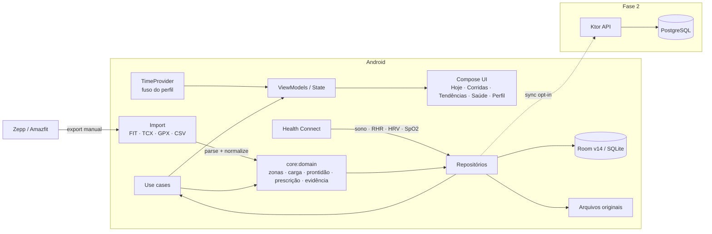
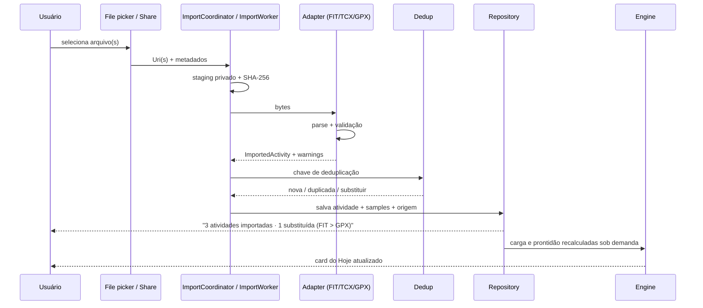

# ARCHITECTURE.md — MeuCoach

**Versão:** 1.10 · **Data:** 10/11/2026 · **Reconciliação:** C3-01A/B e C3-02 implementados (guarda de iniciante, fingerprint/T4/schema 14 e avaliação ao salvar Perfil/Calibração); demais gates do Ciclo 3 pendentes.

## 1. Restrições e forças

- **Android nativo**, uso pessoal primeiro, mas com arquitetura multi-usuário preparada.
- **Local-first**: o app é útil sem rede e sem conta.
- **Dados de saúde**: sensíveis, alto custo de erro, exigem proveniência e explicabilidade.
- **Um desenvolvedor** (com agente), sem prazo, priorizando método e qualidade.
- **Backend futuro** em VPS com Dokploy (IONOS/EUA), sem dependência no MVP.
- **Design premium** com gráficos densos, mas legível e acessível.

## 2. Visão de sistema



## 3. Princípios arquiteturais

1. **O domínio não conhece Android.** `core:model` e `core:domain` são Kotlin/JVM puro. Isso permite testes rápidos, reuso no backend e evolução sem framework.
2. **A UI não calcula.** ViewModels expõem estado; regras ficam em use cases/domain.
3. **Toda entrada é um adapter.** FIT, TCX, GPX, CSV, Health Connect e futuramente Zepp implementam a mesma porta e produzem o modelo canônico.
4. **Proveniência é parte do dado.** `source`, `sourceId`, `importedAt`, `parserVersion`, `rawFileSha256`.
5. **Idempotência.** Importar o mesmo arquivo duas vezes não duplica atividade.
6. **Determinismo.** Mesmo perfil + mesmos dados + mesma versão do motor ⇒ mesma recomendação. Nada de aleatoriedade ou LLM no caminho crítico.
7. **Degradação graciosa.** Sem HRV, sem GPS, sem potência, sem sono: o app continua e declara a confiança.
8. **Offline é o caminho feliz.** Sync é uma camada opcional, com fila e resolução de conflito.
9. **Tempo é uma dependência, não um detalhe.** Dia, semana e fuso vêm do `TimeProvider`/`Clock` injetado; regra de negócio não chama `now()` (`ADR 0022`).
10. **Uma decisão por dia.** O plano é a intenção da semana; a prescrição diária persistida é a autoridade do dia; a execução registra o que aconteceu (`ADR 0023`, `ADR 0024`).

## 4. Módulos

### 4.1 Módulos reais

| Módulo | Tipo | Responsabilidade | Pode depender de |
|---|---|---|---|
| `:app` | Android app | Entry point, navegação, DI, tema raiz, ViewModels, casos de uso e telas | todos |
| `:core:model` | Kotlin JVM | Tipos e unidades (pace, distância, FC, atividade, zona, execução) | nada |
| `:core:domain` | Kotlin JVM | Parsers, zonas, carga, prontidão, prescrição, plano, evidência, regras | `:core:model` |
| `:core:data` | Android library | Room, repositórios, import, Health Connect, WorkManager, época de dados | `:core:model`, `:core:domain` |
| `:core:designsystem` | Android library | Tokens, tema, componentes, gráficos | Compose |

O grafo é validado por `./gradlew -q projects` e por `settings.gradle.kts`. **Não existem** `:core:testing` nem módulos `:feature:*` hoje.

### 4.2 Módulos planejados (não criados)

| Módulo | Quando | Gatilho |
|---|---|---|
| `:core:testing` | Quando houver mais de um consumidor de fixtures/fakes | duplicação real de harness |
| `:feature:today`, `:feature:activity`, `:feature:trends`, `:feature:health`, `:feature:profile` | Fase 2 ou antes se o `:app` passar de ~8 min de build | build > 8 min, mais de 2 desenvolvedores ou isolamento necessário |

**Regra de dependência:** features, quando existirem, nunca dependem umas das outras; compartilham `core`. `domain` não importa `android.*`, Room, Compose ou Hilt. Extrair módulo não é pré-requisito do MVP: o `:app` monolítico é aceitável enquanto o gargalo for ausência de casos de uso, não de módulos.

## 5. Fluxo de importação



### 5.1 Parsers

| Formato | Implementação | Campos canônicos | Observações |
|---|---|---|---|
| **FIT** | Parser próprio, subconjunto do protocolo FIT | file_id, record, lap, session, event, device_info, developer fields | Fonte canônica; valida CRC; lê little/big endian e timestamps comprimidos |
| **TCX** | XML DOM (`javax.xml`) | Activity, Lap, Trackpoint, HR, cadência, posição, altitude, velocidade, potência por extensão | Cadência de corrida normalizada; lap inferido quando ausente |
| **GPX** | XML DOM | trkpt, ele, time, extensões `hr`, `cad`, `speed`, `power` | Sem laps nem esporte explícito; usar como último recurso |
| **CSV diário** | Parser de cabeçalho validado | sono, RHR, HRV, SpO2 | Implementado em `DailyMetricsCsvParser`; template do app |
| **Health Connect** | `androidx.health.connect` | SleepSession, RestingHeartRate, HRV rMSSD, SpO2 | Implementado read-only com `HealthConnectDailySource`; `ExerciseSession` **não** é lido (FR-007, ciclo 2); sync incremental via `HealthSyncService`, agregação em `HealthMetricsAggregator` |

O parser FIT é o componente de maior risco. Estratégia: implementar o subconjunto usado pelo Amazfit Balance, validar contra os arquivos reais e contra o `fitdecode` (Python) em testes de referência. Fixtures reais são sanitizadas antes de entrar no repo.

**Status (29/10/2026):** FIT implementado em `core:domain/src/main/kotlin/com/meucoach/core/domain/parser/fit/` (`FitParser`, `FitReader`, `FitCursor`, `FitCrc`). Cobre headers de 12/14 bytes, little/big endian, CRC, compressed timestamps, tipos base, developer fields e os fallbacks de início/duração/distância. A suíte usa 4 FIT reais sanitizados em `fixtures/fit/` e mantém 93,01% de branches no pacote; a task `verifyParserBranchCoverage` bloqueia o build abaixo de 90%.

TCX e GPX foram implementados em `core/domain/.../parser/tcx/` e `.../parser/gpx/`, com `SecureXml` compartilhado. TCX cobre laps, trackpoints, FC, cadência, posição, altitude, velocidade e potência por extensão, infere um lap quando ausente e cai para distância por GPS/integração de velocidade. GPX cobre GPX 1.0/1.1, extensões `hr`/`cad`/`speed`/`power` e mantém elevação ausente como `null`. As fixtures reais são 4 FIT + 3 TCX sanitizados; GPX é sintético para não expor nomes/coordenadas.

### 5.2 Deduplicação

- Chave primária: `sha256(bytes)` para o arquivo.
- Chave de atividade: `startTimeUtc` (tolerância de ±1 s) + `sport` + `durationSec` (tolerância de ±2 s) + `distanceM` (tolerância de ±1%, mínimo 1 m).
- Implementação atual: `ActivityDeduplicator` em `core/domain/.../importer/`; a chave exata `keyOf` fica disponível para diagnóstico.
- `ActivityRepository` aplica dedup exata por SHA-256 e dedup por chave de atividade no fluxo real de importação.
- A dedup por chave de atividade anexa `alternates`; `ActivitySummary.sources` expõe todos os formatos que contribuíram.
- Se a mesma atividade vier em FIT + TCX + GPX, manter **FIT** (maior riqueza) e anexar os demais como `alternates`.
- Se um arquivo já importado for reprocessado com parser mais novo, permitir `reparse` sem perder IDs de referência.
- Arquivo cuja atividade está na lixeira retorna `ImportResult.TrashConflict` e job `TRASH_CONFLICT`; a restauração é uma decisão explícita na tela Dados (`ADR 0025`).

## 6. Motor de domínio

O motor é uma biblioteca pura, sem I/O, com entradas e saídas explícitas. O fluxo real do dia é:

```text
Perfil + objetivos + disponibilidade
        ↓
WeeklyPlanGenerator(weekStart, today) ──► WeeklyPlan + PlannedSession (intenção)
        ↓
DailyPrescriptionEngine(plano, sessão, prontidão, carga, calor, perfil)
        ↓
DailyPrescription (autoridade do dia, versionada)
        ↓
Hoje (um card) ──► CompleteSession ──► SessionExecution + completionEvidence
```

### 6.1 Componentes

| Componente | Entrada | Saída |
|---|---|---|
| `CalibrationCalculator` | prova/TT, treinos, perfil | VDOT, LTHR, paces, confiança (Tier A/B/C) |
| `HeartRateZoneCalculator` / `PaceZoneCalculator` | LTHR, pace de limiar | 5 zonas de FC, 5 de pace, 3 zonas polarizadas |
| `TrainingLoadEngine` | atividades + frescor da fonte | TRIMP, rTSS, CTL, ATL, TSB, ACWR, monotonia, `LoadCoverage`/`LoadDataState` |
| `ReadinessCalculator` | sono, HRV, RHR, check-in, carga | score, nível, confiança, contribuintes |
| `WeeklyPlanGenerator` | perfil, disponibilidade, prontidão, carga, `today` | semana conservadora (até 2 qualidades, longão, taper, deload) |
| `PlanReplanner` | plano versionado, perfil, prontidão, carga, `today`, datas não treináveis | `Suggest` (futuro mesclado) ou `NoChange`, sem tocar hoje/passado/protegidas |
| `DailyPrescriptionEngine` + `PrescriptionPolicy` | plano, sessão, prontidão, carga, calor, perfil | `KEEP`/`REDUCE`/`DOWNGRADE`/`REST`/`NO_PLAN`, alvos, rationale |
| `PlanCompletionCalculator` | plano, sessões, execuções | adesão, execução comprovada, pendências |
| `SessionMatcher` | sessão planejada, atividades | sugestões de vínculo (nunca automático) |
| `SessionCompletionRules` | sessão, data, prescrição | bloqueios de conclusão e encerramento |
| `WorkoutRecommender` | perfil, prontidão, carga | fallback conservador de `NO_PLAN` |
| `ExplanationCatalog` | `ruleId`/`evidenceId` | rótulo legível, preservando o ID bruto |
| `ActivityInsightsCalculator` | laps da atividade | insights com `ruleId`, evidência, confiança e tom |

`PrescriptionEngine`/`PlanEngine` foram nomes de planejamento; o código real usa os componentes acima. O catálogo canônico de regras e evidências é `docs/SPORTS_SCIENCE.md` §13, espelhado em `ExplanationCatalog.kt`; não há tabela de evidências no Room.

### 6.2 Versionamento do motor

- `engineVersion` semântica (ex.: `1.0.0`) e `inputsHash` determinístico por decisão.
- A `DailyPrescription` persiste `engineVersion`, `inputsHash`, `ruleIds`/`evidenceIds` e confiança; a versão anterior permanece com `supersedesId`.
- Mudou regra? Nova versão do motor e nova linha. Não há `rulesVersion`/`evidenceVersion` como colunas separadas.

### 6.3 Tempo, prescrição e evidência

- **Tempo:** `TimeProvider` (em `:app/time`) expõe `today`, `zoneId`, `now()`, `currentWeekStart()` e `refresh()`. `SystemTimeProvider` usa o relógio do sistema; `ProfileTimeProvider` usa o fuso IANA do perfil e cai para o fuso do sistema antes do onboarding. Hilt fornece um único `Clock`. `MainActivity.onResume()` e a meia-noite disparam `refresh()`; trocar o fuso reagenda lembretes. ViewModels e telas não chamam `LocalDate.now()`/`System.currentTimeMillis()` (`ADR 0022`).
- **Decisão do dia:** `GetTodayDecision` resolve primeiro um `RaceEvent` na data; se existir, devolve `Competition` sem chamar a prescrição. Sem evento, `GetTodayPrescription` lê a última versão de `daily_prescriptions` e só persiste quando `inputsHash`/`engineVersion` mudam. Editar o check-in cria uma nova linha com `supersedesId`; a anterior continua auditável. `TodayViewModel` não recalcula a decisão (`ADR 0023`/`0030`).
- **Conclusão:** `CompleteSession` valida data, estado e prescrição; `DONE` exige `completionEvidence` (`ACTIVITY`, `GUIDED` ou `MANUAL`). `SessionExecution` guarda a execução; índices únicos garantem 1:1 entre atividade e sessão. Descanso/doença encerram a sessão como `CLOSED` com motivo. `LEGACY_UNVERIFIED` preserva o histórico antigo sem promovê-lo a verdade (`ADR 0024`).
- **Datas locais:** atividades persistem instante UTC + `zoneId` + `localDate`; a data local de planejamento vem do fuso do perfil. Treino que cruza meia-noite pertence ao dia de início.

### 6.4 Replanejamento da semana (ADR 0028)

- **Fluxo:** `ReplanContextBuilder` lê o `StoredWeeklyPlan` (versão/hashes, proveniência/checkpoint), perfil, prontidão, carga, semana anterior, bloco e check-ins de doença; captura o baseline de disponibilidade e o checkpoint de perfil quando desconhecidos, usando um snapshot coerente de instante + fuso. `EvaluateReplan` delega ao `PlanReplanner` puro e devolve `Suggestion` (candidato + diff), `NoChange` ou `Unavailable`; `NoChange` persiste somente o checkpoint avaliado.
- **Proteções:** só sessões `date > today` e `PLANNED` entram no diff/substituição. Sessões de hoje/passadas e futuras `DONE`/`CLOSED` são copiadas; a prescrição do dia não é recalculada pelo aceite.
- **Aceite:** `ApplyReplan` relê o estado, exige `expectedVersion`, recalcula o `inputsHash` e chama `TrainingPlanRepository.applyReplan` com validação dentro da transação. A mesma transação relê o perfil persistido, recalcula o fingerprint/contexto temporal e retorna `Stale` se algo divergiu; conflito protegido produz `Rejected`.
- **UI:** `ReplanViewModel` avalia no resume, respeita recusa por proposta (`weekStart` + versão + hash) e supressão até o fim do dia em `ReplanSuggestionStore` (SharedPreferences), e oferece aceitar/recusar/suprimir. O card do plano mostra o selo `v{n}`, o botão explícito e “Ver o que mudou” a partir de `getLatestRevision` + `PlanJson`.
- **Explicabilidade:** a revisão reutiliza as regras/evidências emitidas pelo gerador; `ReplanDiff` e a copy são apresentação, não regra fisiológica.

### 6.5 Ciclo 3 — C3-01A/B, C3-02, C3-03/04, C3-05, C3-06 e C3-G2 implementados

- **Guarda de iniciante (C3-01A):** a prescrição do dia rebaixa `QUALITY → EASY`
  apenas para sessão de hoje `PLANNED` e perfil `BEGINNER`; `DONE`/`CLOSED`
  preservam prescrição, execução e histórico (`R-PRESC-04`).
- **Fingerprint de planejamento (ADR 0031, C3-01B):** fingerprint
  `planning-v1`/canônico dos inputs que alteram plano/alvos; proveniência
  (`generatedFrom*`) e checkpoint (`lastEvaluated*`) separados; `temporalContextHash`
  para o fuso que define `today`/semana; T4 `PROFILE_CHANGED`; aceite revalida o
  fingerprint dentro da transação Room. Migração `13→14`, export/reset e
  `saveWeek` preservam os campos.
- **Perfil e plano (C3-02):** salvar onboarding/perfil e calibração chamam
  `EvaluateReplan`; o resultado é transportado por `ProfilePlanEvaluationStore` e
  exibido no Perfil (sugestão com ações, `NoChange` ou limite). O Hoje continua
  avaliando e mostrando a sugestão.
- **Evento de prova (ADR 0030, C3-05):** `RaceEvent` é separado de
  `WorkoutType`/`PlannedSession`; Room 15 tem `race_events` com `activeKey` único,
  `activityId` único/FK `SET NULL` e migração sem backfill. `GetTodayDecision` lê o
  evento do dia antes de qualquer prescrição e devolve `Training(DailyPrescription)`
  ou `Competition(RaceEvent)`; no ramo de competição nenhuma prescrição é
  calculada/persistida e o Hoje não renderiza treino, briefing, iniciar/trocar/concluir.
  `WeeklyPlanInput`/`ReplanInput` recebem `race` e `eventDates`, o taper/cutoff é
  calculado por data da sessão, a adesão exclui datas de evento e
  `CompleteSession`/`SessionSwapper` recusam o dia da prova. A notificação lê o
  evento do dia, usa copy de prova e `meucoach://today`; o Hoje revalida a decisão
  ao abrir. Perfil concentra criar/editar/concluir/cancelar/não compareceu; plano
  marca o dia como evento e oculta sessão legada sobreposta.
- **Auto-conclusão e referência da meta (ADR 0032, C3-06):**
  `RaceAutoCompletionRule` é pura (mesma data local, `RUNNING`/`TREADMILL`, não
  vinculada, `PLANNED`, 90–110%, uma única candidata, recusa anterior);
  `AutoCompleteRaceFromActivity` só coleta estado e chama a transação existente com
  `completionSource = AUTO_IMPORT`. `StagedImportProcessor` executa a regra após
  `Imported`/`Duplicate` e antes do prompt de treino. Room 16 adiciona
  `completionSource` nullable e a migração `15→16` não reescreve o histórico;
  `reopenAutoCompleted` volta a `PLANNED` e o `RaceAutoCompletionStore` grava a
  recusa. `RaceTargetProjection`/`RaceTargetProjector` são puros, não persistidos e
  consumidos apenas pelo card de prova do Perfil/Hoje; não entram em prescrição,
  plano, briefing ou troca.
- **Briefing (C3-03/04):** `SessionBriefingEngine` puro em `core:domain/briefing`
  deriva o briefing só da `DailyPrescription` persistida. `SessionBriefing` copia
  título, tipo, duração, alvos, rationale, confiança e IDs; não há cálculo de alvo,
  blocos/intervalos, persistência de texto ou leitura do perfil atual. `DONE`/`CLOSED`
  não recebem briefing retrospectivo. O Hoje expõe o CTA “Como correr hoje” e um sheet
  com seções Foco → Alvo → Por que hoje → Como correr → Se estiver difícil, sem
  `R-`/`EV-` na superfície comum.
- **Comparação planejado × executado (FR-010):** `SessionComparisonCalculator` é
  puro e compara a corrida com a `DailyPrescription` do dia (fallback para a sessão
  da semana) apenas quando a atividade é a evidência do treino. Devolve direção e
  tolerância por métrica, com dado ausente como ausente; treino livre não recebe
  alvo. `GetSessionComparison` só coleta estado e o detalhe só renderiza (ADR 0033).
- **Nutrição (F4):** copy educativa estática aprovada pelo ADR 0029 e exibida no
  sheet de briefing. O conteúdo não sai do motor, não altera prescrição/confiança e
  o ramo de prova continua sem dicas (FR-404).

## 7. Persistência

- **Room/SQLite** como fonte de verdade local; versão atual **16** (`MeuCoachDatabase.VERSION`).
- `:core:data` implementa `MeuCoachDatabase` v16 com `ActivityEntity`, `LapEntity`, `SampleBlobEntity`, `ImportJobEntity`, `ActivityAlternateEntity`, `AthleteProfileEntity`, `DailyCheckInEntity`, `DailyMetricsEntity`, `WeeklyPlanEntity`, `PlannedSessionEntity`, `WeeklyPlanRevisionEntity`, `DailyPrescriptionEntity`, `SessionExecutionEntity` e `RaceEventEntity`.
- DAOs separados e repositórios como fronteiras: `ActivityRepository`, `ProfileRepository`, `CheckInRepository`, `DailyMetricsRepository`, `TrainingPlanRepository`, `DailyPrescriptionRepository`, `SessionExecutionRepository`, `RaceEventRepository` e `UserDataRepository`.
- `SampleBlobCodec` `gzip-columnar-v1` para séries temporais; samples decodificados sob demanda (não há série downsampled persistida).
- UUID v7 gerado no cliente para IDs ordenáveis.
- Importação por `ImportCoordinator`/`ImportService` + fila `WorkManager` (`ImportWorker`, `@HiltWorker`); arquivos passam por `ImportStaging` e são copiados para storage privado antes do processamento.
- Atividade, laps e blob são gravados na mesma transação; a lista usa `ActivitySummary` e o detalhe abre `StoredActivity`.
- Exclusão padrão é lógica (`deletedAt`); a lixeira dura 7 dias (`TrashPolicy`), o expurgo roda por clock + `TrashPurgeWorker` e remove linha, filhos, jobs e arquivo bruto. “Apagar definitivamente” está disponível na tela Dados.
- O export JSON padrão **exclui** atividades na lixeira (e execuções ligadas a elas); `includeTrash = true` é opt-in.
- “Apagar tudo” usa transação + `DataEpochStore` + `DataWriteMutex`: gira a época, cancela importação/saúde/lembretes/story/expurgo, limpa banco, staging, avatar, cache e preferências; Health Connect externo não é tocado (`ADR 0025`).
- Arquivos originais em storage privado do app, referenciados por hash; o arquivo temporário de staging é limpo após o processamento.
- `SharedPreferences`/DataStore apenas para preferências e marcas d'água (tema, unidades, onboarding, tutorial, `firstRun`, `HealthSyncStore`, `DataEpochStore`).
- Migrações exportadas em `core/data/schemas/` e testadas com `MigrationTestHelper` em Robolectric: `1→2` (`deletedAt`), `2→3` (`activity_alternates`), `3→4` (`athlete_profile`), `4→5` (`daily_check_ins`), `5→6` (`daily_metrics`), `6→7` (`weekly_plans`/`planned_sessions`), `7→8` (status/motivo), `8→9` (calor/esteira), `9→10` (nome/avatar), `10→11` (`daily_prescriptions`, `createdOn`, `targetsJson`), `11→12` (`session_executions` + evidência/vínculo/encerramento, com backfill `DONE → LEGACY_UNVERIFIED` e `SKIPPED → CLOSED/USER_SKIPPED`), `12→13` (`version`/hashes do plano + `weekly_plan_revisions`, com hashes legados desconhecidos), `13→14` (fingerprint/checkpoint/proveniência do plano + contexto temporal, com todos os campos novos `NULL` no legado), `14→15` (`race_events` vazia, com `activeKey` único, FK `SET NULL` para `activities` e nenhum backfill de `TrainingGoal`) e `15→16` (`completionSource` nullable em `race_events`, com o histórico preservado e `NULL` lido como conclusão explícita anterior).
- Backup Android desativado para o banco de saúde; exportação explícita pelo usuário.

## 8. Health Connect

- `HealthConnectClient` com permissões mínimas: sono, RHR, HRV, SpO2.
- Leitura read-only com paginação; a primeira sincronização cobre 30 dias e as seguintes partem do último sucesso menos 1 dia.
- `HealthSyncService` compartilha a mesma lógica entre o resume do app, a aba Saúde e o `HealthSyncWorker`; o worker roda diariamente via WorkManager como fallback.
- `HealthSyncCoordinator` dispara um sync no resume quando a última leitura bem-sucedida tem mais de 6 h; falta de permissão não abre diálogo e erro de leitura tem backoff de 15 min (`ADR-0021`).
- O último sync bem-sucedido e a última tentativa ficam em `SharedPreferences` (não são dados de saúde); falhas de permissão/leitura não avançam a marca d'água.
- `Mutex` no serviço impede leitura concorrente entre resume, botão manual e worker.
- **Nunca** tratar ausência como recuperação ruim.
- Aba Saúde com diagnóstico de status, autorização, última leitura, aviso de dados do dia e link direto para o Health Connect.
- Se o Zepp não gravar um tipo, o app mostra "sem dados" e usa fallback (check-in/CSV).
- Em Android < 14, Health Connect pode exigir o app oficial instalado; o app detecta disponibilidade.
- Permissões declaradas no manifest; app usa `ACTION_SHOW_PERMISSIONS_RATIONALE` para a política.

## 9. Backend (Fase 2)

- **Ktor** (Kotlin/JVM) reutilizando `core:model` e `core:domain`.
- **PostgreSQL 17+** com migrações Flyway; sem TimescaleDB no MVP.
- Auth: e-mail + senha com Argon2id, JWT curto + refresh token rotativo; passkeys depois.
- Sync: delta por `updatedAt`, IDs UUID gerados no cliente, atividades imutáveis, conflitos de plano por `last-write-wins` com versão.
- Armazenamento de arquivos: S3-compatible (MinIO local, provedor na VPS).
- Deploy: Docker Compose + Dokploy; TLS via Traefik; backup diário do Postgres.
- **Sem backend no MVP**: o app não depende dele para funcionar.

## 10. Build e CI

- Monorepo Gradle, version catalog, wrapper 9.8.2.
- JDK 17 (AGP exige mínimo 17; Gradle 9.8 suporta até 27).
- `compileSdk 37`, `targetSdk 36`, `minSdk 26`.
- Convenções: Spotless (ktlint). Detekt está no roadmap técnico (T-02), não configurado.
- Kover aplicado a `core:domain` (linhas/branches/instruções) e gate próprio de branches do parser FIT (`verifyParserBranchCoverage`, ≥ 90%).
- CI: `./gradlew check :app:assembleDebug :app:verifyRoborazziDebug` + parser golden tests; lint sem erros.
- Testes de UI/screenshot rodam em JVM com Robolectric/Roborazzi; não há `androidTest` nem emulador no CI hoje.
- Releases: APK assinado em GitHub Releases (Fase 2).

## 11. Segurança e privacidade

- Sem SQLCipher/biometria no MVP (decisão do usuário; complexidade desnecessária).
- Banco excluído de backup automático; export/delete explícitos.
- HTTPS obrigatório no sync; certificate pinning não no MVP.
- Tokens no Android Keystore quando o backend existir.
- Sem SDK de analytics/ads.
- Dados de saúde reais nunca no git.

## 12. Performance e confiabilidade

- Import de arquivo ≤ 5 MB em < 2 s em device médio (meta; ainda não medida em instrumentado).
- Samples decodificados sob demanda; o detalhe desenha direto da série decodificada. A série downsampled persistida é planejada, não implementada.
- Listas com `LazyColumn` + chaves estáveis.
- Carga e prontidão são derivadas sob demanda a partir do banco; não há worker nem cache persistido por dia (WorkManager cobre importação, lembretes, Health Connect, story e expurgo).
- Sem trabalho de rede no caminho crítico.
- Testes de regressão de performance com Macrobenchmark na Fase 2.

## 13. Modos de falha

| Falha | Comportamento |
|---|---|
| FIT corrompido | Erro claro; a importação falha sem criar atividade; o arquivo pode ser reimportado |
| TCX sem laps | Infere 1 lap; a importação marca confiança baixa |
| GPS ausente | Atividade válida para pace/FC; mapa indisponível |
| Health Connect indisponível | Fallback para check-in/CSV; aviso não bloqueante |
| Sono não sincroniza | Prontidão com confiança parcial; nunca "ruim" |
| Sem dados de HRV | Peso 0 no modelo; confiança menor |
| Blob de samples corrompido | Atividade permanece; samples descartados com aviso |
| App morto durante import | Job persistente; retoma ou marca como falho |
| Carga desconhecida/desatualizada | Qualidade bloqueada; confiança reduzida; texto “dados insuficientes/desatualizados” (`R-DATA-01`) |
| Sessão concluída sem atividade | Diálogo exige vínculo ou “fiz sem registro”; `DONE` sem evidência é rejeitado |
| Reset com worker em voo | Época de dados invalida a leitura/importação; nada é recriado |

## 14. Decisões relacionadas

- [ADR-0001](adr/0001-monorepo.md) — monorepo
- [ADR-0002](adr/0002-local-first.md) — local-first
- [ADR-0003](adr/0003-fit-canonical.md) — FIT canônico
- [ADR-0004](adr/0004-deterministic-engine.md) — motor determinístico
- [ADR-0005](adr/0005-health-connect.md) — Health Connect + fallback
- [ADR-0006](adr/0006-no-sqlcipher.md) — sem SQLCipher/biometria no MVP
- [ADR-0007](adr/0007-compose-design-tokens.md) — Compose + tokens de marca
- [ADR-0008](adr/0008-backend-dokploy.md) — Ktor + Postgres + Dokploy
- [ADR-0009](adr/0009-strength-out-of-scope.md) — musculação fora do escopo
- [ADR-0010](adr/0010-availability-hard-cap-progression.md) — disponibilidade como teto
- [ADR-0011](adr/0011-deload-block-anchor.md) — deload ancorado em semanas de plano
- [ADR-0012](adr/0012-story-video.md) — story de treino (Canvas + MediaCodec)
- [ADR-0013](adr/0013-manual-session-swap.md) — troca manual de sessões
- [ADR-0014](adr/0014-incremental-health-sync.md) — sync incremental do Health Connect
- [ADR-0015](adr/0015-story-video-map.md) — mapa real no story (OSM + MapLibre)
- [ADR-0016](adr/0016-daily-metrics-merge.md) — mescla de métricas por campo
- [ADR-0018](adr/0018-story-export-background.md) — story em segundo plano
- [ADR-0019](adr/0019-story-camera-projection.md) — câmera 3D no story
- [ADR-0020](adr/0020-health-top-level-destination.md) — Saúde como destino principal
- [ADR-0021](adr/0021-health-sync-on-resume.md) — sync automático no resume
- [ADR-0022](adr/0022-deterministic-time-and-week.md) — tempo determinístico, fuso e virada de dia/semana
- [ADR-0023](adr/0023-weekly-plan-vs-daily-prescription.md) — plano como intenção e prescrição diária como autoridade
- [ADR-0024](adr/0024-completion-evidence.md) — conclusão com evidência e estados próprios
- [ADR-0025](adr/0025-deletion-retention-reset.md) — lixeira de 7 dias, reset imediato e época de dados
- [ADR-0026](adr/0026-load-coverage-quality-eligibility.md) — cobertura de carga, ACWR desconhecido e elegibilidade de qualidade
- [ADR-0028](adr/0028-versioned-plan-replanning.md) — replanejamento versionado e sugerido da semana
- [ADR-0030](adr/0030-race-event-and-weekly-taper.md) — evento de prova, autoridade diária e taper
- [ADR-0031](adr/0031-profile-planning-fingerprint.md) — fingerprint de planejamento e aceite atômico
- [ADR-0032](adr/0032-race-autocompletion-and-target-projection.md) — auto-conclusão da prova e projeção da meta
- [ADR-0033](adr/0033-planned-vs-executed-comparison.md) — comparação planejado × executado

> Não existe ADR-0017; a numeração 0016 → 0018 é intencional e preservada. O ADR 0027 (sessão guiada) ainda não foi extraído.

## 15. Perguntas abertas

- Widgets: Glance na Fase 2; quais métricas expor?
- Sync: conflito de plano quando o usuário edita offline em dois dispositivos.
- Export Zepp: mapear o schema real quando o pacote chegar.
