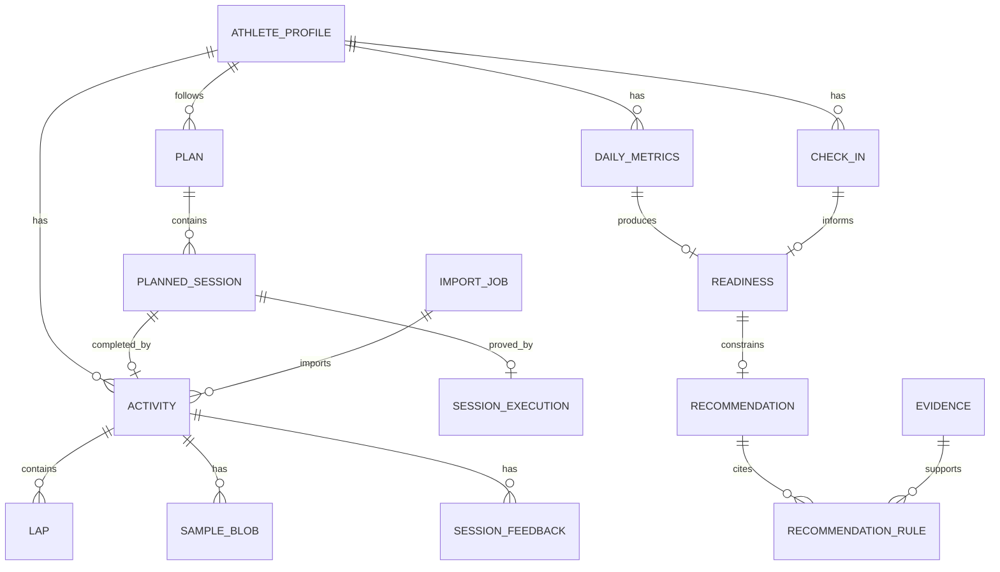

# DATA_MODEL.md — MeuCoach

**Versão:** 1.2 · **Data:** 06/11/2026

## 1. Convenções

- **Unidades internas:** SI. Distância em metros, duração em segundos, pace em s/km, FC em bpm, massa em kg, altura em cm, potência em watts, temperatura em °C.
- **Tempo:** persistir UTC (`Instant`) + `zoneId` + `localDate` derivada para agregações diárias.
- **IDs:** UUID v7 gerados no cliente (ordenáveis por tempo), exceto entidades derivadas que usam chave natural (`localDate`, `activityId + lapIndex`).
- **Dinheiro/medidas:** `Double` para métricas fisiológicas; `Long` para contadores; nunca `Float` em persistência.
- **Nulos:** ausência de dado é `null`, nunca `0`. `0` é um valor medido.
- **Proveniência:** toda entidade importada tem `source`, `sourceId`, `importedAt`, `parserVersion`.
- **Soft delete:** `deletedAt` em atividades e métricas diárias; a lixeira de atividades dura 7 dias (`ADR 0025`).
- **Versionamento:** `schemaVersion` em `Room`; `engineVersion` em recomendações; `evidenceVersion` no registro de evidências.

## 2. Diagrama

## 3. Entidades principais

### 3.1 `AthleteProfile` (singleton local; multi-perfil na Fase 2)

| Campo | Tipo | Notas |
|---|---|---|
| `id` | UUID | |
| `birthDate` | LocalDate | idade derivada |
| `sex` | enum | `FEMALE`, `MALE`, `OTHER`, `UNSPECIFIED` |
| `heightCm` | Double? | |
| `weightKg` | Double? | atual; histórico em `BodyMeasurement` |
| `restingHr` | Int? | informado ou derivado |
| `maxHrObserved` | Int? | **observado**, nunca 220-idade |
| `lthr` | Int? | limiar de FC |
| `thresholdPaceSecPerKm` | Int? | pace de limiar |
| `vdot` | Double? | Daniels |
| `experience` | enum | `BEGINNER`, `INTERMEDIATE`, `ADVANCED` |
| `weeklyAvailability` | JSON | dias + minutos por dia |
| `goal` | JSON | tipo, prova, data, distância, tempo alvo |
| `timezone` | String | IANA |
| `city` / `lat` / `lon` | | clima e horário |
| `units` | enum | `METRIC` (padrão) |
| `createdAt` / `updatedAt` | Instant | |

### 3.2 `Activity`

| Campo | Tipo | Notas |
|---|---|---|
| `id` | UUID | |
| `source` | enum | `FIT`, `TCX`, `GPX`, `HEALTH_CONNECT`, `MANUAL` |
| `sourceId` | String? | file_id/serial ou record ID |
| `sourceFileSha256` | String? | dedup |
| `sport` | enum | `RUNNING`, `TREADMILL`, `WALKING`, `OTHER` |
| `subSport` | String? | `street`, `treadmill`, `trail` |
| `startTimeUtc` | Instant | |
| `zoneId` | String | |
| `durationSec` | Int | elapsed |
| `movingTimeSec` | Int? | |
| `distanceM` | Double | |
| `avgPaceSecPerKm` | Double? | derivado |
| `bestPaceSecPerKm` | Double? | |
| `avgHr` / `maxHr` | Int? | |
| `avgCadenceSpm` / `maxCadenceSpm` | Int? | normalizado para passos/min |
| `avgPowerW` / `maxPowerW` | Int? | quando disponível |
| `avgStepLengthM` | Double? | quando disponível |
| `elevationGainM` / `lossM` | Double? | |
| `calories` | Int? | |
| `trainingEffectAerobic` / `Anaerobic` | Double? | do Zepp, apenas referência |
| `trainingLoadPeak` | Double? | do Zepp, apenas referência |
| `rawFilePath` | String? | arquivo original |
| `parserVersion` | String | |
| `importedAt` | Instant | |
| `deletedAt` | Instant? | soft delete |

**Índices:** `startTimeUtc`, `(sport, startTimeUtc)`, `sourceFileSha256` (unique quando não nulo).

### 3.3 `Lap`

| Campo | Tipo |
|---|---|
| `activityId` | UUID (FK) |
| `index` | Int |
| `startTimeUtc` | Instant |
| `durationSec` | Int |
| `distanceM` | Double |
| `avgHr` / `maxHr` | Int? |
| `avgPaceSecPerKm` | Double? |
| `avgCadenceSpm` | Int? |
| `avgPowerW` | Int? |
| `elevationGainM` | Double? |

Chave: `(activityId, index)`.

### 3.4 `SampleBlob` — séries temporais

Séries de 1 Hz podem gerar milhões de pontos. Estratégia:

- **Blob comprimido** por atividade (`gzip-columnar-v1`), com cabeçalho de versão, contagem e máscara de colunas.
- Colunas: `tOffsetSec`, `lat`, `lon`, `altitudeM`, `speedMps`, `hr`, `cadenceSpm`, `powerW`, `stepLengthM` e `developerFields`.
- Cada coluna opcional tem flags de presença por amostra; ausência continua `null`, nunca vira `0`.
- `SampleBlob(activityId, version, encoding, bytes, sampleCount, startTimeUtc)`.
- Timestamps não são duplicados no blob: `startTimeUtc + tOffsetSec` reconstrói o instante de cada sample.
- Limites de segurança do codec: 5 milhões de samples e 128 MB de payload descomprimido.
- **Série downsampled** (10 s) para gráficos rápidos ainda não está implementada; o detalhe do P0-09 decodifica a série sob demanda até existir uma `SampleSeries`.
- Teste de round-trip obrigatório; corrupção, versão desconhecida ou encoding inválido ⇒ atividade permanece, samples são descartados e a abertura retorna `sampleWarning`.

### 3.5 `DailyMetrics`

| Campo | Tipo | Fonte |
|---|---|---|
| `date` | LocalDate | PK |
| `sleepDurationMin` | Int? | Health Connect/CSV |
| `restingHeartRate` | Double? | Health Connect/CSV |
| `hrvRmssdMs` | Double? | Health Connect/CSV |
| `spo2Avg` | Double? | Health Connect/CSV |
| `source` | enum | `HEALTH_CONNECT`, `CSV`, `MANUAL` |
| `createdAt` / `updatedAt` | Long (epoch ms) | escrita local |

Campos planejados (eficiência do sono, estágios, passos, estresse) ainda não
foram implementados; ausentes ficam `null`, nunca `0`. Um dia pode reunir
campos de mais de uma fonte: a mescla por campo segue o `ADR-0016`, e `source`
guarda a fonte dominante (`MANUAL` > `HEALTH_CONNECT` > `CSV`).

### 3.6 `CheckIn`

| Campo | Tipo | Escala |
|---|---|---|
| `date` | LocalDate | PK |
| `sleepHours` | Double? | |
| `sleepQuality` | Int | 1–5 |
| `fatigue` | Int | 1–5 |
| `soreness` | Int | 1–5 |
| `stress` | Int | 1–5 |
| `mood` | Int? | 1–5 |
| `notes` | String? | |
| `createdAt` | Instant | |

O check-in alimenta o **Hooper index** e o modelo de prontidão mesmo sem wearable.

### 3.7 `Readiness`

| Campo | Tipo |
|---|---|
| `date` | LocalDate (PK) |
| `score` | Int 0–100 |
| `level` | `GREEN`, `AMBER`, `RED` |
| `confidence` | `HIGH`, `MEDIUM`, `LOW` |
| `components` | JSON (sono, HRV, RHR, carga, subjetivo) |
| `missingInputs` | JSON |
| `modelVersion` | String |
| `computedAt` | Instant |

### 3.8 `Plan` / `PlannedSession`

`Plan`: `id`, `startDate`, `endDate`, `goalType`, `targetRaceDate`, `status`, `engineVersion`, `createdAt`.

`PlannedSession`: `id`, `weekStart`, `date`, `type` (`EASY`, `LONG`, `QUALITY`, `REST`), `title`, `durationMin`, `targets` (JSON: zona, pace, FC, distância e RPE), `status` (`PLANNED`, `DONE`, `CLOSED`), `skipReason`, `completedAt`, `completionEvidence` (`ACTIVITY`, `GUIDED`, `MANUAL`, `LEGACY_UNVERIFIED`), `executionId?`, `activityId?`, `closureReason?` (`REST_PRESCRIBED`, `ILLNESS_OR_INJURY`, `USER_SKIPPED`, `MISSED`, `PLAN_REPLACED`), `closedAt?`, `rationale` e IDs de regra/evidência.

Regras do `ADR 0024`:

- `DONE` só existe com evidência; o modelo rejeita a construção sem ela.
- `CLOSED` só existe com motivo; descanso, doença e plano substituído não contam como falha de adesão.
- Uma atividade e uma sessão são 1:1: índices únicos em `planned_sessions.activityId` e `session_executions.activityId`/`plannedSessionId`.
- Atividade na lixeira suspende a evidência (`LEGACY_UNVERIFIED`); restaurar devolve `ACTIVITY`; expurgar remove o vínculo e mantém o histórico não verificado.

### 3.8.1 `SessionExecution`

| Campo | Tipo | Notas |
|---|---|---|
| `id` | UUID | PK |
| `plannedSessionId` | String? | 1:1 com a sessão |
| `activityId` | String? | 1:1 com a atividade; nulo em `MANUAL`/`GUIDED` |
| `startedAt` / `endedAt` | Instant? | nulos em `MANUAL` |
| `pausesJson` | JSON | pausas da execução guiada; vazio neste ciclo |
| `durationSec` | Int | positivo |
| `distanceM` | Double? | nulo em `MANUAL` |
| `rpe` | Int? | obrigatório em `MANUAL` (1–10) |
| `source` | enum | `ACTIVITY`, `GUIDED`, `MANUAL` |
| `createdAt` | Instant | |

`MANUAL` é uma declaração explícita de execução, não uma atividade: não cria
volume, carga, zonas, distância ou pace. `GUIDED` tem contrato definido, mas
nenhuma execução nova é produzida até a sessão guiada persistente do ciclo 3.

### 3.9 `SessionFeedback`

`activityId`, `rpe` (1–10), `feeling` (1–5), `notes`, `createdAt`. O RPE alimenta sRPE e o modelo de carga quando a FC é duvidosa.

### 3.10 Evidências e regras

- `Evidence`: `id`, `citation`, `doi/url`, `claim`, `strength` (`STRONG`, `MODERATE`, `LIMITED`), `appliesTo`.
- `Rule`: `id`, `version`, `description`, `inputs`, `logic`, `evidenceIds`, `confidence`.
- `RecommendationRule`: liga uma recomendação às regras/evidências usadas.
- O registro canônico fica em `core/domain/src/main/resources/evidence.json` (versionado); o banco guarda apenas IDs e snapshots.

### 3.11 `ImportJob`

`id`, `fileName`, `sha256`, `mime`, `sizeBytes`, `status` (`QUEUED`, `PARSING`, `DONE`, `FAILED`, `DUPLICATE`), `parserVersion`, `activityId`, `errorCode`, `errorMessage`, `createdAt`, `finishedAt`.

## 4. Deduplicação e merge

1. Hash do arquivo igual ⇒ duplicata exata; ignorar.
2. Chave de atividade (start ±1 s, sport, duração ±2 s, distância ±1%) ⇒ mesma sessão.
3. Preferência de formato: **FIT > TCX > GPX > Health Connect**.
4. Se o novo formato for mais rico, substituir os agregados e manter o arquivo anterior como `alternate`.
5. Nunca apagar feedback do usuário ao substituir.

## 5. Timezone e dia local

- Atividades: `startTimeUtc` + `zoneId` do dispositivo no momento da importação.
- Métricas diárias: `localDate` no fuso do perfil.
- Treinos que cruzam meia-noite pertencem ao dia de início.
- Export do Zepp usa UTC nos arquivos e hora local no nome; **ignorar o nome** e usar o timestamp interno.

## 6. Mapeamento Health Connect

| Health Connect | Destino |
|---|---|
| `SleepSessionRecord` + stages | `DailyMetrics` (sono) |
| `RestingHeartRateRecord` | `DailyMetrics.restingHr` |
| `HeartRateVariabilityRmssdRecord` | `DailyMetrics.hrvRmssdMs` |
| `OxygenSaturationRecord` | `DailyMetrics.spo2Avg` |
| `ExerciseSessionRecord` | `Activity` (se não houver arquivo melhor) |
| `StepsRecord` | `DailyMetrics.steps` |
| `WeightRecord` | `BodyMeasurement` |

Regras: ler apenas o intervalo desde `lastSync`; deduplicar por `metadata.id`; registrar a fonte (`dataOrigin`) para diagnóstico. Se o mesmo dia vier de CSV e Health Connect, os campos são mesclados: Health Connect tem precedência sobre CSV e o CSV só preenche lacunas (`ADR-0016`).

## 7. Migrações

- Room com `exportSchema = true`, schemas em `core/data/schemas/`.
- Estado atual: banco **v12**; migrações 1→2 até 11→12 testadas em Robolectric.
- `10→11` cria `daily_prescriptions` e adiciona `createdOn`/`targetsJson`.
- `11→12` cria `session_executions`, adiciona as colunas de evidência/vínculo/encerramento e faz backfill explícito: `DONE → LEGACY_UNVERIFIED`; `SKIPPED → CLOSED/USER_SKIPPED`. Status, `completedAt`, planos e sessões são preservados.
- Migrações explícitas testadas com `MigrationTestHelper` em Robolectric; os schemas são assets de teste.
- Nunca `fallbackToDestructiveMigration` em produção.
- Ao mudar o modelo de samples, versionar o `encoding` do blob e manter leitura da versão anterior por pelo menos uma release.

## 8. Qualidade de dados

Cada métrica derivada carrega `confidence`:

- **HIGH:** medida direta + fonte confiável + cobertura ≥ 80% do período.
- **MEDIUM:** estimada ou cobertura 40–80%.
- **LOW:** inferida, esparsa ou conflitante.

Exibir a confiança no UI, não esconder. Uma prontidão "LOW" não deve gerar mudança agressiva de plano.

## 9. Exportação

O usuário pode exportar:

- JSON completo (perfil, atividades, laps, métricas, check-ins, planos, recomendações).
- Arquivos originais (FIT/TCX/GPX).
- CSV de métricas diárias.
- ZIP com `manifest.json` (versão do schema, data, contagens, hashes).

Estado atual: `UserDataRepository.exportJson()` exporta perfil, check-ins, métricas diárias, planos/sessões (com evidência e encerramento), prescrições diárias, execuções, atividades, laps, contagem de samples, jobs de importação e o objeto local `firstRun`. A lixeira fica fora por padrão e só entra com `includeTrash = true`; execuções ligadas a atividades na lixeira também ficam fora. Export ZIP, arquivos originais e séries completas ficam para a Fase 1.

Excluir tudo remove banco, arquivos, blobs, staging, cache, avatar e preferências de dados; a época de dados é o único metadado preservado, sem recibo de exclusão (`ADR 0025`).
