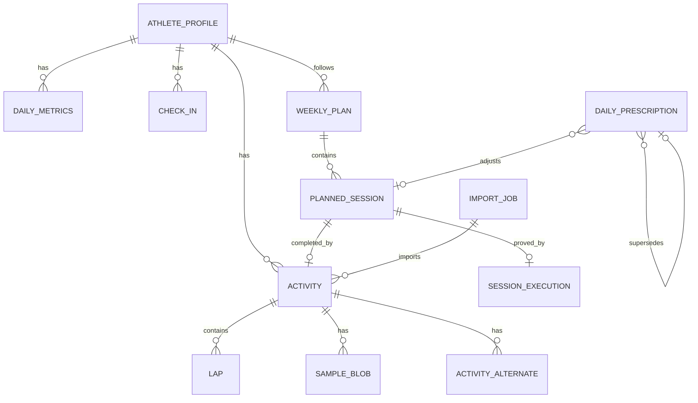

# DATA_MODEL.md — MeuCoach

**Versão:** 1.7 · **Data:** 11/11/2026 · Reconcilia schema v16 (evento de prova, `completionSource` e auto-conclusão do [ADR 0032](adr/0032-race-autocompletion-and-target-projection.md)), mantendo a distinção entre persistido e derivado.

## 1. Convenções

- **Unidades internas:** SI. Distância em metros, duração em segundos, pace em s/km, FC em bpm, massa em kg, altura em cm, potência em watts, temperatura em °C.
- **Tempo:** persistir UTC (`Instant`) + `zoneId` + `localDate` derivada para agregações diárias. No Room, `Instant` vira `INTEGER` (epoch ms) e `LocalDate` vira `TEXT` ISO; as tabelas usam o tipo lógico.
- **IDs:** UUID v7 gerados no cliente (ordenáveis por tempo), exceto entidades derivadas que usam chave natural (`localDate`, `activityId + lapIndex`).
- **Dinheiro/medidas:** `Double` para métricas fisiológicas; `Long` para contadores; nunca `Float` em persistência.
- **Nulos:** ausência de dado é `null`, nunca `0`. `0` é um valor medido.
- **Proveniência:** toda entidade importada tem `source`, `sourceId`, `importedAt`, `parserVersion`.
- **Soft delete:** `deletedAt` apenas em atividades; a lixeira dura 7 dias (`ADR 0025`). Métricas, check-ins e planos não têm soft delete.
- **Persistido × derivado:** o Room guarda perfil, atividades/laps/samples, jobs, check-in, métricas diárias, planos/sessões, prescrições e execuções. Prontidão, carga, recomendações e histórico são **calculados em memória** a partir desses dados e não têm tabela própria.
- **Versionamento:** `schemaVersion` em `Room`; `engineVersion` em prescrições; `evidenceVersion`/IDs no registro de evidências textuais (não persistido em tabela).

## 2. Diagrama

> `READINESS`, `RECOMMENDATION`, `EVIDENCE` e `SESSION_FEEDBACK` aparecem em versões antigas do diagrama, mas **não são tabelas**: prontidão/carga são calculadas por data e as evidências vivem em `docs/SPORTS_SCIENCE.md` + `ExplanationCatalog.kt`.

## 3. Entidades principais

### 3.1 `AthleteProfile` (singleton local; multi-perfil na Fase 2)

| Campo | Tipo | Notas |
|---|---|---|
| `id` | UUID | |
| `name` | String? | nome exibido no onboarding/avatar |
| `avatarPath` | String? | cópia local em `filesDir/profile` |
| `birthDate` | LocalDate | idade derivada |
| `sex` | enum | `FEMALE`, `MALE`, `OTHER`, `UNSPECIFIED` |
| `heightCm` | Double? | |
| `weightKg` | Double? | atual; histórico em `BodyMeasurement` |
| `restingHr` | Int? | informado ou derivado |
| `maxHrObserved` | Int? | **observado**, nunca 220-idade |
| `lthr` | Int? | limiar de FC |
| `thresholdPaceSecPerKm` | Int? | pace de limiar |
| `vdot` | Double? | Daniels |
| `experience` | enum | `BEGINNER`, `INTERMEDIATE`, `ADVANCED` |
| `treadmillAccess` | Boolean | alternativa de qualidade por velocidade/inclinação |
| `weeklyAvailability` | JSON | dias + minutos por dia |
| `goal` | JSON | tipo, prova, data, distância, tempo alvo |
| `timezone` | String | IANA |
| `city` / `lat` / `lon` | | clima e horário |
| `units` | enum | `METRIC` (padrão) |
| `createdAt` / `updatedAt` | Instant | |

### 3.2 `Activity`

| Campo | Tipo | Notas |
|---|---|---|
| `id` | UUID | |
| `source` | enum | `FIT`, `TCX`, `GPX`, `HEALTH_CONNECT`, `MANUAL` |
| `sourceId` | String? | file_id/serial ou record ID |
| `sourceFileSha256` | String? | dedup |
| `sport` | enum | `RUNNING`, `TREADMILL`, `WALKING`, `OTHER` |
| `subSport` | String? | `street`, `treadmill`, `trail` |
| `startTimeUtc` | Instant | |
| `zoneId` | String | |
| `localDate` | LocalDate | derivada do fuso do perfil na importação |
| `durationSec` | Int | elapsed |
| `movingTimeSec` | Int? | |
| `distanceM` | Double | |
| `avgPaceSecPerKm` | Double? | derivado |
| `bestPaceSecPerKm` | Double? | |
| `avgHr` / `maxHr` | Int? | |
| `avgCadenceSpm` / `maxCadenceSpm` | Int? | normalizado para passos/min |
| `avgPowerW` / `maxPowerW` | Int? | quando disponível |
| `avgStepLengthM` | Double? | quando disponível |
| `elevationGainM` / `lossM` | Double? | |
| `calories` | Int? | |
| `trainingEffectAerobic` / `Anaerobic` | Double? | do Zepp, apenas referência |
| `trainingLoadPeak` | Double? | do Zepp, apenas referência |
| `deviceName` | String? | proveniência do dispositivo |
| `rawFilePath` | String? | arquivo original |
| `parserVersion` | String | |
| `importedAt` | Instant | |
| `deletedAt` | Instant? | soft delete |

**Índices:** `startTimeUtc`, `(sport, startTimeUtc)`, `sourceFileSha256` (unique quando não nulo).

### 3.2.1 `ActivityAlternate`

| Campo | Tipo |
|---|---|
| `id` | UUID (PK) |
| `activityId` | UUID (FK, cascade) |
| `source` | enum (`FIT`, `TCX`, `GPX`, `HEALTH_CONNECT`, `MANUAL`) |
| `sourceId` / `sourceFileSha256` | String? |
| `rawFilePath` | String? |
| `parserVersion` | String |
| `importedAt` | Long |
| `sampleCount` / `durationSec` | Int |
| `distanceM` | Double |

Guarda os formatos que descrevem uma atividade já canônica. `sourceFileSha256` é único quando presente; a atividade principal é escolhida por riqueza (FIT > TCX > GPX) e os demais viram alternates.

### 3.3 `Lap`

| Campo | Tipo |
|---|---|
| `activityId` | UUID (FK) |
| `lapIndex` | Int |
| `startTimeUtc` | Instant? |
| `durationSec` | Int |
| `distanceM` | Double |
| `avgHr` / `maxHr` | Int? |
| `avgPaceSecPerKm` | Double? |
| `avgCadenceSpm` | Int? |
| `avgPowerW` | Int? |
| `elevationGainM` | Double? |

Chave: `(activityId, lapIndex)`.

### 3.4 `SampleBlob` — séries temporais

Séries de 1 Hz podem gerar milhões de pontos. Estratégia:

- **Blob comprimido** por atividade (`gzip-columnar-v1`), com cabeçalho de versão, contagem e máscara de colunas.
- Colunas: `tOffsetSec`, `lat`, `lon`, `altitudeM`, `speedMps`, `hr`, `cadenceSpm`, `powerW`, `stepLengthM` e `developerFields`.
- Cada coluna opcional tem flags de presença por amostra; ausência continua `null`, nunca vira `0`.
- `SampleBlob(activityId, version, encoding, bytes, sampleCount, startTimeUtc)`.
- Timestamps não são duplicados no blob: `startTimeUtc + tOffsetSec` reconstrói o instante de cada sample.
- Limites de segurança do codec: 5 milhões de samples e 128 MB de payload descomprimido.
- **Série downsampled** (10 s) para gráficos rápidos ainda não está implementada; o detalhe do P0-09 decodifica a série sob demanda até existir uma `SampleSeries`.
- Teste de round-trip obrigatório; corrupção, versão desconhecida ou encoding inválido ⇒ atividade permanece, samples são descartados e a abertura retorna `sampleWarning`.

### 3.5 `DailyMetrics`

| Campo | Tipo | Fonte |
|---|---|---|
| `date` | LocalDate | PK |
| `sleepDurationMin` | Int? | Health Connect/CSV |
| `restingHeartRate` | Double? | Health Connect/CSV |
| `hrvRmssdMs` | Double? | Health Connect/CSV |
| `spo2Avg` | Double? | Health Connect/CSV |
| `source` | enum | `HEALTH_CONNECT`, `CSV`, `MANUAL` |
| `createdAt` / `updatedAt` | Long (epoch ms) | escrita local |

Campos planejados (eficiência do sono, estágios, passos, estresse) ainda não
foram implementados; ausentes ficam `null`, nunca `0`. Um dia pode reunir
campos de mais de uma fonte: a mescla por campo segue o `ADR-0016`, e `source`
guarda a fonte dominante (`MANUAL` > `HEALTH_CONNECT` > `CSV`).

### 3.6 `CheckIn`

| Campo | Tipo | Escala |
|---|---|---|
| `date` | LocalDate | PK |
| `sleepQuality` | Int | 1–5 |
| `fatigue` | Int | 1–5 |
| `soreness` | Int | 1–5 |
| `stress` | Int | 1–5 |
| `illnessOrInjury` | Boolean | sinal de alerta |
| `heatLevel` | enum | `NONE`, `MILD`, `MODERATE`, `SEVERE` (autorreporte) |
| `createdAt` / `updatedAt` | Long (epoch ms) | escrita local |

O check-in alimenta o **Hooper index** e o modelo de prontidão mesmo sem wearable. `sleepHours`, `mood` e `notes` aparecem em versões antigas do documento, mas **não são persistidos**; sono em horas vem de `DailyMetrics`/Health Connect.

### 3.7 `Readiness` — **derivado, sem tabela**

| Campo | Tipo |
|---|---|
| `score` | Int 0–100 |
| `level` | `GREEN`, `AMBER`, `RED` |
| `confidence` | `HIGH`, `MEDIUM`, `LOW` |
| `components` | `Map<ReadinessComponent, Int>` (subjetivo, sono, HRV, RHR) |
| `missing` | `Set<ReadinessComponent>` |
| `flags` | `Set<ReadinessFlag>` (`ILLNESS_OR_INJURY`, `SHORT_SLEEP`, `RESTING_HEART_RATE_ELEVATED`, `NO_QUALITY`, `INSUFFICIENT_DATA`) |

`ReadinessResult` é calculado em memória a partir de `daily_check_ins` + `daily_metrics` e do histórico de carga. O histórico de 14 dias é reconstruído por data (`ReadinessHistoryCalculator`); não existe entidade `Readiness`, `Recommendation` nem `RecommendationRule` no Room. A decisão auditável do dia fica em `daily_prescriptions` (§3.8.3).

### 3.8 `WeeklyPlan` / `PlannedSession`

`WeeklyPlan`: `weekStart` (PK), `createdAt`, `createdOn` (data de criação usada para cortar a adesão), `confidence`, `rationale`, `weeklyMinutes`, `longRunMinutes`, `qualityCount`, `ruleIdsJson`, `evidenceIdsJson`, `version` (começa em 1), `revisionReason`, `revisedAt`, `inputsHash`, `availabilityHash`, `generatedFromFingerprintVersion`, `generatedFromFingerprint`, `generatedFromProfileSnapshotJson`, `lastEvaluatedFingerprintVersion`, `lastEvaluatedFingerprint` e `temporalContextHash`. Não há `startDate`/`endDate`/`goalType`/`status` na tabela; o objetivo vem do perfil. `inputsHash`/`availabilityHash`/campos de fingerprint nulos significam histórico desconhecido (planos migrados de v12/v13), nunca hash inventado. `generatedFrom*` é proveniência; `lastEvaluated*` é o checkpoint de avaliação e pode avançar em `NoChange` sem incrementar versão (ADR 0031). O snapshot JSON usa apenas a allowlist (experiência, pace de limiar, LTHR, esteira e objetivo suportado).

`PlannedSession`: `id`, `weekStart`, `date`, `type` (`EASY`, `LONG`, `QUALITY`, `REST`), `title`, `durationMin`, `targets` (JSON: zona, pace, FC, distância e RPE), `status` (`PLANNED`, `DONE`, `CLOSED`), `skipReason`, `completedAt`, `completionEvidence` (`ACTIVITY`, `GUIDED`, `MANUAL`, `LEGACY_UNVERIFIED`), `executionId?`, `activityId?`, `closureReason?` (`REST_PRESCRIBED`, `ILLNESS_OR_INJURY`, `USER_SKIPPED`, `MISSED`, `PLAN_REPLACED`), `closedAt?`, `rationale` e IDs de regra/evidência.

Regras do `ADR 0024`:

- `DONE` só existe com evidência; o modelo rejeita a construção sem ela.
- `CLOSED` só existe com motivo; descanso, doença e plano substituído não contam como falha de adesão.
- Uma atividade e uma sessão são 1:1: índices únicos em `planned_sessions.activityId` e `session_executions.activityId`/`plannedSessionId`.
- Atividade na lixeira suspende a evidência (`LEGACY_UNVERIFIED`); restaurar devolve `ACTIVITY`; expurgar remove o vínculo e mantém o histórico não verificado.

### 3.8.1 `WeeklyPlanRevision`

Tabela **append-only** (`weekly_plan_revisions`) que audita cada revisão aceita do plano da semana ([ADR 0028](adr/0028-versioned-plan-replanning.md)):

| Campo | Tipo | Notas |
|---|---|---|
| `id` | String | PK determinística `weekStart-v{toVersion}` |
| `weekStart` | String | FK → `weekly_plans.weekStart` com `CASCADE` |
| `fromVersion` / `toVersion` | Int | versões anterior e resultante |
| `fromInputsHash` / `toInputsHash` | String? / String | hashes de inputs antes e depois |
| `fromAvailabilityHash` / `toAvailabilityHash` | String? / String | baseline de disponibilidade antes e depois |
| `fromFingerprintVersion` / `fromFingerprint` | String? | proveniência substituída; `NULL` em legado |
| `fromProfileSnapshotJson` / `fromTemporalContextHash` | String? | snapshot/contexto anteriores |
| `toFingerprintVersion` / `toFingerprint` | String? | proveniência gravada pelo aceite |
| `toProfileSnapshotJson` / `toTemporalContextHash` | String? | snapshot/contexto do candidato aceito |
| `generatorVersion` | String | versão das regras do `WeeklyPlanGenerator` |
| `previousPlanJson` | JSON | metadados da versão substituída (sem sessões) |
| `replacedSessionsJson` | JSON | snapshot das sessões futuras `PLANNED` removidas |
| `trigger` | enum | `MISSED_SESSIONS`, `AVAILABILITY_CHANGED`, `USER_REQUEST`, `PROFILE_CHANGED` |
| `reason` | String | rationale da revisão |
| `ruleIdsJson` / `evidenceIdsJson` | JSON | regras/evidências emitidas pelo gerador |
| `confidence` | enum | confiança da revisão |
| `createdAt` | Long | epoch ms |

O aceite é transacional: valida `expectedVersion`/baseline, insere o snapshot, apaga somente sessões futuras `PLANNED`, insere as candidatas sem `REPLACE` e incrementa a versão. Sessões de hoje/passadas e futuras `DONE`/`CLOSED` nunca são tocadas; qualquer conflito aborta a transação inteira.

### 3.8.2 `SessionExecution`

| Campo | Tipo | Notas |
|---|---|---|
| `id` | UUID | PK |
| `plannedSessionId` | String? | 1:1 com a sessão |
| `activityId` | String? | 1:1 com a atividade; nulo em `MANUAL`/`GUIDED` |
| `startedAt` / `endedAt` | Instant? | nulos em `MANUAL` |
| `pausesJson` | JSON | pausas da execução guiada; vazio neste ciclo |
| `durationSec` | Int | positivo |
| `distanceM` | Double? | nulo em `MANUAL` |
| `rpe` | Int? | obrigatório em `MANUAL` (1–10) |
| `source` | enum | `ACTIVITY`, `GUIDED`, `MANUAL` |
| `createdAt` | Instant | |

`MANUAL` é uma declaração explícita de execução, não uma atividade: não cria
volume, carga, zonas, distância ou pace. `GUIDED` tem contrato definido, mas
nenhuma execução nova é produzida até a sessão guiada persistente do ciclo 3.

### 3.8.3 `DailyPrescription`

| Campo | Tipo | Notas |
|---|---|---|
| `id` | UUID | PK |
| `date` | LocalDate | dia local da decisão |
| `plannedSessionId` / `plannedType` / `plannedTitle` / `plannedDurationMin` | | intenção de origem |
| `prescribedType` / `title` / `prescribedDurationMin` | | decisão efetiva do dia |
| `targetsJson` | JSON | zona, pace, FC, distância e RPE |
| `adjustment` | enum | `KEEP`, `REDUCE`, `DOWNGRADE`, `REST`, `NO_PLAN` |
| `rationale` | String | explicação em pt-BR |
| `ruleIdsJson` / `evidenceIdsJson` | JSON | auditoria |
| `confidence` | enum | `HIGH`, `MEDIUM`, `LOW` |
| `engineVersion` / `inputsHash` | String | determinismo |
| `supersedesId` | UUID? | versão anterior; nada é sobrescrito |
| `createdAt` | Long | epoch ms |

A versão vigente é a última linha da data (`createdAt DESC, rowid DESC`). O
repositório grava em transação e ignora uma decisão idêntica (mesma data,
`inputsHash` e `engineVersion`); **não existe índice único composto** no schema —
a proteção contra duplicata é lógica, dentro da transação. Editar o check-in
acrescenta uma versão com `supersedesId` (`ADR 0023`).

### 3.8.4 `RaceEvent` (v15; `completionSource` em v16)

Evento de prova separado de `PlannedSession`/`WorkoutType` (`ADR 0030`/`ADR 0032`).

| Campo | Tipo | Notas |
|---|---|---|
| `id` | UUID | PK |
| `distance` | enum | `FIVE_K`, `TEN_K`, `HALF_MARATHON`, `MARATHON` |
| `targetDate` | LocalDate | data local no fuso do perfil |
| `targetTimeSec` | Int? | meta declarada; gera referência aritmética, nunca prescrição |
| `status` | enum | `PLANNED`, `COMPLETED`, `CANCELLED`, `NO_SHOW` |
| `activityId` | UUID? | FK `SET NULL`; único; só em `COMPLETED` |
| `completionSource` | enum? | `USER` ou `AUTO_IMPORT` (v16); `NULL` = explícita anterior/legado |
| `activeKey` | String? | `"ACTIVE"` só em `PLANNED`; índice único |
| `createdAt` / `updatedAt` / `resolvedAt` | Long? | epoch ms; `resolvedAt` só fora de `PLANNED` |

A regra de auto-conclusão é do domínio (`RaceAutoCompletionRule`), não da tabela.
`completionSource` audita a inferência; `reopenAutoCompleted` volta a `PLANNED` e
limpa o vínculo. A corrida vinculada continua uma `Activity` normal.

### 3.9 RPE e carga subjetiva (ADR 0039)

O RPE vive em `session_executions.rpe` (1–10, nullable; obrigatório em
`MANUAL` — ADR 0024) e alimenta a série de carga como **sRPE** (`RPE × min`,
Foster): terceiro nível de carga (`TRIMP > rTSS > SRPE`), usado apenas quando
não há FC/pace objetivos no dia, declarado em `LoadSnapshot.subjectiveDaysInWindow`
e governado por `R-LOAD-04` — subjetivo **conserva, nunca libera aumento**. A
coleção acontece no fechamento: o diálogo "Concluir treino" oferece RPE
opcional ao vincular uma corrida ("se o arquivo não contém a informação…") e
grava na mesma coluna, sem migração; o `TrainingSignalSource` traduz as
execuções em `LoadExecution` e aquece o frescor da fonte. A tabela
`SessionFeedback` (`activityId`, `rpe`, `feeling`, `notes`, `createdAt`) segue
**planejada, não implementada**; se o fluxo atual de execuções continuar
suficiente, pode não existir nunca.

### 3.10 Evidências e regras

- `Evidence` e `Rule` são **catálogo documental**, não tabela: a fonte canônica
  é `docs/SPORTS_SCIENCE.md` §13 (IDs, citação, força e aplicação), espelhada em
  `ExplanationCatalog.kt` para rótulos legíveis.
- A `DailyPrescription` guarda apenas `ruleIdsJson`/`evidenceIdsJson` da decisão;
  não há snapshot de evidência em tabela nem diretório `resources/evidence.json`.
- `RecommendationRule` e `Recommendation` também não existem no Room; a decisão
  auditável é a prescrição diária versionada.

### 3.11 `ImportJob`

`id`, `fileName`, `sha256`, `mime`, `sizeBytes`, `status` (`QUEUED`, `PARSING`, `DONE`, `FAILED`, `DUPLICATE`, `TRASH_CONFLICT`), `parserVersion`, `activityId`, `errorCode`, `errorMessage`, `createdAt`, `finishedAt`.

O job nasce em `PARSING` (uma única escrita) e só o pipeline o move para um estado terminal; `ImportJobGuard` fecha como `FAILED` qualquer erro inesperado depois da criação e a leitura da lista fecha `QUEUED`/`PARSING` com mais de 1 h (processo morto). `QUEUED` permanece no enum para linhas antigas.

## 4. Deduplicação e merge

1. Hash do arquivo igual ⇒ duplicata exata; ignorar.
2. Chave de atividade (start ±1 s, sport, duração ±2 s, distância ±1%) ⇒ mesma sessão.
3. Preferência de formato: **FIT > TCX > GPX > Health Connect**.
4. Se o novo formato for mais rico, substituir os agregados e manter o arquivo anterior como `alternate`.
5. Nunca apagar feedback do usuário ao substituir.

## 5. Timezone e dia local

- Atividades: `startTimeUtc` + `zoneId` vigente do perfil no momento da importação + `localDate` derivada.
- Métricas diárias: `localDate` no fuso do perfil.
- Treinos que cruzam meia-noite pertencem ao dia de início.
- Export do Zepp usa UTC nos arquivos e hora local no nome; **ignorar o nome** e usar o timestamp interno.

## 6. Mapeamento Health Connect

| Health Connect | Destino | Estado |
|---|---|---|
| `SleepSessionRecord` + stages | `DailyMetrics` (sono) | Implementado |
| `RestingHeartRateRecord` | `DailyMetrics.restingHeartRate` | Implementado |
| `HeartRateVariabilityRmssdRecord` | `DailyMetrics.hrvRmssdMs` | Implementado |
| `OxygenSaturationRecord` | `DailyMetrics.spo2Avg` | Implementado |
| `ExerciseSessionRecord` | `Activity` (se não houver arquivo melhor) | **Planejado** (FR-007, ciclo 2) |
| `StepsRecord` | `DailyMetrics.steps` | Planejado (campo não existe no schema) |
| `WeightRecord` | `BodyMeasurement` | Planejado (tabela não existe) |

Regras: ler apenas o intervalo desde `lastSync`; deduplicar por `metadata.id`/`dataOrigin` para diagnóstico. Se o mesmo dia vier de CSV e Health Connect, os campos são mesclados: Health Connect tem precedência sobre CSV e o CSV só preenche lacunas (`ADR-0016`). `ExerciseSession` e as tabelas de passos/peso **não** existem hoje.

## 7. Migrações

- Room com `exportSchema = true`, schemas em `core/data/schemas/`.
- Estado atual: banco **v16**; migrações 1→2 até 15→16 testadas em Robolectric.
- `7→8` grava status/motivo da sessão; `8→9` adiciona calor no check-in e acesso a esteira; `9→10` adiciona nome e avatar do perfil.
- `10→11` cria `daily_prescriptions` e adiciona `createdOn`/`targetsJson`.
- `11→12` cria `session_executions`, adiciona as colunas de evidência/vínculo/encerramento e faz backfill explícito: `DONE → LEGACY_UNVERIFIED`; `SKIPPED → CLOSED/USER_SKIPPED`. Status, `completedAt`, planos e sessões são preservados.
- `12→13` adiciona `version` (default 1), `revisionReason`, `revisedAt`, `inputsHash` e `availabilityHash` a `weekly_plans` e cria `weekly_plan_revisions` com FK `CASCADE`. Planos e sessões existentes são preservados campo a campo; hashes legados ficam `NULL` (desconhecidos) e o baseline de disponibilidade é capturado só depois, de forma explícita.
- `13→14` adiciona proveniência (`generatedFromFingerprintVersion`, `generatedFromFingerprint`, `generatedFromProfileSnapshotJson`), checkpoint (`lastEvaluatedFingerprintVersion`, `lastEvaluatedFingerprint`) e `temporalContextHash` a `weekly_plans`, além dos pares anterior/novo de fingerprint/snapshot/contexto em `weekly_plan_revisions`. Planos, sessões e revisões existentes são preservados; todos os campos novos ficam `NULL` no legado, sem revisão falsa.
- `14→15` cria `race_events` vazia, com `activeKey` único, FK `SET NULL` e nenhum backfill de `TrainingGoal`.
- `15→16` adiciona `completionSource` nullable a `race_events`; nenhum evento é reescrito e `NULL` é lido como conclusão explícita anterior.
- Migrações explícitas testadas com `MigrationTestHelper` em Robolectric; os schemas são assets de teste.
- Nunca `fallbackToDestructiveMigration` em produção.
- Ao mudar o modelo de samples, versionar o `encoding` do blob e manter leitura da versão anterior por pelo menos uma release.

## 8. Qualidade de dados

Cada métrica derivada carrega `confidence`:

- **HIGH:** medida direta + fonte confiável + cobertura ≥ 80% do período.
- **MEDIUM:** estimada ou cobertura 40–80%.
- **LOW:** inferida, esparsa ou conflitante.

Exibir a confiança no UI, não esconder. Uma prontidão "LOW" não deve gerar mudança agressiva de plano.

## 9. Exportação

O usuário pode exportar hoje:

- JSON completo (perfil, atividades, laps, métricas, check-ins, planos, prescrições e execuções).

Planejado (não implementado): arquivos originais FIT/TCX/GPX, CSV de métricas diárias e ZIP com `manifest.json` (versão do schema, data, contagens, hashes).

Estado atual: `UserDataRepository.exportJson()` exporta perfil, check-ins, métricas diárias, planos/sessões (com evidência, encerramento e versão), revisões append-only do plano, prescrições diárias, execuções, atividades, laps, contagem de samples, jobs de importação e o objeto local `firstRun`. A lixeira fica fora por padrão e só entra com `includeTrash = true`; execuções ligadas a atividades na lixeira também ficam fora. Export ZIP, arquivos originais e séries completas ficam para a Fase 1.

Excluir tudo remove banco, arquivos, blobs, staging, cache, avatar e preferências de dados; a época de dados é o único metadado preservado, sem recibo de exclusão (`ADR 0025`).
