# PLANO_CICLO_2 — Sessão guiada (ADR 0027) e replanejamento da semana (ADR 0028)

**Versão:** 0.6 · **Data:** 08/11/2026
**Status:** **R-01 implementado em `core:domain`, R-02 em `core:data` e R-03 no app/UI em 08/11/2026** (evidências em `docs/PROGRESS.md`). A sessão guiada (G) permanece proposta e bloqueada pelas decisões de produto/plataforma indicadas em §10.4.
**Escopo:** Feature 1 (sessão guiada com áudio determinístico) e Feature 3 (replanejamento adaptativo/versionado da semana).
**Fora do escopo desta peça:** Feature 2 (captura automática de atividades via Health Connect `ExerciseSession`) — adiada para outro momento por decisão do usuário 0.

**Propósito:** este arquivo reúne os dois ADRs propostos, o plano técnico, o resultado da auditoria e as decisões aprovadas para R-01. A seção §10.6 registra o handoff que originou R-01 (já implementado); decisões de G continuam abertas.

---

## 0. Como ler a proposta auditada

1. O §2 registra fatos verificados no código nesta auditoria; as referências indicam onde revalidar em uma implementação futura.
2. As correções técnicas incorporadas estão resumidas em §10.5; as decisões pendentes permanecem destacadas em §10.1/§10.4.
3. Os pontos **[AUDITAR — An]** distinguem decisões aprovadas para R-01 das decisões ainda abertas para R-03/G; ver §10.5.
4. Nenhum número, citação científica ou limiar foi inventado. Quando não há evidência aprovada, o plano reutiliza apenas as regras realmente emitidas pelo gerador ou deixa o item em aberto.

---

## 1. Resumo executivo

| | Feature 1 — Sessão guiada | Feature 3 — Replanejamento da semana |
|---|---|---|
| **ADR** | 0027 (proposto) | 0028 (proposto) |
| **PRD** | FR-002 (P1, “execução guiada persistente”), BL-009 | ADR 0023 §3.6 (replanejamento previsto); FR-011/BL-020 são relacionados, mas o replanejamento não entrega a revisão semanal de FR-011 |
| **Problema** | “Iniciar” é um `AlertDialog` com cronômetro em memória; `GUIDED` é rejeitado no código | O plano é gerado uma vez e fica obsoleto quando a semana real desvia (viagem, doença, treinos perdidos) |
| **Núcleo da decisão** | Execução persistida + motor de cues determinístico + TTS nativo; evidência `GUIDED` passa a ser produzida | Regeneração conservadora do futuro da semana, versionada e sugerida ao usuário (nunca silenciosa) |
| **Impacto de dados** | Migração `13 → 14` (tabela `guided_sessions`) | Migração `12 → 13` (colunas em `weekly_plans` + tabela `weekly_plan_revisions`) |
| **Esforço** | M/L (4 entregas) | M (3 entregas) |
| **Risco principal** | Foreground service + política de publicação do Play; áudio em segundo plano | Regressão em adesão/progressão; churn de prescrição |

**Ordem proposta:** Feature 3 primeiro (domínio + persistência), Feature 1 depois (serviço, áudio, validação em aparelho). As migrações Room são sequenciais (`12→13→14`) e compartilham entidades/schema; não planejar implementação paralela sem uma estratégia explícita de integração.

---

## 2. Fatos atuais verificados no código (base da auditoria)

Todos os itens abaixo foram lidos e confirmados no repositório em 08/11/2026 durante a auditoria técnica.

### 2.1 Sessão guiada (estado atual)

| # | Fato | Local |
|---|---|---|
| F1 | “Iniciar” abre `WorkoutSessionDialog`: um `AlertDialog` com `remember { mutableIntStateOf(0) }` e `delay(1_000)` — cronômetro **em memória**, perdido em rotação, dismiss ou morte do processo; o próprio texto diz “é uma prévia e não fica salvo”. | `app/src/main/kotlin/com/meucoach/app/ui/today/TodayScreen.kt:1608-1648` |
| F2 | `CompleteSession` **rejeita** `CompletionEvidence.GUIDED` com mensagem de “ainda não disponível”. | `app/src/main/kotlin/com/meucoach/app/application/CompleteSession.kt:92-95` |
| F3 | O modelo aceita execução `GUIDED` (exige `activityId == null`), e `ExecutionSource.GUIDED`/`CompletionEvidence.GUIDED` já existem como contrato (ADR 0024). | `core/model/src/main/kotlin/com/meucoach/core/model/SessionExecution.kt:24-28,70-72` |
| F4 | `SessionExecutionRepository` tem `recordActivityExecution` e `recordManualExecution`; **não existe** `recordGuidedExecution`. | `core/data/src/main/kotlin/com/meucoach/core/data/repository/SessionExecutionRepository.kt:63,126` |
| F5 | O manifest já tem `FOREGROUND_SERVICE`/`FOREGROUND_SERVICE_DATA_SYNC` apenas para o story; não há serviço para sessão em execução. | `app/src/main/AndroidManifest.xml:11-12,118-121` |
| F6 | Não há nenhuma ocorrência de `TextToSpeech`/`SpeechSynthesizer` no código. | grep global: 0 ocorrências |
| F7 | `TrainingLoadCalculator.srpe(rpe, durationMin)` já existe e é testado, mas **não é coletado nem usado** no fluxo (FR-013 pendente). | `core/domain/.../load/TrainingLoadCalculator.kt:46`; `docs/PRD_COACH_CORRIDA.md:906-908` |
| F8 | O overlay de import já trata dia `DONE` com evidência forte como **aviso** (a corrida importada fica treino livre) — caminho que uma sessão `GUIDED` concluída vai reutilizar. | `app/src/main/kotlin/com/meucoach/app/ui/importer/ImportedRunPromptViewModel.kt:241` |

### 2.2 Plano semanal (estado atual)

| # | Fato | Local |
|---|---|---|
| P1 | `weekly_plans` tem **`weekStart` como PK**; `upsertPlan` sobrescreve a única linha da semana. | `core/data/.../db/entity/WeeklyPlanEntity.kt:16`; `core/data/.../db/dao/TrainingPlanDao.kt:46` |
| P2 | O ID da sessão é determinístico: `plannedSessionId(weekStart, date) = "$weekStart-$date"`; `planned_sessions` faz FK para `weekly_plans(weekStart)` com `CASCADE`. | `WeeklyPlanEntity.kt:28-44,66` |
| P3 | `WeeklyPlan` **não tem** `version`/`revisionReason`/`revisedAt` — o ADR 0023 previu esses campos “se houver replanejamento”, mas eles não existem hoje. | `core/domain/.../prescription/WeeklyPlanGenerator.kt:79-99` |
| P4 | `WeeklyPlan.createdOn` existe e a adesão corta dias anteriores a ele (regra N-02); `WeeklyPlanGenerator` já recebe `today` e **não gera passado**. | `WeeklyPlanGenerator.kt:93,107,152-154` |
| P5 | A troca manual de sessões (`SessionSwapper`) troca **conteúdo mantendo datas e status** — IDs de sessão permanecem estáveis. | `core/domain/.../prescription/SessionSwapper.kt:33-49` |
| P6 | `DailyPrescriptionEngine` é a autoridade do dia; `GetTodayPrescription` só persiste quando `inputsHash`/`engineVersion` mudam (versões novas com `supersedesId`). | `app/src/main/kotlin/com/meucoach/app/application/GetTodayPrescription.kt:30` |
| P7 | A prescrição do dia deriva do conteúdo da sessão planejada do dia; mudar esse conteúdo amanhã ⇒ hash muda ⇒ nova versão de prescrição automaticamente. | `core/domain/.../prescription/DailyPrescriptionEngine.kt:447` |
| P8 | `DataResetCoordinator` limpa Room, staging, prefs e cancela workers; precisará parar também o serviço da sessão guiada. | `docs/PROGRESS.md` (C1-05) |
| P9 | O catálogo `ExplanationCatalog` exige entrada para todo `ruleId` emitido (teste varre o catálogo). | `core/domain/.../prescription/ExplanationCatalog.kt:12,29`; `ExplanationCatalogTest.kt` |
| P10 | Room está no **schema v12**; a próxima migração é 12→13. | `docs/PROGRESS.md` (linhas 8, 14) |

### 2.3 Referências de requisito

- **FR-002** — “Execução guiada persistente”: iniciar, pausar, retomar, encerrar, cancelar; sobreviver a rotação, segundo plano, morte do processo; sem GPS obrigatório. (`docs/PRD_COACH_CORRIDA.md:761-772`, BL-009)
- **FR-011** — “Revisão semanal do coach”: consolidação semanal determinística, sem LLM, sem culpa. (`docs/PRD_COACH_CORRIDA.md:881-891`, BL-020)
- **ADR 0023 §3.6/§3.1** — plano como intenção; “se houver replanejamento, o plano ganha `version`, `revisionReason` e `revisedAt` em vez de sobrescrever o original”; adesão usa “a data de criação da versão que contém a sessão”. (`docs/adr/0023-weekly-plan-vs-daily-prescription.md:48,70-73`)
- **ADR 0024** — `GUIDED` é evidência forte com contrato definido, implementação “no ciclo 3”. (`docs/adr/0024-completion-evidence.md:47,55`)

---

## 3. ADR 0027 — Sessão guiada persistente com áudio determinístico

**Status:** **proposto (auditoria técnica concluída; aguarda decisões/aprovação)**
**Data:** 2026-11-08
**Responsável:** planejamento com Rafael (usuário 0)
**Substitui/fecha:** contrato de `GUIDED` do ADR 0024 (implementação); implementa FR-002.

---

### 3.1 Contexto

O produto promete “saber o que fazer hoje — e por quê”, mas no momento em que o treino acontece o app some: o “Iniciar” é um `AlertDialog` com cronômetro em memória (F1) que se desfaz ao girar a tela ou sair do app. A experiência durante o treino é uma hipótese de produto a explorar; o fundamento deste ADR é fechar FR-002 e entregar a prescrição já existente no momento do treino, sem depender de comparação de mercado.

O ADR 0024 já definiu o contrato: `GUIDED` é evidência forte de conclusão, com execução persistida e recuperável, e a implementação ficou adiada. O `SessionExecution` já modela início/fim/pausas/duração (F3). O que falta é a máquina: estado persistido durante o treino, cues (avisos) determinísticas, áudio e um caminho de conclusão que deixe de rejeitar `GUIDED` (F2).

### 3.2 Problema

1. A sessão em execução não sobrevive a rotação, segundo plano nem morte do processo — critério de aceite do próprio FR-002.
2. Não há como produzir `GUIDED`; a progressão e a adesão ficam sem uma evidência forte para quem não importa arquivo (esteira, corrida sem relógio).
3. O usuário não recebe orientação durante o treino: a prescrição existente (tipo, duração e alvos, sem segmentos executáveis) só é lida antes/depois.
4. Sem estado persistido não há pausa/retomada auditável, nem notificação de controle.
5. Um cronômetro “de mentira” convive com um app cujo princípio é “nada de número inventado”.

### 3.3 Decisão

1. **Sessão guiada = execução persistida do plano do dia, guiada por cues determinísticas.**
    - O usuário toca “Iniciar” e entra num **player da sessão** (tela própria): alvos da prescrição, tempo decorrido, cues visuais + (opcional) áudio.
   - O estado (início, pausas, status) é **persistido em Room** antes de qualquer áudio; recuperação ao reabrir o app é obrigatória (FR-002).
2. **Motor de cues puro no domínio (`GuidedCueEngine`).** Entrada: `PlannedSession` + `DailyPrescription`; a duração alvo vem de `prescribedDurationMin`. Na v1, saída limitada a cues temporais simples: início, marcos a cada 10 min, lembrete de esforço fácil e encerramento/contagem final. Determinístico e testável sem Android.
   - **Sem cues por segmento/repetição na v1:** `PlannedSession` não tem estrutura de intervalos (aquecimento, repetições, recuperações); o título/rationale em texto não é um contrato executável. Cues por segmento exigem um modelo estruturado de treino em ADR/entrega posterior.
3. **As cues nunca inventam dado.** Sem GPS nem sensor ao vivo na v1: as cues são por tempo e esforço percebido. Pace/FC/distância aparecem só quando vêm da prescrição (alvos) ou de entrada do usuário (RPE final); dados ausentes são “—”, nunca zero (regra 7 do AGENTS).
4. **Cada cue herda `ruleIds`/`evidenceIds` da sessão/prescrição que a originou.** A cue é a voz da prescrição, não uma recomendação nova — assim nenhuma evidência é inventada para o áudio (ver O-1, §10).
5. **Áudio via `TextToSpeech` nativo** (API do Android, zero dependência nova — regra 8). Idioma pt-BR do sistema; se o motor TTS não existir, o player degrada para **cues visuais + vibração**, sem quebrar a sessão. Incluir a consulta `TTS_SERVICE` no `<queries>` para dispositivos/versões em que a visibilidade de pacotes se aplica.
6. **Serviço em primeiro plano (`foreground service`) para manter timer e áudio com a tela apagada**, com notificação obrigatória de controle (pausar/encerrar). Tipo e permissões são decisão aberta (**[AUDITAR — A3]**); avaliar também `health`, verificar pré-requisitos e a distribuição pretendida. Distribuição fora da Play elimina revisão do Play Console, não os requisitos Android do tipo declarado.
   - A experiência deve continuar compreensível se `POST_NOTIFICATIONS` for negada: o FGS ainda exige uma notificação, mas no Android 13+ ela pode não aparecer na gaveta normal. Definir/testar controles alternativos no player.
7. **Encerrar grava `SessionExecution` (`source = GUIDED`, início/fim/pausas/duração) e conclui a sessão com `completionEvidence = GUIDED`** — evidência forte, elegível para progressão (ADR 0024). O `require` de `GUIDED` já é compatível (F3). “Cancelar” mantém a sessão `PLANNED`; ao iniciar de novo, resetar a linha única `guided_sessions` para um novo estado `RUNNING`. Tentativas canceladas não criam `SessionExecution` nem ficam no histórico de execuções.
8. **RPE 1–10 é solicitado no encerramento, mas não alimenta a carga nesta entrega.** Se fornecido, persiste em `SessionExecution`; se recusado, fica `null`. Não apresentar sRPE como carga calculada neste ciclo (**recomendação A4(b)**); integrar sRPE requer ampliar o modelo de entrada do `TrainingLoadEngine` e fica para FR-013, com decisão própria.
9. **Carga da v1:** atividades importadas continuam sendo a única fonte da série de carga. A execução guiada não cria TRIMP/rTSS nem substitui carga de atividade.
10. **Guardrails mantidos:** iniciar só quando a prescrição do dia permite treino (`REST`/doença continuam bloqueados, ADR 0024 §3.4). Iniciar e encerrar validam sessão/data/estado e impedem duplicidade; se o estado de segurança mudar durante uma execução ativa, não descartar silenciosamente o registro do que ocorreu — definir e testar o tratamento antes de G-03.
11. **Nada de LLM, nada de GPS, nada de sensores Bluetooth na v1.** O áudio não decide nada; ele recita a decisão já tomada pela prescrição.

### 3.4 Alternativas consideradas

1. **Manter o cronômetro em memória e só “embutir” áudio.**
   - Barato, mas não fecha FR-002 (não persiste, não recupera) e continua sendo um número que some.
2. **Gravar sessão guiada apenas no fim (sem estado persistido durante).**
   - Simples, mas morte do processo perde tudo — critério de aceite falha.
3. **Integrar sensor de FC/cadência ao vivo (BLE) para cues em tempo real.**
   - Melhor qualidade de cue, mas adiciona permissão, pareamento, teste de hardware e escopo novo; viola a v1 conservadora. Fica para ciclo futuro.
4. **GPS nativo para pace ao vivo.**
   - Explicitamente fora do MVP (decisão Import-first) e desnecessário para as cues de v1.
5. **Foreground service com tipo `mediaPlayback` (decisão comum no Android).**
   - Ver **[AUDITAR — A3]**: avaliar `health` (fitness), `mediaPlayback` (reprodução contínua de áudio/vídeo), `specialUse` (subtipo revisado na Play) e a alternativa sem serviço. Não assumir que TTS intermitente se enquadra automaticamente em `mediaPlayback`.
6. **Usar WorkManager para a sessão.**
   - Inadequado: é trabalho contínuo de usuário, não tarefa agendada; WorkManager não mantém áudio.

### 3.5 Justificativa

A prescrição do dia já é decidida e explicada; o gap é só a **entrega no momento do treino**. Fazer o app acompanhar o treino com cues derivadas do próprio plano (a) usa o que já existe (alvos, duração, zonas) sem fingir que há estrutura de intervalos no modelo, (b) fecha o contrato `GUIDED` do ADR 0024 e (c) cria evidência forte de duração para quem treina sem arquivo. Alegações sobre o que concorrentes oferecem ou usuários elogiam são hipóteses de produto, não evidência científica nem premissa necessária do ADR.

Persistir antes de falar é a ordem correta: o estado gravado é o que sobrevive ao Android matando o processo, e a evidência `GUIDED` só passa a existir por causa dele.

### 3.6 Consequências

**Positivas**

- Fecha FR-002/BL-009 e o item “`GUIDED` no ciclo 3” do ADR 0024.
- Sessões guiadas passam a gerar evidência forte de duração; a carga permanece baseada nas atividades importadas até uma decisão/entrega própria de FR-013.
- Cria uma experiência durante o treino com cues derivadas da prescrição e explicabilidade rastreável.
- Player novo reaproveita tokens/componentes do design system; sem dependência nova.

**Negativas e custos**

- Foreground service: complexidade de ciclo de vida (start/pause/resume/stop), notificação obrigatória e revisão de política de publicação (**A3**).
- TTS varia por dispositivo/ROM; degradação visual/vibração é obrigatória, não opcional.
- Novo schema (`guided_sessions`) + migração 13→14; o estado deve persistir intervalos de pausa para compor `SessionExecution.pauses`.
- Testes de tempo real são propensos a flakiness; exigem relógio/corrotina injetáveis desde o primeiro commit.
- Risco de percepção: usuário pode achar que o app “falou demais”; volume/frequência de cues precisa de configuração (v1: silenciar áudio mantendo visual).

**Riscos e mitigação**

| Risco | Mitigação |
|---|---|
| Play Store recusar/restringir o tipo de serviço | Decidir A3 antes de implementar; se `specialUse`, preparar declaração desde o início; app ainda não publicado (Fase 2 = release) |
| Timer fica errado em segundo plano (Doze, OEM agressivos) | Fonte de tempo = `Instant` absoluto + acumulado de pausas persistido, **nunca** contagem de ticks; recalcular ao reconectar |
| Testes flakiness com `delay` | Ticker injetável (`CoroutineScope` + relógio do teste); nenhum teste usa espera real |
| sRPE integrado sem modelo de origem suficiente | Fora desta entrega; RPE é persistido, mas a série de carga continua usando atividades |
| App reinicia e recria sessão duplicada | PK `plannedSessionId` em `guided_sessions`; transação ao iniciar |
| Reset com serviço rodando ou escrita tardia | Girar época, parar o serviço antes da limpeza e validar época/barreira de escrita antes de qualquer gravação (P8) |
| Reinício após sessão cancelada | Definir e testar o reset da linha `CANCELLED`; não reutilizar uma execução cancelada como evidência |
| TalkBack não anuncia cues | Cue visual em `liveRegion` semântico + vibração; áudio é reforço, nunca o único canal |

### 3.7 Impactos arquiteturais

- **`core:model`:** `GuidedStatus` (`RUNNING`, `PAUSED`, `FINISHED`, `CANCELLED`) e `GuidedSessionState` (ou tipo equivalente).
- **`core:domain`:** `GuidedCueEngine` puro (cues), regras de início/encerramento reutilizando `SessionCompletionRules`; nada de Android.
- **`core:data`:** entidade/DAO `guided_sessions`; `SessionExecutionRepository.recordGuidedExecution(...)` + cancelamento; export JSON e reset incluem a tabela.
- **`:app`:** `GuidedSessionService` (foreground + TTS + notificação), `GuidedSessionViewModel`, `GuidedSessionScreen`, caso de uso `StartGuidedSession`/`FinishGuidedSession`; `CompleteSession` deixa de rejeitar `GUIDED` (F2).
- **Carga:** sem integração de sRPE nesta entrega (recomendação **A4(b)**). FR-013 exige novo desenho da entrada de carga; `srpe()` isolada não integra uma `SessionExecution` à série diária.
- **Explicabilidade:** `GuidedCueEngine` emite apenas `ruleIds`/`evidenceIds` existentes da sessão/prescrição; cues temporais não são novas decisões fisiológicas. A futura integração de sRPE precisa de regra explícita no catálogo (O-1).
- **Manifest:** declarar permissões/tipo do foreground service conforme A3 e adicionar consulta TTS. `POST_NOTIFICATIONS` é runtime e pode ser negada; a notificação do FGS ainda é obrigatória.

### 3.8 Dependências

- ADR 0024 (`GUIDED` como contrato) e ADR 0023 (prescrição do dia como fonte dos alvos).
- ADR 0022 (`TimeProvider`/`Clock` injetáveis — o player não pode chamar `System.currentTimeMillis()`).
- FR-013 fica parcialmente pendente: o caminho guiado coleta/persiste RPE, mas sRPE não entra na carga nesta entrega.
- Nenhuma dependência externa nova.

### 3.9 Relação com o PRD

| Requisito | Como o ADR atende |
|---|---|
| **FR-002** | Execução persistida, pausar/retomar/encerrar/cancelar, recuperação pós-morte, sem GPS. |
| **FR-003/ADR 0024** | Produz `GUIDED` (evidência forte); “Iniciar” deixa de ser prévia falsa. |
| **FR-013** | A sessão guiada coleta e persiste RPE; uso de sRPE na carga permanece pendente e não é considerado concluído. |
| **NFR-001** | Cues determinísticas; sessão auditável com início/fim/pausas. |
| **NFR-002** | 100% offline; TTS local; nenhum dado sai do dispositivo. |
| **BL-009** | Entrega “timer/alvos com recuperação”. |

### 3.10 Referências

- `docs/PRD_COACH_CORRIDA.md` §6 (FR-002, FR-013), §8 (BL-009)
- `docs/adr/0024-completion-evidence.md` (contrato `GUIDED`)
- `docs/adr/0023-weekly-plan-vs-daily-prescription.md` (prescrição como fonte)
- `docs/SPORTS_SCIENCE.md` §6.1 (sRPE, `EV-FOSTER-2001`), §8.11
- `docs/PLANO_TECNICO_CICLO_1.md` §3 (camadas)

---

## 4. ADR 0028 — Replanejamento versionado e sugerido da semana

**Status:** **proposto (auditoria técnica concluída; aguarda decisões/aprovação)**
**Data:** 2026-11-08
**Responsável:** planejamento com Rafael (usuário 0)
**Relação:** executa o que o ADR 0023 previu (“se houver replanejamento, o plano ganha `version`, `revisionReason` e `revisedAt`”). É relacionado/precursor de FR-011, mas não implementa os critérios de revisão semanal do PRD.

---

### 4.1 Contexto

O plano semanal é gerado uma vez e persistido; check-ins e prescrições não o reescrevem (ADR 0023). Isso é certo para a **prescrição do dia**, mas cria um gap de produto: quando a realidade desvia — perdeu segunda e quinta, viajou, ficou doente — o resto da semana continua desenhado para um mundo que não existe mais. O usuário corre “contra o plano velho”, e o app só reage dia a dia.

Replanejar após desvios é uma hipótese de produto que precisa ser validada com o usuário 0; nenhuma alegação de mercado é usada como evidência científica. O `WeeklyPlanGenerator` já gera uma semana parcial a partir de `today` (N-02), mas ainda não é um replanejador completo: não incorpora as sessões já concluídas da semana ao orçamento de qualidade/espaçamento nem preserva versões. Falta definir **quando** recompor a semana e **como** fazê-lo sem perder auditoria nem confiança.

### 4.2 Problema

1. Sessões planejadas perdidas acumulam e o plano futuro não se redistribui (ex.: qualidade prescrita para quinta fica órfã quando o usuário perde a semana toda até quinta).
2. Mudança de disponibilidade no meio da semana não rewire o plano (só afeta a próxima geração, na segunda).
3. `weekly_plans` tem PK única por semana (P1): hoje, qualquer revisão seria um sobrescrever silencioso — sem histórico, sem “o que mudou”.
4. ADR 0023 previu `version`/`revisionReason`/`revisedAt`, mas o modelo não os tem (P3); a cláusula de adesão “por versão que contém a sessão” (ADR 0023 §3.6) não é expressável hoje.
5. Reescrever sozinho quebraria o princípio “plan as intent”: o usuário perderia a referência do que ele considerava a semana.

### 4.3 Decisão

1. **Replanejar = regenerar o futuro da semana com o próprio `WeeklyPlanGenerator` e validar a semana mesclada.**
   - `ReplanInput` inclui plano vigente, perfil, prontidão, carga, `previousWeek`, `weekNumberInBlock`, datas passadas comprovadamente não treináveis e `today` = data da revisão.
   - O gerador produz apenas sessões futuras; `PlanReplanner` mescla essas sessões com as sessões preservadas da semana vigente e valida os invariantes sobre o resultado completo: máximo de duas qualidades, espaçamento, posição do longão, disponibilidade e limites de volume. Sessões já feitas contam para esses limites.
   - A revisão não “compensa” sessões perdidas adicionando carga: volume/duração e quantidade de qualidades futuras não podem exceder a intenção futura vigente. Se o candidato não puder ser validado sob esse teto e os demais guardrails, não há sugestão aplicável.
   - Reaproveita a lógica N-02 (não gera passado), os guardrails de qualidade (ADR 0026), deload/taper (ADR 0011) e disponibilidade como teto (ADR 0010). **Nenhuma regra nova de treino é criada aqui.**
2. **Toque apenas em sessões com `date > today` (estritamente futuro).**
   - Sessões de hoje e passadas — `DONE`, `CLOSED`, `PLANNED` — **nunca** são tocadas. A decisão de hoje continua sendo da prescrição diária (ADR 0023): “uma decisão por dia” é preservada por construção.
3. **Versionamento com auditoria.**
   - `weekly_plans` ganha `version` (começa em 1), `revisionReason?`, `revisedAt?`, `inputsHash?` e `availabilityHash?`. `revisedAt` segue o nome/tipo temporal do ADR 0023; `availabilityHash` é separado do hash de todos os inputs.
   - Nova tabela **append-only** `weekly_plan_revisions` guarda `fromVersion`/`toVersion`, hashes anterior/novo, versão do gerador, resumo/metadados da versão anterior e snapshot JSON das sessões futuras substituídas, além de motivo, trigger, regras/evidências/confiança e `createdAt`.
   - Não se inventa hash histórico na migração v12: planos legados começam com hash desconhecido. Após migração, a disponibilidade atual pode ser capturada como baseline explícito para detectar mudanças futuras; isso não afirma que era a disponibilidade original do plano.
   - `createdOn` **permanece o original** para revisões da semana vigente; isso é equivalente para as sessões estritamente futuras, desde que o replanejamento não seja estendido a outra semana (**recomendação A1**).
4. **Nunca silencioso: revisão é sugerida e confirmada.**
   - Padrão já usado pela oferta de importação (“nunca vincular sozinho”): o app **avisa**, o usuário **aceita ou recusa**. Recusa suprime a sugestão daquele dia (preferência em `SharedPreferences`, mesmo padrão de `ImportedRunPromptStore`).
   - Gatilhos determinísticos v1:
      - **T1 — desvio de adesão:** limiar de produto ainda pendente (**A6**); contar sessões elegíveis com `date < today`, `date >= createdOn`, `status = PLANNED`, excluindo `REST` e datas comprovadamente não treináveis pela prescrição/check-in disponível. Não fechar sessões automaticamente só para disparar o gatilho;
     - **T2 — disponibilidade mudou:** comparar a disponibilidade atual somente com `availabilityHash`; se o baseline estiver desconhecido, capturá-lo explicitamente sem inferir o histórico;
     - **T3 — pedido explícito:** botão “Replanejar minha semana” no card do plano (sempre disponível para o futuro da semana).
   - `NoChange` compara a projeção semântica completa das sessões futuras — data, tipo, título, duração, alvos, regras e evidências — não apenas tipo/duração/data.
   - A sugestão guarda `expectedVersion`/hash dos inputs. No aceite, se a versão vigente ou os inputs mudaram, ela é invalidada/recalculada; não se aplica candidato obsoleto.
5. **Aceite ⇒ transação:** validar `expectedVersion`; snapshot e metadados anteriores → `weekly_plan_revisions`; remover somente sessões futuras `PLANNED` que serão substituídas; inserir candidatas sem `REPLACE` sobre linhas protegidas; mesclar com sessões preservadas; recalcular `weeklyMinutes`, `longRunMinutes`, `qualityCount`, rationale/confiança/regras/evidências da semana resultante; atualizar hashes e `version++`; manter `createdOn`. Qualquer conflito com sessão `DONE`/`CLOSED` aborta a transação.
6. **Interação com troca (ADR 0013):** trocas são edições da versão vigente; uma revisão as substitui e o snapshot as preserva. Documentar na UI (“trocas desta versão serão substituídas”).
7. **Prescrição:** como o toque é `date > today`, a prescrição de hoje **não** muda na revisão. Amanhã, a prescrição é recalculada normalmente (hash muda ⇒ nova versão com `supersedesId`) — a autoridade do dia continua sendo a prescrição.
8. **Determinismo e explicabilidade:** mesma entrada ⇒ mesmo plano (`inputsHash`); toda revisão cita ≥ 1 regra/evidência efetivamente emitida pelo gerador e tem `confidence`; sem LLM. Não criar `R-PLAN-09` sem necessidade/evidência aprovada (**O-2**). Não citar `R-PLAN-01` como reaplicada: progressão de volume ainda não está implementada; usar somente IDs realmente presentes no plano/sessões gerados.
9. **`PLAN_REPLACED` (ADR 0024)** continua existindo, mas a revisão **apaga** futuras `PLANNED` em vez de encerrá-las — elas saem do denominador de adesão por não existirem mais. O motivo fica registrado no snapshot, não em status de sessão.

### 4.4 Alternativas consideradas

1. **Sobrescrever o plano em silêncio (upsert atual).**
   - Perde a intenção original e viola ADR 0023; o usuário vê o plano mudar sem saber por quê.
2. **Replanejar sozinho quando detecta desvio.**
   - Confortável, mas fere a confiança (“o plano mudou enquanto eu dormia”) e o princípio de decisão explícita já estabelecido pela oferta de import.
3. **Linhas novas em `weekly_plans` por versão (PK composta `weekStart+version`).**
   - Historicamente mais limpo, mas quebra a FK `planned_sessions → weekly_plans(weekStart)` (P2), exige refazer índices, queries de “plano vigente” e testes de migração — custo alto, benefício idêntico ao snapshot em tabela separada.
4. **Deixar a prescrição diária cuidar de tudo (não fazer nada).**
   - A prescrição só rebaixa o dia; ela não redistribui a semana nem reorganiza dias disponíveis. O gap de produto permanece.
5. **Revisão semanal automática no domingo (só FR-011).**
   - Importante, mas resolve “para a próxima semana”, não “esta semana está quebrada”. Pode ser a camada seguinte; fora deste ADR.
6. **LLM escrevendo o novo plano.**
   - Proibido pela regra 6/ADR 0004; a regeneração é do gerador determinístico.

### 4.5 Justificativa

O `WeeklyPlanGenerator` é o primitivo de geração reutilizado: conhece `today` (N-02), disponibilidade, guardrails e deload. Ele não conhece, sozinho, as sessões já concluídas nesta semana. `PlanReplanner` precisa mesclar e validar a semana inteira antes de sugerir; não basta chamar o gerador para o futuro. A parte adicional é governança: versionar, sugerir e preservar sessões passadas/atuais e estados protegidos.

Sugerir em vez de executar alinha o app ao padrão já aceito pelo usuário 0 na oferta de importação e ao princípio “sem culpa”: a revisão é um convite (“2 treinos não aconteceram; quer remontar o resto da semana?”), não uma punição nem uma reescrita escondida.

### 4.6 Consequências

**Positivas**

- O plano volta a descrever a realidade do usuário no meio da semana sem exceder limites ao combinar sessões já feitas e sessões novas.
- Auditoria por revisão: snapshots e metadados versionados suficientes para explicar o estado substituído e o vigente.
- Reuso do gerador e dos guardrails — zero regra fisiológica nova.
- `createdOn` original mantém a semântica de adesão N-02 e evita punição retroativa.
- Base pronta para N-03 (semana de prova) e periodização (FR-012), que virão com ADR próprio.

**Negativas e custos**

- Migração 12→13 (colunas + tabela nova) com teste de migração.
- UI nova: sugestão (overlay/card), selo “v2”, sheet “o que mudou”, botão explícito — goldens refeitos.
- `PlanCompletionCalculator` e queries de plano precisam olhar a versão vigente sem perder histórico.
- Risco de churn de prescrição amanhã (hash muda após revisão) — esperado e auditável, mas a copy deve explicar.
- Mais uma superfície de explicação para o usuário entender (“plano mudou por quê”).

**Riscos e mitigação**

| Risco | Mitigação |
|---|---|
| Regressão em adesão/progressão (denominador mudar) | Testes: `createdOn` preservado; sessões passadas idênticas campo a campo antes/depois da revisão; cenário Mon→Fri |
| Revisão exceder limites semanais por ignorar treino concluído | Validar invariantes sobre o plano mesclado; casos com qualidade/longão já concluídos e trocas manuais |
| Linha protegida sobrescrita por ID determinístico | Inserção sem `REPLACE`; conflito com `DONE`/`CLOSED` aborta transação; testar colisão |
| Revisão virar “recompensa de pular treino” | Testar que a revisão não repõe sessões perdidas nem aumenta volume/duração/qualidades futuras acima da intenção futura vigente |
| Snapshot incompatível com export/reset | Incluir `weekly_plan_revisions` no JSON de backup e no reset (padrão T-06/C1-05) |
| Sugerir em dia sem plano/fim de semana | Regra: sem plano futuro ⇒ `NoChange`; teste de borda domingo 23h |
| Dupla sugestão encher a tela | Preferência por dia (padrão `ImportedRunPromptStore`); supressão na recusa |
| Hash histórico do plano não existe (P3) | Não alegar hash original; manter desconhecido para planos v12 e capturar baseline de disponibilidade de forma explícita após migração |
| Aceite de sugestão ficou obsoleto | Guardar `expectedVersion`/hash e invalidar ou recalcular antes do commit |
| Troca + revisão confundir o usuário | Copy no sheet de revisão: “substitui o futuro desta semana, incluindo trocas” |

### 4.7 Impactos arquiteturais

- **`core:domain`:** `ReplanTrigger`, `ReplanSuggestion`/`ReplanResult` e `PlanReplanner` puros (avalia gatilhos, gera futuro, mescla sessões preservadas, recalcula agregados, valida invariantes semanais e produz `NoChange` quando a projeção completa é igual); `WeeklyPlanGenerator` sem mudança de regra.
- **`core:data`:** colunas novas em `weekly_plans`; `weekly_plan_revisions` + DAO; transação de revisão; migração 12→13; export/reset.
- **`:app/application`:** `EvaluateReplan` lê plano, perfil, carga e evidências históricas de dias não treináveis; `ApplyReplan` revalida versão/hash e executa a transação.
- **`:app/ui`:** card do plano com selo de versão e “Ver o que mudou”; sugestão persistida por dia; botão explícito.
- **Explicabilidade:** rationale da revisão re-aplica apenas regras/evidências realmente emitidas pelo gerador; não adicionar `R-PLAN-09` sem decisão/evidência aprovada.
- **Sem novos módulos**; nenhuma dependência nova.

### 4.8 Dependências

- ADR 0023 (intenção × autoridade; `version` previsto) e ADR 0024 (`PLAN_REPLACED`).
- ADR 0022 (`TimeProvider` — gatilhos por data local), ADR 0010/0011/0026 (guardrails reaproveitados pelo gerador).
- `GetTodayPrescription` (recálculo por hash — já existe, P7).
- Migração Room `12 → 13`.

### 4.9 Relação com o PRD

| Requisito | Como o ADR atende |
|---|---|
| **FR-011 (relacionado, não atendido)** | O replanejamento pode ser pré-requisito para a prévia da próxima semana, mas não entrega o card de revisão, métricas e observações exigidos pelo FR-011. O requisito continua pendente. |
| **ADR 0023 §3.6** | Implementa `version`/`revisionReason`/`revisedAt` e registra a revisão sem perder os metadados da versão substituída. |
| **FR-001** | Preservado: a prescrição do dia não é tocada (`date > today`). |
| **NFR-001** | Revisão versionada, determinística, com hash, regra, evidência e confiança. |
| **BL-020** | Pré-requisito para a revisão semanal completa. |

### 4.10 Referências

- `docs/adr/0023-weekly-plan-vs-daily-prescription.md` (§3, §3.6)
- `docs/adr/0024-completion-evidence.md` (`PLAN_REPLACED`)
- `docs/adr/0013-manual-session-swap.md` (troca de sessões)
- `docs/PRD_COACH_CORRIDA.md` §6 (FR-011), §8 (BL-020)
- `docs/SPORTS_SCIENCE.md` §8.8 (plano semanal conservador)
- `docs/PLANO_TECNICO_CICLO_1.md` §6.3 (C1-03)

---

## 5. Plano técnico

### 5.1 Arquitetura alvo

```mermaid
flowchart TB
    subgraph Feature3 [Feature 3 — Replanejamento]
        TR[Trigger: adesão / disponibilidade / pedido] --> EV[EvaluateReplan]
        EV --> RP[PlanReplanner puro]
        RP -->|NoChange| NC[Sem sugestão]
        RP -->|Sugestão| SG[Sugestão por dia<br/>aceitar / recusar]
        SG -->|aceitar| AP[ApplyReplan - transação]
        AP --> SNAP[(weekly_plan_revisions<br/>snapshot v1)]
        AP --> WP2[(weekly_plans<br/>version++ )]
        WP2 --> NS[Novas sessões futuras PLANNED]
        WP2 --> DP[Prescrição de amanhã recalcula<br/>por hash - hoje intocado]
    end

    subgraph Feature1 [Feature 1 — Sessão guiada]
        IN[Iniciar] --> GS[(guided_sessions<br/>estado persistido)]
        GS --> SVC[GuidedSessionService<br/>foreground + TTS]
        CE[GuidedCueEngine puro] --> SVC
        DP2[Prescrição do dia] --> CE
        SVC --> UI[GuidedSessionScreen<br/>player + visual + vibração]
        SVC -->|Encerrar| FIN[recordGuidedExecution]
        FIN --> EX[(session_executions<br/>source GUIDED)]
        EX --> SDONE[Sessão DONE - evidência forte]
        FIN --> RPE[RPE final persistido; sem carga sRPE nesta entrega]
    end
```



### 5.2 Modelo de dados e migrações

| Entrega | Migração | Conteúdo | Teste |
|---|---|---|---|
| **R-02** (replanejamento) | `12 → 13` | `weekly_plans`: `+version INT NOT NULL DEFAULT 1`, `+revisionReason TEXT?`, `+revisedAt INTEGER?`, `+inputsHash TEXT?`, `+availabilityHash TEXT?`; `NULL` significa hash histórico desconhecido. Nova tabela `weekly_plan_revisions` (`id` PK, `weekStart` FK→`weekly_plans` `CASCADE`, `fromVersion`, `toVersion`, hashes anterior/novo, versão do gerador, snapshot dos metadados do plano e das sessões futuras substituídas, trigger, reason, rules/evidences, confidence, `createdAt`) | `MigrationTestHelper` com banco v12 sanitizado: schema/FK/cascade, plano preservado campo a campo, `createdOn` intacto e hashes legados desconhecidos; baseline de disponibilidade capturado explicitamente após migração |
| **G-02** (sessão guiada) | `13 → 14` | Nova tabela `guided_sessions` (`plannedSessionId` PK, `status`, `startedAt`, `pausedAt?`, `pauseIntervalsJson`, `accumulatedPauseSec`, `updatedAt`); nenhum toque em `session_executions` | Migração cria tabela; pausas recuperáveis; `guided_sessions` isolada não afeta planos/execuções existentes |

**Regras herdadas:** nunca `fallbackToDestructiveMigration`; schema exportado em `core/data/schemas/`; nenhum dado real em teste de migração; uma migração por entrega.

**Export/reset (T-06/C1-05):** `weekly_plan_revisions` e `guided_sessions` entram no JSON de backup e no reset. O reset gira a época primeiro, para o serviço, invalida qualquer escrita tardia e só então limpa os dados; serviço e reset compartilham a barreira de escrita existente (P8).

### 5.3 Contratos de domínio (propostos)

```kotlin
// core:model — GuidedSession.kt
enum class GuidedStatus { RUNNING, PAUSED, FINISHED, CANCELLED }

data class GuidedSessionState(
    val plannedSessionId: String,
    val status: GuidedStatus,
    val startedAt: Instant,
    val pausedAt: Instant?,
    val pauseIntervals: List<ExecutionPause>,
    val accumulatedPauseSec: Int,
    val updatedAt: Instant,
)

// core:domain — guided/GuidedCueEngine.kt
enum class CueKind { SESSION_START, COUNTDOWN, MILESTONE, EFFORT_REMINDER, SESSION_END }

data class GuidedCue(
    val atElapsedSec: Int,
    val kind: CueKind,
    val text: String,          // pt-BR, gerada do template + dados da prescrição
    val ruleIds: List<String>, // herdadas da sessão/prescrição; nunca novas
    val evidenceIds: List<String>,
)

object GuidedCueEngine {
    /** Determinístico: mesma sessão + prescrição ⇒ mesmas cues. */
    fun cues(session: PlannedSession, prescription: DailyPrescription): List<GuidedCue>
}
```

```kotlin
// core:domain — replan/PlanReplanner.kt
enum class ReplanTrigger { MISSED_SESSIONS, AVAILABILITY_CHANGED, USER_REQUEST }

data class ReplanSuggestion(
    val weekStart: LocalDate,
    val trigger: ReplanTrigger,
    val missedTrainableCount: Int,
    val expectedVersion: Int,
    val expectedInputsHash: String?,
    val expectedAvailabilityHash: String?,
    val rationale: String,
    val ruleIds: List<String>,
    val evidenceIds: List<String>,
    val confidence: DataConfidence,
)

sealed interface ReplanResult {
    /** Candidate is the merged full-week plan, not only the regenerated future sessions. */
    data class Suggest(val suggestion: ReplanSuggestion, val candidate: WeeklyPlan) : ReplanResult
    data class NoChange(val reason: String) : ReplanResult
}

class PlanReplanner(private val generator: WeeklyPlanGenerator) {
    fun evaluate(input: ReplanInput): ReplanResult   // gatilhos + geração do futuro + merge/validação
}

data class ReplanInput(
    val currentPlan: WeeklyPlan,
    val currentVersion: Int,
    val currentInputsHash: String?,
    val currentAvailabilityHash: String?,
    val trigger: ReplanTrigger,          // USER_REQUEST p/ botão; demais avaliados
    val profile: AthleteProfile,         // disponibilidade atual p/ T2
    val readiness: ReadinessResult,
    val load: LoadSnapshot?,
    val previousWeek: WeeklyPlan?,
    val weekNumberInBlock: Int,
    val nonTrainablePastDates: Set<LocalDate>,
    val missedSessionThreshold: Int,     // parâmetro de produto; valor inicial 2 ainda não aprovado
    val today: LocalDate,
)
```

**Regras de teste obrigatórias (contrato):**

1. `date <= today` permanece idêntica campo a campo; sessões protegidas futuras (`DONE`/`CLOSED`) também são preservadas.
2. Mesma entrada ⇒ mesmo plano mesclado e `inputsHash` estável.
3. Igualdade compara data, tipo, título, duração, alvos, regras/evidências; equivalência semântica ⇒ `NoChange`.
4. Validar a semana mesclada: máximos/espaçamentos de qualidade, longão, disponibilidade e agregados coerentes; sessões já concluídas contam para os limites. O volume/duração e qualidade futura não excedem a intenção futura vigente.
5. `ApplyReplan` falha sem alterar dados se `expectedVersion`/hash não forem os atuais ou se houver colisão com sessão protegida; operação é atômica.
6. `GUIDED`/`ACTIVITY`/`MANUAL` (sessões `DONE`) e `CLOSED` nunca entram no snapshot de substituição.
7. Sessões `PLANNED` elegíveis passadas não são apagadas nem reescritas; `createdOn` continua sendo respeitado.

### 5.4 Sequência de entregas

> **Regra de ouro (herdada do ciclo 1):** cada entrega é um commit/PR pequeno, com teste que falha antes, migração testada quando houver schema e documentação no mesmo commit. Nenhuma refatoração ampla, nenhum módulo novo.
> **Esforço:** S = dias · M = 1–2 semanas · L = 2–4 semanas (ordem de grandeza).

#### Etapa R — Replanejamento (Feature 3)

| ID | Entrega | Escopo | Gate | Esforço |
|---|---|---|---|---|
| **R-01** | `PlanReplanner` puro | Gatilhos T1/T2/T3, geração do futuro via `WeeklyPlanGenerator`, merge com sessões preservadas, validação semanal/agregados, `NoChange` semântico e sugestão com versão/hash esperados; sem regra nova no catálogo | Testar limiar configurado, sessão treinável perdida, doença/REST excluídos, qualidade/longão já concluídos, troca manual, disponibilidade, domingo, sem plano, igualdade semântica e determinismo | S/M |
| **R-02** | Persistência | Migração 12→13; snapshot versionado com hashes/metadados; `ApplyReplan` condicional e transacional (verificar versão → snapshot → alterar só futuras `PLANNED` → inserir sem `REPLACE` → recalcular agregados → `version++`); export/reset | Migração campo a campo, hashes legados desconhecidos, conflito protegido e rollback integral; export/reset incluem as tabelas novas | M |
| **R-03** | App/UI | `EvaluateReplan`/`ApplyReplan`; sugestão por dia com invalidação/reavaliação se versão/hash mudar; selo de versão + diff; botão explícito; prescrição de hoje intacta; goldens e docs | `check` + `verifyRoborazzi`; sugestão recusada/suprimida, stale, aceite, `NoChange`, cópia sem culpa revisada com usuário 0 | M |

**R-01 concluído em 08/11/2026:** contratos e `PlanReplanner` em `core:domain/replan`, com `PlanReplannerTest` (28 testes).

**R-02 concluído em 08/11/2026:** schema `13` com `weekly_plans.version/revisionReason/revisedAt/inputsHash/availabilityHash`, tabela append-only `weekly_plan_revisions` (FK `CASCADE`), `applyReplan` transacional no `TrainingPlanRepository` e export/reset das tabelas novas.

**R-03 concluído em 08/11/2026:** `EvaluateReplan`/`ApplyReplan` no `:app/application` (sem repetir a regra do `PlanReplanner`), `ReplanContextBuilder`, `ReplanDiff`, `ReplanViewModel` e card do Hoje com aceitar/recusar/suprimir, selo de versão e “o que mudou”. A recusa é por proposta (semana/versão/hashes) e a supressão vale até o fim do dia; o botão explícito ignora ambas. O aceite recalcula os inputs e invalida candidato obsoleto. `getLatestRevision` reconstrói o snapshot para o diff sem novo schema.

**Ajuste de mapeamento Room registrado (R-02):** `weekly_plans.inputsHash` passa a guardar o hash dos inputs que produziram a **versão vigente** (o `expectedInputsHash` da sugestão aceita). Ele é auditável e nunca é comparado à sugestão para decidir obsolescência, porque uma sugestão nova é gerada justamente quando os inputs mudaram; a checagem de obsolescência usa `expectedVersion`, o baseline de disponibilidade e, opcionalmente, `currentInputsHash` recalculado no aceite (`applyReplan(..., currentInputsHash)`). A validação condicional vive dentro da mesma transação, para não haver janela entre leitura e escrita.

#### Etapa G — Sessão guiada (Feature 1)

| ID | Entrega | Escopo | Gate | Esforço |
|---|---|---|---|---|
| **G-01** | `GuidedCueEngine` puro | Cues temporais simples (início, marcos de 10 min, esforço fácil, contagem/fim); sem segmentos/repetições; herança de IDs existentes e templates pt-BR | Determinismo, limites de duração, ausência de alvo, `REST` bloqueado e catálogo de templates | S/M |
| **G-02** | Persistência da execução | Migração 13→14; `recordGuidedExecution`/pause/resume/cancel transacionais; persistir intervalos de pausa; cancelamento não conclui e permite reinício explícito | Migração; pausas recuperadas; cancelar ⇒ sessão segue `PLANNED`; reiniciar não cria duplicata; encerrar ⇒ execução + `DONE/GUIDED` | M |
| **G-03** | Serviço + player | `GuidedSessionService` (tipo FGS conforme **A3**), notificação/controles com fallback, timer por `Instant` + pausas persistidas, recuperação pós-morte/rotação, RPE persistido sem sRPE na carga, `CompleteSession` libera `GUIDED` | Relógio fixo; matar/reabrir; estado de segurança alterado durante execução; `REST`/doença bloqueiam início; sem duplicidade; goldens | L |
| **G-04** | Polimento e validação | Fallback sem TTS, consulta TTS, TalkBack, áudio opcional, overlay de import, estado da sessão guiada no card Hoje, permissão de notificação negada, reset com serviço ativo e validação em aparelho | Acessibilidade; notificações negadas; reset sem escrita tardia; validação com tela apagada/reinício; `check` + lint + goldens | M |

### 5.5 Matriz de testes

| Camada | O que | Onde (padrão existente) |
|---|---|---|
| Domínio — cues | Determinismo, cues temporais, herança de regras, bordas, ausência de dado; sem cues por segmento | `core/domain/src/test/.../guided/GuidedCueEngineTest.kt` |
| Domínio — replan | Tabela de gatilhos, `NoChange` semântico, não tocar passado/hoje/estados protegidos, limites semanais sobre o plano mesclado, agregados, obsolescência, determinismo | `core/domain/src/test/.../replan/PlanReplannerTest.kt` |
| Domínio — regressão | Cenários novos em `Cycle1RegressionTest` (revisão não aumenta carga; `GUIDED` não inventa distância) | `core/domain/src/test/.../Cycle1RegressionTest.kt` |
| Dados | Migrações 12→13 e 13→14 (`MigrationTestHelper`), transação/concorrência de revisão, conflito com estados protegidos, pausas/cancelamento, export/reset e época | `core/data/src/test/.../db/MeuCoachDatabaseMigrationTest.kt` |
| App — caso de uso | `EvaluateReplan`/`ApplyReplan`, `FinishGuidedSession`, `CompleteSession` com `GUIDED` | `app/src/test/.../application/*Test.kt` |
| App — ViewModel | Recuperação pós-morte, pausa/retomada com relógio fixo, sugestão por dia, prescrição de hoje intacta | `app/src/test/.../ui/*Test.kt` (com `FakeTimeProvider`) |
| UI/goldens | Player (dark/light/390 dp), card do plano com selo v2, sheet “o que mudou”, sugestão | `app/src/test/screenshots/` (Roborazzi) |
| Execução | RPE guiado persiste quando informado; sessão guiada não altera a série de carga nesta entrega | Testes de `SessionExecutionRepository`/caso de uso; FR-013 e golden de carga não mudam |

**Anti-flakiness (obrigatório):** nenhum teste usa `delay` real ou relógio do sistema; ticker do player é injetável; goldens com frames/pausa como já feito em `HealthMetricsScreenshotTest`.

### 5.6 Riscos consolidados

| # | Risco | Severidade | Mitigação (resumo) |
|---|---|---|---|
| R1 | Tipo de foreground service/política de publicação (A3) | Alta | Fechar A3 antes de G-03; avaliar `health`, `mediaPlayback`, `specialUse`, permissões e canal de distribuição |
| R2 | Regressão de adesão/progressão na revisão (A1) | Alta | `createdOn` preservado; snapshots e testes campo a campo Mon→Fri |
| R3 | Agregados/limites semanais após merge | Alta | Validar semana completa incluindo treinos já feitos e agregados recalculados |
| R4 | Flakiness de timer/áudio | Média | Relógio/corrotina injetáveis desde G-03 |
| R5 | Churn de prescrição após revisão amanhã | Média | Esperado (P7); copy “o que mudou”; teste de versão com `supersedesId` |
| R6 | TTS indisponível/idioma errado | Baixa | Degradção visual + vibração; sem TTS a sessão funciona |
| R7 | Evidência nova inventada para cues/sRPE (O-1/O-2) | Alta (regra 5) | Sem regra nova nesta entrega; cues herdam IDs existentes e sRPE fica fora |
| R8 | Reset com serviço ativo/escrita tardia | Média | Girar época, parar serviço e validar época/barreira antes de gravar |
| R9 | Sugestão obsoleta aplicada após edição | Alta | `expectedVersion`/hash verificados dentro da transação |
| R10 | Notificação/TTS indisponíveis | Média | Fallback no player; testar TTS ausente e `POST_NOTIFICATIONS` negada |

---

## 6. Rastreabilidade

| Feature | PRD | ADR | Entrega | Regras de ciência |
|---|---|---|---|---|
| Sessão guiada | FR-002, BL-009; coleta de RPE sem carga FR-013 | 0024 (contrato) → **0027** | G-01..G-04 | Regras/evidências herdadas da prescrição; sRPE fora desta entrega |
| Replanejamento | ADR 0023 §3.6; FR-011 relacionado, não atendido | 0023 §3.6 → **0028** | R-01..R-03 | Reaplica somente regras/evidências efetivamente emitidas pelo gerador; sem `R-PLAN-09` nesta proposta |

---

## 7. Fora de escopo (explícito)

- **Feature 2 — captura automática via Health Connect (`ExerciseSession`):** adiada; nenhum trabalho deste plano deve pressupô-la.
- GPS nativo, sensores BLE (FC/cadência), pace ao vivo.
- LLM em qualquer etapa (cues, revisão, texto) — ADR 0004.
- Revisão semanal “no domingo” com observações (FR-011 completo), periodização e semana de prova (N-03/FR-012) — ADR próprio futuro.
- Social, widgets, Wear OS, Zepp, musculação/nutrição.
- Alteração de regras fisiológicas (guardrails, ACWR, deload, taper) — o replanejamento **re-aplica**, não reescreve.

---

## 8. Atualizações de documentação exigidas (por entrega)

| Documento | Quando | O quê |
|---|---|---|
| `docs/DECISIONS.md` | Após aprovação dos ADRs | Registrar 0027/0028 como “Aceito — implementação pendente”; atualizar para “Implementado” somente após os gates de código |
| `docs/adr/` | Após aprovação | Extrair §3/§4 para `0027-guided-session-audio.md` e `0028-versioned-plan-replanning.md` |
| `docs/SPORTS_SCIENCE.md` | G-01/R-01 | §8.12 sessão guiada (cues temporais = entrega da prescrição; RPE coletado, sRPE fora do escopo) e §8.8 (replanejamento conservador) |
| `docs/DATA_MODEL.md` | R-02/G-02 | `guided_sessions`, `weekly_plan_revisions`, colunas novas, persistido × derivado |
| `docs/ARCHITECTURE.md` | G-03/R-03 | Componentes novos (serviço, replanner) no fluxo |
| `docs/ROADMAP.md` | R-03/G-04 | Itens P1/P2 atualizados com status |
| `docs/PROGRESS.md` | A cada entrega | Sessão com objetivo, concluído, evidências, decisões, próximo passo |
| `docs/COMMUNICATION.md` | G-01/R-03 | Templates pt-BR das cues e da sugestão de revisão |

---

## 9. Definition of Done do ciclo

- [ ] `./gradlew check` verde (testes, Spotless, lint, Kover, gate do parser FIT).
- [ ] `./gradlew :app:assembleDebug` e `:app:verifyRoborazziDebug` verdes.
- [ ] Migrações 12→13 e 13→14 testadas; nenhum `fallbackToDestructiveMigration`.
- [ ] `core:domain` mantém ≥ 85% de linhas (baseline 97,69%; após R-01, 97,76%).
- [ ] Todo `ruleId` novo no catálogo com `evidenceId` aprovado (O-1/O-2 resolvidos).
- [ ] Nenhum dado real no diff; nenhum número inventado.
- [ ] Validação em aparelho real das duas features (player com tela apagada; revisão no dispositivo com dados locais privados, sem incluí-los no diff/fixtures).
- [ ] `ROADMAP.md`, `PROGRESS.md`, `DECISIONS.md` e docs de dados/arquitetura atualizados.

---

## 10. Checklist de auditoria

> Resultado da auditoria e decisões do usuário 0 registradas em §10.5. `An` são decisões de produto/plataforma; somente as decisões necessárias para R-01 foram fechadas.

### 10.1 Decisões de produto/plataforma e estado de aprovação

| ID | Pergunta | Opções conhecidas | Recomendação deste plano |
|---|---|---|---|
| **A1** | Adesão após revisão: manter `createdOn` original é compatível com ADR 0023 §3.6? Para a semana vigente, as sessões substituídas são estritamente futuras e portanto posteriores ao `createdOn` original. | (a) manter `createdOn` na semana vigente · (b) alterar o corte · (c) `createdOn` por versão | **Aprovado pelo usuário 0:** (a), limitado à semana vigente; não generalizar para replanejar outras semanas sem nova decisão |
| **A2** | A linha vigente de `weekly_plans` será atualizada, mas a tabela append-only precisa reter hashes, versão do gerador, metadados e sessões substituídas suficientes para auditar a versão anterior. | (a) uma linha vigente + snapshots completos por revisão · (b) chave composta por semana/versão e refatoração de FKs/queries | **Aprovado pelo usuário 0:** (a), com os dados de snapshot definidos em §4.3/§5.2; não reescrever o ADR 0023 histórico |
| **A3** | Qual tipo de FGS atende ao uso real e ao canal de distribuição: considerar `health` (fitness, com pré-requisitos), `mediaPlayback` (reprodução de áudio/vídeo), `specialUse` (subtipo sujeito a revisão da Play) ou não usar FGS? | (a) escolher após verificar docs Android atuais + destino de distribuição · (b) sem FGS, aceitando limitações do FR-002 | Não presumir que sideload torna `specialUse` automaticamente adequado; fechar antes de G-03 |
| **A4** | RPE guiado: integrar sRPE à carga agora ou apenas coletar/persistir RPE e deixar FR-013 para desenho próprio? `TrainingLoadEngine` hoje recebe atividades, não execuções. | (a) integrar sRPE agora, ampliando o modelo de carga e definindo precedência por sessão/dia · (b) persistir RPE, sem carga guiada nesta entrega (recomendado) | Recomendação técnica: (b); a decisão final continua com o usuário 0 |
| **A5** | Trigger T1: considerar sessões elegíveis no passado ainda `PLANNED` como perdidas sem alterar seu status? Excluir dias REST/doença e respeitar `createdOn`. O app hoje fecha bloqueios apenas no dia corrente (`TodayViewModel.kt:261`). | (a) usar sessões elegíveis `PLANNED` passadas para contar · (b) implementar fechamento automático `MISSED` | **Aprovado pelo usuário 0:** (a); fechamento automático não faz parte de R-01 |
| **A6** | Qual limiar de sessões perdidas dispara T1? É um parâmetro de produto, não científico. | Escolher limiar; testar como parâmetro e rotulá-lo como heurística de produto | **Aprovado pelo usuário 0:** 2 sessões elegíveis; é heurística de produto, não limiar científico |
| **A7** | Se doença/`REST` surgir enquanto uma sessão guiada já está ativa, como preservar o que aconteceu sem contar como adesão/progressão nem encorajar treino inseguro? A conclusão atual fecha bloqueios e não registra a execução guiada. | (a) preservar duração como execução livre/não elegível para progressão (recomendado) · (b) permitir `DONE/GUIDED` como conclusão normal · (c) descartar o registro (não recomendado) | Fechar antes de G-03; não contornar o bloqueio atual nem perder silenciosamente a execução |

### 10.2 Verificações de viabilidade no código

| ID | Verificar | Por quê |
|---|---|---|
| **V1** | Entradas reais de `TrainingLoadEngine` | **Confirmado:** recebe `LoadActivity` geradas a partir de atividades; não recebe execuções. sRPE requer alteração de integração/modelo. |
| **V2** | Hash da prescrição quando muda a sessão de amanhã | **Confirmado:** hash inclui conteúdo da sessão (tipo, duração, título, alvos, regras/evidências); manter teste de regressão ponta a ponta. |
| **V3** | `PlanCompletionCalculator` com versionamento | **Confirmado:** hoje usa uma linha por semana e corta por `createdOn`; ainda não há suporte a versão. Definir o plano mesclado como vigente e testar a contagem após revisão. |
| **V4** | DAO e consumidores do plano | **Confirmado:** `saveWeek` apaga todas as sessões e `insertSessions` usa `REPLACE`; `ApplyReplan` precisa de transação própria, sem sobrescrever estados protegidos. |
| **V5** | UI com `DONE + GUIDED` | **Parcial:** overlay de import identifica GUIDED como aviso e não permite corrigir; acrescentar estado/copy/golden do card Hoje e teste do fluxo completo. |
| **V6** | Reset com FGS ativo | **Parcial:** reset gira época/cancela workers, mas ainda não conhece o serviço guiado. Integrar parada após girar época e checagem de época/barreira antes de gravar. |
| **V7** | Guardrails de conclusão guiada | **Confirmado:** `SessionCompletionRules` bloqueia futuro, `REST`, doença e estado encerrado; o caso de uso guiado não pode contornar as regras. |
| **V8** | Cobertura de domínio após implementação | Baseline 97,69%; após R-01, 97,76% de linhas. ≥85% continua gate de DoD e deve ser medido após cada entrega. |

### 10.3 Verificações de documento/ciência

| ID | Verificar |
|---|---|
| **O-1** | Regra/evidência para sRPE e cues | **Corrigido:** `EV-FOSTER-2001` existe, mas não há `ruleId` específico que o cálculo `srpe()` emita. sRPE fica fora desta entrega; antes de FR-013, documentar regra no catálogo. Cues herdam apenas os IDs realmente presentes na prescrição/sessão. |
| **O-2** | Necessidade de `R-PLAN-09` | **Corrigido:** não criar `R-PLAN-09` nesta proposta. Usar somente IDs realmente emitidos; `R-PLAN-01` não é emitida pelo gerador atual, pois progressão de volume permanece pendente. |
| **O-3** | Ciência das cues temporais | **Corrigido:** documentar cues como entrega da prescrição, sem nova recomendação fisiológica. Qualquer conteúdo que altere intensidade exige regra/evidência própria; não usar rationale em texto como estrutura executável. |
| **O-4** | Alegações sobre Runna/NRC | **Corrigido:** manter fora do catálogo científico e tratar alegações de mercado como hipótese de produto ou citar fonte de pesquisa de produto; não são premissa técnica necessária. |

### 10.4 Perguntas de produto (usuário 0)

1. **R-01 — decisões fechadas:** A1 (manter `createdOn` na semana vigente), A2 (linha vigente + snapshots completos), A5 (`PLANNED` elegíveis passadas, sem fechamento automático) e A6 (limiar de 2) foram aprovadas em 08/11/2026.
2. **R-03:** o formato da sugestão de replanejamento será convite com aceitar/recusar ou automático com notificação? Não bloqueia R-01.
3. **G — frequência das cues:** início, marcos temporais, lembrete de esforço fácil e encerramento; cues de repetições/segmentos ficam para quando houver modelo estruturado. Confirmar antes de G-01/G-04.
4. **G — RPE (A4):** manter opcional e persistir, sem sRPE na carga desta entrega, ou integrar sRPE em uma entrega própria?
5. **Prioridade:** R antes de G foi confirmada pelo usuário 0 em 08/11/2026; a autorização atual cobre R-01, não a implementação completa do ciclo nem a sessão guiada.
6. **G — distribuição/FGS (A3):** o alvo é Play Store, sideload/GitHub Releases ou ambos? Fechar tipo de FGS com docs atuais e permissões antes de G-03.
7. **G — segurança durante execução (A7):** se doença/REST for sinalizado depois de iniciar, preservar a duração como execução livre sem crédito para o plano/progressão?

---

### 10.5 Resultado da auditoria técnica (08/11/2026)

| Itens | Parecer | Resultado incorporado |
|---|---|---|
| **A1** | **Aprovado pelo usuário 0** | Manter `createdOn` original para revisões da semana vigente; não estender a outras semanas sem nova decisão. |
| **A2** | **Aprovado pelo usuário 0** | Uma linha vigente + tabela append-only de revisões, guardando hashes, versão do gerador, metadados e snapshot das sessões substituídas. |
| **A3** | **Pendente de decisão** | Incluir `health` nas opções; fechar tipo FGS com docs Android atuais, permissões e canal de distribuição antes de G-03. Fora da Play não elimina requisitos de runtime. |
| **A4** | **Recomendação: (b), aguarda confirmação** | Persistir RPE sem inserir sRPE na carga deste ciclo; a entrada atual de carga aceita atividades, não execuções. |
| **A5** | **Aprovado pelo usuário 0** | Contar sessões passadas `PLANNED` elegíveis sem fechá-las; excluir descanso/doença e respeitar `createdOn`. |
| **A6** | **Aprovado pelo usuário 0** | O limiar T1 é 2 sessões elegíveis; registrar/testar como heurística de produto, não como ciência. |
| **A7** | **Pendente de decisão antes de G-03** | Não deixar que a conclusão guiada contorne doença/REST; decidir como preservar a execução real sem crédito de progressão. |
| **V1–V4** | **Confirmados com correções** | Carga só recebe atividades; hash da prescrição inclui conteúdo da sessão; adesão hoje é uma linha por semana; `saveWeek` apaga sessões e insert usa `REPLACE`, então `ApplyReplan` precisa de caminho próprio e protegido. |
| **V5–V6** | **Parciais** | Import overlay já trata GUIDED como aviso; falta estado explícito no card Hoje. Reset gira época/cancela workers; serviço guiado ainda precisa parar e validar época antes de gravar. |
| **V7–V8** | **Confirmados como gates** | Guardrails de sessão são reutilizáveis; cobertura atual excede 85%, a ser medida novamente após implementação. |
| **O1–O4** | **Corrigidos** | sRPE não tem regra específica; não criar `R-PLAN-09` nem citar `R-PLAN-01` como emitida; cues não criam recomendação; alegações de mercado não são evidência científica. |

### 10.6 Handoff para a próxima sessão — R-01

**Documento a fornecer ao próximo modelo:** este arquivo, `docs/PLANO_CICLO_2_GUIADO_E_REPLANEJAMENTO.md` (v0.4), junto com `AGENTS.md`. Começar por esta seção e pelos §§4.3, 5.3, 5.4 (linha R-01), 5.5 e 10.5.

**Tarefa autorizada:** implementar somente **R-01 — `PlanReplanner` puro no `core:domain`**, com testes determinísticos escritos antes do código. As decisões de produto aprovadas para esta tarefa são A1, A2, A5 e A6, conforme §10.5. O limiar T1 é `2` sessões elegíveis e deve permanecer parâmetro testável/heurística de produto.

**Contrato mínimo de R-01:**

1. Avaliar T1 (`PLANNED` passado, a partir de `createdOn`, treinável e não incluído em `nonTrainablePastDates`), T2 (hash de disponibilidade conhecido e diferente) e T3 (pedido explícito).
2. Gerar somente o futuro com `WeeklyPlanGenerator`, mesclar com sessões preservadas e validar a semana completa. Não modificar sessões de hoje/passadas ou estados protegidos; não repor sessões perdidas nem exceder a intenção futura vigente.
3. Retornar `NoChange` para projeções futuras semanticamente iguais (data, tipo, título, duração, alvos, regras/evidências); caso contrário, `Suggest` com rationale, confiança e IDs existentes.
4. Produzir hashes determinísticos de disponibilidade/inputs conforme §§4.3/5.3. Se o hash de disponibilidade legado for desconhecido, não inferir uma mudança histórica; estabelecer baseline sem sugerir replanejamento por T2.
5. Não adicionar `R-PLAN-09`; não citar `R-PLAN-01` como regra emitida pelo gerador atual.

**Testes mínimos antes da implementação:** T1 no limite `1/2`, datas antes de `createdOn`, REST/doença excluídos; T2 igual/diferente/desconhecido; T3; semana sem plano/futuro; disponibilidade vazia; conclusão de qualidade/longão antes de hoje; estados `DONE`/`CLOSED` protegidos; troca manual; limites semanais e teto futuro; `NoChange` incluindo mudança de alvos/regras; determinismo/hash.

**Limites de escopo:** não implementar R-02/R-03, Room/migração/export, UI, `DECISIONS.md`, sessão guiada, FGS, TTS ou sRPE. A3/A4/A7 continuam pendentes e bloqueiam G-03, não R-01. O próximo modelo deve conferir o estado do Git, usar o wrapper Gradle, rodar o teste focal (`./gradlew :core:domain:test --tests "*PlanReplannerTest"`), depois `./gradlew check` e `./gradlew spotlessCheck`, e atualizar `PROGRESS.md` com resultados reais.

**Próximo passo:** abrir nova sessão com este documento e pedir ao modelo para executar a tarefa autorizada acima. Nenhum teste ou código de R-01 foi produzido nesta sessão.

**Atualização (08/11/2026):** R-01 foi implementado na sessão seguinte, dentro deste escopo, com 28 testes em `PlanReplannerTest` e `./gradlew check` verde. R-02 foi implementado com migração `12→13`, revisão append-only, `applyReplan` transacional e export/reset. R-03 foi concluído no app/UI com sugestão por dia, recusa/supressão, invalidação por versão/hash, selo e diff, prescrição de hoje intacta e goldens. Evidências em `docs/PROGRESS.md`. A3/A4/A7 continuam bloqueando G-03.
