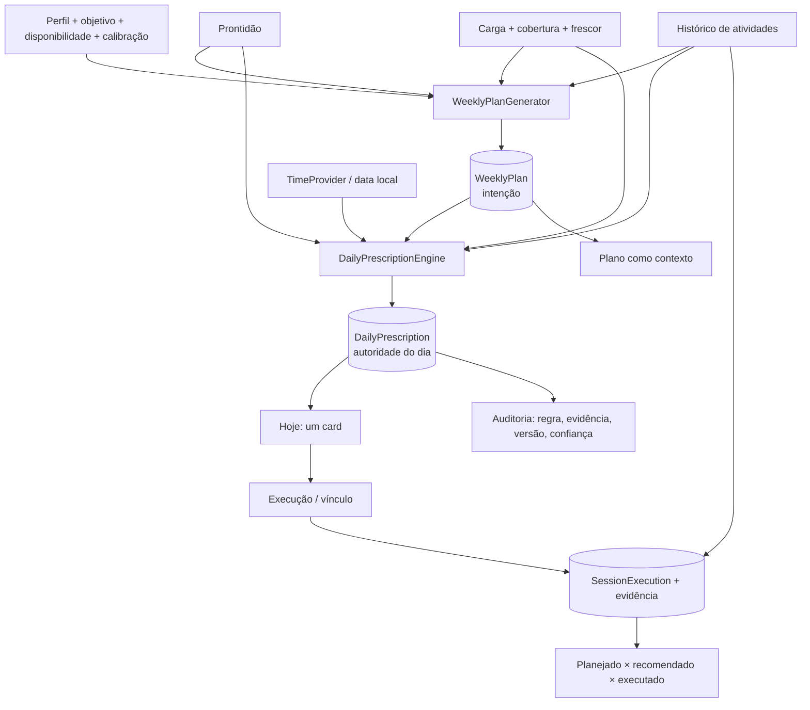

# PLANO_TECNICO_CICLO_1.md — Formalização arquitetural e preparação dos testes

**Versão:** 1.2 · **Data:** 06/11/2026
**Status:** C1-01 a C1-06 concluídos em 06/11/2026; documentação reconciliada com o schema v12.
**Escopo:** C1-01 a C1-06, ADRs 0022–0026, estratégia de testes e ordem de execução.
**Documentos de referência:** `docs/PRD_COACH_CORRIDA.md`, `docs/REVISAO_E_DIRECIONAMENTO_PRODUTO.md` (Anexo C), `docs/ARCHITECTURE.md`, `docs/DATA_MODEL.md`, `docs/SPORTS_SCIENCE.md`, `docs/TESTING.md`, `docs/ROADMAP.md`.

---

## 1. Objetivo e limites

Este plano transforma as decisões aprovadas em uma sequência executável, sem antecipar código de produção. Ele responde:

1. qual arquitetura o ciclo 1 quer atingir;
2. quais contratos e dados precisam existir antes da primeira tela;
3. quais testes provam cada correção;
4. quais cenários ainda não podem ser implementados e como ficam documentados;
5. qual é a ordem que minimiza retrabalho e risco de regressão.

**Dentro:** C1-01 (tempo), C1-02 (carga/qualidade), C1-03 (plano × prescrição), C1-04 (evidência), C1-05 (exclusão/reset), C1-06 (verdade documental), ADRs 0022–0026, testes de regressão.

**Fora:** sessão guiada persistente completa, captura de `ExerciseSession` do Health Connect, backup/restauração versionado, revisão semanal, periodização, semana de prova/recovery, Tier B, GPS nativo, LLM, novos módulos, refatoração ampla, redesenho visual.

**Restrições desta etapa:** o plano original não alterou código de produção. Em 06/11/2026, C1-01 a C1-06 foram implementados conforme §6.2 a §6.8; `Cycle1RegressionTest` não tem mais cenários `@Ignore`. O C1-06 não alterou schema, dependência ou código de produção: apenas documentos e a verificação final.

---

## 2. Decisões aprovadas e consequências

| Decisão | Conteúdo aprovado | ADR | Entrega |
|---|---|---|---|
| **D2** | `ACTIVITY` > `GUIDED` > `MANUAL`; adesão ≠ execução comprovada; descanso/doença/não realizado com estados próprios; doença não impede registro fiel, mas não estimula treino | 0024 | C1-04 (ACTIVITY/MANUAL/vínculo); GUIDED no ciclo 3 |
| **D3** | Plano = intenção; prescrição diária = autoridade única; adaptação preserva o plano; motivos auditáveis | 0023 | C1-03 |
| **D6** | Lixeira de 7 dias; reset imediato; época de dados; cancelar/limpar tudo; Health Connect não é apagado | 0025 | C1-05 |
| **Tempo** | Fuso do perfil, `Clock`/`TimeProvider`, virada de dia/semana | 0022 | C1-01 |
| **Carga/qualidade** | ACWR desconhecido não libera; ausência não é zero; cobertura e frescor; critérios de iniciante | 0026 (Proposed) | C1-02 (gate); iniciante após C1-04 |
| **Import-first** | FIT/TCX/GPX + HC + manual; sem GPS nativo | 0003/0005 | Já vigente; manual no ciclo 2 |
| **Perfil único** | Um perfil por instalação | — | Sem schema novo; documentar no C1-06 |
| **Um objetivo ativo** | Geral ou prova; um por vez | — | Já vigente; documentar no C1-06 |
| **Sem backend** | App local-first; sync futuro opt-in | 0002/0008 | Já vigente |
| **Backup** | Versionado/restaurável em ciclo posterior | — | Fora do C1 |
| **Determinismo** | Motor determinístico; sem LLM decidindo | 0004 | Mantido |

> As decisões sem ADR novo são restrições de escopo que não mudam schema nem contrato de código neste ciclo. A documentação será reconciliada no C1-06, preservando o histórico.

**Por que cinco ADRs (e não mais):** os ADRs 0022–0026 cobrem as decisões que mudam contrato de domínio, schema ou semântica de dados — tempo, plano × prescrição, evidência, exclusão e carga/qualidade. As demais diretrizes aprovadas já estão ancoradas em ADRs existentes (0002 local-first, 0003 FIT canônico, 0004 motor determinístico, 0005 Health Connect, 0008 backend futuro) ou são restrições de escopo sem impacto de modelo (perfil único, um objetivo ativo, backup em ciclo posterior). Criar ADRs adicionais só para “distribuir” decisões aumentaria a documentação sem melhorar a rastreabilidade. Se a progressão de volume por histórico for aprovada, ela exigirá um ADR próprio para substituir o 0010; não foi antecipada aqui.

---

## 3. Arquitetura alvo

### 3.1 Princípio central

**O plano decide a intenção da semana; a prescrição decide o dia; a execução registra o que aconteceu; os demais componentes calculam ou apresentam.**

Hoje há três centros de decisão (`TodayViewModel`, `WorkoutRecommender`, `WeeklyPlanGenerator`). O ciclo 1 reduz para dois:

- `WeeklyPlanGenerator` → `WeeklyPlan` (intenção persistida);
- `DailyPrescriptionEngine` → `DailyPrescription` (autoridade persistida do dia).

A UI não decide, não recalcula e não cria uma segunda prescrição.

### 3.2 Fluxo alvo



### 3.3 Fontes de verdade

| Pergunta | Fonte única | Regra |
|---|---|---|
| Qual é o treino de hoje? | `daily_prescriptions` (última versão do dia) | UI nunca recalcula |
| Qual era a intenção da semana? | `weekly_plans` + `planned_sessions` | Plano não vira segunda prescrição |
| O que aconteceu? | `session_executions` + `activities` | Uma atividade por sessão; vínculo 1:1 |
| Como estou recuperando? | `ReadinessResult` derivado de `daily_metrics` + `daily_check_ins` | Snapshot do dia para auditoria |
| Quanto estou carregando? | `LoadSnapshot` derivado de atividades | Não persistir como verdade independente |
| O treino foi concluído? | `session_executions` + `completionEvidence` | Status derivado; nunca setado por clique |
| Que horas/dia são? | `TimeProvider` + `ZoneId` do perfil | Nenhum `now()` em UI/ViewModel |
| Por que mudou? | `DailyPrescription` com regra/evidência/versão | Catálogo único de explicações |
| O dado foi apagado? | lixeira + época de dados | Sem ressurreição por worker |

### 3.4 Camadas e onde o código entra

| Camada | O que entra | Exemplos |
|---|---|---|
| `core:model` | Tipos canônicos e IDs | `DailyPrescription`, `SessionExecution`, `CompletionEvidence`, `LoadCoverage` |
| `core:domain` | Cálculo puro, sem Android | `DailyPrescriptionEngine`, `WeeklyPlanGenerator`, `SessionMatcher`, `PlanCompletionCalculator`, `TrainingLoadEngine` |
| `core:data` | Room, repositórios, adapters | `DailyPrescriptionRepository`, `SessionExecutionRepository`, `DataEpochStore`, `ActivityRepository`, `UserDataRepository` |
| `:app/application` | Casos de uso que orquestram repositórios | `GetTodayPrescription`, `CompleteSession`, `ResetAllData`, `ExportBackup` |
| `:app/ui` | ViewModels + Compose | `TodayViewModel` só coleta estado e chama caso de uso |
| `:app/time` | Tempo de aplicação | `TimeProvider`, `ProfileTimeProvider`, `FakeTimeProvider` |

**Não criar módulos por feature agora.** O `:app` monolítico não é o problema imediato; o problema é a ausência de casos de uso. Gatilho para extrair módulo: build > 8 min, mais de 2 desenvolvedores ou necessidade real de isolamento.

---

## 4. Modelo de dados planejado (sem implementar agora)

### 4.1 Entidades e campos

| Entidade/tabela | Campos essenciais | Por que |
|---|---|---|
| `daily_prescriptions` (nova) | `id`, `date`, `plannedSessionId?`, `plannedType?`, `prescribedType`, `plannedDurationMin?`, `prescribedDurationMin?`, `targetsJson?`, `adjustment`, `rationale`, `ruleIdsJson`, `evidenceIdsJson`, `confidence`, `engineVersion`, `inputsHash`, `supersedesId?`, `createdAt` | Auditoria e estabilidade da decisão do dia |
| `session_executions` (nova) | `id`, `plannedSessionId?`, `activityId?`, `startedAt`, `endedAt`, `pausesJson?`, `durationSec`, `distanceM?`, `rpe?`, `source`, `createdAt` | Evidência de execução |
| `planned_sessions` (alterar) | `completionEvidence?`, `executionId?`, `activityId?`, `closureReason?`, `closedAt?` | Status derivado e vínculo |
| `weekly_plans` (expor) | `createdOn` no modelo (a entidade já tem `createdAt`) | Corte de adesão por criação do plano |
| `data_epoch` (prefs separado) | `epoch`, `resetAt` | Invalidar workers em voo |
| `activity` (já existe) | `deletedAt` para lixeira; consultas de expurgo | Exclusão de 7 dias |

### 4.2 Migrações

| Entrega | Migração | Conteúdo | Teste |
|---|---|---|---|
| C1-03 | `10 → 11` | `daily_prescriptions`; nenhum backfill de prescrições antigas; planos/sessões preservados | `MigrationTestHelper` com banco v10 sanitizado |
| C1-04 | `11 → 12` | `session_executions`; colunas de evidência/vínculo/closure; backfill `DONE → LEGACY_UNVERIFIED`; `SKIPPED → CLOSED/USER_SKIPPED` | Migração campo a campo + contagem |
| C1-05 | Nenhuma, se o expurgo usar `deletedAt` existente | Se índice for necessário, `12 → 13` testada | Teste de expurgo e export |

**Regras:**

- Nunca `fallbackToDestructiveMigration`.
- Uma migração por entrega, salvo se C1-03 e C1-04 forem entregues no mesmo commit; nesse caso, uma única migração com ambas é aceitável, desde que testada.
- Schema exportado em `core/data/schemas/`; schema antigo é asset de teste.
- Nenhum dado real no teste de migração.

---

## 5. N-01 a N-05 no ciclo revisado

### N-01 — Sessão planejada sem alvos/vínculos

**Tratamento:** C1-03 enriquece `PlannedSession` com `targetZone`, `targetPace`, `targetHr`, `distanceM` quando aplicável; a prescrição deriva o que faltar do perfil. C1-04 adiciona `activityId`/`executionId`/`completionEvidence`. A UI consome a prescrição, não a sessão crua.

**Critério de aceite:** a prescrição de um “Tempo” em dia verde tem tipo, duração e alvos iguais aos do plano; sem calibração, mostra RPE e `null`, nunca número inventado.

### N-02 — Plano no meio da semana

**Tratamento:** `WeeklyPlanGenerator` recebe `today`; gera de `max(weekStart, today)` até domingo. `WeeklyPlan` expõe `createdOn`; `PlanCompletionCalculator` ignora sessões anteriores à criação do plano. Nenhuma sessão passada entra como “pendente” ou “pulada”.

**Critério de aceite:** plano gerado na quinta não contém segunda–quarta; a adesão não conta dias anteriores à criação.

### N-03 — Taper, qualidade e recuperação pós-prova

**Tratamento:** **fora do C1**; registrado no `ROADMAP.md` como backlog do ciclo 2. Exige decisão de prova/periodização e ADR próprio.

**Critério de entrada no ciclo 2:** definir evento de prova, redução da qualidade no taper, dia sem treino depois da prova e 1–2 semanas de recuperação conforme distância.

### N-04 — ACWR ausente/zero

**Tratamento:** C1-02 + ADR 0026. `LoadSnapshot` expõe `LoadCoverage`/`LoadDataState`; `acwr == null` ou cobertura insuficiente ou fonte desatualizada bloqueiam qualidade e progressão. `WorkoutRecommender` deixa de usar `acwr ?: 0.0`.

**Critério de aceite:** sem atividade/carga → sem qualidade e texto “dados insuficientes”; fonte velha → “dados desatualizados”, não “você descansou”; ACWR conhecido 0,8–1,3 com cobertura → qualidade elegível.

### N-05 — Health Connect sem backfill

**Tratamento:** **fora do C1**; registrado no `ROADMAP.md` como backlog de integração. A primeira sincronização continua em 30 dias. O backfill será avaliado junto com `ExerciseSession`, dedup e proveniência no ciclo 2, depois de validar o comportamento do Zepp.

**Critério de entrada no ciclo 2:** saber o que o Health Connect realmente entrega no aparelho do usuário 0 e qual janela é suportada sem custo/risco desproporcional.

---

## 6. Sequência revisada de C1-01 a C1-06

### 6.1 Visão geral

| Ordem | ID | Iniciativa | Prioridade | Esforço | Depende de | Gate |
|---|---|---|---|---|---|---|
| 1 | **C1-01** | Tempo determinístico e virada de dia/semana | P0 | S/M | — | Clock fixo 23:59/00:01, segunda-feira, fuso e DST |
| 2 | **C1-02** | Cobertura de carga, ACWR desconhecido e gate de qualidade | P0 | S/M | C1-01 | “Sem dado/sem frescor ⇒ sem qualidade” testado |
| 3 | **C1-03** | Plano = intenção + prescrição única (N-01/N-02) | P0 | M | C1-01, C1-02 | Um card; prescrição versionada; plano sem passado |
| 4 | **C1-04** | Conclusão com evidência e vínculo | P0 | M | C1-03 | Impossível `DONE` sem evidência; migração testada |
| 5 | **C1-05** | Lixeira de 7 dias, reset efetivo e época | P0 | M | C1-01 | Reset sem ressurreição; expurgo por clock |
| 6 | **C1-06** | Verdade documental, ADRs e regressões finais | P1 | S | C1-01..C1-05 | Docs = código; suíte e goldens verdes |

**Esforço:** S = dias; M = 1–2 semanas; L = 2–4 semanas. É ordem de grandeza, não compromisso.

**Regra de ouro:** cada entrega é um commit/PR pequeno, com teste que falha antes, migração testada quando houver schema e documentação no mesmo commit. Nenhuma refatoração ampla.

### 6.2 C1-01 — Tempo determinístico e virada de dia/semana

**Objetivo:** uma única noção de “hoje” e “semana”, derivada do fuso do perfil, que reaja à meia-noite, ao resume e à mudança de fuso.

**Escopo:**

- `TimeProvider` no `:app`; `Clock`/data explícita no domínio e dados.
- `ProfileTimeProvider` com fallback para sistema antes do onboarding.
- Fluxo de dia/semana que emite na virada, no resume e na mudança de fuso.
- Remover `LocalDate.now()`/`LocalTime.now()`/`ZonedDateTime.now()` de `ui/`, ViewModels, geradores e schedulers.
- `WeeklyPlanInput` sem default de `weekStart`; `today` explícito.
- `TodayScreen`/`CheckInScreen` recebem a data do estado.
- Reagendar lembretes quando o fuso do perfil mudar.
- `HealthSyncService` usa o fuso do perfil.

**Fora de escopo:** UI de viagem/fuso, DST exótico além do teste, mudança de copy de lembrete.

**Arquivos prováveis:** `app/time/*`, `app/di/*`, `TodayViewModel.kt`, `CheckInViewModel.kt`, `CheckInScreen.kt`, `TrendsViewModel.kt`, `ReadinessHistoryViewModel.kt`, `CalibrationViewModel.kt`, `MetricsImportViewModel.kt`, `FirstRunChecklistViewModel.kt`, `TutorialViewModel.kt`, `ReminderScheduler.kt`, `ReminderContent.kt`, `WeeklyPlanGenerator.kt`, `TodayScreen.kt`; testes correspondentes.

**Aceite:**

1. 23:59 salva o check-in no dia corrente; 00:01 mostra o novo dia sem reiniciar o processo.
2. Domingo→segunda exibe o novo plano; nenhuma sessão anterior aparece como “hoje”.
3. Lembrete no fuso do perfil; antes do onboarding, fuso do sistema; reagenda ao concluir/editar o perfil.
4. `WeeklyPlanGenerator` não tem default de data; testes injetam `weekStart`/`today`.
5. Nenhum `now()` em `ui/`/ViewModels, exceto `SystemTimeProvider`.
6. Testes de 23:59/00:01, segunda-feira, mudança de fuso e DST passam.

**Risco:** médio (muitos ViewModels/goldens). Mitigação: provider injetável, commits por tela, `FakeTimeProvider` nos goldens.

**Status da execução (06/11/2026):** implementado.

- `app/time/TimeProvider.kt`: `TimeProvider`, `SystemTimeProvider` e `ProfileTimeProvider` com fluxo de `today`, `zoneId`, `refresh()` e cálculo de meia-noite por `ZonedDateTime`.
- Hilt fornece um único `Clock` e o `TimeProvider`; repositórios, `HealthSyncService`, lembretes, `TutorialStore` e `FirstRunMetricsStore` recebem o mesmo relógio.
- `TodayViewModel`, `CheckInViewModel`, `TrendsViewModel`, `ReadinessHistoryViewModel`, `MetricsImportViewModel`, `HealthConnectViewModel`, `ProfileViewModel`, `FirstRunChecklistViewModel`, `TutorialViewModel`, `CalibrationViewModel`, `ActivityDetailViewModel`, `OnboardingViewModel` e `DataManagementViewModel` deixaram de chamar o relógio do sistema.
- `TodayScreen`, `CheckInScreen`, `HealthContent`, `ProfileDetails` e `DataManagementScreen` recebem a data do estado/provider; `HealthConnectCopy` e `OnboardingValidator` não têm mais defaults de “hoje”.
- `WeeklyPlanInput.weekStart` não tem default; `ReminderScheduler`/`ReminderWorker` usam o fuso e o dia do perfil; atividades importadas usam o fuso vigente do perfil para gravar a data local.
- Testes novos: `app/src/test/.../time/TimeProviderTest.kt` e `TimeDrivenStateTest.kt` (relógio fixo, 23:59→00:01, domingo→segunda, mês/ano, fuso, DST, atualização de estado e plano semanal).
- Validação: `./gradlew check` verde (467 testes em `:app`, 295 em `core:domain`, 100 em `core:data`, 27 em `core:model`; 3 falhas esperadas seguem `@Ignore`), `:app:assembleDebug` verde, lint sem erros e `spotlessCheck` verde.
- Pendência fora do escopo: `StoryVideoExporter` ainda usa `System.currentTimeMillis()` apenas para nomear o arquivo do story; não participa de planejamento, carga ou check-in.

### 6.3 C1-02 — Cobertura de carga, ACWR desconhecido e gate de qualidade

**Objetivo:** impedir que ausência de dados vire permissão para aumentar carga.

**Escopo:**

- `LoadSnapshot` com `LoadCoverage`, `LoadDataState`, `daysWithLoad`, `lastActivityAt`, `sourceFresh`.
- Distinguir dia sem atividade (descanso) de dia sem dado (desconhecido).
- `acwr` `null` quando cobertura insuficiente/fonte velha; nunca “sem restrição”.
- `WeeklyPlanGenerator.qualityAllowed` exige `KNOWN`, cobertura ≥ 8 dias/28, frescor ≤ 14 dias, ACWR 0,8–1,3, prontidão verde, espaçamento.
- `WorkoutRecommender` deixa de usar `acwr ?: 0.0`.
- Explicação “dados insuficientes”/“dados desatualizados”; confiança reduzida.
- Documentar a regra em `SPORTS_SCIENCE.md` e ADR 0026.

**Fora de escopo:** EMA/42 dias (BUG-03), HRV (BUG-04), mistura TRIMP/rTSS (N-09), semana de prova (N-03), elegibilidade completa de iniciante (depende de C1-04).

**Arquivos prováveis:** `core/domain/load/TrainingLoadEngine.kt`, `TrainingLoadCalculator.kt`, `WeeklyPlanGenerator.kt`, `WorkoutRecommender.kt`, `core/domain/load/*Test`, `WeeklyPlanGeneratorTest`, `WorkoutRecommenderTest`, `SPORTS_SCIENCE.md`, ADR 0026.

**Aceite:**

1. Sem nenhuma atividade com carga em 28 dias → ACWR `null`; plano sem qualidade e “dados de carga insuficientes”.
2. ACWR conhecido com < 8 dias de carga/28 → qualidade bloqueada, confiança reduzida.
3. Fonte sem atualização há > 14 dias → carga desatualizada; qualidade bloqueada e texto “dados desatualizados”.
4. Cobertura adequada + ACWR 0,8–1,3 → qualidade elegível.
5. ACWR > 1,3 ou < 0,8 → qualidade bloqueada.
6. Carga constante, carga zero, cobertura insuficiente e fonte velha têm testes.
7. Nenhuma decisão usa ACWR isoladamente como diagnóstico.

**Risco:** baixo/médio; pode reduzir qualidade para usuários com dados parciais. É o comportamento desejado; explicar na UI e atualizar goldens.

**Status da execução (06/11/2026):** implementado.

- `TrainingLoadEngine` ganhou `ActivitySourceStatus`, `LoadCoverage` e
  `LoadDataState`; `acwr` só é exposto com fonte fresca e ≥ 8 dias com carga
  em 28. Dias sem atividade só são descanso com fonte fresca.
- `ActivityRepository` expõe `lastImportedAt()`/`observeLastImportedAt()` sem
  migração de Room.
- `WeeklyPlanGenerator` exige `KNOWN` + ACWR 0,8–1,3 para qualidade, reduz a
  confiança quando a carga não é confiável e explica “dados insuficientes” ou
  “desatualizados”.
- `WorkoutRecommender` removeu `acwr ?: 0.0`; carga desconhecida/velha mantém o
  dia fácil e reduz a confiança.
- UI: card de carga e explicação declaram `INSUFFICIENT`/`STALE`; catálogo
  ganhou `EV-IMPELLIZZERI-2020`.
- Testes: `Cycle1RegressionTest` habilitou os dois gates de C1-02; novos casos
  em `TrainingLoadEngineTest`, `WeeklyPlanGeneratorTest`,
  `WorkoutRecommenderTest`, `ActivityRepositoryTest` e UI.
- Validação: `./gradlew check` e `:app:verifyRoborazziDebug` verdes; 924 testes
  (478 `:app`, 109 `core:data`, 310 `core:domain`, 27 `core:model`), 1 `@Ignore`
  de C1-03.

### 6.4 C1-03 — Plano como intenção e prescrição única do dia

**Objetivo:** uma única decisão diária que parte da sessão planejada e a ajusta por prontidão, carga, calor e execução.

**Escopo:**

- `DailyPrescriptionEngine` puro com `KEEP`/`REDUCE`/`DOWNGRADE`/`REST`/`NO_PLAN`.
- Nunca aumentar tipo/volume/duração.
- Alvos de pace/FC derivados do perfil; sem calibração, RPE e `null`.
- Persistir `daily_prescriptions` com `engineVersion`, `inputsHash`, regra/evidência/confiança e versão (`supersedesId`).
- `TodayViewModel` chama `GetTodayPrescription`; `WorkoutRecommender` deixa de ser a fonte do card.
- Um card principal; plano como contexto com selo “ajustado hoje”; sem CTA de conclusão próprio.
- Plano no meio da semana não gera passado; adesão cortada pela criação (N-02).
- Explicação “planejado → ajustado → por quê”.

**Fora de escopo:** sessão guiada persistente, áudio, GPS, periodização, revisão semanal, alvos ao vivo.

**Arquivos prováveis:** `core/domain/prescription/DailyPrescription.kt`, `DailyPrescriptionEngine.kt`, `PrescriptionPolicy.kt`, `WeeklyPlanGenerator.kt`, `PlanCompletionCalculator.kt`, `core/data/db/entity/DailyPrescriptionEntity.kt`, DAO, `DailyPrescriptionRepository.kt`, `MeuCoachDatabase.kt` (migração `10 → 11`), `app/application/GetTodayPrescription.kt`, `TodayViewModel.kt`, `TodayScreen.kt`, `TodayExplanation.kt`, `ExplanationCatalog.kt`; testes e goldens.

**Aceite:**

1. Verde + “Tempo” → card “Tempo”, mesma duração/alvos; nenhum segundo card diferente.
2. Vermelho/doença + “Tempo” → `REST`; “Iniciar”/“Concluir” desabilitados; explicação cita doença/prontidão.
3. Âmbar/sono curto + “Tempo” → fácil ou descanso, com duração reduzida e motivo.
4. Âmbar + “Longão” → fácil reduzido, não qualidade.
5. Sem plano → fácil conservador, confiança baixa, sem alvo inventado.
6. Plano gerado na quinta não tem segunda–quarta; adesão não conta dias anteriores à criação.
7. Prescrição persistida uma vez por data/versão; editar check-in acrescenta versão.
8. Explicação cita ≥ 1 regra e ≥ 1 evidência; catálogo cobre os IDs.
9. Contrato cobre fácil, longão, qualidade, descanso, sem plano, doença, calor e sem calibração.
10. Migração `10 → 11` preserva planos/sessões/status.

**Risco:** alto (coração do Hoje e goldens). Mitigação: contrato testado antes da UI; commits pequenos; comparar planos antigos/novos com dados sanitizados; manter fallback temporário durante a migração.

**Status da execução (06/11/2026):** implementado.

- `DailyPrescription`, `PrescriptionTargets`, `PrescriptionAdjustment` e `DailyPrescriptionEngine` em `core:domain`; decisão `KEEP`/`REDUCE`/`DOWNGRADE`/`REST`/`NO_PLAN`, nunca aumentando tipo/duração/intensidade.
- `PrescriptionPolicy` é a fonte única de alvos: plano e prescrição derivam zona/pace/FC/distância/RPE do mesmo lugar. Sem calibração, pace/FC ficam `null` e o alvo vira RPE; calor desacelera o pace ou sobe o RPE, sem aumentar a duração.
- `WeeklyPlanInput.today` passou a ser obrigatório; o gerador corta dias anteriores e grava `WeeklyPlan.createdOn`. A adesão ignora sessões anteriores à criação (N-02). `PlannedSession.targets` guarda os alvos (N-01).
- `daily_prescriptions` (Room 11), DAO e `DailyPrescriptionRepository` com `observeLatest`, `getVersions` e `append` (`supersedesId`; a duplicata da mesma `date + inputsHash + engineVersion` é ignorada dentro da transação — não há índice único composto). Migração `10 → 11` cobre a tabela, `weekly_plans.createdOn` e `planned_sessions.targetsJson`, preservando planos e status.
- `GetTodayPrescription` (caso de uso) persiste uma vez por hash/versão e ignora sessão `SKIPPED` como plano do dia. `TodayViewModel` consome a prescrição; `WorkoutRecommender` ficou apenas como fallback de `NO_PLAN`.
- UI com um card principal, selo “Ajustado hoje” no plano, sem CTA de conclusão no plano e ações desabilitadas em `REST`; explicação “planejado → hoje → por quê”. Export inclui prescrições e o reset as apaga.
- Testes: novos casos de domínio, `DailyPrescriptionRepositoryTest`, migração 10→11, `GetTodayPrescriptionTest`, UI e goldens de Hoje.
- Validação: `./gradlew check`, `:app:assembleDebug`, `:app:recordRoborazziDebug` e `:app:verifyRoborazziDebug` verdes; 961 testes (487 `:app`, 117 `core:data`, 330 `core:domain`, 27 `core:model`), 0 `@Ignore`.

### 6.5 C1-04 — Conclusão com evidência e vínculo atividade ↔ sessão

**Objetivo:** tornar `DONE` consequência de execução/atividade, não de clique.

**Escopo:**

- `SessionExecution` (início, fim, pausas, duração, distância, RPE, `activityId?`, `source`).
- `completionEvidence` (`ACTIVITY`, `GUIDED`, `MANUAL`, `LEGACY_UNVERIFIED`); `executionId`/`activityId`; `closureReason`/`closedAt`.
- `CompleteSession` valida sessão/prescrição/data; permite hoje e dia passado da mesma semana com aviso; nunca futuro; bloqueia `REST`/doença; exige evidência.
- `REST`/doença encerram a sessão como `CLOSED` com motivo, sem pendência eterna.
- `SessionMatcher` puro (data local, esporte, duração/distância com tolerância); sempre confirmação.
- UI: vincular corrida ou “fiz sem registro” (duração + RPE); uma atividade por sessão.
- `MANUAL` não cria atividade, não entra em volume/carga/zonas; UI diz isso.
- Backfill `DONE → LEGACY_UNVERIFIED`; `SKIPPED → CLOSED/USER_SKIPPED`.
- Adesão vs. execução comprovada separadas; `LEGACY_UNVERIFIED`/`MANUAL` não liberam progressão.

**Fora de escopo:** timer persistente, foreground service, áudio, GPS, atividade manual completa, auto-vínculo sem confirmação, sessão guiada completa (ciclo 3).

**Arquivos prováveis:** `core/domain/prescription/SessionMatcher.kt`, `CompletionEvidence.kt`, `core/data/db/entity/SessionExecutionEntity.kt`, `PlannedSessionEntity.kt`, DAO, `SessionExecutionRepository.kt`, `MeuCoachDatabase.kt` (migração `11 → 12`), `app/application/CompleteSession.kt`, `TodayViewModel.kt`, `TodayScreen.kt`, `ActivityDetailViewModel.kt`/`ActivitiesScreen.kt`, `PlanCompletionCalculator.kt`; testes.

**Aceite:**

1. Concluir sem evidência → não salva; oferece vincular atividade ou “fiz sem registro”.
2. “Fiz sem registro” exige duração > 0 e RPE 1–10; salva `MANUAL`, confiança baixa; UI diz que não entrou no histórico/volume.
3. Corrida importada compatível → sugestão; confirmar → `DONE`/`ACTIVITY`; rejeitar → sessão `PLANNED`, corrida livre.
4. Duas atividades não podem ir para a mesma sessão; uma atividade não pode ir para duas sessões.
5. Descanso/doença → conclusão e início bloqueados; sessão encerrada com motivo.
6. `LEGACY_UNVERIFIED` separado; não conta para progressão.
7. Migração `11 → 12` preserva status, `completedAt` e planos; teste com banco v11 sanitizado.
8. Doença não impede registrar corrida real; ela fica como treino livre/override rotulado, sem estímulo e sem crédito de progressão.
9. Sessão de ontem da mesma semana permitida com aviso; futura bloqueada.
10. Testes de match, rejeição, duplicidade, descanso, atividade sem plano e manual inválido.

**Risco:** alto (schema + semântica de adesão + dados antigos). Mitigação: backfill explícito, leitura tolerante, migração com banco v11 real sanitizado, testes de concorrência.

**Status da execução (06/11/2026):** implementado.

- `core:model`: `CompletionEvidence`, `ExecutionSource`, `ExecutionPause` e `SessionExecution`; `MANUAL` não carrega atividade/distância e exige RPE.
- `core:domain`: `SessionStatus` com `CLOSED`, `SessionClosureReason`, `SessionCompletionRules`, `SessionMatcher` e `PlanCompletionCalculator` separando adesão de execução comprovada. `PlannedSession` rejeita `DONE` sem evidência.
- `core:data`: `session_executions`, colunas de evidência/vínculo/encerramento, índices únicos 1:1, `SessionExecutionRepository` transacional e migração `11 → 12` com backfill `DONE → LEGACY_UNVERIFIED` e `SKIPPED → CLOSED/USER_SKIPPED`.
- `:app`: `CompleteSession` valida data/estado/evidência e encerra descanso/doença; o Hoje ganhou o diálogo de vínculo/manual, rótulos de evidência e o bloqueio de ações em dia encerrado. Tendências mostra “feito” e “com evidência”.
- Lixeira: suspende/restaura/remove o vínculo conforme `ADR 0025`; export padrão exclui execuções de atividades na lixeira.
- Testes novos: `SessionCompletionRulesTest`, `SessionMatcherTest`, `SessionExecutionRepositoryTest`, `CompleteSessionTest`, migração 11→12 e UI do diálogo/status; `Cycle1RegressionTest` ganhou `DONE` sem evidência e progressão bloqueada por legado.
- Validação: `./gradlew check`, `:app:assembleDebug`, `:app:recordRoborazziDebug` e `:app:verifyRoborazziDebug` verdes; 999 testes (497 `:app`, 124 `core:data`, 351 `core:domain`, 27 `core:model`), 0 `@Ignore`; `core:domain` 97,69% de linhas e parser FIT 93,01% de branches.

### 6.6 C1-05 — Lixeira de 7 dias, reset efetivo e época de dados

**Objetivo:** “apagar” significa apagar; “apagar tudo” não pode ser desfeito por workers.

**Escopo:**

- Lixeira de 7 dias: `deletedAt`, restauração, “apagar definitivamente”, expurgo por clock + worker, cascade.
- Export padrão exclui lixeira; opção explícita separada.
- Reset imediato: transação + cancelamento de trabalhos (Health, Import, Reminder, Story) + limpeza de staging/cache/preferências/avatar/firstRun/tutorial + reset do HC + `DataEpochStore`.
- `HealthSyncService`/`HealthSyncWorker`: no-op sem perfil; checar época antes de salvar.
- `ImportWorker`/`StagedImportProcessor`: sem perfil/época inválida → limpar staging e falhar/cancelar sem recriar atividade.
- `MeuCoachApplication`: não reagendar lembretes/health após reset sem perfil.
- UI: confirmação clara, lista da lixeira, texto de retenção.
- Vínculo com atividade na lixeira: sessão deixa de contar como evidência; restaurar devolve; expurgar remove vínculo e marca `LEGACY_UNVERIFIED`.

**Fora de escopo:** criptografia, biometria/PIN, backup/restore, exclusão por métrica, apagar Health Connect.

**Arquivos prováveis:** `ActivityDao.kt`, `ActivityRepository.kt`, `UserDataRepository.kt`, `DataManagementViewModel.kt`, `DataManagementScreen.kt`, `ActivitiesScreen.kt`/`ActivityDetailScreen.kt`, `HealthSyncService.kt`, `HealthSyncWorker.kt`, `ImportWorker.kt`, `StagedImportProcessor.kt`, `ImportStaging.kt`, `ReminderScheduler.kt`, `StoryExportCoordinator`/cache, `DataEpochStore.kt`, `DataResetCoordinator.kt`, `MeuCoachApplication.kt`, `MeuCoachApp.kt`; testes.

**Aceite:**

1. Apagar atividade → sai da lista/uso; lixeira mostra; restaurar volta; “apagar definitivamente” remove linha e filhos.
2. Clock fixo: após 7 dias o expurgo remove; antes de 7 dias não remove; export padrão não contém lixeira.
3. “Apagar tudo” → perfil, atividades, check-ins, métricas, planos, execuções, jobs, staging, cache, avatar, preferências de dados apagados; onboarding volta.
4. Health sync sem perfil não grava; worker simulado após reset não recria métricas.
5. Import em fila após reset não recria atividade; staging é limpo.
6. Lembretes/story/health cancelados; nenhuma notificação órfã.
7. Teste com clock fixo + `WorkManagerTestInitHelper` + fake de Health Connect + latch de concorrência.
8. Apagar atividade vinculada suspende a evidência; restaurar devolve; expurgar remove e marca `LEGACY_UNVERIFIED`.
9. Reset não apaga dados do Health Connect; só a cópia local e a marca d’água.
10. Não há recibo de exclusão; a época é o único metadado preservado.

**Risco:** médio. Exclusão errada é irreversível; cancelar trabalho pode afetar usuários ativos. Mitigação: testes com clock, transação, confirmação dupla, purge só após prazo, checklist de limpeza, logs locais sem dados sensíveis.

**Status da execução (06/11/2026):** implementado.

- **Lixeira:** `ActivityDao`/`ActivityRepository` expõem `observeTrash`, `restoreActivity`, `purgeActivity`, `purgeTrashBefore` e `PurgedActivity`; `TrashPolicy` em `core:domain` centraliza os 7 dias. `purgeTrashBefore` recebe `now` e calcula o corte internamente.
- **UI:** a tela Dados ganhou lista da lixeira, dias restantes, restaurar, apagar definitivamente com confirmação e opção explícita de incluir a lixeira no backup. O detalhe da atividade continua fazendo soft delete.
- **Export:** padrão exclui atividades com `deletedAt` e seus jobs de importação; `includeTrash = true` é opcional.
- **Reimportação:** arquivo cuja atividade está na lixeira retorna `ImportResult.TrashConflict`, registra `ImportJobStatus.TRASH_CONFLICT` e notifica com link para Dados; não restaura silenciosamente.
- **Expurgo:** `TrashPurgeWorker` diário, agendado apenas com perfil; sem perfil é no-op. Também remove o arquivo bruto associado.
- **Reset:** `DataEpochStore` + `DataWriteMutex`; `DataResetCoordinator` gira a época antes da limpeza, cancela trabalhos de importação/saúde/lembretes/story/expurgo, limpa Room, staging, avatar, cache de story, preferências de tutorial/first-run/story e notificações, e reseta o estado do Health Connect. O arquivo da época não é apagado.
- **Workers:** `HealthSyncService` não lê nem grava sem perfil e descarta a leitura se a época mudou; `ImportService`/`StagedImportProcessor` fazem o mesmo e limpam o staging. `MeuCoachApplication` só agenda trabalhos quando existe perfil.
- **Fora do C1-05:** o vínculo de evidência de sessão (aceite 8) depende de C1-04, que ainda não existe no schema atual (não há `session_executions`/`completionEvidence`); a lixeira já suspende o uso da atividade porque todas as consultas normais filtram `deletedAt`.
- **Validação:** testes de `TrashPolicy`, lixeira/expurgo/restauração, export com e sem lixeira, conflito de reimportação, época, reset de banco/arquivos/preferências e sync sem perfil/época.

### 6.7 C1-06 — Verdade documental, ADRs e regressões finais

**Objetivo:** impedir que a documentação volte a descrever um app que não existe.

**Escopo:**

- Atualizar `ARCHITECTURE.md` (5 módulos reais + planejados; tempo; prescrição; evidência; exclusão), `DATA_MODEL.md` (schema v12), `README.md` (testes), `TESTING.md` (contagens, ausência de instrumentados), `PRODUCT.md` (escopo aprovado), `PROGRESS.md`, `ROADMAP.md`.
- ADRs 0022–0026 linkados no `DECISIONS.md`; 0026 revisado se os limiares forem validados.
- Reconciliar PRD FR-009 (30 dias) com o ADR 0025 (7 dias) e FR-004/005 com o ADR 0026 (proposto).
- Atualizar `SPORTS_SCIENCE.md` quando a regra mudar (ACWR/qualidade/cobertura).
- Rodar suíte completa, Kover, parser FIT e Roborazzi.
- Revisar checklist de DoD.

**Aceite:**

1. Nenhum documento afirma módulo, entidade, teste ou capacidade inexistente.
2. `DATA_MODEL.md` bate com `MeuCoachDatabase.VERSION` e entidades.
3. ADRs 0022–0026 aceitos/propostos e linkados.
4. `./gradlew check`, `:app:assembleDebug` e `:app:verifyRoborazziDebug` verdes.
5. `PROGRESS.md` com sessão, evidências e próximo passo.
6. Nenhum dado real no diff.

**Teste:** não é código; é revisão de documentos + suíte completa. Um teste barato que compare a lista de entidades do `MeuCoachDatabase` com a documentada é recomendado se não gerar fragilidade; caso contrário, revisão manual no gate.

**Status da execução (06/11/2026):** concluído.

- **Documentos reconciliados:** `ARCHITECTURE.md` (5 módulos reais, planejados separados, `TimeProvider`, fluxo plano → prescrição → execução, schema v12, ADRs 0022–0026), `DATA_MODEL.md` (persistido × derivado, `DailyPrescription`, campos reais de perfil/check-in, ausência de `SessionFeedback`/`Readiness`/`Recommendation` no Room, evidências documentais fora de `resources/`), `TESTING.md` (contagens, 46 goldens, ausência de instrumentados, gates reais de cobertura), `README.md` (999 testes, Room v12, módulos reais), `PRODUCT.md` (revisão 1.2, escopo com evidência e lixeira de 7 dias), `ROADMAP.md` (ciclo 1 concluído, critérios de MVP), `DECISIONS.md` (status dos ADRs), `SPORTS_SCIENCE.md` (`R-PRESC-01/02/03` e §8.11) e `PRD_COACH_CORRIDA.md` (§0.4 e FR-001/003/004/005/009).
- **Correção factual documentada:** o índice único de `daily_prescriptions` não existe; a deduplicação é transacional no repositório. `PROGRESS.md` e o plano foram corrigidos.
- **Verificação:** `./gradlew check`, `:app:assembleDebug` e `:app:verifyRoborazziDebug` verdes; contagens e cobertura registradas em `PROGRESS.md`.
- **Sem código de produção, schema, dependência ou migração nova.** O gate é manual porque um teste de documento × banco seria frágil e não cobriria a prosa.

---

## 7. Estratégia de testes

### 7.1 Princípios

1. **Teste no lugar certo:** fórmula no domínio, persistência no `core:data`, comportamento na UI.
2. **Determinismo:** todo teste recebe clock/data/fuso; nada depende do relógio da máquina.
3. **Regressão de bug:** o teste deve falhar no código antigo. Quando o comportamento ainda não existe, o cenário é documentado e/ou marcado como falha esperada.
4. **Privacidade:** fixtures sintéticas/sanitizadas; nenhum dado real no CI.
5. **Sem estruturas artificiais:** não criar classes de produção só para compilar testes antecipados. Se o contrato não existe, documentar primeiro.
6. **Gate por C1:** cada entrega tem seu conjunto de testes e só avança com ele verde.

### 7.2 Ativos de teste existentes

| Ativo | Estado | Uso no ciclo 1 |
|---|---|---|
| JUnit 4 + AssertJ | 158 arquivos de teste, 999 `@Test`, 0 `@Ignore` | Base dos testes de domínio/dados |
| `kotlinx-coroutines-test` | presente em `:app`; `runBlocking` em dados | Fluxos, concorrência, ViewModels |
| Robolectric | presente | Room, WorkManager, UI Compose |
| Roborazzi | 46 goldens | Hoje/plano/evidência/lixeira |
| `MigrationTestHelper` | `core:data` | Migrações 10→11 e 11→12 |
| `WorkManagerTestInitHelper` | `:app` | Lembretes, sync, expurgo, cancelamento |
| `TestListenableWorkerBuilder` (work-testing) | disponível | Testar workers isoladamente |
| Fake de Health Connect | `HealthSyncServiceTest` | Reset/época/sem perfil |
| Fixtures FIT/TCX/GPX | 4+3+2 sanitizadas | Regressão de importação |
| `androidTest` | **0** | Fora do escopo; TEST-01 condicional à distribuição |

**Testes existentes mais relevantes:**

- `WeeklyPlanGeneratorTest` — disponibilidade, qualidade, taper, deload, ACWR.
- `PlanCompletionCalculatorTest` — adesão, futuro, REST.
- `TrainingLoadEngineTest` / `LoadEngineGoldenTest` — TRIMP/rTSS, CTL/ATL/TSB, ACWR, dias ausentes.
- `WorkoutRecommenderTest` — guardrails e recomendação diária.
- `TodayViewModelTest` / `TodayViewModelPersistTest` / `TodayPlanTest` — Hoje, card, persistência.
- `MeuCoachDatabaseMigrationTest` — migrações 1→10.
- `ActivityRepositoryTest` / `UserDataRepositoryTest` — soft delete, hard delete, reset, export.
- `HealthSyncServiceTest` / `HealthSyncStoreTest` — sync, frescor, permissão.
- `ReminderSchedulerTest` / `HealthSyncSchedulerTest` — WorkManager.
- `ImportServiceTest` / `StagedImportProcessorTest` / `ImportWorker` — importação.
- `StoryExportCoordinatorTest` — cancelamento de trabalho.

### 7.3 Novos testes executáveis preparados

**Arquivo:** `core/domain/src/test/kotlin/com/meucoach/core/domain/prescription/Cycle1RegressionTest.kt`.

| Teste | Estado | O que protege |
|---|---|---|
| `plans only the configured availability days` | **Verde** | O gerador não inventa dias; base para C1-03 |
| `never places quality on consecutive days or next to the long run` | **Verde** | Invariante de espaçamento que a prescrição deve preservar |
| `does not create quality when readiness is red` | **Verde** | Guardrail de segurança que não pode regredir |
| `completion ignores future sessions and rest days` | **Verde** | Base do corte de adesão de C1-03 |
| `quality is blocked when acute chronic load is unknown` | **Verde** | C1-02: ACWR desconhecido bloqueia qualidade |
| `quality is blocked when load coverage is insufficient` | **Verde** | C1-02: cobertura insuficiente bloqueia qualidade |
| `plan created midweek does not include days before today` | **Verde** | C1-03/N-02: gerador começa em hoje e adesão corta o passado |
| `a done session cannot exist without completion evidence` | **Verde** | C1-04: `DONE` sem evidência é rejeitado no modelo/caso de uso |
| `legacy completion does not unlock quality progression` | **Verde** | C1-04: `LEGACY_UNVERIFIED` não libera progressão |

**Política de falha esperada:**

- Nenhum cenário do ciclo 1 permanece ignorado: C1-02 e C1-03 habilitaram seus gates no mesmo commit da correção.
- O teste **não** é removido nem tem assert reduzido.
- Quando a correção entra, o `@Ignore` é removido no mesmo commit; o teste passa a ser gate.
- O CI continua verde; a lista de `@Ignore` é revisada no gate de cada C1 para não virar dívida eterna.
- Cenários que dependem de classes inexistentes **não** são escritos em Kotlin; ficam na matriz documentada abaixo.

### 7.4 Matriz por tipo de teste

**Legenda de status:** `Pendente de contrato` = depende de classe/API que ainda não existe; `Pendente` = executável quando a correção entrar; `Parcial` = já há teste próximo, precisa ampliar; `Existente` = já coberto; `Falha esperada` = teste escrito e ignorado por representar bug atual.

#### 7.4.1 Unitários de domínio

| ID | Cenário | Resultado esperado | C1 | Status |
|---|---|---|---|---|
| U-TIME-01 | `TimeProvider` 23:59:59 → 00:00:01 | Emite novo dia; check-in usa a data do estado | 01 | Implementado (`TimeProviderTest`) |
| U-TIME-02 | Domingo 23:59 → segunda 00:00 | `weekStart` muda; plano novo | 01 | Implementado (`TimeProviderTest`, `TimeDrivenStateTest`) |
| U-TIME-03 | Fuso America/Sao_Paulo → America/New_York | `today`/`weekStart` recalculados | 01 | Implementado (`TimeProviderTest`) |
| U-TIME-04 | DST (America/New_York) | Meia-noite e lembrete corretos | 01 | Implementado (`TimeProviderTest`) |
| U-TIME-05 | `WeeklyPlanInput` sem `weekStart` | Não compila/não tem default | 01 | Implementado (compilação impedida pelo construtor) |
| U-LOAD-01 | Nenhuma atividade em 28 dias | `acwr == null`; `INSUFFICIENT` | 02 | Implementado (`TrainingLoadEngineTest`) |
| U-LOAD-02 | 8 dias com carga, 20 sem dado | `KNOWN` se cobertura/frescor ok; senão `INSUFFICIENT` | 02 | Implementado (`TrainingLoadEngineTest`) |
| U-LOAD-03 | 7 dias com carga | Bloqueia qualidade | 02 | Implementado (`TrainingLoadEngineTest`, `WeeklyPlanGeneratorTest`) |
| U-LOAD-04 | Fonte sem importação há 15 dias | `STALE`; bloqueia qualidade | 02 | Implementado (`TrainingLoadEngineTest`, `WeeklyPlanGeneratorTest`) |
| U-LOAD-05 | ACWR 0,8 / 1,3 / 0,79 / 1,31 | Limites exatos | 02 | Implementado (`WeeklyPlanGeneratorTest`) |
| U-LOAD-06 | Carga constante | ACWR ~1,0; sem alerta falso | 02 | Implementado (`TrainingLoadEngineTest`) |
| U-LOAD-07 | Carga zero vs. dia sem dado | Zero medido ≠ ausência | 02 | Implementado (`TrainingLoadEngineTest`) |
| U-LOAD-08 | ACWR desconhecido no recomendador | Conservador; sem `?: 0.0` | 02 | Implementado (`WorkoutRecommenderTest`) |
| U-PRESC-01 | Verde + Tempo | `KEEP`; tipo/duração/alvos | 03 | Implementado (`DailyPrescriptionEngineTest`) |
| U-PRESC-02 | Vermelho/doença + Tempo | `REST`; sem CTA | 03 | Implementado (`DailyPrescriptionEngineTest`) |
| U-PRESC-03 | Âmbar + Tempo | `REDUCE`/`DOWNGRADE` | 03 | Implementado (`DailyPrescriptionEngineTest`) |
| U-PRESC-04 | Âmbar + Longão | Fácil reduzido | 03 | Implementado (`DailyPrescriptionEngineTest`) |
| U-PRESC-05 | Sem plano | `NO_PLAN`, confiança baixa | 03 | Implementado (`DailyPrescriptionEngineTest`) |
| U-PRESC-06 | Tentativa de aumentar | Nunca aumenta | 03 | Implementado (`DailyPrescriptionEngineTest`) |
| U-PRESC-07 | Sem calibração | RPE + `null`; sem número | 03 | Implementado (`DailyPrescriptionEngineTest`) |
| U-PRESC-08 | Calor | Pace mais lento/RPE maior; duração não sobe | 03 | Implementado (`DailyPrescriptionEngineTest`) |
| U-PRESC-09 | Check-in editado | Nova versão, não sobrescreve | 03 | Implementado (`DailyPrescriptionEngineTest`) |
| U-EVID-01 | `DONE` sem evidência | Rejeitado | 04 | Implementado (`PlannedSession`, `CompleteSessionTest`) |
| U-EVID-02 | `ACTIVITY` compatível | `DONE` + vínculo | 04 | Implementado (`CompleteSessionTest`, `SessionExecutionRepositoryTest`) |
| U-EVID-03 | `GUIDED` (contrato) | Execução persistida/recuperável | 04/3 | Contrato implementado; produção de `GUIDED` no ciclo 3 |
| U-EVID-04 | `MANUAL` duração 0/RPE 11 | Rejeitado | 04 | Implementado (`SessionCompletionRulesTest`, `CompleteSessionTest`) |
| U-EVID-05 | `MANUAL` válido | Execução; sem volume/carga/zonas | 04 | Implementado (`CompleteSessionTest`, `SessionExecutionRepositoryTest`) |
| U-EVID-06 | REST/doença | Conclusão/início bloqueados | 04 | Implementado (`SessionCompletionRulesTest`, `CompleteSessionTest`) |
| U-EVID-07 | Doença + corrida importada | Registro fiel como treino livre; sem estímulo | 04 | Implementado de forma conservadora: a corrida fica livre e não é vinculada automaticamente |
| U-EVID-08 | Match: tolerância, esporte errado, ambíguo | Sugestão correta/ausente | 04 | Implementado (`SessionMatcherTest`) |
| U-EVID-09 | Duplicidade atividade/sessão | Bloqueada | 04 | Implementado (`SessionExecutionRepositoryTest`) |
| U-EVID-10 | Sessão futura | Bloqueada | 04 | Implementado (`SessionCompletionRulesTest`, `CompleteSessionTest`) |
| U-EVID-11 | Sessão de ontem da mesma semana | Permitida com aviso | 04 | Implementado (`SessionCompletionRulesTest`, `CompleteSessionTest`) |
| U-EVID-12 | Legado `DONE` | `LEGACY_UNVERIFIED`; não progressão | 04 | Implementado (migração 11→12, `PlanCompletionCalculatorTest`, `Cycle1RegressionTest`) |
| U-DEL-01 | Expurgo 6d23h / 7d / 7d1h | Não / sim / sim | 05 | Implementado (`TrashPolicyTest`, `ActivityRepositoryTest`) |
| U-DEL-02 | Export padrão com lixeira | Exclui lixeira | 05 | Implementado (`UserDataRepositoryTest`) |
| U-DEL-03 | Reset com dados | Tabelas vazias; onboarding | 05 | Implementado (`DataResetCoordinatorTest`) |
| U-DEL-04 | Reset limpa arquivos/prefs | Sem staging/cache/avatar/firstRun/tutorial | 05 | Implementado (`DataResetCoordinatorTest`) |
| U-DEL-05 | Época muda | Worker antigo não grava | 05 | Implementado (`DataEpochStoreTest`, `HealthSyncServiceTest`) |
| U-DEL-06 | Reset sem perfil | Health/import no-op; sem agendamento | 05 | Implementado (`HealthSyncServiceTest`, `MeuCoachApplication`) |
| U-DEL-07 | Reset e HC | HC não é apagado | 05 | Implementado (apenas estado local é limpo) |

#### 7.4.2 Integração (domínio + dados + caso de uso)

| ID | Cenário | Resultado esperado | C1 |
|---|---|---|---|
| I-TIME-01 | Perfil criado com fuso; check-in salvo; virada de dia | Hoje e plano usam o novo dia | 01 |
| I-LOAD-01 | Importar atividades → carga → plano | Sem cobertura, sem qualidade | 02 |
| I-LOAD-02 | Fonte atualizada + cobertura | Qualidade elegível | 02 |
| I-PRESC-01 | Plano persistido → prescrição → Hoje | Um card; plano como contexto | 03 |
| I-PRESC-02 | Editar check-in | Nova versão persistida; UI atualiza | 03 |
| I-PRESC-03 | Gerar plano na quinta | Nenhuma sessão antes de hoje; adesão correta | 03 |
| I-EVID-01 | Importar corrida → sugestão → concluir | `DONE/ACTIVITY`; adesão verificada | 04 |
| I-EVID-02 | Manual → adesão | Conta adesão; não conta volume/carga | 04 |
| I-EVID-03 | REST → fechar sessão | `CLOSED/REST_PRESCRIBED`; sem pendência | 04 |
| I-DEL-01 | Apagar → restaurar → expurgar | Ciclo completo; vínculo acompanha | 05 |
| I-DEL-02 | Reset → worker de saúde | Nada é recriado | 05 |
| I-DEL-03 | Reset → import em fila | Staging limpo; nenhuma atividade | 05 |

#### 7.4.3 Persistência e migração

| ID | Cenário | Resultado esperado | C1 |
|---|---|---|---|
| P-MIG-01 | Banco v10 → v11 | Planos/sessões/status preservados; `daily_prescriptions` vazia | 03 |
| P-MIG-02 | Banco v11 → v12 | Status/`completedAt`/planos preservados; `DONE → LEGACY_UNVERIFIED` | 04 |
| P-MIG-03 | Banco v10 com `SKIPPED` | `CLOSED/USER_SKIPPED`; sem perda | 04 |
| P-MIG-04 | Migração repetida/idempotente | Sem duplicar tabela/coluna | 03/04 |
| P-MIG-05 | Expurgo com `deletedAt` (sem schema novo) | Funciona em v12 | 05 |
| P-REPO-01 | Prescrição: append, latest, supersedes | Versão correta | 03 |
| P-REPO-02 | Execução: round-trip, pausas, RPE | Dados fiéis | 04 |
| P-REPO-03 | Lixeira: restore/purge/cascade | Filhos removidos | 05 |
| P-REPO-04 | Export: default sem lixeira | Lixeira só com flag | 05 |

#### 7.4.4 Concorrência

| ID | Cenário | Resultado esperado | C1 |
|---|---|---|---|
| C-CONC-01 | Dois vínculos simultâneos para a mesma sessão | Um vence; outro falha | 04 |
| C-CONC-02 | Duas prescrições para a mesma data | Versão consistente; sem perda | 03 |
| C-CONC-03 | Reset enquanto sync/import grava | Época invalida; nada é recriado | 05 |
| C-CONC-04 | Sync manual + resume + worker | `Mutex` serializa; sem leitura duplicada | 01/02 |
| C-CONC-05 | Expurgo + restauração | Um vence; estado final consistente | 05 |

#### 7.4.5 WorkManager

| ID | Cenário | Resultado esperado | C1 |
|---|---|---|---|
| W-WM-01 | Lembrete agendado no fuso do perfil | Horário correto | 01 |
| W-WM-02 | Mudança de fuso | Reagenda sem duplicar | 01 |
| W-WM-03 | Reset | Cancela lembretes/health/import/story | 05 |
| W-WM-04 | Sem perfil | Não reagenda | 05 |
| W-WM-05 | Expurgo diário | Enfileirado; executa com clock fixo | 05 |
| W-WM-06 | Worker de import após reset | No-op; staging limpo | 05 |
| W-WM-07 | Worker de health após reset | No-op; sem métricas | 05 |

#### 7.4.6 Data, virada de semana e fuso

| ID | Cenário | Resultado esperado | C1 |
|---|---|---|---|
| D-DATE-01 | 23:59:59 → 00:00:01 | Check-in e Hoje no novo dia | 01 |
| D-DATE-02 | Domingo → segunda | Novo plano; nada de ontem como “hoje” | 01 |
| D-DATE-03 | Fuso do perfil muda | Data/semana/lembrete recalculados | 01 |
| D-DATE-04 | DST | Sem data inexistente/duplicada indevida | 01 |
| D-DATE-05 | Atividade cruza meia-noite | Pertence ao dia de início | 01/04 |
| D-DATE-06 | Plano criado na quinta | Só hoje→domingo | 03 |
| D-DATE-07 | Virada de semana com plano antigo | Plano antigo consultável; Hoje aponta novo | 01/03 |

#### 7.4.7 Exclusão e não ressurreição

| ID | Cenário | Resultado esperado | C1 |
|---|---|---|---|
| X-DEL-01 | Apagar atividade | Some do uso; aparece na lixeira | 05 |
| X-DEL-02 | Restaurar | Volta ao uso e ao vínculo | 05 |
| X-DEL-03 | Expurgo após 7 dias | Remove linha e filhos | 05 |
| X-DEL-04 | Export padrão | Sem lixeira | 05 |
| X-DEL-05 | Reset | Tudo local apagado; onboarding | 05 |
| X-DEL-06 | Worker antigo pós-reset | Não grava | 05 |
| X-DEL-07 | Reimportar arquivo na lixeira | Não restaura silenciosamente | 05 |
| X-DEL-08 | Health Connect | Registros externos intactos | 05 |
| X-DEL-09 | Recibo de exclusão | Não existe | 05 |

#### 7.4.8 Decisão diária

| ID | Cenário | Resultado esperado | C1 |
|---|---|---|---|
| Y-PRESC-01 | Verde + Tempo | `KEEP`; um card | 03 |
| Y-PRESC-02 | Vermelho/doença | `REST`; sem CTA | 03 |
| Y-PRESC-03 | Âmbar/sono curto | `REDUCE`/`DOWNGRADE` | 03 |
| Y-PRESC-04 | Longão âmbar | Fácil reduzido | 03 |
| Y-PRESC-05 | Sem plano | `NO_PLAN`; sem alvo inventado | 03 |
| Y-PRESC-06 | Calor | Ajuste conservador | 03 |
| Y-PRESC-07 | Check-in editado | Nova versão | 03 |
| Y-PRESC-08 | Plano × prescrição | “ajustado hoje”; plano sem CTA | 03 |
| Y-PRESC-09 | Explicação | Regra + evidência + confiança | 03 |

#### 7.4.9 Vínculo sessão ↔ atividade

| ID | Cenário | Resultado esperado | C1 |
|---|---|---|---|
| Z-LINK-01 | Corrida compatível | Sugestão; confirmar → `DONE/ACTIVITY` | 04 |
| Z-LINK-02 | Rejeitar | Sessão `PLANNED`; corrida livre | 04 |
| Z-LINK-03 | Esporte errado | Sem sugestão | 04 |
| Z-LINK-04 | Duas atividades | Bloqueio | 04 |
| Z-LINK-05 | Atividade em duas sessões | Bloqueio | 04 |
| Z-LINK-06 | Atividade na lixeira | Evidência suspensa | 04/05 |
| Z-LINK-07 | Expurgo da atividade | Vínculo removido; `LEGACY_UNVERIFIED` | 04/05 |
| Z-LINK-08 | Sessão futura | Bloqueada | 04 |

#### 7.4.10 Indicadores de treinamento

| ID | Cenário | Resultado esperado | C1 |
|---|---|---|---|
| T-IND-01 | Adesão | Numerador/denominador sem REST/doença | 04 |
| T-IND-02 | Execução comprovada | Contagem por evidência | 04 |
| T-IND-03 | Manual | Adesão sim; volume/carga não | 04 |
| T-IND-04 | Legado | Não conta para progressão | 04 |
| T-IND-05 | ACWR nulo | Sem qualidade; sem “carga zero” | 02 |
| T-IND-06 | Cobertura/frescor | Estado explícito na UI | 02 |
| T-IND-07 | TRIMP/rTSS | Sem regressão de fórmula | 02 |
| T-IND-08 | Plano × executado | Base para comparação futura | 03/04 |

### 7.5 Infraestrutura de teste a adicionar

| Item | Onde | Por quê |
|---|---|---|
| `FakeTimeProvider` / `MutableClock` | `app/src/test` e `core:domain/src/test` | Virada de dia/semana, fuso, DST |
| `FakeActivitySourceStatus` | `core:domain`/`core:data` | Frescor/cobertura sem I/O |
| `TestDataEpochStore` | `core:data` | Reset/época sem prefs reais |
| `TestListenableWorkerBuilder` | `:app` | Workers isolados (já disponível via work-testing) |
| `WorkManagerTestInitHelper` | `:app` | Já usado; ampliar para reset/cancelamento |
| `MigrationTestHelper` | `core:data` | Já usado; adicionar v10→v11/v11→v12 |
| `CompletableDeferred`/latches | `core:data`/`:app` | Concorrência de vínculo/reset/sync |
| Goldens Roborazzi | `:app` | Hoje com um card, lixeira, evidência |
| Fixtures sintéticas | `core:data`/`core:domain` | Atividade/sessão/execução; sem dados reais |

**Nenhuma dependência nova é necessária.** `androidx.work:work-testing`, `kotlinx-coroutines-test`, Robolectric, Roborazzi e `MigrationTestHelper` já estão no projeto.

### 7.6 Roteiro manual por gate

1. **C1-01:** mudar a data do aparelho para 23:59, salvar check-in, avançar para 00:01; conferir Hoje e plano. Trocar o fuso do perfil e conferir lembrete.
2. **C1-02:** perfil sem atividades → Hoje/plano não oferecem qualidade e explicam “dados insuficientes”. Importar uma atividade antiga e simular fonte velha → “dados desatualizados”.
3. **C1-03:** plano com “Tempo” em dia verde → um card “Tempo”; simular doença → “Descanso” e sem CTA; editar check-in → versão nova.
4. **C1-04:** tentar concluir sem evidência → bloqueio; vincular corrida → `DONE`; tentar duplicar → bloqueio; “fiz sem registro” → confiança baixa e aviso de volume.
5. **C1-05:** apagar corrida → lixeira → restaurar; apagar de novo e expurgar; apagar tudo → onboarding; esperar worker → nada volta; conferir Health Connect intacto.
6. **C1-06:** revisar docs contra banco e árvore de módulos; rodar suíte completa.

### 7.7 Gates de CI

- `./gradlew check` (testes, Spotless, lint, Kover de `core:domain`, parser FIT).
- `./gradlew :app:assembleDebug`.
- `./gradlew :app:verifyRoborazziDebug` quando houver UI.
- `./gradlew koverVerify` quando aplicável.
- Nenhum dado real no diff.
- Migração testada quando houver schema.
- Testes novos falham no código antigo (ou estão marcados como falha esperada com justificativa).
- Documentação e `PROGRESS.md` atualizados.

---

### 7.8 Evidências de teste de C1-01

| Arquivo | Casos cobertos | Resultado |
|---|---|---|
| `app/src/test/kotlin/com/meucoach/app/time/TimeProviderTest.kt` | relógio fixo; 23:59→00:01; domingo→segunda; virada de mês/ano; mudança de fuso; DST (23 h/25 h) | verde |
| `app/src/test/kotlin/com/meucoach/app/time/TimeDrivenStateTest.kt` | check-in às 23:59 e 00:01; fuso do perfil como fonte única; atualização do `TodayViewModel` na virada de semana; consistência `plan.weekStart` × data local | verde |
| `app/src/test/kotlin/com/meucoach/app/ui/checkin/CheckInViewModelTest.kt` | relógio fixo injetado; save usa a data do estado | verde |
| `app/src/test/kotlin/com/meucoach/app/reminder/ReminderSchedulerTest.kt` | lembretes continuam agendados com o provider injetado | verde |

**Fora do gate de C1-01:** `StoryVideoExporter` mantém `System.currentTimeMillis()` para nomear o arquivo de vídeo; não é referência de dia, semana, carga ou planejamento. Fica registrado como pendência de consistência de tempo para o ciclo de story, sem alteração nesta iniciativa.

## 8. Dependências identificadas

### 8.1 Internas

| Dependência | Origem | Efeito |
|---|---|---|
| C1-01 antes de C1-02 | Janela de carga/data | Sem “hoje” confiável, ACWR não é determinístico |
| C1-01 antes de C1-03 | Data da prescrição e corte de adesão | Sem data confiável, versão do dia não é auditável |
| C1-02 antes de C1-03 | Gate de qualidade | Prescrição não pode liberar qualidade com dado ausente |
| C1-03 antes de C1-04 | Sessão prescrita | Evidência precisa de uma sessão/decisão à qual se vincular |
| C1-01 antes de C1-05 | Expurgo por clock | 7 dias precisa de clock/fuso determinístico |
| C1-04 antes da elegibilidade de iniciante | Evidência forte | 80% com evidência não existe sem vínculo |
| C1-05 antes do backup/restore | Política de retenção/export | Backup precisa saber o que é lixeira |
| C1-06 depois de C1-01..C1-05 | Modelo final | Documentar o que existe, não o que se espera |

### 8.2 Externas

- Nenhuma dependência nova de biblioteca.
- Health Connect: o reset só mexe na marca d’água local; não há API de exclusão externa.
- WorkManager: comportamento OEM pode atrasar expurgo/lembrete; a época e o clock são a garantia lógica.
- Fixtures sanitizadas existentes; nenhuma fixture privada no CI.
- Validação científica dos limiares do ADR 0026 (especialmente iniciante).
- Se houver distribuição, TEST-01 (instrumentados/E2E) e política de saúde da Play passam a ser dependências; hoje não são.

### 8.3 Documentais

- ADRs 0022–0026 linkados no `DECISIONS.md`.
- `SPORTS_SCIENCE.md` atualizado quando a regra de carga/qualidade mudar.
- `DATA_MODEL.md` e `ARCHITECTURE.md` atualizados no C1-06.
- PRD FR-009 reconciliado (7 dias) e FR-004/005 com o ADR 0026 (proposto).
- `PROGRESS.md` e `ROADMAP.md` atualizados a cada gate.

---

## 9. Riscos ainda não resolvidos

| Risco | Tipo | Prob. | Impacto | Mitigação |
|---|---|---|---|---|
| Decisão do ADR 0026 ainda proposta | Produto/ciência | Alta | Médio | Validar limiares antes de tornar definitivos; manter conservador |
| Migração Room com dados reais | Técnico | Média | Alto | Teste v10→v11/v11→v12 com banco sanitizado; backfill explícito |
| `DONE` legado vira “não verificado” e muda adesão | Produto | Alta | Médio | Copy cuidadosa; histórico separado; não punir |
| Golden tests quebram em massa | Técnico | Alta | Médio | Atualizar por C1; revisar diff visual; `FakeTimeProvider` |
| WorkManager cancelado tarde | Técnico | Média | Alto | Época + perfil + mutex; teste de concorrência |
| Reset deixa cache/staging/prefs | Técnico | Média | Alto | Checklist de limpeza + teste que varre diretórios |
| Expurgo apaga antes do prazo | Técnico | Baixa | Alto | Clock fixo; teste 6d23h/7d/7d1h; transação |
| Fonte velha bloquear demais | Produto | Média | Médio | Distinguir `STALE` de `INSUFFICIENT`; explicar o que falta |
| Iniciante liberado cedo demais | Segurança | Média | Alto | Critérios conjuntos + evidência forte + validação científica |
| ACWR tratado como diagnóstico | Produto | Média | Alto | Copy + evidência `EV-IMPELLIZZERI-2020`; nunca número isolado |
| Sessão guiada prometida e não entregue | Produto | Média | Médio | `GUIDED` só quando existir; contrato documentado |
| Sem instrumentados deixa regressão passar | Qualidade | Alta | Médio | C1-06 + roteiro manual; TEST-01 se distribuir |
| Escopo crescer para refatoração | Execução | Alta | Alto | Uma tarefa por vez; sem novos módulos; gate |
| Documentação voltar a divergir | Manutenção | Alta | Médio | Doc no mesmo commit; gate C1-06 |
| Health Connect/Zepp não entregar exercícios | Externo | Média | Alto | Não prometer; validar no ciclo 2 |
| Viagem/DST | Técnico | Baixa | Médio | `ZoneId` do perfil; testes de fuso/DST |
| Backup/restore atrasar “dados para sempre” | Produto | Média | Médio | D5 aprovado como direção; ciclo posterior explícito |
| n=1 e ausência de cohort | Produto | Alta | Médio | Teste moderado; métricas locais; não generalizar |

---

## 10. Sequência recomendada de implementação

### 10.1 Ordem e gates

```text
C1-01 Tempo determinístico
   ↓ gate: 23:59/00:01, segunda, fuso, DST
C1-02 Carga/cobertura/qualidade
   ↓ gate: sem dado/sem frescor ⇒ sem qualidade
C1-03 Plano = intenção + prescrição única
   ↓ gate: um card, versão, plano sem passado, migração 10→11
C1-04 Conclusão com evidência + vínculo
   ↓ gate: impossível DONE sem evidência, migração 11→12
C1-05 Lixeira/reset/época
   ↓ gate: reset sem ressurreição, expurgo por clock
C1-06 Verdade documental + regressões finais
   ↓ gate: docs = código, suíte/goldens verdes
```

**C1-05 pode rodar em paralelo a C1-03/C1-04 depois de C1-01**, porque depende apenas de clock/época. A ordem recomendada acima é para reduzir troca de contexto e manter um gate por vez; se houver bloqueio externo em C1-03, C1-05 é a melhor tarefa independente.

### 10.2 Sugestão de commits/PRs

| C1 | Commits sugeridos |
|---|---|
| C1-01 | (1) `TimeProvider` + DI + testes; (2) remover `now()` dos ViewModels/telas; (3) lembretes/fuso; (4) goldens |
| C1-02 | (1) `LoadCoverage`/`LoadDataState` + testes; (2) gate no gerador/recomendador; (3) copy/catálogo; (4) goldens |
| C1-03 | (1) contrato + engine + testes; (2) entidade/DAO/migração 10→11 + testes; (3) caso de uso; (4) UI um card; (5) N-02/corte de adesão; (6) goldens |
| C1-04 | (1) modelo/evidence/migração 11→12; (2) `SessionMatcher` + testes; (3) `CompleteSession` + bloqueios; (4) UI vínculo/manual; (5) adesão vs. prova; (6) goldens |
| C1-05 | (1) época/coordinator + testes; (2) lixeira/expurgo/worker; (3) reset completo/limpeza; (4) guards em workers; (5) UI; (6) testes de concorrência |
| C1-06 | (1) docs; (2) suíte/goldens; (3) revisão final |

### 10.3 Definição de pronto por C1

- [ ] Teste que falha antes (ou falha esperada documentada) e passa depois.
- [ ] `./gradlew check` verde.
- [ ] `./gradlew :app:assembleDebug` verde.
- [ ] `./gradlew :app:verifyRoborazziDebug` quando houver UI.
- [ ] Migração testada quando houver schema.
- [ ] Nenhum dado real no diff.
- [ ] Documentação e `PROGRESS.md` atualizados.
- [ ] Roteiro manual do gate executado.
- [ ] Nenhum P0 novo escondido.

---

## 11. Rastreabilidade PRD → ADR → C1 → testes

| PRD / achado | ADR | C1 | Testes principais |
|---|---|---|---|
| FR-001 / BUG-01 / BL-001 | 0023 | C1-03 | U-PRESC-01..09, Y-PRESC-01..09, P-MIG-01, I-PRESC-01..03 |
| FR-003 / BUG-02 / N-10 / BL-002 | 0024 | C1-04 | U-EVID-01..12, Z-LINK-01..08, P-MIG-02/03, T-IND-01..04 |
| FR-009 / SEC-01 / SEC-02 / NFR-003 / BL-003 | 0025 | C1-05 | U-DEL-01..07, X-DEL-01..09, W-WM-03..07, C-CONC-03/05 |
| NFR-005 / BUG-09 / ARCH-03 / BL-010 | 0022 | C1-01 | U-TIME-01..05, D-DATE-01..07, W-WM-01/02 |
| N-04 / NFR-001 / FR-004/005 | 0026 | C1-02 | U-LOAD-01..08, I-LOAD-01/02, T-IND-05..07 |
| N-01 | 0023/0024 | C1-03/C1-04 | U-PRESC-01/07, U-EVID-02, Z-LINK-01 |
| N-02 | 0023 | C1-03 | U-PRESC-09, D-DATE-06, I-PRESC-03 |
| N-03 | — | Ciclo 2 | Backlog; sem teste no C1 |
| N-05 | — | Ciclo 2 (HC) | Backlog; sem teste no C1 |
| FR-002 / BL-009 / GUIDED | 0024 | C1-04 (contrato) + ciclo 3 | U-EVID-03 |
| FR-008 / D5 | — | Ciclo posterior | Fora do C1 |
| ARCH-01/04 / DEBT-03/04 | — | C1-06 | Revisão documental + suíte |

---

## 12. Fora do escopo do ciclo 1

- Sessão guiada persistente completa (timer, foreground service, recuperação, áudio, GPS). `GUIDED` fica como contrato.
- Leitura de `ExerciseSession` do Health Connect, backfill e dedup de exercícios (N-05).
- Backup/restauração versionado (D5/FR-008).
- Revisão semanal narrativa (FR-011).
- Periodização Base/Build/Peak (FR-012).
- Semana de prova/recovery (N-03/BUG-05).
- Tier B (FR-006).
- Entrada manual de corrida com volume/distância (ciclo 2); no C1, `MANUAL` é execução.
- GPS nativo, widgets, social, story, LLM.
- Testes instrumentados/E2E (dependem de decisão de distribuição).
- Refatoração ampla, novos módulos, troca de stack, mudança de design system.

---

## 13. Pendências e decisões abertas

1. **Limiares do ADR 0026:** validar 8 dias/28, frescor de 14 dias, 15–20 km/120 min e 4 semanas/80% com dados reais e, se possível, revisão profissional.
2. **ADR 0010:** decidir se a progressão de volume passa a considerar o realizado; não é pré-requisito do C1, mas `R-PLAN-01` continua prometendo 5–8% sem executar.
3. **N-03:** definir evento de prova, taper da qualidade e recuperação pós-prova no ciclo 2.
4. **N-05:** validar o que o Zepp/Health Connect entrega antes de prometer backfill.
5. **Backup:** definir pacote, checksums, restore transacional e política de samples no ciclo 2.
6. **`LEGACY_UNVERIFIED`:** validar a copy com o usuário 0 para não parecer punição.
7. **Tolerâncias de match:** validar em corridas reais (esteira, rua, arquivos com e sem GPS).
8. **Distribuição:** se houver Play, TEST-01 e política de saúde entram no roadmap.
9. **`GUIDED`:** definir persistência (Room vs. DataStore), recuperação e foreground no ciclo 3.
10. **Dados reais:** nenhum dado de saúde no diff; fixtures privadas continuam fora do repo.

---

## Apêndice A — Mapa de arquivos por C1

| C1 | Arquivos principais |
|---|---|
| C1-01 | `app/time/*`, `app/di/*`, `TodayViewModel.kt`, `CheckInViewModel.kt`, `CheckInScreen.kt`, `TrendsViewModel.kt`, `ReadinessHistoryViewModel.kt`, `ReminderScheduler.kt`, `ReminderContent.kt`, `WeeklyPlanGenerator.kt`, `TodayScreen.kt`; testes |
| C1-02 | `core/domain/load/TrainingLoadEngine.kt`, `TrainingLoadCalculator.kt`, `core/domain/prescription/WeeklyPlanGenerator.kt`, `WorkoutRecommender.kt`; testes; `SPORTS_SCIENCE.md`; ADR 0026 |
| C1-03 | `core/domain/prescription/DailyPrescription*.kt`, `WeeklyPlanGenerator.kt`, `PlanCompletionCalculator.kt`, `core/data/db/entity/DailyPrescriptionEntity.kt`, DAO, `DailyPrescriptionRepository.kt`, `MeuCoachDatabase.kt`, `app/application/GetTodayPrescription.kt`, `TodayViewModel.kt`, `TodayScreen.kt`, `TodayExplanation.kt`, `ExplanationCatalog.kt`; testes/goldens |
| C1-04 | `core/domain/prescription/SessionMatcher.kt`, `CompletionEvidence.kt`, `core/data/db/entity/SessionExecutionEntity.kt`, `PlannedSessionEntity.kt`, DAO, `SessionExecutionRepository.kt`, `MeuCoachDatabase.kt`, `app/application/CompleteSession.kt`, `TodayViewModel.kt`, `TodayScreen.kt`, `ActivityDetailViewModel.kt`, `PlanCompletionCalculator.kt`; testes |
| C1-05 | `ActivityDao.kt`, `ActivityRepository.kt`, `UserDataRepository.kt`, `DataManagementViewModel.kt`, `DataManagementScreen.kt`, `HealthSyncService.kt`, `HealthSyncWorker.kt`, `ImportWorker.kt`, `StagedImportProcessor.kt`, `ImportStaging.kt`, `ReminderScheduler.kt`, `StoryExportCoordinator.kt`, `DataEpochStore.kt`, `DataResetCoordinator.kt`, `MeuCoachApplication.kt`, `MeuCoachApp.kt`; testes |
| C1-06 | `ARCHITECTURE.md`, `DATA_MODEL.md`, `TESTING.md`, `PRODUCT.md`, `PROGRESS.md`, `ROADMAP.md`, `DECISIONS.md`, `SPORTS_SCIENCE.md`, `PRD_COACH_CORRIDA.md` (reconciliação) |

## Apêndice B — Checklist de aceite do ciclo

- [x] ADRs 0022–0026 revisados e linkados; 0026 com status “aceito parcialmente”.
- [x] C1-01: tempo/fuso determinísticos; nenhum `now()` em UI/ViewModel.
- [x] C1-02: ACWR desconhecido/cobertura/frescor bloqueiam qualidade.
- [x] C1-03: um card; prescrição versionada; plano sem passado; migração 10→11.
- [x] C1-04: `DONE` só com evidência; vínculo 1:1; migração 11→12.
- [x] C1-05: lixeira 7 dias; reset sem ressurreição; HC intacto.
- [x] C1-06: docs = código; suíte/goldens verdes.
- [x] Nenhum dado real no diff.
- [x] Nenhum P0 novo escondido.
- [x] `PROGRESS.md` com sessão e próximo passo.
- [x] Autorização explícita para iniciar C1-01 (histórico; ciclo concluído).

---

*Fim do plano. Nenhuma linha de código de produção, schema, dependência ou migração foi alterada nesta etapa.*
