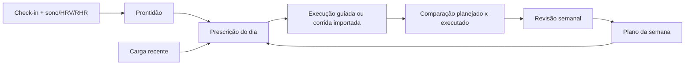

# PRD — MeuCoach: do registro à decisão

**Versão:** 1.0 (auditoria) · **Data:** 06/11/2026 · **Commit auditado:** `56085fc`
**Status:** diagnóstico e planejamento concluídos; **ciclo 1 implementado em 06/11/2026** (ver §0.4).
**Produto:** MeuCoach — coach de corrida Android, local-first e determinístico.

---

## 0. Ficha, método e convenções

### 0.1 Escopo da auditoria

Foram examinados, em modo somente leitura:

- todos os módulos Gradle e o código-fonte principal (`app`, `core:model`, `core:domain`, `core:data`, `core:designsystem`);
- os testes unitários, de UI e de screenshot;
- configuração de build, version catalog, manifest, CI e wrapper;
- documentação de produto, arquitetura, ciência, dados, design, testes, roadmap, progresso e ADRs;
- fixtures e scripts de sanitização, sem abrir dados pessoais.

Não foram executados builds, testes, lint, Kover, Roborazzi, emulador, dispositivo real, Health Connect real nem perfilamento. A única verificação executada foi `./gradlew -q projects`, para confirmar o grafo real de módulos.

### 0.2 Limitações explícitas

| Informação | Situação nesta auditoria |
|---|---|
| Números de teste e cobertura | Lidos de `docs/PROGRESS.md` e contados estaticamente (`872` anotações `@Test`); a suíte não foi reexecutada. |
| Lint, Kover, Roborazzi | Não reexecutados; os resultados citados são os registrados pela documentação do projeto. |
| Comportamento em aparelho | Não observado. Health Connect, notificações, WorkManager, MapLibre, MediaCodec e permissões foram avaliados por código. |
| Dados reais | Não acessados. Fixtures privadas não foram abertas. |
| Performance | Sem medição; conclusões são estáticas e baseadas em complexidade, alocação e dispatchers. |
| Estado de produção | Não há release assinada nem telemetria; não foi possível avaliar crash-free real, retenção ou uso. |

### 0.3 Convenções de leitura

- **[FATO]**: verificado diretamente no código, configuração ou documento citado.
- **[HIPÓTESE]**: inferência plausível, indicada como tal e sujeita a validação.
- **[RECOMENDAÇÃO]**: decisão proposta por este PRD, não implementada.
- **Prioridade:** P0 crítico · P1 alta · P2 média · P3 baixa.
- **Esforço:** S (dias) · M (1–2 semanas) · L (2–4 semanas) · XL (mais de um mês), para um desenvolvedor assistido por agente.
- **Confiança da estimativa:** alta, média ou baixa, considerando o código existente.
- **Evidência:** caminho e faixa de linhas do commit auditado; quando a evidência for documental, o documento é citado.

### 0.4 Reconciliação pós-auditoria (C1-06, 06/11/2026)

Esta seção preserva a auditoria do commit `56085fc` e registra o que o ciclo 1 mudou.
O PRD continua sendo um retrato datado; onde ele divergir do código, vale o código +
`docs/ARCHITECTURE.md`/`docs/DATA_MODEL.md`.

| Achado / requisito | Situação após o ciclo 1 |
|---|---|
| BUG-01 / FR-001 — duas prescrições concorrentes | Resolvido em C1-03: `DailyPrescriptionEngine` + `daily_prescriptions`; o Hoje tem um card e o plano é contexto (`ADR 0023`). |
| BUG-02 / FR-003 — conclusão sem execução | Resolvido para `ACTIVITY`/`MANUAL`: `SessionExecution`, `completionEvidence` e vínculo 1:1; `DONE` sem evidência é rejeitado (`ADR 0024`). FR-002 (`GUIDED` persistente) segue no ciclo 3. |
| BUG-03 — PMC enviesado por janela de 42 dias e EMA inicializada em zero | Resolvido em 11/11/2026: `TrainingLoadEngine` alimenta CTL/ATL com até 180 dias anteriores à janela exibida; sem histórico, a série começa honestamente em zero; ACWR, monotonia, cobertura e `lastActivityAt` continuam restritos à janela de decisão. Testes de burn-in, ausência de histórico e decaimento em `TrainingLoadEngineTest`. |
| BUG-04 — HRV mistura média aritmética do RMSSD com desvio-padrão do log | Resolvido em 11/11/2026: `HrvMetrics` guarda `meanLog7d`/`meanLog60d` e expõe um único `zScore`; média bruta fica só para exibição. `ReadinessCalculator`, `TodayExplanation` e `TodayViewModel` deixaram de duplicar a fórmula. A prescrição sobe para `daily-prescription-v3` para forçar a reavaliação. Testes de skew, baseline log e dados não finitos. |
| BUG-05 — treino depois da prova e ausência de recuperação | Resolvido em 12/11/2026 (`ADR 0037`, C3-07): a semana da prova já não recebe sessões após o evento (C3-05) e a prova concluída abre uma janela de recuperação de 2/3/5/10 dias (5k/10k/meia/maratona), com sessões fáceis de até 30/45/60 min, sem `QUALITY` e sem longão. A prescrição do dia aplica a mesma guarda; o plano persistido que ainda viola a janela gera sugestão de revisão `RACE_COMPLETED` com aceite. `R-RACE-04` LIMITED, sem migração.
| BUG-06 / FR-006 — Calibração Tier B não entrega estimativas | **Resolvido e validado em 11/11/2026** (`ADR 0035`, fatias 1–2): `CalibrationCalculator` estima pace de limiar pelo melhor esforço sustentado de 20–35 min com FC, VDOT derivado a 88% (limites 10–90) e LTHR na janela 25–35 min, com confiança média, avisos novos (`NO_SUSTAINED_EFFORT`, `EFFORT_PACE_OUT_OF_RANGE`) e confirmação explícita no salvamento. O app alimenta `trainingEfforts` com os mesmos treinos do contador e oferece “Estimar pelos meus treinos” quando há ≥ 3 esforços; a tela mostra a estimativa com copy honesta e sem IDs técnicos. No usuário 0, a estimativa ficou ~3% acima do VDOT de prova (30,6 vs 29,63) e 10 s/km mais rápida no pace de limiar. Sem candidato, Tier B permanece sem números com o teste de 30 min como recomendação. |
| SEC-01/SEC-02 / FR-009 — exclusão não efetiva | Resolvido em C1-05: lixeira de **7 dias**, expurgo por clock, reset com época e workers bloqueados (`ADR 0025`). O prazo de 30 dias desta auditoria foi substituído por 7. |
| BUG-09 / NFR-005 — tempo congelado | Resolvido em C1-01: `TimeProvider`/`Clock` injetados, fuso do perfil e virada de dia/semana (`ADR 0022`). |
| N-04 / FR-004/005 — carga ausente liberando qualidade | Gate implementado em C1-02: `LoadCoverage`/`LoadDataState`, frescor de 14 dias, mínimo de 8 dias com carga; iniciante ainda pendente (`ADR 0026`, parcial). |
| ARCH-01/ARCH-04 / DEBT-04 — docs × código | Resolvido no C1-06: `ARCHITECTURE.md`, `DATA_MODEL.md`, `TESTING.md`, `README.md`, `PRODUCT.md`, `ROADMAP.md` e este PRD reconciliados com o schema v12. |
| FR-004 (progressão por volume) | **Resolvido em 12/11/2026** (`ADR 0038`): o plano usa como base o maior volume concluído com evidência forte nas últimas 4 semanas, cresce no máximo 6% (faixa 5–8%) só com semana anterior ≥ 80%, prontidão verde, carga conhecida e ACWR 0,8–1,3, e mantém o volume quando o dado não sustenta aumento. A disponibilidade continua sendo teto; sem histórico, o volume vem da agenda com aviso. `R-PLAN-01` passa a ser emitida pelo gerador e o catálogo foi corrigido (N-07). |
| FR-005 (qualidade para iniciante) | **Pendente**: depende de histórico de evidência forte e validação dos limiares do ADR 0026. |
| FR-002/FR-007/FR-008/FR-011..FR-018 | **Pendentes**, conforme prioridade original. FR-010 foi implementado em 11/11/2026 (ADR 0033). |

Divergências documentais apontadas em §3.9 foram corrigidas na fonte; a tabela abaixo
permanece como registro histórico da auditoria.

---

## 1. Visão executiva

### 1.1 Resumo do estado atual

O MeuCoach já é tecnicamente mais maduro do que a média dos MVPs pessoais: tem domínio Kotlin/JVM puro, parsers próprios de FIT/TCX/GPX, deduplicação, Room com migrações testadas, importação em segundo plano, Health Connect read-only, motor determinístico de zonas/carga/prontidão/prescrição, plano semanal persistido, explicabilidade com `ruleId`/`evidenceId`/confiança, gráficos, notificações, backup/reset e um protótipo sofisticado de story em vídeo. A suíte tinha 872 anotações `@Test` na auditoria (999 após o ciclo 1) e a documentação registra `core:domain` acima de 98% de linhas.

O problema central não é falta de código. É que **o ciclo de coaching ainda não está fechado**:

1. O cartão “Próximo treino” do Hoje é produzido por um motor que **não conhece o plano semanal**. Em um dia com “Tempo” ou “Longão” planejado, ele recomenda “Fácil e conversável”, com duração e alvo próprios.
2. A execução do treino é um **cronômetro em memória dentro de um diálogo**. Fechar o app, girar a tela ou sair da tela perde o estado; o botão “Concluir” marca a sessão como feita sem qualquer vínculo com uma corrida real.
3. A conclusão e a adesão são **auto-declaradas**. O plano não sabe se o usuário correu, quanto correu, se respeitou o alvo ou se a corrida importada corresponde à sessão planejada.
4. O plano é **gerado semanalmente a partir da disponibilidade**, não do volume recente. Aumentar a disponibilidade de 3 para 6 dias pode mais que dobrar o volume prescrito, contrariando a própria regra `R-PLAN-01` de progressão de 5–8%.
5. “Apagar todos os dados” **não apaga de fato**: atividades são soft-deleted sem expurgo, não há lixeira, e o worker diário do Health Connect pode repovoar métricas depois do reset.

Em resumo: **o app já sabe analisar e planejar, mas ainda não sabe conduzir e aprender com o que aconteceu**. O próximo ciclo deve priorizar o loop “planejar → executar/registrar → comparar → adaptar”, não novas superfícies visuais.

### 1.2 Principais descobertas

| # | Descoberta | Evidência principal | Severidade |
|---|---|---|---|
| 1 | Treino do dia e plano semanal são duas fontes de verdade concorrentes | `TodayViewModel.kt:335-345`; `WorkoutRecommender.kt:72-169`; `TodayScreen.kt:155-172` | P0 |
| 2 | Conclusão de sessão não exige execução e continua disponível em dia de descanso/doença | `TodayScreen.kt:198-210, 803-823, 1108-1200`; `TodayViewModel.kt:190-194` | P0 |
| 3 | Exclusão de dados não é efetiva e pode ser desfeita por workers | `ActivityRepository.kt:300-303`; `ActivityDao.kt:47-54`; `HealthSyncWorker.kt:17-26`; `HealthSyncService.kt:61-97` | P0 |
| 4 | Backup é incompleto e não restaurável | `UserDataRepository.kt:44-79, 114-136`; `StagedImportProcessor.kt:14-25` | P1 |
| 5 | Plano não parte do volume recente; iniciante nunca recebe qualidade | `WeeklyPlanGenerator.kt:107-127, 161-168`; ADR 0010 | P1 |
| 6 | PMC (CTL/ATL/TSB) é enviesado por janela de 42 dias inicializada em zero | `TrainingLoadEngine.kt:52-90`; `TrainingLoadCalculator.kt:52-66` | P1 |
| 7 | HRV mistura média aritmética de RMSSD com desvio-padrão de log | `DailyMetricsReadinessBuilder.kt:39-58`; `ReadinessCalculator.kt:110-114` | P1 |
| 8 | Calibração Tier B é anunciada, mas não calcula VDOT/LTHR/pace | `CalibrationCalculator.kt:168-193` | P1 |
| 9 | Health Connect não importa corridas (`ExerciseSession`), apesar da promessa do produto | `HealthConnectDailySource.kt:50-55`; `PRODUCT.md:57` | P1 |
| 10 | Não há execução guiada persistente nem captura de RPE | `TodayScreen.kt:1108-1200`; `TrainingLoadCalculator.kt:46-50` (sRPE sem uso) | P1 |
| 11 | Semana de prova pode prescrever treino depois da prova e não há recuperação pós-prova | `WeeklyPlanGenerator.kt:129-203, 317-324` | P1 |
| 12 | Fuso horário e data ficam congelados em ViewModels; dia/semana podem ficar errados | `TodayViewModel.kt:67, 95, 154`; `CheckInViewModel.kt:60` | P1 |
| 13 | Documentação descreve uma arquitetura e um modelo de dados que não existem no código | `settings.gradle.kts:19-23`; `ARCHITECTURE.md:57-74`; `DATA_MODEL.md:16-35` | P2 |
| 14 | Sem testes instrumentados/E2E e sem gate de cobertura fora de `core:domain` | `.github/workflows/ci.yml:43-47`; `core/data/build.gradle.kts` | P1/P2 |
| 15 | Exclusão por `alternate` após soft delete gera “duplicado” invisível | `ImportService.kt:54-61`; `ActivityAlternateDao.kt:25-26` | P1/P2 |

### 1.3 Direcionamento recomendado

**[RECOMENDAÇÃO] Três apostas, nesta ordem:**

1. **Uma decisão por dia.** Unificar plano semanal e recomendação diária em um único `DailyPrescription`, que parte da sessão planejada e a ajusta por prontidão, carga, calor e execução. A UI deixa de mostrar dois treinos concorrentes.
2. **Registrar o que aconteceu sem fricção.** Primeiro importar corridas do Health Connect; depois, sessão guiada persistente e vínculo explícito entre atividade e sessão planejada. A adesão passa a ter evidência, não auto-declaração.
3. **Adaptar com segurança.** O plano semanal passa a considerar volume recente, conclusão real e recuperação; iniciantes ganham progressão de qualidade com critérios; prova ganha semana de prova e recuperação coerentes.

**O que não fazer agora:** gravação GPS nativa, social, widgets, LLM, novos gráficos, reescrita de UI ou migração para muitos módulos. Nada disso fortalece o loop central neste momento.

### 1.4 Cinco melhorias mais importantes

1. Unificar a prescrição do dia com o plano e bloquear conclusão sem execução (P0).
2. Tornar exclusão e retenção de dados efetivas, com expurgo, lixeira e cancelamento de workers (P0).
3. Fazer o plano partir do volume recente e permitir progressão de qualidade para iniciantes (P1).
4. Importar corridas do Health Connect e vincular atividade → sessão planejada (P1).
5. Corrigir PMC, HRV, fuso/data e semana de prova, com testes de regressão (P1).

### 1.5 Cinco funcionalidades com maior potencial

1. **Importação automática de corridas do Health Connect** — elimina a exportação manual de arquivos, que é a maior fricção do job “importar sem trabalho”.
2. **Sessão guiada persistente** — transforma o “Iniciar” em execução real, com alvos, pausa/retomada e recuperação após morte do processo.
3. **Comparação planejado × executado** — fecha o loop e gera feedback pós-treino útil, não apenas gráficos.
4. **Revisão semanal do coach** — consolida adesão, volume, intensidade, prontidão e próximo passo em uma leitura determinística.
5. **Plano de prova com periodização e pace alvo** — aproveita o objetivo já cadastrado e hoje subutilizado.

---

## 2. Identidade e posicionamento do produto

### 2.1 Problema que o app resolve

Corredores amadores acumulam dados em relógios e aplicativos, mas não sabem transformá-los em decisão: correm forte demais nos dias fáceis, ignoram sinais de recuperação, não sabem se estão evoluindo e dependem de planilhas ou de regras genéricas. O MeuCoach existe para responder, com os dados do próprio atleta e com explicabilidade:

> “O que eu faço hoje, por quê, e o que isso significa para a minha evolução?”

### 2.2 Proposta de valor

**“Seu coach de corrida que mostra a evidência, respeita seu corpo e não depende da nuvem.”**

Pilares:

1. **Explicar, não impressionar.** Toda recomendação cita regra, evidência, confiança e dados usados/ausentes.
2. **Dado ausente não é dado ruim.** O motor degrada confiança e permanece conservador; nunca inventa zero.
3. **Local-first e privado.** Sem conta, sem anúncios, sem SDK de analytics; exportação e exclusão explícitas.
4. **Segurança antes de performance.** Guardrails de doença, dor, sono, carga e calor.
5. **Uma coisa bem feita: corrida.** Musculação é rotina do usuário; nutrição e diagnóstico estão fora.
6. **Determinismo.** Mesmos dados + mesma versão do motor ⇒ mesma recomendação; LLM não decide.

### 2.3 Público-alvo

**Persona primária [FATO, documentada em `docs/PRODUCT.md` §2]:** corredor adulto iniciante/intermediário, com volume semanal baixo, parte dos treinos na rua e parte na esteira, sono curto, mora em região de calor úmido, usa relógio Amazfit + cinta e mantém Health Connect ativo. Objetivo: performance geral e provas ocasionais. Os detalhes antropométricos e de desempenho ficam no documento de produto e não são repetidos aqui.

**Personas secundárias [HIPÓTESE]:**

- corredor amador de 30–50 anos, com relógio que exporta FIT/TCX/GPX e dificuldade de interpretar carga;
- usuário que treina em esteira por calor/segurança e precisa de prescrição por velocidade/inclinação;
- usuário que valoriza privacidade e não quer conta em nuvem.

**Fora do público inicial:** atletas de alto rendimento com treinador humano, triatletas, usuários que esperam prescrição médica/nutricional.

### 2.4 Jobs to be done

1. **Importar** minhas corridas sem trabalho manual e sem depender de um único vestível.
2. **Entender** se estou evoluindo: carga, ritmo, FC, cadência, consistência.
3. **Saber o que fazer hoje** — e por quê — sem montar planilha.
4. **Não me lesionar** nem acumular fadiga sem perceber.
5. **Confiar** no que o app diz: ver a fonte e o nível de confiança.
6. **Ter meus dados comigo** para sempre, exportáveis e apagáveis.

### 2.5 Diferenciais que o produto pode desenvolver

| Diferencial | Estado atual | Potencial |
|---|---|---|
| Explicabilidade auditável | Implementada no Hoje, plano, atividade e story | Transformar em “por que mudei seu treino esta semana” |
| Dados do próprio atleta | Zonas por LTHR, VDOT, carga, prontidão | Fechar o ciclo com execução real |
| Local-first | Implementado | Reforçar como marca de confiança |
| Segurança conservadora | Guardrails no motor | Torna-se visível no pós-treino e na semana |
| Agnóstico de vestível | FIT/TCX/GPX + Health Connect parcial | Importação automática via Health Connect |
| Design premium | Design system consistente, dark-first | Não é diferencial sozinho; sustenta confiança |

### 2.6 Não escopo explícito

- prescrição/acompanhamento de musculação;
- nutrição, emagrecimento, prescrição alimentar;
- diagnóstico, reabilitação ou tratamento de lesão;
- social, ranking, feed e desafios (Fase 3);
- LLM decidindo carga, pace ou plano;
- iOS, Wear OS e widgets no MVP;
- navegação turn-by-turn;
- ciclismo/natação/triatlo na UI do MVP.

---

## 3. Diagnóstico do estado atual

### 3.1 Stack e configuração

| Área | Implementação observada |
|---|---|
| Linguagem | Kotlin 2.4.21; JDK 17; Compose |
| Build | AGP 9.4.1, Gradle 9.8.2, KSP 2.3.12, version catalog |
| SDK | `compileSdk 37`, `targetSdk 36`, `minSdk 26` |
| UI | Jetpack Compose, Material 3, Navigation Compose, design system próprio |
| Estado | ViewModels + `StateFlow`; sem MVI formal |
| DI | Hilt 2.60.1; `@HiltViewModel`, `@HiltWorker` |
| Persistência | Room 2.8.5, schema v10, migrações 1→10 testadas |
| Preferências | `SharedPreferences` para tutorial, Health Sync, dicas e métricas de primeiro uso |
| Background | WorkManager 2.12.0: import, Health Sync, lembretes, story |
| Health | Health Connect 1.1.0, leitura de sono/RHR/HRV/SpO₂ |
| Autenticação/backend | Não há login, conta, backend ou sync; o app é single-profile local |
| Rede | Tiles do mapa do story e links explícitos para a Play Store; o resto é offline |
| Sensores/GPS | Nenhum; não há gravação de corrida nem permissão de localização no manifest |
| Permissões | Health Connect (4 leituras), notificações, internet/rede, foreground service `dataSync` |
| Gráficos | Vico 3.3.1 + Canvas para gauge/zonas/heatmap |
| Mapas | MapLibre 12.3.1 + OpenFreeMap/OSM no story |
| Testes | JUnit 4, AssertJ, Robolectric, Compose UI Test, Roborazzi; MockK/Turbine/Kotest aparecem na documentação, mas não no catálogo de dependências atual |
| Qualidade | Spotless/ktlint; Kover apenas em `core:domain`; sem Detekt configurado |

**FATO:** o `README.md` cita Detekt 1.23.8 e uma stack de testes com MockK/Turbine/Kotest, mas `gradle/libs.versions.toml` não contém essas dependências e não há configuração de Detekt nos arquivos Gradle. A documentação está à frente do código nesses pontos.

### 3.2 Módulos reais vs. documentados

**FATO:** o `settings.gradle.kts` inclui apenas cinco módulos:

```
:app
:core:model
:core:domain
:core:data
:core:designsystem
```

**Documentado, mas inexistente:** `:core:testing`, `:feature:today`, `:feature:activity`, `:feature:trends`, `:feature:import`, `:feature:onboarding`, `:feature:settings`, `infra/` e `feature/`. Toda a UI, navegação, ViewModels, import coordinator, notificações, story e Health Sync vivem em `:app` (28.798 linhas de Kotlin principal no total).

**Consequência:** a separação `core` está correta e o domínio é puro, mas a modularização por feature prometida não existe. Isso não é um bug em si; é uma divergência documental e um limite de escalabilidade. A regra “features não dependem de features” não é exercitada porque não há features.

### 3.3 Funcionalidades efetivamente implementadas

| Capacidade | Estado | Evidência | Limitações relevantes |
|---|---|---|---|
| Onboarding e perfil | Implementado | `OnboardingForm.kt`, `OnboardingViewModel.kt`, Room v4/v10 | Não captura volume atual, frequência real, histórico de lesão ou terreno; meta de prova pode ficar sem data |
| Calibração | Parcial (Tier A/C) | `CalibrationCalculator.kt` | Tier B não calcula VDOT/LTHR/pace; usa confirmação manual para corrida candidata |
| Zonas de FC e pace | Implementado | `HeartRateZoneCalculator.kt`, `PaceZoneCalculator.kt` | Dependem de LTHR/pace de limiar; sem calibração não há alvo |
| Importação FIT/TCX/GPX | Implementado | `ImportService.kt`, `ImportWorker.kt`, `ImportStaging.kt` | Lê o arquivo inteiro em memória; cap de 64 MB; sem importação de Health Connect ExerciseSession |
| Deduplicação | Implementado | `ActivityDeduplicator.kt`, `ActivityRepository.kt` | Caso de alternate após soft delete não é tratado |
| Detalhe da atividade | Implementado | `ActivityDetailScreen.kt`, `ActivityDetailViewModel.kt` | Insights dependem de laps; GPX normalmente não tem lap |
| Carga e PMC | Implementado | `TrainingLoadEngine.kt` | Janela de 42 dias inicializada em zero; sem burn-in |
| Prontidão | Implementado | `ReadinessCalculator.kt`, `DailyMetricsReadinessBuilder.kt` | HRV mistura escalas; check-in pode ser neutro por default |
| Check-in | Implementado | `CheckInViewModel.kt`, `CheckInScreen.kt` | Sem estado “não respondido”; 4 respostas default 3 |
| CSV diário | Implementado | `DailyMetricsCsvParser.kt` | Uma linha por data; duplicatas: última vence |
| Health Connect (métricas) | Implementado | `HealthConnectDailySource.kt`, `HealthSyncService.kt` | Sem leitura parcial; qualquer permissão faltante bloqueia tudo |
| Health Connect (corridas) | Não implementado | — | `ExerciseSession` não é lido; produto documenta que sim |
| Registro manual de corrida | Não implementado | `ActivitySource.MANUAL` existe no modelo, sem UI | Sem forma de registrar esteira/corrida sem arquivo |
| Plano semanal | Implementado | `WeeklyPlanGenerator.kt`, `TrainingPlanRepository.kt` | Baseado em disponibilidade, não em volume; sem blocos; sem recuperação pós-prova |
| Tela Hoje | Implementado | `TodayViewModel.kt`, `TodayScreen.kt` | Duas prescrições concorrentes; conclusão sem execução |
| Sessão guiada | Parcial (protótipo) | `TodayScreen.kt:1108-1200` | Cronômetro em memória; sem persistência, background, alvos, áudio ou RPE |
| Explicabilidade | Implementado | `TodayExplanation.kt`, `ExplanationCatalog.kt` | Catálogo incompleto (`R-PLAN-01`); alguns IDs aparecem crus |
| Tendências | Implementado | `TrendsViewModel.kt`, `TrendsScreen.kt` | Sem revisão semanal; “recordes” são médias de treino inteiro; sem comparação planejado × executado |
| Notificações | Implementado | `ReminderScheduler.kt`, `ImportNotifier.kt` | Agendamento usa fuso do sistema, não do perfil; reset não cancela lembretes |
| Story de treino | Protótipo avançado | `story/` (MapLibre, MediaCodec) | P3; validação em aparelho pendente; não afeta o motor |
| Backup/export | Parcial | `UserDataRepository.kt`, `DataManagementScreen.kt` | JSON incompleto; sem restauração; arquivos originais não ficam guardados |
| Exclusão | Parcial | `ActivityRepository.kt`, `UserDataRepository.kt` | Soft delete sem expurgo; sem lixeira; workers podem repovoar |
| Tutorial/primeiro uso | Implementado | `TutorialScreen.kt`, `FirstRun*` | Métricas locais; sem SDK de analytics |
| Testes | Amplos em unidade/screenshot | 872 `@Test`; 46 screenshots | Sem `androidTest`/E2E; sem gate de cobertura em `:app`/`:core:data` |

### 3.4 Fluxos principais

**Fluxo 1 — Primeiro acesso e perfil.** `MeuCoachApp` bloqueia em onboarding se não há perfil. O formulário tem 3 passos (dados, objetivo/disponibilidade, rotina), grava Room e libera o app. Depois, um tutorial em 3 cenas aparece sobre o Hoje. A calibração fica no Perfil, não no onboarding.

**Fluxo 2 — Importação.** O usuário escolhe arquivos no seletor ou compartilha para o app. `ImportCoordinator` copia para `files/imports` com limite de 64 MB, enfileira `ImportWorker`; o worker lê o arquivo inteiro, detecta formato, parseia, aplica dedup por SHA e por chave de atividade, grava atividade/laps/blob em transação e apaga o arquivo staged.

**Fluxo 3 — Hoje.** `TodayViewModel` combina perfil, check-in, métricas, atividades, plano e carga. Calcula prontidão, carga, recomendação diária (fácil/descanso), explicação e salva o plano da semana se não existir. A tela mostra prontidão, “Próximo treino”, plano da semana, carga, check-in e última corrida.

**Fluxo 4 — Check-in.** Tela com 4 escalas (sono, fadiga, dor, estresse), sinais de doença/lesão e calor. Salva por data; a prontidão e a recomendação do dia reagem ao salvar.

**Fluxo 5 — Saúde.** Sincroniza Health Connect no resume (se >6 h), no botão manual e por worker diário. Lê sono, RHR, HRV e SpO₂; agrega por dia local; mescla por campo com CSV (MANUAL > HC > CSV); mostra painel e diagnóstico.

**Fluxo 6 — Tendências.** Carrega atividades, calcula volume semanal, consistência, relação pace×FC, distribuição 80/20, PMC, prontidão dos últimos 14 dias e adesão aos planos. A tela permite 6/12/26 semanas.

**Fluxo 7 — Atividade e story.** O detalhe abre hero, gráfico pace×FC, splits, rota offline, zonas e insights. Se houver GPS suficiente, permite criar story; a geração vai para WorkManager com foreground service, mapa MapLibre e export MediaCodec.

**Fluxo 8 — Dados.** Exporta JSON e apaga perfil, corridas, check-ins, métricas e planos em transação; remove a foto do perfil; reseta a marca d'água do Health Connect.

### 3.5 Persistência e modelo de dados

**FATO:** Room v10 com 10 entidades: `activities`, `laps`, `sample_blobs`, `import_jobs`, `activity_alternates`, `athlete_profile`, `daily_check_ins`, `daily_metrics`, `weekly_plans`, `planned_sessions`. Samples são comprimidos em blob colunar (`gzip-columnar-v1`), com limites de 5 milhões de amostras e 128 MB descomprimidos.

**Não existem no código:** tabelas de `readiness`, `recommendation`, `recommendation_rule`, `evidence`, `session_feedback` ou histórico de medidas corporais, embora `docs/DATA_MODEL.md` as descreva. A prontidão e a recomendação são recalculadas em memória, não persistidas com versão do motor.

**Consequências:**

- Não há auditoria histórica de “qual recomendação foi dada naquele dia e com qual versão do motor”; o plano persiste, a recomendação diária não.
- Não há vínculo entre atividade e sessão planejada.
- `rawFilePath` é gravado, mas o arquivo staged é apagado após o import; o caminho fica pendente.
- Não há expurgo de soft-deleted; o espaço e os dados permanecem.

### 3.6 Build, CI e qualidade

- `./gradlew check` inclui testes, Spotless, lint Android, Kover de `core:domain` e gate de branches do parser FIT.
- CI roda `spotlessCheck check :core:domain:koverVerify :app:assembleDebug` e `:app:verifyRoborazziDebug`.
- Não há job de testes instrumentados, emulador noturno, Macrobenchmark ou baseline profile.
- `release` está com `isMinifyEnabled = false` e não há `signingConfig`; não há pipeline de release assinada.
- Kover não está aplicado a `:app`, `:core:data` nem `:core:model`.

### 3.7 Pontos fortes

1. **Domínio puro e testável.** `core:model` e `core:domain` não importam Android; parsers e cálculos são reutilizáveis.
2. **Motor determinístico com rastreabilidade.** Recomendações e planos carregam regra, evidência e confiança.
3. **Importação robusta.** Três formatos, dedup por SHA e por atividade, alternates, fila persistente, tratamento de erro e fixtures sanitizadas.
4. **Persistência cuidadosa.** Migrações 1→10 testadas; blob versionado; exclusão lógica; export JSON.
5. **Privacidade por padrão.** Sem conta, sem analytics, backup Android desativado, permissões mínimas.
6. **Design system consistente.** Tokens, dark/light, componentes, gráficos com unidade e descrição.
7. **Cobertura de testes incomum para MVP.** 872 testes e 46 goldens, com foco em regras e telas críticas.

### 3.8 Limitações estruturais

1. O app **não registra corridas**: não há GPS, foreground service de atividade, sensor de passos ou gravação de sessão. A entrada é sempre arquivo ou Health Connect (métricas).
2. O app **não lê corridas do Health Connect**, então a promessa de “sem trabalho manual” ainda depende de exportar arquivo do Zepp.
3. O app **não compara planejado e executado**; a adesão é um booleano auto-declarado.
4. O plano **não é periodizado** em blocos Base/Build/Peak; é uma semana conservadora repetida com deload e taper.
5. O plano **não aprende com o volume realizado**, apenas com a conclusão (para liberar a segunda qualidade).
6. **Iniciante nunca recebe qualidade**, pois a experiência é um campo estático e o gerador exige `!= BEGINNER`.
7. **Tier B não entrega o que promete**: não há estimativa por curva pace×FC.
8. **Semana de prova** pode incluir sessões depois da prova e não há recuperação pós-prova.
9. **Dados podem ressuscitar** após “apagar tudo” por causa do worker de Health Connect e de importações em fila.
10. **Documentação e código divergem** em módulos, modelo de dados, contagem de testes, Detekt, ExerciseSession e arquivos originais.

### 3.9 Divergências documentação × código

| Documento | Afirmação | Realidade no commit `56085fc` |
|---|---|---|
| `ARCHITECTURE.md:57-74` | 11 módulos, features separadas, `core:testing` | 5 módulos; toda UI em `:app`; sem `core:testing` |
| `ARCHITECTURE.md:181-182` | Arquivos originais em storage privado, referenciados por hash | Arquivo staged é apagado após o import; `rawFilePath` fica pendente |
| `PRODUCT.md:57` | Health Connect lê “exercícios” | Só sono, RHR, HRV e SpO₂ são lidos |
| `PRODUCT.md:117` | Exportação completa (JSON + arquivos originais) | JSON sem samples e sem `name`/`avatarPath`; sem restauração |
| `DATA_MODEL.md:16-35` | Tabelas de readiness, recommendation, evidence, session_feedback | Não existem; recomendações não são persistidas |
| `DATA_MODEL.md:13` | Soft delete em métricas diárias | `daily_metrics` não tem `deletedAt` |
| `TESTING.md:90` | 494 testes | 872 `@Test` no código; `PROGRESS.md` registra 872 |
| `PROGRESS.md:14` | Room schema v9 | Código em v10, com migração 9→10 (`name`/`avatarPath`) |
| `TESTING.md:27,324` | Testes instrumentados e nightly | Não há `androidTest`; CI não roda emulador |
| `README.md:12,36` | 628 testes, Detekt 1.23.8 | 872 testes; Detekt não configurado |
| `ROADMAP.md:207` | Blocos/periodização pendentes | Confirmado: não implementado |

Essas divergências não invalidam o produto, mas **reduzem a confiança de quem usa a documentação como fonte de verdade** — inclusive agentes de IA, que podem implementar contra uma arquitetura inexistente.

---

## 4. Auditoria e problemas identificados

> **Como ler:** cada item tem uma categoria primária. Quando um problema atravessa categorias, ele é citado uma vez e referenciado nas demais. A gravidade considera impacto no usuário e no fluxo essencial, não apenas esforço de correção.

### 4.1 Bugs

#### BUG-01 — O treino do dia contradiz o plano semanal · **P0** · Impacto alto

- **Descrição:** o cartão “PRÓXIMO TREINO” usa `WorkoutRecommender`, que só produz `EASY` ou `REST`. O plano semanal é exibido separadamente e pode dizer “Tempo”, “Intervalos” ou “Longão” no mesmo dia. O usuário recebe duas instruções diferentes, com durações e alvos diferentes.
- **Evidência:** `app/.../ui/today/TodayViewModel.kt:335-345` (recomendação sem plano); `core/domain/.../prescription/WorkoutRecommender.kt:72-169` (só fácil/descanso); `app/.../ui/today/TodayScreen.kt:155-172` (dois cards); `PrescriptionInput` em `WorkoutRecommender.kt:58-64` não tem `plan`.
- **Componentes:** `TodayViewModel`, `WorkoutRecommender`, `TodayScreen`, `WeeklyPlanGenerator`.
- **Impacto no usuário:** ele pode fazer o treino errado, ignorar a qualidade planejada ou treinar forte em dia que deveria ser leve. A confiança no “coach” cai.
- **Consequência técnica:** dois motores de decisão sem contrato comum; testes de plano e de recomendação passam isoladamente, mas o produto é inconsistente.
- **Recomendação:** criar uma única `DailyPrescription` que receba `WeeklyPlan` + sessão planejada + prontidão + carga + check-in + execução. A sessão planejada é a intenção; a prescrição diária pode rebaixar (qualidade → fácil/descanso), reduzir volume ou manter, sempre explicando a mudança com regra/evidência. A UI mostra um único treino.

#### BUG-02 — Conclusão de sessão sem execução e em dia de descanso · **P0** · Impacto alto

- **Descrição:** o diálogo “Sessão guiada” tem um cronômetro em memória. O botão “Concluir treino” chama `onCompleteSession(today)` e marca a sessão planejada como `DONE`, sem verificar se houve execução, duração, distância ou vínculo com atividade. Se a recomendação do dia for “Descanso” (doença, prontidão baixa), o botão “Iniciar” continua disponível e o diálogo ainda oferece “Concluir treino”.
- **Evidência:** `TodayScreen.kt:198-210` (abre o diálogo), `TodayScreen.kt:1108-1200` (cronômetro e `onFinish`), `TodayScreen.kt:803-823` (botão “Concluir” no plano), `TodayViewModel.kt:190-194` (`completeSession`).
- **Componentes:** `TodayScreen`, `TodayViewModel`, `TrainingPlanRepository`.
- **Impacto no usuário:** adesão falsa, plano “cumprido” sem treino, possível incentivo a treinar doente; o coach passa a decidir a próxima semana com dados errados.
- **Consequência técnica:** `SessionStatus.DONE` não tem evidência; `PlanCompletionCalculator` conta qualquer clique; não há entidade de execução.
- **Recomendação:** (a) desabilitar início/conclusão quando a prescrição for `REST` ou houver `ILLNESS_OR_INJURY`; (b) exigir uma execução guiada concluída ou vínculo com atividade importada; (c) permitir “fiz sem registro” apenas com confirmação explícita, duração e RPE; (d) persistir `completedAt` + `executionId`/`activityId` + evidência.

#### BUG-03 — PMC enviesado por janela de 42 dias e EMA inicializada em zero · **P1** · Impacto médio-alto

- **Descrição:** o motor monta apenas 42 dias de carga e aplica EMA com valor inicial 0. Para um atleta com carga estável, o CTL calculado tende a ~63% do valor real (1 − e⁻¹), enquanto o ATL (constante de 7 dias) já convergiu; o TSB fica artificialmente negativo. Atividades anteriores à janela são ignoradas, embora a EMA de 42 dias ainda dependa delas.
- **Evidência:** `core/domain/.../load/TrainingLoadEngine.kt:52-90` (`days = 42`, `start = today - 41`, `ctl(loads)`); `TrainingLoadCalculator.kt:52-66` (`ewma` começa em 0).
- **Componentes:** `TrainingLoadEngine`, `TrainingLoadCalculator`, `TodayViewModel`, `TrendsViewModel`.
- **Impacto no usuário:** “Base”, “Fadiga” e “Balanço” não representam a carga real; a leitura de evolução fica enganosa. Não afeta a prescrição hoje (o plano usa ACWR, não CTL), mas afeta confiança e decisões futuras se o motor passar a usar CTL/TSB.
- **Consequência técnica:** os goldens atuais perpetuam o viés; qualquer correção exige recalibrar cenários e documentar a inicialização.
- **Recomendação:** carregar janela de burn-in (≥ 3× a maior constante de tempo, por exemplo 180 dias) ou inicializar as EMAs com a média da carga anterior à janela; documentar a escolha e adicionar teste com carga constante que convirja para o valor esperado.

#### BUG-04 — HRV mistura média aritmética de RMSSD com desvio-padrão de log · **P1** · Impacto médio

- **Descrição:** o baseline de 60 dias é a média aritmética dos RMSSD brutos, mas o desvio usado no z-score é o desvio dos logaritmos. O cálculo `ln(rmssd7d / baseline60d) / sdLn` compara unidades/escalas diferentes e produz z-score enviesado. O ideal é calcular média e desvio no espaço log (ln rMSSD) e comparar as médias logarítmicas.
- **Evidência:** `core/domain/.../readiness/DailyMetricsReadinessBuilder.kt:39-58` (`baseline60dMs = hrvBaselineValues.average()` e `sdLnMs` sobre `ln`); `ReadinessCalculator.kt:110-114` (fórmula).
- **Componentes:** `DailyMetricsReadinessBuilder`, `ReadinessCalculator`, `TodayViewModel`, `ReadinessHistoryCalculator`.
- **Impacto no usuário:** a prontidão pode mudar de nível por um erro de escala, principalmente perto dos limites 40/70; o peso de HRV é 25%.
- **Consequência técnica:** o golden de prontidão atual fixa o comportamento; é preciso versionar a correção (`engineVersion`) e comparar cenários.
- **Recomendação:** usar `ln` em cada noite, calcular média/desvio do log, comparar `meanLog7d − meanLog60d` normalizado por `sdLog60d`; manter `rmssd` bruto apenas para exibição. Adicionar testes com RMSSD constante e com variação conhecida.

#### BUG-05 — Semana de prova pode prescrever treino depois da prova e não há recuperação · **P1** · Impacto alto · **Resolvido em 12/11/2026**

- **Descrição original:** o gerador aplicava taper a todas as sessões da semana da prova, mas não removia sessões posteriores ao dia do evento; também não existia recuperação após a prova.
- **Situação:** o C3-05 passou a excluir os dias posteriores à prova na semana civil do evento. O C3-07 ([ADR 0037](../adr/0037-post-race-recovery.md)) adicionou a janela de recuperação por distância (5k 2, 10k 3, meia 5, maratona 10 dias), sem qualidade e sem longão, com sessões fáceis de até 30/45/60 min, na prescrição e no plano. `R-RACE-04` é política `LIMITED`; `CANCELLED`/`NO_SHOW` e meta legada não iniciam janela. A sugestão de revisão é explícita e auditável.

#### BUG-06 — Calibração Tier B não entrega estimativas · **P1** · Impacto médio-alto

- **Descrição:** `CalibrationCalculator` declara Tier B quando há ≥3 treinos com FC+pace, mas retorna `vdot = null`, `thresholdPace = null`, `lthr = null`. A documentação promete “melhor esforço sustentado + curva pace×FC; LTHR estimada”. O usuário sem prova recente continua sem alvos de pace, apesar de ter dados suficientes para uma estimativa de confiança média.
- **Evidência:** `CalibrationCalculator.kt:168-193`; `SPORTS_SCIENCE.md:51-56`; `ROADMAP.md:159-171`.
- **Componentes:** `CalibrationCalculator`, `CalibrationViewModel`, `AthleteProfile`.
- **Impacto no usuário:** o coach prescreve por RPE por mais tempo que o necessário; a personalização fica aquém do prometido.
- **Consequência técnica:** o enum `CalibrationTier.B` existe, mas não tem algoritmo próprio; testes cobrem apenas o rótulo.
- **Recomendação:** implementar Tier B determinístico (ex.: melhor esforço sustentado de 20–30 min + regressão pace×FC com outliers removidos), com confiança média, limites de segurança e confirmação do usuário; se os dados não passarem nos critérios, permanecer Tier C. Documentar a fórmula e adicionar goldens.

#### BUG-07 — Importação de `alternate` após exclusão lógica gera duplicado invisível · **P1** · Impacto médio

- **Descrição:** o arquivo alternativo (ex.: GPX de uma corrida já importada como FIT) é consultado por SHA sem verificar se a atividade canônica foi soft-deleted. Se o usuário apagar a corrida e reimportar o GPX, o app responde “duplicado” apontando para uma atividade que não aparece em lugar nenhum.
- **Evidência:** `ImportService.kt:54-61`; `ActivityRepository.kt:88-90`; `ActivityAlternateDao.kt:25-26`; `ActivityDao.kt:26-30` e `47-54`.
- **Componentes:** `ImportService`, `ActivityRepository`, `ActivityAlternateDao`, `ActivityDao`.
- **Impacto no usuário:** ele não consegue recuperar a corrida e recebe uma mensagem enganosa.
- **Consequência técnica:** o dedup não tem visão do estado do agregado; o alternate não tem `deletedAt`.
- **Recomendação:** ao encontrar alternate cujo pai está deleted, restaurar o pai e registrar o novo arquivo como alternate (ou promover o arquivo a canônico); filtrar consultas por `deletedAt IS NULL` com join; adicionar teste de regressão.

#### BUG-08 — Meta de prova sem data é aceita e desliga o taper silenciosamente · **P2** · Impacto médio-baixo

- **Descrição:** o onboarding permite escolher 5K/10K/meia/maratona sem data; o teste `accepts a race goal without a target date` confirma que isso é intencional no formulário. Como o taper depende de `goal.targetDate`, o plano nunca reduz volume e o usuário não é avisado.
- **Evidência:** `OnboardingForm.kt:177-187`; `WeeklyPlanGenerator.kt:317-323`; teste em `OnboardingFormTest.kt` (meta sem data).
- **Componentes:** `OnboardingForm`, `TrainingGoal`, `WeeklyPlanGenerator`.
- **Impacto no usuário:** expectativa de plano de prova sem taper; risco de chegar à prova com carga alta.
- **Recomendação:** exigir data para metas de prova ou exibir aviso claro de que, sem data, não haverá taper; no plano, declarar “sem data de prova, sem taper”.

#### BUG-09 — Fuso horário e data congelados em ViewModels · **P1** · Impacto médio

- **Descrição:** `TodayViewModel` calcula `currentWeekStart` e observa o check-in com `LocalDate.now()` no momento da criação; `CheckInViewModel` congela `today`; `TodayScreen` e `ReminderScheduler` usam o fuso do sistema, enquanto o restante do app usa o fuso do perfil. Depois da meia-noite ou de uma viagem, o app pode salvar o check-in no dia errado, mostrar o plano da semana anterior e agendar lembretes no horário errado.
- **Evidência:** `TodayViewModel.kt:67, 95, 154`; `CheckInViewModel.kt:60`; `TrendsViewModel.kt:80`; `ReminderScheduler.kt:21-33`; `ReminderContent.kt:31-40`.
- **Componentes:** ViewModels, `ReminderScheduler`, `TodayScreen`, `HealthSyncService` (este usa o fuso do perfil).
- **Impacto no usuário:** dados no dia errado, plano desatualizado, lembretes fora de hora.
- **Consequência técnica:** regra de tempo duplicada e não injetável; testes dependem de `LocalDate.now()`.
- **Recomendação:** introduzir `TimeProvider`/`Clock` + `ZoneId` do perfil como dependência explícita; recalcular “hoje” em um fluxo que reaja à meia-noite/resume; usar o mesmo provedor em ViewModels, lembretes e agregações.

#### BUG-10 — Notificação de check-in promete ajustar “o treino de amanhã” · **P3** · Impacto baixo

- **Descrição:** o texto do lembrete diz “Isso ajusta o treino de amanhã”, mas o check-in é salvo para hoje e consumido pela prontidão/recomendação de hoje.
- **Evidência:** `ReminderContent.kt:31-40`; `CheckInViewModel.kt:60-93`; `TodayViewModel.kt:243-259`.
- **Impacto:** expectativa errada sobre quando o check-in surte efeito.
- **Recomendação:** alinhar o texto (“ajusta o treino de hoje” ou explicar que o check-in da noite prepara o dia seguinte, caso o produto mude o comportamento).

#### BUG-11 — Falha inesperada no import pode deixar o job em `PARSING` para sempre · **P2** · Impacto médio

- **Descrição:** o `ImportWorker` só trata `IOException`; qualquer exceção de runtime fora do trecho protegido do `ImportService` (por exemplo, falha de SQLite ao inserir o job inicial, erro do notificador ou `SecurityException` no staging) faz o worker terminar em falha sem atualizar o `ImportJobEntity`. A UI continua exibindo o job como “Processando…” indefinidamente. Além disso, `ImportStagingException` estende `IOException`, então erros permanentes de caminho/tamanho entram em `Result.retry()` sem limite útil.
- **Evidência:** `ImportWorker.kt:19-32` (apenas `catch (IOException)` e `Result.retry()`); `ImportService.kt:51-52` (insert/update fora do `try` principal); `ImportJobCard` em `ActivitiesScreen.kt:258-297`; `ImportStaging.kt:116-122`.
- **Componentes:** `ImportWorker`, `ImportService`, `ImportJobDao`, `ImportStaging`, `ActivitiesScreen`.
- **Impacto no usuário:** arquivo “preso”, sem erro claro; a fila parece travada e pode ficar retentando um erro permanente.
- **Consequência técnica:** o job é auditável, mas não reflete o estado real; retries podem não acontecer ou nunca terminar.
- **Recomendação:** envolver todo o processamento em `try/catch (Throwable)` com exclusão de `CancellationException`, marcar o job como `FAILED` com código/mensagem e devolver `Result.failure()`; separar falhas transitórias (I/O de leitura) de permanentes (caminho inválido, arquivo grande, formato) e não retentar estas últimas; adicionar teste de exceção inesperada e de erro permanente.

### 4.2 Problemas de UX

#### UX-01 — Check-in pode registrar “neutro” sem o usuário responder · **P2** · Impacto médio

- **Descrição:** o formulário começa com todas as escalas em 3 e o salvamento não exige interação. Um toque em “Salvar” grava um check-in neutro que parece respondido, contaminando a prontidão e a explicação.
- **Evidência:** `CheckInViewModel.kt:18-24, 86-93`; teste “starts with neutral answers”; `CheckInScreen.kt`.
- **Impacto:** dado subjetivo fabricado; confiança indevida.
- **Recomendação:** exigir resposta explícita (ou marcar “não respondido” e reduzir confiança); usar defaults apenas visuais e não persistir sem confirmação; mostrar “responda ao menos sono e fadiga”.

#### UX-02 — Onboarding não captura volume atual nem desempenho recente · **P2** · Impacto médio

- **Descrição:** o perfil guarda disponibilidade e objetivo, mas não o volume semanal atual, a frequência real, o terreno habitual ou uma performance recente. Sem isso, o plano não pode progredir a partir do que o atleta já faz e a calibração fica dependente de uma tela separada.
- **Evidência:** `AthleteProfile.kt:64-110`; `OnboardingForm.kt:37-58, 86-119`; `WeeklyPlanGenerator.kt:161-168`.
- **Impacto:** o primeiro plano pode ser um salto grande; o coach parece genérico.
- **Recomendação:** adicionar “últimas 4 semanas: corridas/semana e km/semana” e “melhor esforço recente (opcional)”; usar isso como baseline do plano e para sugerir calibração.

#### UX-03 — Acessibilidade não é verificada na matriz real · **P1** · Impacto médio

- **Descrição:** os goldens cobrem 393 dp e um caso 360 dp, mas não tablet, paisagem, fonte 200% em todas as telas, TalkBack ou alvos de toque de forma sistemática. O tutorial tem teste de fonte 200%; as demais telas não.
- **Evidência:** `@Config(qualifiers = ...)` nos testes de screenshot; apenas `TutorialScreenTest` usa `fontScale = 2f`; não há testes de acessibilidade fora de `StoryFrameScreenshotTest`.
- **Impacto:** quebra de layout, texto cortado e navegação por voz em um app que se propõe acessível.
- **Recomendação:** matriz mínima 360/393/412 dp × dark/light × fonte 100/200% para Hoje, Tendências, Saúde, Perfil, detalhe e check-in; testes de `contentDescription` e ordem de foco; validação em aparelho.

#### UX-04 — Histórico sem busca, filtro ou agrupamento · **P3** · Impacto baixo-médio

- **Descrição:** a lista de corridas é um `LazyColumn` simples, ordenado por data, sem filtro por período, tipo, fonte ou texto. Com dezenas de corridas, encontrar uma atividade específica fica trabalhoso.
- **Evidência:** `ActivitiesScreen.kt:88-125`; `ActivitiesViewModel.kt:26-43`.
- **Impacto:** fricção crescente com o uso.
- **Recomendação:** agrupar por semana/mês, filtros rápidos e busca; manter a lista leve e offline.

#### UX-05 — “Seus melhores trechos” são médias de treino inteiro · **P3** · Impacto baixo

- **Descrição:** o cartão chama “melhores trechos”, mas mostra maior distância, melhor ritmo médio de uma corrida ≥3 km e maior tempo. Não é um recorde de 5 km/10 km nem um melhor esforço segmentado.
- **Evidência:** `ActivityTrendsCalculator.kt:149-168`; `TrendsScreen.kt:723-771`.
- **Impacto:** expectativa de recordes pessoais não atendida; comparação pouco útil.
- **Recomendação:** renomear para “melhores corridas” ou implementar melhores esforços por distância (5 km, 10 km) a partir de samples/laps; deixar claro o que é recorde e o que é resumo.

#### UX-06 — Sem feedback pós-treino e sem revisão semanal · **P2** · Impacto alto

- **Descrição:** o app mostra gráficos e um veredito privado no detalhe/story, mas não conduz o usuário depois da corrida: “como foi em relação ao planejado?”, “o que isso muda na próxima semana?”, “você está evoluindo?”.
- **Evidência:** `ActivityDetailScreen` (insights e veredito, sem comparação com plano); `TrendsScreen` (dados, sem narrativa semanal); `PlanCompletionCalculator` (apenas contagem).
- **Impacto:** o produto informa, mas não fecha o ciclo de coaching; o usuário precisa interpretar sozinho.
- **Recomendação:** implementar FR-010 (comparação planejado × executado) e FR-011 (revisão semanal determinística), com uma conclusão acionável e sem culpa.

#### UX-07 — Uma permissão negada no Health Connect bloqueia a leitura inteira · **P2** · Impacto médio

- **Descrição:** o adaptador exige as quatro permissões (sono, RHR, HRV, SpO₂) e, se qualquer uma faltar, retorna lista vazia e `missingPermissions`; o serviço só salva quando `missingPermissions.isEmpty()`. O usuário que autoriza sono e RHR, mas nega HRV, não recebe nenhum dado.
- **Evidência:** `HealthConnectDailySource.kt:83-86`; `HealthSyncService.kt:81-89`; `HealthConnectViewModel.kt:105-116`.
- **Componentes:** `HealthConnectDailySource`, `HealthSyncService`, `HealthConnectViewModel`, `HealthScreen`.
- **Impacto:** parece que o Health Connect “não funciona”, quando na verdade uma métrica foi negada; o usuário perde os dados que autorizou.
- **Consequência técnica:** a leitura é all-or-nothing; a confiança não reflete a cobertura real por métrica.
- **Recomendação:** ler cada tipo disponível de forma independente, salvar o que foi autorizado, mostrar “faltam: HRV” e ajustar a confiança; só bloquear o tipo negado. Isso também prepara FR-007 (exercícios).

#### UX-08 — Estado inicial do Hoje pode exibir treino de demonstração · **P3** · Impacto baixo

- **Descrição:** o `TodayViewModel` inicializa com `todayState(null, emptyList())`, que usa `demoTodayUiState()` como base. Enquanto o perfil/atividades não emitem, o cartão “Próximo treino” pode mostrar “Fácil, sem pressa”, 40 min e pace 7:40–8:20 — valores de demonstração, não do usuário.
- **Evidência:** `TodayViewModel.kt:142-146`; `TodayViewModel.kt:299-389`; `TodayDemoData.kt:106-115`.
- **Componentes:** `TodayViewModel`, `TodayScreen`, `TodayDemoData`.
- **Impacto:** em cold start, o usuário pode ver um treino que não é dele por alguns frames; em falha de carregamento, pode persistir.
- **Consequência técnica:** dados de demonstração convivem com produção no mesmo estado; o gate de perfil reduz, mas não elimina.
- **Recomendação:** usar um estado inicial neutro/skeleton (`loading`) e reservar `demoTodayUiState` para previews/testes; nunca preencher um campo real com valor demo.

### 4.3 Problemas arquiteturais

#### ARCH-01 — A arquitetura documentada não é a arquitetura real · **P2** · Impacto médio

- **Descrição:** a documentação descreve módulos por feature e `core:testing`; o código tem um `:app` monolítico de UI. Isso não impede o MVP, mas engana agentes e novos colaboradores, e dificulta a aplicação da regra “features não dependem de features”.
- **Evidência:** `settings.gradle.kts:19-23`; `ARCHITECTURE.md:57-74`; `README.md:57-72`; árvore real em `app/src/main/kotlin`.
- **Impacto:** decisões de código baseadas em uma estrutura inexistente; risco de refatoração prematura ou de acoplamento silencioso.
- **Recomendação:** atualizar os documentos para a estrutura real e definir um gatilho objetivo para extrair features (ex.: >6 módulos, >2 times, ou build >X min). Não extrair módulos agora sem necessidade.

#### ARCH-02 — Orquestração do Hoje concentrada no ViewModel · **P2** · Impacto médio

- **Descrição:** `TodayViewModel` combina cinco repositórios, monta carga, calcula prontidão, recomenda, explica, gera/salva plano e expõe ações. `TutorialViewModel` replica parte dessa montagem (`readinessResult`, `buildLoadSnapshot`). Não há caso de uso explícito para “prescrição do dia”.
- **Evidência:** `TodayViewModel.kt:56-215, 222-389`; `TutorialViewModel.kt:172-209`.
- **Impacto:** regras difíceis de testar em conjunto; duplicação; a UI fica acoplada a detalhes de dados.
- **Recomendação:** extrair `GetTodayPrescription`/`TodayContextBuilder` para uma camada de aplicação (`app/domain` ou `core:domain` com portas), mantendo o domínio puro; injetar `Clock`/`ZoneId`; testar o caso de uso com fakes.

#### ARCH-03 — Tempo não é uma dependência explícita · **P1** · Impacto médio

- **Descrição:** o código chama `LocalDate.now()`, `LocalTime.now()` e `ZonedDateTime.now()` em ViewModels, telas, domínio e scheduler. Isso viola o princípio de determinismo/testabilidade e causa o BUG-09.
- **Evidência:** busca por `LocalDate.now()` em `app/src/main` (Today, CheckIn, Calibration, Trends, Health, Data, Tutorial) e `WeeklyPlanGenerator.kt:64`.
- **Impacto:** testes dependentes de data; comportamento diferente por fuso; difícil simular virada de dia/semana.
- **Recomendação:** `TimeProvider` no `:app`/`:core:data` e `Clock` no domínio; sempre derivar `LocalDate` do fuso do perfil; testes com clock fixo e virada de meia-noite/segunda-feira.

#### ARCH-04 — Modelo de dados documentado não existe · **P2** · Impacto médio

- **Descrição:** `DATA_MODEL.md` descreve entidades de prontidão, recomendação, evidência, regras e feedback que não estão no Room. A recomendação diária não é persistida com `engineVersion`, então não há auditoria histórica do que foi dito.
- **Evidência:** `MeuCoachDatabase.kt:29-44` (10 entidades); `DATA_MODEL.md:16-35`; `WeeklyPlanEntity` guarda apenas o plano.
- **Impacto:** impossibilidade de auditar recomendações passadas; documentação enganosa.
- **Recomendação:** decidir se a recomendação será persistida (recomendado para auditoria) e atualizar o modelo; ou remover as entidades fictícias do doc. Se persistir, incluir `engineVersion`, `rulesVersion`, `evidenceVersion`, entradas usadas e confiança.

### 4.4 Dívidas técnicas

#### DEBT-01 — Backup incompleto e sem restauração · **P1** · Impacto alto

- **Descrição:** o JSON exporta perfil, check-ins, métricas, planos, atividades, laps, metadados de samples e jobs de import. Não exporta `name`/`avatarPath` do perfil, não inclui samples (só contagem) e não existe importação/restauração. Os arquivos originais são apagados após o import, então `rawFilePath` aponta para o vazio.
- **Evidência:** `UserDataRepository.kt:44-79`; `114-136` (sem `name`/`avatarPath`); `188-228` (samples só contagem); `StagedImportProcessor.kt:14-25` (apaga staged); `DataManagementScreen.kt:126-149`.
- **Impacto:** o usuário não consegue migrar de aparelho nem recuperar o histórico; a promessa “seus dados para sempre” não se sustenta.
- **Recomendação:** schema de export versionado, incluindo identidade e samples (ou arquivo opcional), restauração transacional com validação e dedup; teste export → wipe → restore; decidir se arquivos brutos serão mantidos (e ajustar o doc).

#### DEBT-02 — Import lê o arquivo inteiro em memória · **P1** · Impacto médio

- **Descrição:** `ImportStaging` permite 64 MB negativos e `read()` usa `readBytes()`; o parser FIT/TCX/GPX recebe `ByteArray` e o TCX/GPX usam DOM. O alvo documentado é 5 MB em <2 s em device médio. O cap de 64 MB pode causar OOM em aparelho de RAM baixa, especialmente com MapLibre no APK.
- **Evidência:** `ImportStaging.kt:74-76, 126-129`; `ImportService.kt:33-144`; `TcxParser.kt:36-40`; `GpxParser.kt:33-42`.
- **Impacto:** falha de importação/ANR em arquivos grandes; pico de memória.
- **Recomendação:** reduzir o cap para um valor justificado (ex.: 10–20 MB) com mensagem clara; avaliar parser streaming para FIT e XML pull para TCX/GPX; medir com Macrobenchmark.

#### DEBT-03 — Catálogo de explicações incompleto · **P3** · Impacto baixo-médio

- **Descrição:** `WorkoutRecommender` cita `R-PLAN-01` quando não há disponibilidade, mas o `ExplanationCatalog` não tem essa regra; o sheet mostra o ID cru. `R-ACT-01/02` também não estão no catálogo (embora o detalhe use rótulos próprios). O teste do catálogo não cobre todos os IDs usados pelo motor.
- **Evidência:** `ExplanationCatalog.kt:13-32`; `WorkoutRecommender.kt:80-95`; `ExplanationCatalogTest.kt:8-31`.
- **Impacto:** quebra a promessa de linguagem simples justamente no “por quê”.
- **Recomendação:** tornar o catálogo a fonte única e adicionar teste que varra todas as recomendações/planos e verifique `hasRule`/`hasEvidence` para cada ID emitido.

#### DEBT-04 — Documentação e contagens desatualizadas · **P2** · Impacto médio

- **Descrição:** README, TESTING, ARCHITECTURE e DATA_MODEL divergem do código em módulos, testes, Detekt, ExerciseSession, arquivos originais e modelo de dados. Isso já foi listado em 3.9; aqui o foco é o custo de manutenção.
- **Impacto:** agentes e pessoas implementam contra premissas falsas.
- **Recomendação:** atualizar os documentos na mesma entrega de cada mudança; adicionar um teste/checagem de documentação para contagens e IDs.

### 4.5 Performance

#### PERF-01 — Agregação de amostras de 28 dias no escopo Main · **P1** · Impacto médio

- **Descrição:** `TrendsViewModel.load()` roda em `viewModelScope` (Main), abre cada atividade em sequência e, após a decodificação, executa `IntensityDistributionCalculator.calculate` sobre todas as amostras no Main. Em um histórico com muitas corridas, isso pode causar jank.
- **Evidência:** `TrendsViewModel.kt:71-111, 127-148`; `IntensityDistributionCalculator.kt:90-124`.
- **Impacto:** travamento ao abrir Tendências; consumo de bateria.
- **Recomendação:** mover cálculo para `Dispatchers.Default`; carregar samples em lote (query única) e/ou cachear a distribuição por atividade; medir com Macrobenchmark.

#### PERF-02 — Sem baseline de performance · **P2** · Impacto médio

- **Descrição:** não há Macrobenchmark, baseline profile, teste de cold start, tempo de import ou memória. As metas de `ARCHITECTURE` §12 não são verificadas.
- **Evidência:** ausência de `benchmark` no projeto; CI sem benchmark.
- **Impacto:** regressões de performance passam despercebidas.
- **Recomendação:** adicionar módulo de benchmark e baseline profile quando o loop principal estabilizar; medir import, abertura do Hoje, Tendências e export do story.

### 4.6 Segurança e privacidade

#### SEC-01 — Exclusão lógica sem expurgo e sem lixeira · **P0** · Impacto alto

- **Descrição:** “Apagar atividade” faz soft delete; não existe job de expurgo, nem UI de lixeira/restauração, nem exclusão permanente pela interface. O JSON de export inclui `deletedAt`, então os dados “apagados” continuam no banco e no backup. `permanentlyDeleteActivity` existe no repositório, mas não é chamado pela UI.
- **Evidência:** `ActivityRepository.kt:300-303`; `ActivityDao.kt:47-54`; `UserDataRepository.kt:188-228`; `ActivityDetailScreen.kt:315-328`; busca sem chamada de `permanentlyDeleteActivity`.
- **Impacto:** o usuário acredita que apagou um dado sensível, mas ele permanece indefinidamente; risco de LGPD e de privacidade em caso de acesso ao aparelho/backup.
- **Recomendação:** política explícita: lixeira de 30 dias com restauração e “apagar definitivamente”, ou exclusão imediata; job de expurgo; não exportar lixeira por padrão; teste de expurgo e de export.

#### SEC-02 — Reset pode ser desfeito por workers e importações em fila · **P0** · Impacto alto

- **Descrição:** `deleteAllData()` apaga tabelas e reseta a marca d'água do Health Connect, mas não cancela `HealthSyncWorker`, `ImportWorker`, `ReminderWorker` nem trabalho de story. O `HealthSyncService` continua funcionando sem perfil e grava métricas novamente no próximo worker; importações enfileiradas podem recriar atividades. Reminders continuam agendados.
- **Evidência:** `UserDataRepository.kt:58-79`; `HealthSyncService.kt:61-97`; `HealthSyncWorker.kt:17-26`; `ImportWorker.kt:19-32`; `ReminderScheduler.kt:21-33`.
- **Impacto:** “apagar tudo” não é confiável; dados de saúde reaparecem após o reset.
- **Recomendação:** ao apagar tudo, cancelar trabalho único/periódico relevante, limpar filas/staging, limpar preferências de dados (não só Health Sync), remover cache do story e só então liberar o onboarding; teste com worker simulado após reset.

#### SEC-03 — Dados em repouso sem criptografia e sem bloqueio do app · **P2** · Impacto médio (risco aceito)

- **Descrição:** o banco Room e os arquivos de perfil/story não são criptografados; não há biometria/PIN. A decisão está registrada no ADR 0006.
- **Evidência:** ADR 0006; `MeuCoachDatabase.create` sem SQLCipher; `ProfilePhotoStore`.
- **Impacto:** acesso físico/backup externo pode expor dados de saúde. Como o backup Android está desativado, o risco é menor, mas não nulo.
- **Recomendação:** manter a decisão para o MVP, mas documentar o risco no app (tela de privacidade) e reavaliar se houver sync/backend ou uso compartilhado do aparelho.

#### SEC-04 — Export JSON contém dados de saúde sem aviso/criptografia · **P2** · Impacto médio

- **Descrição:** o usuário escolhe um destino via SAF e grava JSON com perfil, check-ins, métricas e atividades. Não há aviso sobre o conteúdo sensível nem opção de exportar sem métricas. O texto diz “guarde em um lugar seguro” apenas depois.
- **Evidência:** `DataManagementViewModel.kt:41-70`; `DataManagementScreen.kt:126-149`.
- **Impacto:** vazamento por compartilhamento inadvertido.
- **Recomendação:** aviso prévio, opção de exportar sem dados sensíveis/anonimizado e texto claro sobre o que vai no arquivo; nunca logar o JSON.

#### SEC-05 — Story compartilha rota e localização sem aviso específico · **P2** · Impacto baixo-médio

- **Descrição:** o story mostra a rota real e é compartilhado pelo usuário. O texto de primeira vez explica o download de tiles, mas não alerta que o vídeo revela o percurso (potencialmente a região de casa).
- **Evidência:** `ActivityDetailScreen.kt:562-585`; `StoryIntroStore.kt` (apenas flag de aviso); `StoryMessages.kt`.
- **Impacto:** exposição de localização em rede social.
- **Recomendação:** aviso no preview (“o vídeo mostra sua rota; revise antes de compartilhar”), opção de ocultar o início/fim ou usar rota estilizada; manter a geração local.

### 4.7 Lacunas de testes

#### TEST-01 — Sem testes instrumentados ou E2E · **P1** · Impacto alto

- **Descrição:** não existe diretório `androidTest`; o CI não sobe emulador. Os testes de UI são Robolectric/Compose, ótimos para lógica e screenshot, mas não exercitam permissões, Health Connect real, WorkManager, notificações, MediaCodec, SAF, ciclo de vida e processo morto.
- **Evidência:** `find app/src core -type d -name androidTest` vazio; `.github/workflows/ci.yml:43-47`; `TESTING.md:27,324` promete nightly.
- **Impacto:** regressões de integração chegam ao usuário; fluxos críticos (import, permissão, story) não têm aceitação automatizada.
- **Recomendação:** criar `androidTest` com fake de Health Connect, testes de import via `WorkManagerTestInitHelper`, permissões e um smoke E2E “onboarding → check-in → import → Hoje”; job noturno em emulador API 35/36.

#### TEST-02 — Gates de cobertura cobrem só o domínio e o parser · **P2** · Impacto médio

- **Descrição:** Kover só está aplicado a `core:domain`; `:app`, `:core:data` e `:core:model` não têm meta. A documentação promete 75% para data e 60% para app.
- **Evidência:** `core/domain/build.gradle.kts:24-36`; ausência de Kover em `app/build.gradle.kts` e `core/data/build.gradle.kts`.
- **Impacto:** partes grandes e críticas (import, repositórios, ViewModels) podem regredir sem bloqueio.
- **Recomendação:** aplicar Kover aos módulos Android e definir metas realistas por módulo, com exclusões justificadas.

#### TEST-03 — Cenários críticos sem teste de regressão · **P1** · Impacto alto

- **Descrição:** não há testes para: (a) treino do dia vs. plano; (b) conclusão em dia de descanso/doença; (c) reset com worker de Health Connect; (d) reimportação de alternate após exclusão; (e) virada de dia/semana/fuso; (f) semana de prova no meio da semana; (g) PMC com carga constante; (h) HRV log vs. raw.
- **Impacto:** os bugs acima não são pegos pela suíte.
- **Recomendação:** escrever testes que falham antes da correção, conforme `AGENTS.md` §7.

#### TEST-04 — Sem matriz de acessibilidade e tablets · **P2** · Impacto médio

- **Descrição:** goldens cobrem 360/393 dp; não há tablet, paisagem, fonte 200% fora do tutorial, TalkBack ou alvos de 48 dp verificados de forma sistemática.
- **Impacto:** regressões visuais e de acessibilidade.
- **Recomendação:** incluir 412 dp e 600+ dp; fonte 200% em telas-chave; testes de semântica; validação manual com TalkBack.

#### TEST-05 — Sem benchmark de performance · **P2** · Impacto médio

- **Descrição:** não há Macrobenchmark/baseline profile; as metas de performance são declarações.
- **Impacto:** não há como provar que o app cumpre o próprio SLA.
- **Recomendação:** adicionar benchmark de cold start, import, Hoje e Tendências; rodar em CI dedicado ou local.

---

## 5. Visão de produto futuro

### 5.1 Como o app deveria funcionar

O MeuCoach deve operar em um ciclo semanal explícito:



**Um dia ideal:**

1. Ao abrir o app, o usuário vê **um** treino: o planejado para hoje, ajustado pela prontidão, com alvo, duração e “por quê”.
2. Ele toca em “Iniciar”; a sessão guiada mostra tempo, alvo de pace/FC/zona e permite pausar/retomar. Se preferir usar o relógio, pode apenas correr; ao importar a corrida, o app propõe vinculá-la à sessão.
3. Ao terminar, o app compara planejado × executado e dá uma leitura curta, específica e sem culpa.
4. No fim da semana, uma revisão mostra adesão, volume, distribuição de intensidade, prontidão e o que muda na próxima semana.
5. Se houver prova, o plano atravessa Base → Build → Peak → Taper, com recuperação depois.

### 5.2 Experiência pretendida

- **Uma decisão por tela.** Hoje = “o que faço agora”; Tendências = “como estou evoluindo”; Saúde = “como estou recuperando”; Corridas = “o que já fiz”; Perfil = “quem sou e o que quero”.
- **Confiança visível.** Cada número derivado mostra fonte, data e confiança; cada mudança de treino mostra o motivo.
- **Sem culpa.** Perder um treino não gera punição, streak ou notificação passivo-agressiva.
- **Continuidade.** O usuário pode sair no meio de uma sessão, trocar de tela, matar o app; ao voltar, o estado está lá.
- **Privacidade como padrão.** Sem conta; exportar e apagar são ações de primeira classe, não escondidas.

### 5.3 Como o app acompanha e evolui com o corredor

- **Base de dados crescente:** volume, consistência, eficiência pace×FC, distribuição 80/20, recordes por distância, prontidão.
- **Adaptação:** a próxima semana parte do que foi feito, não só do que foi disponibilizado.
- **Calibração:** Tier A/B/C; recalibração sugerida após prova/TT ou 6–8 semanas; zonas atualizadas.
- **Prova:** objetivo com data/distância vira plano de blocos e pace alvo; depois, recuperação.
- **Explicação:** o usuário consegue reconstruir por que o treino mudou.

### 5.4 Princípios para decisões futuras

1. **Fechar o loop antes de abrir novas superfícies.** Nenhuma feature nova sem plano → execução → comparação → adaptação funcionando.
2. **Determinismo e auditabilidade.** Nenhuma decisão de treino por LLM; no máximo, reescrita de texto sobre um rationale já calculado.
3. **Dado ausente não é zero.** Ausência reduz confiança; nunca vira recuperação ruim ou carga zero silenciosa.
4. **Segurança conservadora.** Em dúvida, menos carga; sinais de alerta interrompem.
5. **Uma fonte de verdade.** Um treino por dia, um modelo de plano, um histórico de execução.
6. **Privacidade local-first.** Sync é opcional e explícito; apagar é efetivo.
7. **Sem gamificação agressiva.** Sem streaks punitivas, ranking ou culpa.
8. **Documentação é código.** Se a arquitetura/regra mudar, o doc muda no mesmo commit.

### 5.5 Engajamento com a filosofia do produto

O app já tem tutorial, checklist, dicas contextuais e métricas locais de primeiro uso. O engajamento que faz sentido é o que **reduz esforço e aumenta compreensão**, não o que cria compulsão:

- revisão semanal e mensal com uma conclusão acionável;
- consistência mostrada como calendário/heatmap, sem streak punitiva;
- “primeira vitória” após check-in/importação, já implementada;
- lembretes contextuais (check-in, treino, calibração) com possibilidade de desligar;
- marcos objetivos (“4 semanas seguidas concluídas”, “primeiro longão”) sem badges vazios.

**Rejeitados por princípio:** ranking, feed social, streaks que punem, notificações passivo-agressivas, moedas/lojas e gamificação que compete com a decisão de treino.

### 5.6 Integrações

| Integração | Estado | Direção |
|---|---|---|
| FIT/TCX/GPX | Implementado | Manter como fonte canônica e exportação |
| Health Connect (métricas) | Implementado | Leitura parcial e proveniência por campo |
| Health Connect (exercícios) | Não implementado | Prioridade P1: importar corridas automaticamente |
| CSV diário | Implementado | Manter como fallback |
| Zepp direto | Fase 3, experimental | Não bloquear o MVP; avaliar termos/risco |
| Exportação individual FIT/GPX | Não implementado | P3, interoperabilidade |
| Backend/sync | Fase 2 | Opt-in, TLS, consentimento e região explícitos |
| Social/ranking | Fora | Não faz parte da proposta |

---

## 6. Requisitos funcionais

> **Formato:** cada requisito tem nome, descrição, problema, comportamento, critérios de aceitação, prioridade, dependências e evidência. Critérios são verificáveis por teste automatizado ou roteiro de aceitação.

### FR-001 — Prescrição única do dia

- **Descrição:** o app deve produzir uma única prescrição diária que parta da sessão planejada e a ajuste por prontidão, carga, check-in (incluindo calor) e execução.
- **Problema:** BUG-01; duas instruções concorrentes.
- **Comportamento esperado:** em dia com sessão planejada, o cartão principal mostra essa sessão (tipo, duração, alvos, rationale). A prontidão pode rebaixar qualidade para fácil/descanso, reduzir duração ou manter; a mudança é explicada com regra/evidência. Sem plano, o app gera um ou mostra fácil conservador. O plano semanal continua visível como intenção, mas não como uma segunda prescrição do dia.
- **Critérios de aceitação:**
  1. Dia verde com “Tempo” planejado → cartão principal = “Tempo”, mesmos alvo/duração do plano.
  2. Dia vermelho com qualidade planejada → cartão principal = descanso ou fácil, com motivo e sem botão de qualidade.
  3. Não existem dois cartões com treinos diferentes para o mesmo dia.
  4. Testes de contrato cobrem fácil, longão, qualidade, descanso, dia sem plano e dia com doença.
  5. A explicação cita ao menos uma regra e uma evidência.
- **Prioridade:** P0 · **Dependências:** nenhuma (pode ser incremental) · **Evidência:** BUG-01.
- **Status na reconciliação:** implementado em C1-03 (`ADR 0023`).

### FR-002 — Execução guiada persistente

- **Descrição:** transformar o “Iniciar” em uma sessão executável, com estado persistido e recuperação.
- **Problema:** a execução atual é um cronômetro em memória, sem persistência nem alvos.
- **Comportamento esperado:** iniciar, pausar, retomar, encerrar e cancelar; exibir tempo decorrido, duração alvo, pace/FC/zona e status; sobreviver a rotação, segundo plano, morte do processo e retorno; notificar o andamento se necessário. Sem GPS obrigatório: a distância pode vir de atividade importada ou entrada manual.
- **Critérios de aceitação:**
  1. Matar o app no meio da sessão e reabrir → tempo e estado preservados.
  2. “Encerrar” grava uma execução com início, fim, pausas, duração e status; “Cancelar” mantém a sessão `PLANNED`.
  3. Não é possível marcar `DONE` sem execução encerrada ou confirmação manual explícita.
  4. A tela mostra alvo e decorrido; se não houver calibração, mostra RPE em vez de pace inventado.
  5. Testes de ViewModel e de UI cobrem pausa/retomada/recuperação.
- **Prioridade:** P1 · **Dependências:** FR-001, FR-003 · **Evidência:** BUG-02; `TodayScreen.kt:1108-1200`.

### FR-003 — Vínculo atividade ↔ sessão e conclusão auditável

- **Descrição:** ligar uma corrida importada a uma sessão planejada e usar essa ligação como evidência de conclusão.
- **Problema:** adesão auto-declarada; conclusão sem execução.
- **Comportamento esperado:** ao importar uma corrida, o app procura sessões planejadas compatíveis (mesmo dia local, esporte, duração/distância dentro de tolerância) e propõe o vínculo. O usuário confirma; a sessão vira `DONE` com `activityId`/`executionId`. Se não houver corrida, “fiz sem registro” exige confirmação, duração e RPE. Em dia de descanso/doença, a conclusão fica bloqueada com explicação.
- **Critérios de aceitação:**
  1. Importar uma corrida que corresponde ao plano → sugestão de vínculo com dados do plano e da atividade.
  2. Confirmar → status `DONE`, vínculo visível no plano e no detalhe; adesão passa a contar apenas vínculos/execuções.
  3. Rejeitar → sessão continua `PLANNED`; a corrida permanece como treino livre.
  4. Duas atividades não podem ser vinculadas à mesma sessão.
  5. Dia de descanso/doença não permite conclusão.
  6. Testes cobrem match, rejeição, duplicidade, dia de descanso e atividade sem plano.
- **Prioridade:** P0 · **Dependências:** FR-001; modelo de execução · **Evidência:** BUG-02, UX-06.
- **Status na reconciliação:** implementado para `ACTIVITY`/`MANUAL` em C1-04 (`ADR 0024`); a oferta no momento da importação (incluindo aviso quando o dia já foi concluído e correção de `MANUAL` pela corrida real) entrou em 08/11/2026. `GUIDED` persistente segue em FR-002.

### FR-004 — Progressão de volume com guardrails

- **Descrição:** o plano semanal deve partir do volume recente e respeitar a regra de progressão, usando a disponibilidade como teto.
- **Problema:** o volume é derivado apenas da disponibilidade; pode saltar de 20 km para 40+ km.
- **Comportamento esperado:** calcular a base das últimas 2–4 semanas (quando houver histórico); aplicar aumento de 5–8% somente com prontidão verde, ACWR 0,8–1,3, sono ≥6,5 h, dor ≤2/10 e semana anterior ≥80% concluída; caso contrário, manter ou reduzir. Sem histórico, usar uma base conservadora por experiência e declarar baixa confiança. A disponibilidade limita, mas não define sozinha o volume.
- **Critérios de aceitação:**
  1. Histórico de 20 km/semana + disponibilidade de 6×60 min → semana ≤ ~21,6 km (20 × 1,08), não 40+ km.
  2. Sem histórico → plano inicial conservador, com confiança baixa e aviso.
  3. Semana vermelha/lesão → não aumenta; pode reduzir.
  4. O plano cita `R-PLAN-01` e mostra a base usada.
  5. Testes cobrem progressão, manutenção, redução, ausência de histórico e disponibilidade como teto.
- **Prioridade:** P1 · **Dependências:** FR-001; histórico de atividades; `PlanCompletionCalculator` · **Evidência:** `WeeklyPlanGenerator.kt:161-168`; `SPORTS_SCIENCE.md:250-265`.
- **Reconciliação:** o gate de cobertura/frescor de carga entrou em C1-02 (`ADR 0026`); a progressão de volume a partir do histórico foi implementada em 12/11/2026 pelo [ADR 0038](../adr/0038-volume-progression-from-completed.md). Base = maior volume concluído com evidência forte em até 4 semanas; +6% só com semana anterior ≥ 80%, prontidão verde, carga conhecida e ACWR 0,8–1,3; disponibilidade segue como teto; `R-PLAN-01` emitida; `weekly-plan-v3`.

### FR-005 — Progressão de qualidade para iniciantes

- **Descrição:** permitir que um iniciante receba uma sessão de qualidade após uma base mínima, em vez de ficar permanentemente em fácil.
- **Problema:** `qualityAllowed` exige `experience != BEGINNER`; a experiência é estática e o iniciante nunca progride.
- **Comportamento esperado:** após 4 semanas consecutivas de plano com ≥80% de conclusão, prontidão verde, sem dor e ACWR 0,8–1,3, o plano pode incluir 1 qualidade/semana (nunca consecutiva, nunca adjacente ao longão). O app explica os critérios e permite ao usuário recusar. A experiência pode ser sugerida automaticamente, mas a decisão final é do usuário.
- **Critérios de aceitação:**
  1. Iniciante com 3 semanas concluídas → sem qualidade.
  2. Iniciante com 4 semanas ≥80%, verde, sem dor → 1 qualidade elegível, com rationale.
  3. Doença/dor/ACWR alto → qualidade não elegível.
  4. Perfil “intermediário” continua limitado a 2 qualidades, nunca consecutivas.
  5. Testes cobrem os limites e a recusa do usuário.
- **Prioridade:** P1 · **Dependências:** FR-004; histórico de conclusão · **Evidência:** `WeeklyPlanGenerator.kt:112-127`.
- **Reconciliação:** pendente. Depende de histórico com evidência forte (C1-04) e da validação dos limiares propostos no `ADR 0026`; não foi implementado no ciclo 1.

### FR-006 — Calibração Tier B e atualização de zonas

- **Descrição:** estimar VDOT/LTHR/pace de limiar a partir de treinos recentes com FC e pace, quando não há prova/TT.
- **Problema:** Tier B não calcula nada (BUG-06).
- **Comportamento esperado:** usar ≥3 corridas recentes (≤8 semanas) com FC e pace; selecionar o melhor esforço sustentado (20–30 min), ajustar por outliers e derivar pace de limiar/LTHR com confiança média; nunca salvar sem confirmação; se os critérios não forem atendidos, permanecer Tier C. Mostrar método, dados usados e limitações.
- **Status (11/11/2026, ADR 0035 — fatias 1–2):** o domínio estima pace de limiar pelo melhor esforço sustentado de 20–35 min (empate → mais recente), VDOT derivado a 88% com limites 10–90 e LTHR na janela 25–35 min, com confiança média. O app mapeia os treinos recentes (FC + pace + ≤ 8 semanas) para `trainingEfforts`, oferece “Estimar pelos meus treinos” com ≥ 3 esforços e mostra a estimativa com copy honesta, confiança e sem IDs técnicos; o salvamento continua explícito. Ajuste por outliers e a regressão pace×FC completas ficam para evolução; o ADR registra as janelas 20–35/25–35 como a leitura conservadora do critério. **Validação em dados reais (11/11/2026):** a estimativa ficou em 30,6 de VDOT e 6:18/km, contra 29,63 e 6:28/km do VDOT de prova (5k ~31 min) — ~3% acima, dentro da confiança média; a calibração salva no perfil (27,09 / 6:56) era conservadora por vir de um treino, não da prova.
- **Critérios de aceitação:**
  1. Conjunto de 3 corridas elegíveis → resultado não nulo com confiança média e aviso de estimativa. **Atendido** (`CalibrationCalculatorTest`, `CalibrationViewModelTest`).
  2. Menos de 3 corridas ou dados inconsistentes → Tier C, sem valores inventados. **Atendido**; a tela esconde a ação de estimar abaixo do gate e mantém o teste de 30 min como recomendação.
  3. Nenhum valor é salvo automaticamente; a tela exige confirmação. **Atendido**; o salvamento do Tier B é coberto por teste de ViewModel.
  4. Zonas de FC/pace no detalhe e no Hoje refletem a nova calibração. **Atendido pelo fluxo existente:** o salvamento grava LTHR/pace/VDOT no perfil e os consumidores leem do perfil; o teste de salvamento do Tier B cobre a gravação.
  5. Testes com fixtures sintéticas e reais sanitizadas; golden de Tier B. **Atendido para sintéticas e goldens** (`calibration-tier-b-{dark,light}`); a validação com os dados reais do usuário 0 fica no roteiro de aparelho e não usa dados reais no CI.
- **Prioridade:** P1 · **Dependências:** FR-001; parser/dados de FC+pace · **Evidência:** `CalibrationCalculator.kt:168-193`.

### FR-007 — Importação automática de corridas do Health Connect

- **Descrição:** ler `ExerciseSession` (e, se disponível, rota) do Health Connect e criar atividades canônicas.
- **Problema:** a importação ainda depende de exportar arquivo manualmente; o produto promete exercícios, mas só lê métricas.
- **Comportamento esperado:** sincronizar exercícios incrementais; mapear esporte, início, duração, distância, FC e calorias quando existirem; origem `HEALTH_CONNECT`; dedup com arquivos FIT/TCX/GPX; permitir desativar; não bloquear se a permissão de exercício for negada.
- **Critérios de aceitação:**
  1. Corrida disponível no Health Connect aparece na lista sem arquivo manual.
  2. A mesma corrida importada como FIT e HC gera uma atividade, com fontes `FIT · HEALTH_CONNECT`.
  3. Sem permissão de exercício, o app continua sincronizando sono/RHR/HRV/SpO₂ e mostra “sem permissão para corridas”.
  4. Proveniência e data local corretas; sem duplicação de carga.
  5. Testes com fake de Health Connect e fixtures de sessão.
- **Prioridade:** P1 · **Dependências:** FR-003; dedup; permissões · **Evidência:** `HealthConnectDailySource.kt:50-55`; `PRODUCT.md:57`.

### FR-008 — Backup completo e restauração

- **Descrição:** exportar e restaurar todo o estado do usuário em formato versionado.
- **Problema:** backup incompleto e não restaurável (DEBT-01).
- **Comportamento esperado:** schema v2 com perfil (incluindo nome e referência à foto), check-ins, métricas, planos/sessões/status, atividades/laps, metadados de samples e métricas de primeiro uso; opcionalmente samples comprimidos. Importação valida versão, integridade e conflitos; restauração é transacional e idempotente; o usuário vê um resumo antes de confirmar.
- **Critérios de aceitação:**
  1. Exportar → apagar tudo → restaurar produz as mesmas contagens, status de plano e perfil.
  2. Arquivo corrompido/versão desconhecida é rejeitado sem alterar o banco.
  3. Restaurar duas vezes não duplica atividades.
  4. Nenhum dado é enviado para a nuvem.
  5. Testes de round-trip, corrupção, versão e conflito.
- **Prioridade:** P1 · **Dependências:** FR-009; schema de export · **Evidência:** `UserDataRepository.kt:44-79, 114-136`.

### FR-009 — Exclusão efetiva, lixeira e retenção

- **Descrição:** garantir que apagar dados seja uma operação completa, verificável e reversível apenas quando o usuário quiser.
- **Problema:** SEC-01 e SEC-02.
- **Comportamento esperado:** exclusão de atividade com lixeira de **7 dias** (restaurar/apagar definitivamente) — o prazo de 30 dias desta auditoria foi substituído pelo `ADR 0025`; expurgo automático; “apagar tudo” cancela trabalhos, limpa filas/staging/preferências/cache e não permite repovoamento; exportação não inclui lixeira por padrão.
- **Critérios de aceitação:**
  1. Apagar atividade → sai da lista/uso; lixeira mostra e permite restaurar dentro do prazo.
  2. Após **7 dias** ou “apagar definitivamente” → linha e filhos removidos; export não contém.
  3. “Apagar tudo” → nenhum worker/importação recria dados; Health Connect não repovoa; lembretes cancelados.
  4. Testes com clock fixo, worker simulado e export.
- **Prioridade:** P0 · **Dependências:** nenhuma para exclusão; FR-008 para a política de exportação/restauração · **Evidência:** SEC-01, SEC-02.
- **Status na reconciliação:** implementado em C1-05 com lixeira de 7 dias, expurgo por clock e época de dados (`ADR 0025`).

### FR-010 — Comparação planejado × executado

- **Descrição:** mostrar, no detalhe da atividade e no fim da sessão, o que foi planejado e o que foi executado.
- **Problema:** UX-06; não há feedback acionável.
- **Comportamento esperado:** para atividade vinculada, comparar duração, distância, pace médio, zona de FC, RPE e adesão ao alvo; para treino livre, mostrar “sem plano” sem julgamento; destacar diferenças relevantes com regra/evidência e sugerir próximo passo.
- **Critérios de aceitação:**
  1. Atividade vinculada mostra alvo/realizado e diferenças.
  2. Atividade sem plano mostra “treino livre” e não inventa alvo.
  3. Dados ausentes aparecem como “—”, não zero.
  4. Testes de UI e de cálculo.
- **Prioridade:** P2 · **Dependências:** FR-003 · **Evidência:** UX-06.
- **Status na reconciliação:** implementado em 11/11/2026: `SessionComparisonCalculator` puro compara a corrida com a prescrição do dia; o detalhe mostra as linhas planejado → feito, dados ausentes como “—” e “treino livre” sem alvo. Sem migração; ver ADR 0033.

### FR-011 — Revisão semanal do coach

- **Descrição:** consolidar a semana em uma leitura curta e determinística.
- **Problema:** Tendências mostra dados, mas não interpreta.
- **Comportamento esperado:** card semanal com adesão (com evidência), volume vs. plano, distribuição de intensidade, prontidão média, sono, sinais de alerta e 1–3 observações acionáveis; prévia da próxima semana. Sem streak/culpa.
- **Critérios de aceitação:**
  1. Semana com dados → resumo com números e observações que citam regras.
  2. Semana sem plano/sem dados → estado vazio honesto.
  3. Observações não usam LLM e são reproduzíveis.
  4. Testes de cálculo e de UI; golden.
- **Prioridade:** P2 · **Dependências:** FR-003, FR-004, FR-010 · **Evidência:** UX-06.
- **Status na reconciliação:** implementado em 11/11/2026: `WeeklyReviewCalculator` consolida a última semana fechada em adesão, volume, intensidade, prontidão, sono e até 3 observações determinísticas, com estados vazios honestos; o card “Revisão da semana” vive em Tendências com goldens dark/light/estreito. Sem migração; ver ADR 0034. “Prévia da próxima semana” e interpretação de “próximo passo” ficam para uma evolução.

### FR-012 — Periodização por blocos e plano de prova

- **Descrição:** organizar o treinamento em Base/Build/Peak/Taper e preparar uma prova-alvo.
- **Problema:** o plano é semanal e repetitivo; a prova só afeta o volume da semana.
- **Comportamento esperado:** com data e distância de prova, distribuir blocos coerentes; taper de 2 semanas (5k–meia) ou 3 (maratona); pace alvo conservador por VDOT/Riegel; recuperação pós-prova; sem data, não inventar plano de prova. A periodização não deve violar disponibilidade nem guardrails.
- **Critérios de aceitação:**
  1. Prova de 5 km em 8 semanas → sequência de blocos e taper.
  2. Maratona → taper de 3 semanas e volume reduzido.
  3. Sem data → plano geral, sem taper.
  4. Prova no meio da semana → nenhuma sessão depois da prova; recuperação na semana seguinte.
  5. Testes de plano e de segurança.
- **Prioridade:** P2 · **Dependências:** FR-004, FR-005, BUG-05 · **Evidência:** `WeeklyPlanGenerator.kt:317-324`; `ROADMAP.md:207`.

### FR-013 — RPE pós-treino e carga subjetiva

- **Descrição:** coletar esforço percebido (1–10) após a corrida e usar sRPE quando não houver FC/pace confiável.
- **Problema:** `srpe()` existe, mas não é coletado nem usado.
- **Comportamento esperado:** campo opcional no detalhe/sessão; persistir; usar sRPE como fallback de carga quando TRIMP/rTSS não estiverem disponíveis; nunca sobrepor FC confiável; mostrar no detalhe e na revisão.
- **Critérios de aceitação:**
  1. RPE é salvo por atividade/sessão e exibido.
  2. Sem FC/pace, a carga do dia usa sRPE e marca a fonte.
  3. Com FC confiável, o RPE não altera o TRIMP.
  4. Testes de cálculo e de persistência.
- **Prioridade:** P2 · **Dependências:** FR-003/FR-010 · **Evidência:** `TrainingLoadCalculator.kt:46-50`.

### FR-014 — Check-in sem neutro implícito

- **Descrição:** impedir que um check-in não respondido seja salvo como neutro.
- **Problema:** UX-01.
- **Comportamento esperado:** exigir resposta explícita para sono e fadiga (mínimo) ou registrar “não respondido” com confiança reduzida; não persistir defaults silenciosos; mostrar o que falta.
- **Critérios de aceitação:**
  1. Salvar sem tocar em nada → erro/bloqueio ou estado “não respondido” explícito.
  2. Check-in parcial reduz confiança e é exibido como parcial.
  3. Testes de UI/ViewModel.
- **Prioridade:** P2 · **Dependências:** nenhuma · **Evidência:** `CheckInViewModel.kt:18-24, 86-93`.

### FR-015 — Alvos durante a execução

- **Descrição:** mostrar alvo de pace/FC/zona e progresso durante a sessão guiada.
- **Problema:** o diálogo atual mostra apenas tempo e uma linha de texto.
- **Comportamento esperado:** alvo visível, tempo decorrido, distância (manual/vinculada), zona estimada quando houver FC, avisos de ritmo; opcional áudio/háptico; tela bloqueada não interrompe.
- **Critérios de aceitação:**
  1. Sessão calibrada mostra alvo de pace e FC; sem calibração mostra RPE.
  2. Alerta quando o pace sai da faixa por tempo configurado (se áudio/háptico habilitado).
  3. Testes de UI e de estado.
- **Prioridade:** P2 · **Dependências:** FR-002, FR-006 · **Evidência:** BUG-02.

### FR-016 — Histórico com busca e filtros

- **Descrição:** facilitar encontrar corridas no histórico.
- **Problema:** UX-04.
- **Comportamento esperado:** busca por nome/data, filtro por período, esporte e fonte; agrupamento por semana/mês; estado vazio.
- **Critérios de aceitação:**
  1. Filtro reduz a lista corretamente.
  2. Busca funciona com acentos/caixa.
  3. Testes de ViewModel/UI.
- **Prioridade:** P3 · **Dependências:** nenhuma · **Evidência:** `ActivitiesScreen.kt:88-125`.

### FR-017 — Clima automático

- **Descrição:** substituir o calor autorreportado por temperatura/ponto de orvalho quando disponíveis, com fallback manual.
- **Problema:** o app depende de “está muito calor?” no check-in.
- **Comportamento esperado:** Open-Meteo ou fonte equivalente, cache, offline fallback, sem enviar coordenadas exatas (arredondar), ajuste conservador e confiança; usuário pode sobrescrever.
- **Critérios de aceitação:**
  1. Com rede, o Hoje usa clima do dia; sem rede, usa cache ou autorreporte.
  2. O ajuste de pace segue a faixa documentada e reduz confiança.
  3. Nenhuma coordenada precisa é enviada.
  4. Testes com fake de clima e cache.
- **Prioridade:** P3 · **Dependências:** FR-001 · **Evidência:** `SPORTS_SCIENCE.md:322-330`; `ROADMAP.md:352`.

### FR-018 — Registro nativo ou manual de corrida (opcional)

- **Descrição:** permitir registrar uma corrida no próprio app, com GPS ou entrada manual, para quem não tem arquivo nem Health Connect.
- **Problema:** o app não registra corridas; depende de arquivo/Health Connect.
- **Comportamento esperado:** entrada manual (duração, distância, FC média opcional, RPE) para esteira/sem arquivo; opcionalmente gravação GPS com foreground service, permissões de localização apenas no contexto, gravação offline, recuperação após morte, export FIT/GPX e bateria controlada. **Não implementar a gravação GPS antes de decidir se o produto é import-first.**
- **Critérios de aceitação:**
  1. Corrida manual aparece no histórico e participa de carga/zonas conforme os dados informados.
  2. Corrida gravada aparece com rota e métricas.
  3. Tela bloqueada/segundo plano não perde pontos.
  4. Sem permissão, o app continua funcionando sem gravar.
  5. Testes instrumentados e de bateria para a gravação; testes de validação para a entrada manual.
- **Prioridade:** P3 (condicionada a decisão) · **Dependências:** FR-002/FR-003; decisão de produto · **Evidência:** ausência de permissões/gravação no manifest; `ActivitySource.MANUAL` sem UI.

---

## 7. Requisitos não funcionais

### NFR-001 — Determinismo e auditabilidade

- Toda recomendação/plano deve ser reproduzível a partir de `profile + activities + metrics + checkIns + plan + today + engineVersion`; nenhuma decisão pode depender de aleatoriedade, rede ou LLM.
- Toda recomendação deve citar `ruleId`, `evidenceId`, confiança e dados usados/ausentes.
- **Aceite:** teste de determinismo com o mesmo input duas vezes; nenhuma recomendação sem regra/evidência; versão do motor persistida quando a recomendação for auditável.
- **Justificativa:** é o principal diferencial do produto e a base de confiança.

### NFR-002 — Privacidade e local-first

- Nenhum dado de saúde sai do aparelho sem ação explícita do usuário; sem conta, ads ou SDK de analytics.
- Exportação e exclusão devem ser explícitas, compreensíveis e efetivas.
- **Aceite:** inspeção de rede em fluxos principais (exceto story/mapa) não mostra chamadas; export só ocorre após escolha do usuário; exclusão verificada.
- **Justificativa:** proposta central do produto e LGPD.

### NFR-003 — Retenção e exclusão

- Dados apagados não podem reaparecer; lixeira, se existir, tem prazo e expurgo; “apagar tudo” limpa banco, arquivos, cache, preferências de dados e trabalhos.
- **Aceite:** teste com worker simulado após reset; export não contém lixeira por padrão; expurgo por clock fixo.
- **Justificativa:** SEC-01/SEC-02; direito de eliminação.

### NFR-004 — Segurança em repouso

- Banco e arquivos privados não são criptografados no MVP (ADR 0006), mas o risco deve ser documentado no app e reavaliado se houver sync/uso compartilhado.
- **Aceite:** tela de privacidade declara o risco; backup Android permanece desativado; nenhum dado sensível em logs.
- **Justificativa:** transparência; evita falsa sensação de segurança.

### NFR-005 — Tempo e fuso

- Toda data local deve derivar do fuso do perfil; “hoje”, semana e lembretes devem reagir à virada de dia/semana e a mudanças de fuso.
- **Aceite:** testes com clock fixo em 23:59/00:01 e segunda-feira; lembrete no horário do perfil; check-in no dia local correto.
- **Justificativa:** BUG-09; dados diários são a base do motor.

### NFR-006 — Responsividade

- Nenhuma decodificação/agregação pesada no Main; listas usam `LazyColumn` com chaves estáveis; abertura do Hoje/Tendências não deve bloquear a UI.
- **Aceite:** Macrobenchmark sem frame perdido acima do orçamento definido; teste de 100 atividades com samples.
- **Justificativa:** PERF-01; percepção de qualidade.

### NFR-007 — Importação robusta

- Arquivos válidos FIT/TCX/GPX devem importar sem crash; arquivos inválidos devem falhar com mensagem clara e sem perda do arquivo original; memória limitada.
- **Aceite:** ≥99% dos arquivos válidos; cap de tamanho justificado; testes de truncamento/CRC/XML; sem OOM em 2 GB.
- **Justificativa:** job central; parser é o componente de maior risco.

### NFR-008 — Bateria e background

- Sem rastreamento contínuo no MVP; workers diários com constraints; story em foreground apenas durante o trabalho; notificações sem som desnecessário.
- **Aceite:** perfil de bateria em 24 h sem uso ativo; nenhum wakelock indevido; worker não roda em loop.
- **Justificativa:** app de saúde precisa ser confiável sem drenar o aparelho.

### NFR-009 — Offline

- Onboarding, perfil, check-in, import, Hoje, atividade, tendências, saúde e backup devem funcionar offline; apenas o mapa do story depende de rede, com erro claro e fallback.
- **Aceite:** modo avião cobre fluxos principais; story informa a dependência.
- **Justificativa:** local-first.

### NFR-010 — Acessibilidade

- Contraste AA, alvos de 48 dp, TalkBack, fonte escalável até 200%, rótulos sem depender de cor.
- **Aceite:** matriz de testes; `contentDescription` em gráficos; leitura de prontidão sem cor; validação manual.
- **Justificativa:** princípio do produto e risco de exclusão.

### NFR-011 — Compatibilidade Android

- `minSdk 26`, `targetSdk 36`; Health Connect degrada graciosamente; sem permissões de localização para mapas; APK com ABIs suportadas.
- **Aceite:** instalação e fluxos principais em API 26, 33, 35 e 36; Health Connect indisponível não quebra o app.
- **Justificativa:** base instalada e decisões já tomadas.

### NFR-012 — Testabilidade e gates

- Domínio puro testável sem Android; `core:domain` ≥85% de linhas; parser FIT ≥90% de branches; `:app` e `:core:data` com metas definidas; fluxos críticos com testes instrumentados.
- **Aceite:** CI bloqueia regressão; cobertura reportada por módulo; E2E noturno.
- **Justificativa:** TEST-01/TEST-02.

### NFR-013 — Observabilidade sem analytics

- Sem SDK de terceiros; erros/eventos podem ser registrados localmente e incluídos no export, com consentimento; crash-free pode usar Play Console se houver release.
- **Aceite:** nenhum evento sai do aparelho sem opt-in; logs não contêm saúde identificável.
- **Justificativa:** privacidade + necessidade de diagnosticar falhas.

### NFR-014 — Escalabilidade e manutenção

- Novas features devem entrar sem aumentar o acoplamento do `:app`; extrair módulos quando houver gatilho objetivo; documentação atualizada no mesmo commit.
- **Aceite:** revisão de arquitetura a cada fase; sem dependência circular; build previsível.
- **Justificativa:** ARCH-01; projeto de longo prazo.

---

## 8. Melhorias de arquitetura e engenharia

### 8.1 Tempo como dependência explícita

**O que:** introduzir `TimeProvider` (app/data) e `Clock` (domínio), sempre com `ZoneId` do perfil; substituir `LocalDate.now()`/`LocalTime.now()`/`ZonedDateTime.now()` em ViewModels, telas, scheduler e gerador.

**Por que:** corrige BUG-09, elimina flakiness e permite simular virada de dia/semana.

**Dependências:** nenhuma; pode ser feito em paralelo ao P0.

**Resultado:** testes determinísticos, check-in no dia certo, lembretes no fuso certo.

### 8.2 Caso de uso “prescrição do dia”

**O que:** extrair de `TodayViewModel` a montagem de contexto (perfil, check-in, métricas, atividades, carga, plano) e a decisão diária para um caso de uso testável; `TodayViewModel` apenas coleta estado e chama o caso de uso.

**Por que:** reduz duplicação com `TutorialViewModel`, facilita FR-001 e testa o fluxo completo sem Compose.

**Dependências:** FR-001; TimeProvider.

**Resultado:** uma fonte de verdade, testes de contrato e UI mais simples.

### 8.3 Modelo de execução e vínculo com atividade

**O que:** adicionar `SessionExecution` (início, fim, pausas, duração, distância, RPE, `activityId`) e persistir a associação com `PlannedSession`; opcionalmente persistir a recomendação diária com versão.

**Por que:** FR-002/FR-003/FR-010; auditoria e adesão com evidência.

**Dependências:** migração Room; FR-001.

**Resultado:** adesão confiável, comparação planejado × executado, histórico auditável.

### 8.4 Corrigir o PMC

**O que:** carregar burn-in suficiente ou inicializar as EMAs com a média da carga anterior; documentar e recalibrar goldens.

**Por que:** BUG-03; os números atuais são sistematicamente subestimados.

**Dependências:** nenhuma; afeta Tendências/Hoje.

**Resultado:** CTL/ATL/TSB representam a carga real; decisões futuras podem usar TSB sem viés.

### 8.5 Corrigir HRV

**O que:** calcular média/desvio no espaço log; versionar o motor; recalibrar cenários.

**Por que:** BUG-04; prontidão é 25% HRV.

**Dependências:** nenhuma.

**Resultado:** z-score consistente e comparável.

### 8.6 Exclusão, retenção e reset

**O que:** política de lixeira/expurgo; cancelamento de workers; limpeza de staging/preferências/cache; teste de não ressurreição.

**Por que:** SEC-01/SEC-02; confiança e LGPD.

**Dependências:** FR-008/FR-009.

**Resultado:** “apagar” é verdadeiro; backup/restore é seguro.

### 8.7 Importação com memória limitada

**O que:** reduzir cap e/ou implementar parsing streaming; medir com arquivos grandes; manter cópia original quando necessário.

**Por que:** DEBT-02; OOM é falha crítica no job principal.

**Dependências:** nenhuma.

**Resultado:** importação previsível em aparelhos de 2–4 GB.

### 8.8 Health Connect parcial e exercícios

**O que:** ler cada tipo disponível independentemente; adicionar `ExerciseSession`; reportar permissões por tipo; não bloquear tudo por uma permissão negada.

**Por que:** leitura all-or-nothing e ausência de `ExerciseSession` (UX-07, FR-007); fricção e cobertura.

**Dependências:** FR-007.

**Resultado:** mais dados com menos atrito.

### 8.9 Documentação e módulos

**O que:** atualizar README/ARCHITECTURE/DATA_MODEL/TESTING para o estado real; definir gatilho de extração de features; adicionar Detekt e Kover aos módulos Android se o custo for aceitável.

**Por que:** ARCH-01/ARCH-04/DEBT-04; agentes e humanos precisam de fonte confiável.

**Dependências:** nenhuma.

**Resultado:** decisões baseadas em fatos; menos retrabalho.

---

## 9. Experiência do usuário

### 9.1 Primeiro acesso

**Atual:** onboarding em 3 passos, nome obrigatório, foto opcional, objetivo/disponibilidade, rotina; tutorial em 3 cenas sobre o Hoje; calibração no Perfil.

**Problemas:** não captura volume atual; meta de prova sem data; calibração não é oferecida como parte do primeiro valor; o usuário pode terminar sem plano/calibração e ver um Hoje conservador sem entender o próximo passo.

**Futuro:** após o onboarding, mostrar “qual é seu volume atual?” e, se houver performance recente, oferecer calibração; se não houver, explicar que o coach começa por RPE e como calibrar depois. O tutorial deve terminar com uma ação concreta (check-in, importar ou conectar Health Connect).

### 9.2 Hoje

**Atual:** prontidão, “Próximo treino” (fácil/descanso), plano da semana, carga, check-in, última corrida.

**Problemas:** dois treinos concorrentes; “Iniciar” disponível em descanso; conclusão sem execução; plano não reage a check-ins durante a semana.

**Futuro:** um único cartão de treino, com status (planejado/ajustado/feito/pulado), alvo, duração, explicação e ação primária contextual (“Iniciar”, “Vincular corrida”, “Descansar”). O plano da semana vira contexto, não uma segunda ordem.

### 9.3 Execução

**Atual:** diálogo com cronômetro em memória; “Começar/Pausar”; “Concluir treino” marca o plano.

**Problemas:** estado volátil; sem alvos; sem background; sem áudio; sem distância; sem RPE.

**Futuro:** tela de sessão persistente, com alvo, tempo, pausa, encerramento, recuperação e, opcionalmente, vínculo com corrida importada. O usuário pode usar o relógio e apenas importar depois.

### 9.4 Pós-treino

**Atual:** detalhe com métricas, gráfico, splits, zonas, insights e veredito privado; story.

**Problemas:** não compara com o plano; não diz o que fazer a seguir; insights dependem de laps.

**Futuro:** “Como foi vs. planejado”, “o que isso significa”, “próximo passo”; RPE; link para a sessão; sem julgamento.

### 9.5 Semana

**Atual:** plano persistido, adesão em Tendências (8 semanas), deload/taper.

**Problemas:** plano estático; volume por disponibilidade; sem revisão narrativa; sem recuperação pós-prova.

**Futuro:** revisão semanal, progressão baseada no realizado, periodização e recuperação; uma decisão clara para a próxima semana.

### 9.6 Saúde

**Atual:** 5ª aba, painel de sono/RHR/HRV/SpO₂, sync automático, diagnóstico, CSV.

**Problemas:** permissões all-or-nothing; sem corridas; sem proveniência por campo.

**Futuro:** importar exercícios, permitir leitura parcial, mostrar o que veio de onde e o que falta; manter o Hoje como decisão e a Saúde como contexto.

### 9.7 Dados e privacidade

**Atual:** export JSON e “apagar tudo”.

**Problemas:** export incompleto/não restaurável; exclusão lógica; reset reversível por workers.

**Futuro:** export/restore completo, lixeira transparente, exclusão verificável, aviso sobre dados sensíveis e sobre a rota no story.

---

## 10. Backlog priorizado

> **Relação com requisitos:** cada item aponta para FR/NFR/finding. A ordem dentro de cada prioridade respeita dependências. A prioridade de cada iniciativa é a do bloco em que ela aparece (P0, P1, P2 ou P3).

### P0 — Crítico

| ID | Título | Objetivo | Resultado esperado | Esforço | Dependências | Confiança |
|---|---|---|---|---|---|---|
| BL-001 | Prescrição única do dia | Unificar plano + prontidão + carga em uma decisão | Um treino por dia, explicado; fim da contradição | M | FR-001 | Alta |
| BL-002 | Conclusão auditável e bloqueio de descanso | Exigir execução/vínculo; bloquear REST/doença | Adesão com evidência; sem treino “fantasma” | M | FR-003, FR-009 | Alta |
| BL-003 | Exclusão e retenção efetivas | Lixeira/expurgo, cancelar workers, limpar cache | “Apagar” é verdadeiro e verificável | M | FR-009 | Alta |

### P1 — Alta prioridade

| ID | Título | Objetivo | Resultado esperado | Esforço | Dependências | Confiança |
|---|---|---|---|---|---|---|
| BL-004 | Progressão de volume com guardrails | Plano parte do volume recente | Sem saltos; regra 5–8% visível | M | FR-004 | Alta |
| BL-005 | Qualidade para iniciantes | Progressão após base | Iniciante não fica eterno no fácil | S | FR-005 | Alta |
| BL-006 | Calibração Tier B | Estimar VDOT/LTHR/pace por treinos | Alvos sem prova recente | M | FR-006 | Média |
| BL-007 | Corridas do Health Connect | Importar ExerciseSession | Menos exportação manual | L | FR-007 | Média |
| BL-008 | Backup e restauração | Export v2 + restore | Migração de aparelho confiável | L | FR-008 | Média |
| BL-009 | Sessão guiada persistente | Timer/alvos com recuperação | Execução real e retomável | M | FR-002 | Alta |
| BL-010 | Tempo/fuso determinístico | TimeProvider + zona do perfil | Dia/semana/lembrete corretos | S | NFR-005 | Alta |
| BL-011 | Corrigir PMC | Burn-in/seed da EMA | CTL/ATL/TSB corretos | S | NFR-001 | Alta |
| BL-012 | Corrigir HRV | Média/desvio em log | Prontidão consistente | S | NFR-001 | Alta |
| BL-013 | Semana de prova e recuperação | Não treinar após prova; recovery | Segurança no ciclo de prova | S | BUG-05 | Alta |
| BL-014 | Import após exclusão | Restaurar/promover alternate | Reimportação funciona | S | BUG-07 | Alta |
| BL-015 | Testes instrumentados/E2E | Cobertura de integração | Fluxos críticos protegidos | L | TEST-01 | Média |
| BL-016 | Matriz de acessibilidade | 360/412/tablet/200%/TalkBack | UI acessível de fato | M | NFR-010 | Média |
| BL-017 | Import robusto | Cap/streaming e falha explícita | Sem OOM e sem job preso | S | NFR-007, BUG-11 | Média |
| BL-018 | Tendências fora do Main | Cálculo em Default/lote | Sem jank | S | NFR-006 | Média |

### P2 — Média prioridade

| ID | Título | Objetivo | Resultado esperado | Esforço | Dependências | Confiança |
|---|---|---|---|---|---|---|
| BL-019 | Comparação planejado × executado | Feedback pós-treino | Usuário entende o que fazer | M | FR-010 | Média |
| BL-020 | Revisão semanal | Consolidar semana | Decisão para a próxima semana | M | FR-011 | Média |
| BL-021 | Periodização e plano de prova | Base/Build/Peak/Taper | Preparação coerente | L/XL | FR-012 | Média |
| BL-022 | RPE e sRPE | Carga subjetiva | Carga quando falta FC/pace | S | FR-013 | Alta |
| BL-023 | Check-in explícito | Sem neutro implícito | Dado subjetivo confiável | S | FR-014 | Alta |
| BL-024 | Alvos na execução | Pace/FC/zona ao vivo | Treino mais útil | M | FR-015 | Média |
| BL-025 | Health Connect parcial | Ler o que foi autorizado | Menos bloqueio | S | FR-007 | Média |
| BL-026 | Docs/arquitetura reais | Atualizar docs e modelo | Fonte de verdade confiável | S | ARCH-01/04 | Alta |
| BL-027 | Módulos/Detekt/Kover | Escalar manutenção | Build sustentável | M | NFR-014 | Média |
| BL-028 | Aviso de privacidade do story | Rota/localização | Compartilhamento consciente | S | SEC-05 | Alta |
| BL-029 | Recordes por distância | Melhores esforços reais | Evolução comparável | M | UX-05 | Média |

### P3 — Baixa prioridade

| ID | Título | Objetivo | Resultado esperado | Esforço | Dependências | Confiança |
|---|---|---|---|---|---|---|
| BL-030 | Busca/filtros no histórico | Encontrar corridas | Histórico utilizável | M | FR-016 | Média |
| BL-031 | Clima automático | Menos autorreporte | Ajuste mais preciso | M | FR-017 | Média |
| BL-032 | Registro nativo/manual | Correr sem relógio/arquivo | App completo | XL (GPS) / S (manual) | FR-018 | Baixa |
| BL-033 | Widget | Ver Hoje fora do app | Conveniência | M | Fase 2 | Baixa |
| BL-034 | Exportar atividade individual | Interoperabilidade | Dados portáveis | S/M | FR-008 | Média |
| BL-035 | i18n | Inglês futuro | Alcance | L | Fase 2 | Baixa |

---

## 11. Roadmap de desenvolvimento

> Sem datas. Cada horizonte termina com build/testes verdes, documentação atualizada e aceite do item.

### Agora — fechar o loop e estabilizar

**Objetivo:** eliminar contradições e riscos de integridade antes de adicionar inteligência.

1. BL-001 (prescrição única), BL-002 (conclusão auditável), BL-003 (exclusão).
2. BL-010 (tempo/fuso), BL-011 (PMC), BL-012 (HRV), BL-013 (semana de prova).
3. BL-014 (import após exclusão), BL-017 (import robusto), BL-018 (Main thread).
4. Testes de regressão para todos os bugs (TEST-03) e atualização de docs afetados.

**Critério de saída:** um único treino no Hoje; impossível concluir em descanso/doença; reset não ressuscita dados; números de carga/prontidão consistentes; suíte verde.

### Próximo — registrar e adaptar

**Objetivo:** transformar o app de “analisador” em “coach que acompanha”.

1. BL-009 (sessão guiada), BL-019 (comparação), BL-022 (RPE), BL-024 (alvos).
2. BL-004 (volume), BL-005 (iniciante), BL-006 (Tier B).
3. BL-007 (Health Connect exercícios), BL-008 (backup/restore), BL-020 (revisão semanal).
4. BL-015 (instrumentados/E2E), BL-016 (acessibilidade), BL-026 (docs).

**Critério de saída:** corrida importada vincula-se ao plano; adesão com evidência; plano parte do realizado; usuário consegue restaurar backup; fluxos críticos têm E2E.

### Futuro — preparar e diferenciar

**Objetivo:** provas, periodização e conveniência, sem perder o núcleo.

1. BL-021 (periodização/plano de prova), BL-023 (check-in explícito), BL-025 (HC parcial), BL-029 (recordes).
2. BL-030 (busca), BL-031 (clima), BL-028 (privacidade do story), BL-034 (export individual).
3. Avaliar BL-032 (GPS nativo), BL-033 (widget), BL-035 (i18n) somente após decisão de produto e validação do loop.

**Critério de saída:** plano de prova seguro; revisão semanal útil; produto pronto para mais usuários ou para sync opt-in.

---

## 12. Métricas de sucesso

### 12.1 Métricas já coletáveis localmente (sem SDK)

| Métrica | Como calcular hoje | Uso |
|---|---|---|
| Importações concluídas/falhas/duplicadas | `import_jobs` (status, erro) | Qualidade do job central |
| Adesão ao plano | `planned_sessions` com status | Eficácia do coach |
| Volume semanal e consistência | `activities` + `ActivityTrendsCalculator` | Evolução |
| Distribuição 80/20 | `IntensityDistributionCalculator` | Equilíbrio de intensidade |
| Prontidão e cobertura | `DailyMetrics` + `ReadinessCalculator` | Confiança dos dados |
| Check-ins concluídos | `daily_check_ins` | Engajamento |
| Ativação | `FirstRunMetricsStore` (local, exportável) | Primeiro valor |
| Tempo até primeiro insight | Instrumentação local a adicionar | Promessa de onboarding |
| Plano vs. executado | Requer FR-003/FR-010 | Qualidade do loop |

### 12.2 Métricas que exigem instrumentação/consentimento

| Métrica | Instrumentação | Observação |
|---|---|---|
| Retenção 4/8 semanas | Play Console/Vitals ou evento local opt-in | Sem analytics de terceiros; preferir métrica local agregada e exportável |
| Crash-free sessions / ANR | Play Vitals (se release) ou log local | Sem SDK de terceiros |
| Taxa de conclusão de treinos | Local, mas precisa de vínculo/execução | Depende de FR-002/FR-003 |
| Compreensão da recomendação | Teste moderado (5–10 usuários) | Meta de 80% do PRODUCT |
| Tempo de import | Benchmark/instrumentação | Meta de <2 s para 5 MB |
| Bateria | Battery Historian/Macrobenchmark | Sem rastreamento contínuo |

### 12.3 Metas propostas

- **Import:** ≥99% dos arquivos válidos sem erro; 100% de dedup entre formatos; nenhum OOM em arquivo de 20 MB.
- **Loop:** ≥90% das sessões `DONE` com execução ou vínculo; 0 conclusões em dia de descanso/doença.
- **Plano:** 100% dos planos com volume dentro do guardrail (teste automatizado); nenhum aumento após semana falha.
- **Dados:** 100% dos resets sem ressurreição em teste; 100% dos restores válidos em teste.
- **Qualidade:** `core:domain` ≥85% de linhas; parser FIT ≥90% de branches; `:app`/`:core:data` com metas definidas; E2E noturno verde.
- **Experiência:** check-in ≤20 s; recomendação compreendida por ≥80% em teste moderado; dias com confiança A/B ≥70% após 4 semanas.
- **Confiabilidade:** crash-free ≥99,5% quando houver release; nenhuma perda de dados em migração.

---

## 13. Riscos e dependências

| Risco | Tipo | Probabilidade | Impacto | Mitigação |
|---|---|---|---|---|
| Coach contraditório ou inseguro | Produto/segurança | Alta (hoje) | Alto | BL-001/BL-002; guardrails; testes de contrato |
| Dados “apagados” reaparecem | Privacidade/legal | Média | Alto | BL-003; cancelar workers; testes |
| Plano com salto de volume | Segurança | Média | Alto | BL-004; baseline; limite 5–8% |
| Semana de prova mal modelada | Segurança | Média | Alto | BL-013; recovery; testes |
| PMC/HRV enviesados | Científico | Alta (hoje) | Médio | BL-011/BL-012; versionamento |
| Tier B não entrega | Produto | Alta (hoje) | Médio | BL-006; validação com dados reais |
| Dependência de exportação manual | Produto | Alta | Alto | BL-007; Health Connect exercícios |
| Health Connect indisponível/impreciso | Plataforma | Média | Médio | Fallback CSV/check-in; confiança |
| Aparelho de RAM baixa/OOM no import | Performance | Média | Alto | BL-017; cap/streaming |
| Story consome esforço e desvia do núcleo | Escopo | Alta | Médio | Tratar como P3; não bloquear loop |
| Documentação divergente | Manutenção | Alta | Médio | BL-026; doc no mesmo commit |
| Sem testes instrumentados | Qualidade | Alta | Alto | BL-015 |
| Release sem assinatura/Play policy | Operacional | Média | Médio | Definir antes de distribuir; privacy policy |
| LGPD/saúde | Legal | Média | Alto | Local-first; exclusão efetiva; consentimento para sync futuro |
| Dados de wearables imprecisos | Científico | Alta | Médio | Proveniência, confiança, nunca decisão isolada |
| n=1 / validação limitada | Científico | Alta | Médio | Teste moderado; recalibrar com dados reais |
| Dependência de tiles OSM/MapLibre | Externo | Média | Baixo | Cache/fallback; aviso; story é P3 |

---

## 14. Questões em aberto

### 14.1 Decisões que dependem do responsável pelo produto

1. **Import-first ou gravação nativa?** O produto deve continuar dependendo de arquivo/Health Connect ou investir em GPS próprio? (Impacta FR-018 e o posicionamento.)
2. **Qual é a definição oficial de “treino concluído”?** Execução guiada, atividade vinculada, confirmação manual ou combinação? (FR-003.)
3. **Qual é a fonte única do dia?** O plano semanal manda e a prontidão ajusta, ou a recomendação diária é independente? (Recomendação: plano manda; FR-001.)
4. **Iniciante pode receber qualidade?** Com quais critérios e após quanto tempo? (FR-005.)
5. **O backup deve incluir samples e arquivos originais?** Se sim, o storage e o tempo de export aumentam. (FR-008.)
6. **Exclusão deve ter lixeira de 30 dias ou ser imediata?** (FR-009.)
7. **Quais provas e distâncias serão suportadas no plano de prova?** 5k/10k/meia/maratona? (FR-012.)
8. **O app será publicado na Play Store?** Isso define assinatura, política de saúde, privacy policy e Vitals. (NFR-013.)
9. **Multi-perfil é necessário?** Hoje é singleton; a arquitetura diz multi-usuário, mas não há UI. (Fase 2.)
10. **O produto aceita sync futuro com servidor nos EUA?** Se sim, consentimento e região precisam ser explícitos. (PRODUCT §8.)
11. **Qual o aparelho mínimo e o suporte a tablets?** (NFR-011.)
12. **O story continua no escopo antes do loop?** (Recomendação: não.)

### 14.2 Informações que podem ser verificadas depois

1. Números reais de cobertura (`koverVerify`) e lint no commit.
2. Comportamento do Health Connect no Amazfit Balance (quais tipos chegam e com que atraso).
3. Tempo real de import de um FIT de 5 MB e de 20 MB em aparelho médio.
4. Memória real do story em 1080p e em aparelho de 4 GB.
5. Layout em fonte 200% nas 5 abas e em tablet.
6. Taxa de falha do parser em arquivos reais de outros usuários.
7. Compatibilidade do MapLibre/ABIs com aparelhos 32-bit (hoje excluídos).
8. Eficácia do Tier B em dados reais (após implementação).
9. Acurácia da prontidão vs. sensação subjetiva em 4–8 semanas.
10. Se o `WorkManager` realmente roda o sync diário em fabricantes agressivos (Samsung/Xiaomi).

---

## 15. Referências e rastreabilidade

### 15.1 Código principal

| Área | Arquivo | Linhas relevantes |
|---|---|---|
| Grafo de módulos | `settings.gradle.kts` | 19-23 |
| Build do app | `app/build.gradle.kts` | 9-101 |
| Manifest/permissões | `app/src/main/AndroidManifest.xml` | 5-22, 40-121 |
| Navegação/abas | `app/.../MeuCoachApp.kt` | 56-105, 128-288 |
| Hoje (VM) | `app/.../ui/today/TodayViewModel.kt` | 56-215, 222-389 |
| Hoje (UI) | `app/.../ui/today/TodayScreen.kt` | 117-230, 708-885, 1108-1200 |
| Recomendação diária | `core/domain/.../prescription/WorkoutRecommender.kt` | 58-169 |
| Plano semanal | `core/domain/.../prescription/WeeklyPlanGenerator.kt` | 82-264, 317-324 |
| Conclusão/adesão | `core/domain/.../prescription/PlanCompletionCalculator.kt` | 20-43 |
| Carga/PMC | `core/domain/.../load/TrainingLoadEngine.kt`; `TrainingLoadCalculator.kt` | 52-90; 52-66 |
| Prontidão | `core/domain/.../readiness/ReadinessCalculator.kt`; `DailyMetricsReadiness.kt` | 8-140; 21-83 |
| Calibração | `core/domain/.../calibration/CalibrationCalculator.kt` | 82-193 |
| Zonas | `core/domain/.../zones/*` | — |
| Importação | `core/data/.../importer/ImportService.kt`; `app/.../importer/*` | 33-144; 14-25, 74-96 |
| Dedup/persistência | `core/data/.../repository/ActivityRepository.kt`; `ActivityDao.kt`; `ActivityAlternateDao.kt` | 74-134, 300-303; 20-57; 25-29 |
| Backup/reset | `core/data/.../repository/UserDataRepository.kt` | 44-79, 114-136, 188-228 |
| Health Connect | `core/data/.../health/HealthConnectDailySource.kt`; `HealthSyncService.kt`; `HealthSyncWorker.kt` | 47-155; 28-105; 17-26 |
| Tendências | `app/.../ui/trends/TrendsViewModel.kt`; `TrendsScreen.kt` | 71-148; 723-771 |
| Explicabilidade | `app/.../ui/today/TodayExplanation.kt`; `ExplanationCatalog.kt` | 37-179; 12-108 |
| Check-in | `app/.../ui/checkin/CheckInViewModel.kt` | 18-103 |
| Lembretes | `app/.../reminder/ReminderScheduler.kt`; `ReminderContent.kt` | 21-33; 31-67 |
| Story | `app/.../story/*` | — |

### 15.2 Documentos

- `README.md` — visão, stack, status (contagens atualizadas no C1-06).
- `AGENTS.md` — regras de arquitetura, privacidade, testes e estilo.
- `docs/PRODUCT.md` — visão, escopo, métricas, riscos.
- `docs/ARCHITECTURE.md` — módulos, fluxos, persistência, modos de falha.
- `docs/DATA_MODEL.md` — modelo persistido e derivado (reconciliado no C1-06).
- `docs/SPORTS_SCIENCE.md` — regras, evidências, prescrição, segurança.
- `docs/TESTING.md` — pirâmide, fixtures, cobertura (contagens reconciliadas no C1-06).
- `docs/DESIGN_SYSTEM.md` — marca, tokens, componentes, acessibilidade.
- `docs/ROADMAP.md` — fases e pendências.
- `docs/PROGRESS.md` — diário e estado atual (872 testes).
- `docs/adr/*` — decisões, em especial 0006, 0010, 0011, 0013, 0015, 0018, 0019, 0020, 0021.
- `docs/COMMUNICATION.md`, `docs/GLOSSARY.md` — linguagem e termos.

### 15.3 Configuração e CI

- `gradle/libs.versions.toml` — dependências reais.
- `.github/workflows/ci.yml` — verificação e ausência de instrumentados.
- `build.gradle.kts` — Spotless; sem Detekt.
- `core/domain/build.gradle.kts` — Kover e gate do parser.
- `core/data/build.gradle.kts`, `app/build.gradle.kts` — ausência de Kover.

### 15.4 Matriz de rastreabilidade requisito → problema → backlog

| Requisito | Problemas cobertos | Backlog |
|---|---|---|
| FR-001 | BUG-01, UX-06 | BL-001 |
| FR-002 | BUG-02, UX-06 | BL-009 |
| FR-003 | BUG-02, UX-06 | BL-002 |
| FR-004 | volume por disponibilidade, R-PLAN-01 | BL-004 |
| FR-005 | iniciante sem qualidade | BL-005 |
| FR-006 | BUG-06 | BL-006 |
| FR-007 | Health Connect sem ExerciseSession; UX-07 | BL-007, BL-025 |
| FR-008 | DEBT-01 | BL-008 |
| FR-009 | SEC-01, SEC-02 | BL-003 |
| FR-010 | UX-06 | BL-019 |
| FR-011 | UX-06 | BL-020 |
| FR-012 | BUG-05, meta sem data | BL-013, BL-021 |
| FR-013 | sRPE sem uso | BL-022 |
| FR-014 | UX-01 | BL-023 |
| FR-015 | BUG-02 | BL-024 |
| FR-016 | UX-04 | BL-030 |
| FR-017 | calor autorreportado | BL-031 |
| FR-018 | ausência de gravação | BL-032 |
| NFR-001 | BUG-03/04; determinismo | BL-011, BL-012 |
| NFR-005 | BUG-09 | BL-010 |
| NFR-006 | PERF-01 | BL-018 |
| NFR-007 | DEBT-02, BUG-11 | BL-017 |
| NFR-010 | UX-03 | BL-016 |
| NFR-012 | TEST-01/02 | BL-015 |
| NFR-014 | ARCH-01/04 | BL-026, BL-027 |

---

## 16. Revisão crítica do PRD (autoavaliação)

**O que foi verificado:**

- Estrutura real de módulos via `./gradlew -q projects`.
- Contagem estática de 872 `@Test` e 28.798 linhas Kotlin principais.
- Cada bug P0/P1 tem arquivo e faixa de linhas.
- Requisitos, backlog e roadmap apontam para os mesmos IDs.
- Funcionalidades existentes foram separadas de propostas.
- Limitações de verificação foram declaradas.

**Inconsistências corrigidas durante a revisão:**

- Não tratei “Tier B” como implementado: o código só rotula.
- Não tratei “Health Connect exercícios” como existente.
- Não tratei “módulos por feature” como existentes.
- Não tratei “exportação completa” como verdadeira.
- Não classifiquei a falta de criptografia como bug; é risco aceito no ADR 0006.
- Não propus reescrita do app; as mudanças são incrementais e preservam o motor.

**Riscos residuais do próprio PRD:**

- As estimativas de esforço são ordens de grandeza, não compromissos.
- O comportamento em aparelho não foi observado.
- A priorização pode mudar após teste com usuários reais.
- A decisão import-first vs. GPS nativo é do responsável pelo produto e altera o roadmap.

**Próximo passo recomendado:** validar as decisões da seção 14.1 com o responsável pelo produto e iniciar o horizonte “Agora” por BL-001, BL-002 e BL-003, com testes que reproduzam os bugs antes da correção.

---

*Fim do documento. Nenhuma alteração de código, configuração, dependência, banco ou infraestrutura foi realizada nesta auditoria.*
