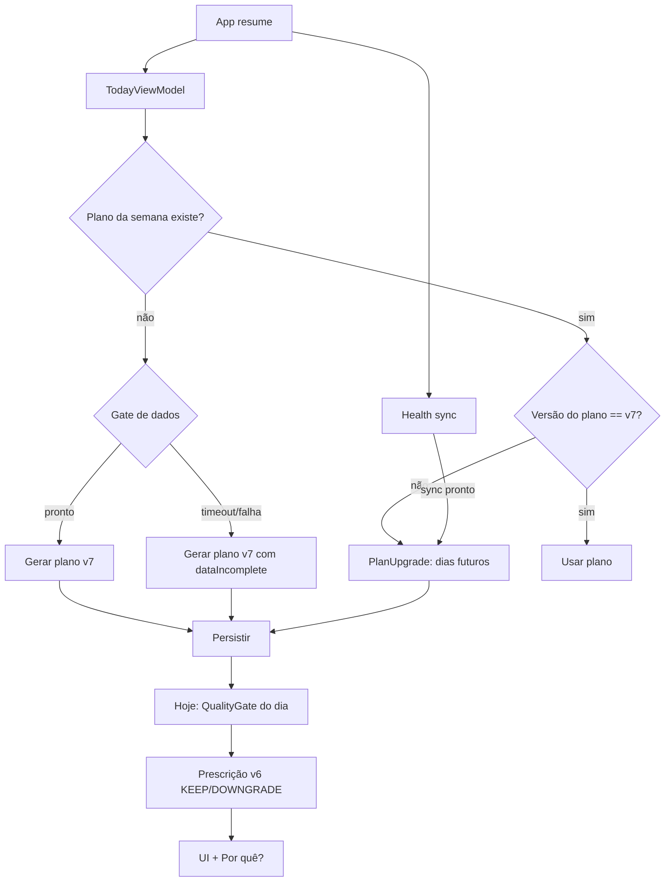

# PRD — Treino real: da manutenção à prescrição que desenvolve

**Versão:** 1.1 · **Data:** 16/11/2026 · **Status:** aprovado pelo usuário 0 em 16/11/2026 (12 decisões; ver §11.5) — pronto para virar tasks
**Changelog:** 1.0 proposto; 1.1 registra as 12 decisões aprovadas, a política do iniciante (strides + fartlek leve como `EASY`) e a evolução dinâmica do pace.
**Ciclo:** 4 — Treino real (qualidade, progressão e confiança no plano)
**Escopo:** `core:domain`, `core:data`, `:app` (orquestração, persistência e UI estritamente necessária) e documentação/ADRs.
**Fora de escopo:** backend, sync, LLM, nutrição, musculação, social, gravação GPS nativa, reescrita visual ampla e novos gráficos.
**Relação com o ciclo 3:** este PRD não substitui o ciclo 3 (briefing, execução, prova e recuperação). Ele corrige o **motor de decisão semanal/diário** que hoje impede o ciclo 3 de entregar treino forte de verdade.

### Mapa do documento

| Seção | Conteúdo |
|---|---|
| §0 | Ficha, método, limitações e convenções |
| §1 | Sumário executivo, tese, apostas e decisões pedidas |
| §2 | Diagnóstico P-01..P-13 com evidência |
| §3 | Objetivos e métricas locais |
| §4 | Princípios e restrições |
| §5 | Modelo conceitual (oportunidade, estrutura, gates, carga, volume) |
| §6 | Requisitos funcionais FR-401..FR-413 |
| §7 | Arquitetura, schema v18, versionamento e rollout |
| §8 | Explicabilidade, códigos e copy |
| §9 | Matriz de testes e goldens |
| §10 | Rollout, migração e rollback |
| §11 | Riscos, alternativas e questões abertas |
| §12 | Backlog C4-01..C4-60 e Definition of Done |
| §13 | Anexos (fórmulas, matriz, goldens, referências) |
| §14 | Aprovação |

---

## 0. Ficha, método e convenções

### 0.1 Origem

Este documento nasce de uma auditoria do motor de treino feita em 16/11/2026, combinando:

- leitura do código de `core:model`, `core:domain`, `core:data` e dos pontos de orquestração do `:app`;
- leitura da documentação de ciência, produto, arquitetura, testes e ADRs 0023, 0024, 0026, 0028, 0038, 0041, 0042 e 0043;
- reprodução do comportamento real do motor com um cenário sintético equivalente ao do usuário 0 (3 dias × 40 min, dois fáceis, um longão, 2 semanas de histórico e 8 dias de carga em 28);
- validação somente leitura do banco do aparelho, fora do repositório, sem persistir dados de saúde no git. O banco temporário foi apagado após a análise.

O objetivo não é “deixar o app mais permissivo”. É fazer o app **tentar prescrever o estímulo certo toda semana**, explicar quando não consegue e parar de esconder limites reais atrás de um plano que parece conservador, mas na prática é imutável.

### 0.2 O que foi auditado

| Camada | O que foi examinado |
|---|---|
| `core:model` | `AthleteProfile`, `WeeklyAvailability`, `DailyMetrics`, `DailyCheckIn`, `CompletionEvidence`, `RaceEvent` |
| `core:domain/prescription` | `WeeklyPlanGenerator`, `DailyPrescriptionEngine`, `SessionLibrary`, `MesoCycle`, `MacroPlan`, `VolumeProgression`, `LevelGraduationEngine`, `PrescriptionTargets`, `SessionSwapper` |
| `core:domain/load` | `TrainingLoadEngine`, `TrainingLoadCalculator`, `LoadSnapshot`, `LoadCoverage`, `ActivitySourceStatus` |
| `core:domain/readiness` | `ReadinessCalculator`, `DailyMetricsReadinessBuilder`, `ReadinessResult`, flags e pesos |
| `core:domain/health` | `HealthMetricsAggregator` e agregação de sono |
| `core:domain/replan` | `PlanReplanner`, `PlanningFingerprint`, `ReplanModels` |
| `core:data` | `TrainingPlanRepository.saveWeek`, entidades, serialização de plano/prescrição, schema v17 |
| `:app` | `TodayViewModel` (geração do plano), `GetTodayPrescription`, `CheckInViewModel`, `HealthSyncCoordinator`, `MeuCoachApp` |
| Testes | `WeeklyPlanGeneratorTest`, `DailyPrescriptionEngineTest`, `VolumeProgressionTest`, `ReadinessCalculatorTest`, `LevelGraduationEngineTest` |

### 0.3 Limitações explícitas

- Não foram executados builds, lint, Kover, Roborazzi nem a suíte completa nesta auditoria. Os gates citados são os do `docs/PROGRESS.md` de 16/11/2026 (app 881, domain 774, spotless/kover/lint/detekt verdes).
- O comportamento em aparelho foi observado para o cenário real do usuário 0, mas não é reproduzido com dados brutos neste documento.
- As estimativas de esforço são para um desenvolvedor assistido por agente, sem prazo externo.
- Números de linha são indicativos do commit de 16/11/2026; o nome do arquivo e o símbolo valem mais que a linha.

### 0.4 Convenções

- **[FATO]**: verificado no código ou nos dados.
- **[HIPÓTESE]**: inferência plausível, a validar.
- **[RECOMENDAÇÃO]**: decisão proposta por este PRD.
- **Prioridade:** P0 bloqueia a sensação de treino real; P1 alta; P2 média; P3 baixa.
- **Esforço:** S (até 2 dias), M (3–5 dias), L (1–2 semanas), XL (2–4 semanas), para um desenvolvedor com agente.
- **Confiança:** alta, média ou baixa.
- **Regra:** todo comportamento novo cita `ruleId`, `evidenceIds` e confiança; nada de número inventado.
- **Dado ausente:** é `null` ou “não medido”, nunca `0` silencioso; ausência reduz confiança e não pode liberar mais agressividade.

### 0.5 Privacidade

Este PRD usa **cenários sintéticos** para reproduzir o problema. Nenhum dado de saúde real (FC, sono, HRV, arquivos FIT/TCX/GPX, prints ou export) entra no repositório, em issues, em logs ou em prompts. O cenário do usuário 0 é descrito apenas por parâmetros de configuração e de plano (dias, minutos, títulos, contagens), que já são públicos nos documentos de produto.

---

## 1. Sumário executivo

### 1.1 O problema

O app foi construído para ser conservador. A intenção está certa: o usuário 0 corre forte demais nos dias fáceis (a distribuição real é ~13% fácil / ~87% moderado-forte, o oposto de 80/20). O motor, porém, foi ficando **conservador em camadas** e perdeu a capacidade de **tentar** um estímulo forte:

1. O plano semanal decide a qualidade com a prontidão e a carga da **segunda-feira**. Se a segunda está âmbar, a semana inteira nasce sem qualidade. A sexta pode estar verde e nada muda.
2. O plano é gerado antes de o Health Connect terminar de sincronizar. Em um caso real, o plano foi salvo **8 minutos antes** de as métricas do dia chegarem. A razão declarada foi “prontidão não está verde”; no dia seguinte a prontidão era verde, mas o plano já estava congelado.
3. Com 3 dias × 40 min, o “longão” é cortado para **34 min** — menor que os dias fáceis de **40 min** — porque a regra de 25–30% é aplicada como teto rígido, sem piso efetivo e sem preferência pelo fim de semana.
4. O catálogo de qualidade do intermediário é só **“Ritmo forte” contínuo**. Intervalado, fartlek e colinas não existem no catálogo para ele. Fartlek não existe para ninguém.
5. Para virar `ADVANCED` e destravar intervalado, o motor exige um **longão de 90 min**; o plano nunca passa de 34. O ciclo não fecha.
6. O ACWR é usado como veto duro no dia com limite **1,3**, enquanto a documentação fala **1,5** e o gerador semanal permite a primeira qualidade com ACWR alto. Com 8 dias de carga em 28, o ACWR é matematicamente instável e pode ir de 1,75 a 0,41 em quatro dias sem treinar.
7. O check-in padrão **3/3/3/3** dá 50/100 no componente subjetivo (35% do peso) e derruba a prontidão para âmbar; **não fazer check-in** renormaliza os pesos e sobe a prontidão. O app recompensa não responder.
8. Uma noite de **36 min** no Health Connect (sessão parcial) é tratada como noite real: zera o sono, liga `SHORT_SLEEP` e bloqueia qualidade.
9. Treino extra conta como **carga** (aumenta ACWR) mas não conta como **volume** (não entra na base de progressão). Quanto mais o usuário treina por fora, mais o app o segura.
10. Pace fácil e FC fácil discordam: pace E 7:52–8:49/km vs FC Z2 137–151 bpm. No cenário, o atleta corre em um pace mais rápido que a faixa E, mas dentro da FC Z2. O app mostra os dois sem dizer qual prevalece.

O resultado é um **“no-man’s land”**: volume fácil baixo demais para construir uma base grande, e qualidade quase zero para desenvolver VO2max/limiar. O usuário sente que o app não o treina; a sensação é correta.

### 1.2 A tese

**O plano deve ser uma intenção viva, não um snapshot congelado.** A semana deve nascer com uma **oportunidade de qualidade estrutural** sempre que o nível, a fase e a agenda permitirem. O **dia** confirma ou rebaixa, com a prontidão e a carga daquele dia. O plano não precisa adivinhar na segunda se a sexta será verde; ele precisa garantir que a sexta **tenha** uma qualidade para confirmar.

Essa mudança resolve o problema principal sem afrouxar a segurança:

- Se a sexta estiver verde e a carga permitir → qualidade mantida.
- Se a sexta estiver âmbar, sem check-in, com sono curto ou carga alta → fácil, com motivo e “o que fazer para liberar”.
- O usuário vê que o app **tentou** toda semana, em vez de ver uma semana inteira de fácil sem explicação.

### 1.3 As cinco apostas

1. **Oportunidade de qualidade (Quality Opportunity).** Separar elegibilidade estrutural (plano) de elegibilidade do dia (prescrição). A primeira qualidade é sempre agendada quando há estrutura; o dia decide.
2. **Longão de verdade.** Piso de 45 min para iniciante/intermediário e 60 para avançado, preferência por sábado/domingo, longão nunca menor que o fácil mais longo, e título honesto (“Corrida mais longa”) quando a agenda não permite o piso.
3. **Catálogo de qualidade por fase/nível/distância.** Intervalado, fartlek, colinas e pace de prova para o intermediário em `BUILD`/`PEAK`; `PEAK` deixa de ser cópia do `BUILD`; o iniciante recebe strides e fartlek leve como `EASY` após 4 semanas consistentes, com `R-PRESC-04` bloqueando apenas o intervalado estruturado.
4. **Carga confiável e dia reavaliável.** ACWR com limite documentado (1,5), flag de confiabilidade (28 dias de histórico), sem veto quando o número é instável; volume só cresce com ACWR confiável; o dia é reavaliado quando o check-in/carga mudam, antes de a sessão ser concluída.
5. **Dados e explicação honestos.** Plano gerado depois do sync (ou com `dataIncomplete` explícito), check-in sem default enganoso, sono implausível ignorado, treino extra creditado e cada bloqueio com código, valor, motivo e dica de desbloqueio.

### 1.4 Decisões que este PRD pede

Estas são as decisões que precisam de aprovação antes da implementação. O detalhe e as alternativas estão no §11.

1. **Oportunidade de qualidade estrutural**: a primeira qualidade da semana existe por estrutura; o dia confirma/rebaixa. A segunda continua condicionada à progressão.
2. **Longão**: piso de 45 min (iniciante/intermediário) e 60 (avançado); nunca menor que o fácil mais longo; abaixo do piso, “Corrida mais longa” + sugestão de agenda.
3. **Catálogo**: intermediário recebe intervalado, fartlek e colinas em `BUILD`/`PEAK`; `PEAK` é específico; o iniciante recebe **strides + fartlek leve como `EASY`** após 4 semanas consistentes, mas não intervalado estruturado; a graduação deixa de ser a porta do intervalado.
4. **Carga**: ACWR 1,5 em todos os caminhos; só veta qualidade quando confiável (28 dias); não confiável não veta; progressão exige confiável e 0,8–1,3.
5. **Prontidão**: check-in ausente não libera qualidade; 3/3/3/3 não é default; check-in tardio pode restaurar a qualidade antes da conclusão.
6. **Sono**: noite <3 h ou sessão parcial é ausente, não curta; noite válida <6 h continua bloqueando.
7. **Volume**: atividade forte não planejada conta para volume/graduação; não conta para adesão; `LEGACY` do mesmo dia reparável com confirmação.
8. **Dados/rollout**: schema v18 aditivo, `generatorVersion`, `PlanUpgrade` idempotente na semana vigente, histórico intocado.

### 1.5 O que não fazer

- Não usar LLM para decidir carga, pace ou plano.
- Não criar backend, sync, social, nutrição ou musculação.
- Não reescrever a UI inteira; só o Hoje/Plano/Por quê e o check-in.
- Não inventar meta de prova como prescrição de pace.
- Não remover os guardrails de segurança (doença, dor, prontidão vermelha, sono curto, recuperação pós-prova, taper).
- Não compensar treino perdido com carga extra.
- Não promover `LEGACY_UNVERIFIED` em massa; só reparar o caso de import no mesmo dia, com confirmação.
- Não usar `fallbackToDestructiveMigration`.
- Não adicionar dependência sem justificativa.

---

## 2. Diagnóstico

### 2.1 Cenário sintético de reprodução

Para evitar dados reais, o PRD usa o seguinte cenário, que reproduz o comportamento observado:

| Item | Valor |
|---|---|
| Perfil | `INTERMEDIATE`, sem prova ou com prova de 5 km distante |
| Disponibilidade | Ter 40, Sex 40, Dom 40 |
| Plano da semana | 3 sessões, 114 min, 0 qualidade |
| Sessões | Ter “Longão” 34, Sex “Fácil” 40, Dom “Fácil” 40 |
| Histórico | 2 semanas de plano; 8 dias com carga em 28 |
| Prontidão | Segunda âmbar; terça/sexta verdes |
| Check-in | 3/3/3/3 no dia da decisão |
| Carga | ACWR 1,75; monotonia 1,14; strain próximo do limite |

Esse cenário é suficiente para reproduzir os problemas abaixo. Ele não contém FC, sono, HRV, coordenadas ou arquivos de saúde.

### 2.2 Os problemas

#### P-01 — O plano congela a qualidade na segunda-feira

**FATO.** `WeeklyPlanGenerator` usa uma única `ReadinessResult` e um único `LoadSnapshot` para decidir `qualityAllowed` da semana inteira (`WeeklyPlanGenerator.kt:240-245`). `TodayViewModel` gera o plano na primeira composição e o persiste; depois usa o plano salvo (`TodayViewModel.kt:197-225`). O `PlanReplanner` não tem gatilho de prontidão/carga (`PlanReplanner.kt:36-77`) e não pode adicionar qualidade além da intenção futura (`PlanReplanner.kt:120-135`).

**Consequência.** Segunda âmbar = semana inteira sem qualidade, mesmo com terça/sexta verdes. É exatamente o que aconteceu no cenário real: o plano da semana declarou “prontidão não está verde” e a semana teve dias verdes depois.

**Por que os testes não pegam.** Os testes do gerador cobrem “âmbar bloqueia qualidade” e “verde permite qualidade”, mas não cobrem “segunda âmbar + sexta verde”. O comportamento atual é considerado correto pela suíte.

#### P-02 — O plano é gerado antes dos dados chegarem

**FATO.** No cenário real, o plano da semana foi salvo às 16:27:18; as métricas do dia anterior chegaram às 16:35:27 (8 min depois) e as do próprio dia às 16:27:55 (37 s depois). O `HealthSyncCoordinator.syncOnResume()` é disparado no `LifecycleResumeEffect` (`MeuCoachApp.kt:133-140`) em paralelo com a composição do Hoje. O `TodayViewModel` não espera o sync.

**Consequência.** O plano é decidido com dados incompletos. O usuário vê “prontidão não está verde” ou “faltam dados de carga” e perde a semana. O plano não é reavaliado quando os dados chegam.

#### P-03 — O “longão” é menor que o fácil

**FATO.** `maxLong = maxOf(30, easyMinutes × 3/7)` e `min(sessão, maxLong)` (`WeeklyPlanGenerator.kt:473-483`). Com dois fáceis de 40, o longão vira 34. O teste `builds a conservative beginner week` fixa um longão de **30 min** com sábado de **90 min** disponíveis (`WeeklyPlanGeneratorTest.kt:45`). O `ADR 0038` reconhece que “em semanas muito pequenas o piso vence”, mas o piso é 30 e o fácil é 40.

**Consequência.** O app chama de “Longão” uma corrida que não é a mais longa da semana e não desenvolve resistência. O `SPORTS_SCIENCE.md` §8.5 fala em 45–90 min para iniciantes; o §8.8 fala em “dia mais longo disponível”. O código não cumpre nenhum dos dois.

#### P-04 — Intermediário só tem “Ritmo forte” contínuo; intervalado é privilégio de avançado

**FATO.** `SessionLibrary` mapeia `INTERMEDIATE` para `QualityKind.CONTINUOUS` em `BUILD` e `PEAK`; `ADVANCED` recebe `INTERVALS` (`SessionLibrary.kt:79-105`). `QualityKind` só tem `STRIDES_ONLY`, `CONTINUOUS`, `INTERVALS` (`:15-19`). Não existe `FARTLEK`, `HILLS` ou `RACE_PACE`. O `PEAK` do intermediário é idêntico ao `BUILD`.

**Consequência.** O usuário nunca vê intervalado, fartlek ou colinas. O `SPORTS_SCIENCE.md` §8.4 lista cinco tipos de qualidade; o código implementa três e o intermediário acessa um. O §6.4 fala em polarizado/pirâmide para intermediário; o código entrega só tempo contínuo.

#### P-05 — A graduação para avançado exige o que o plano não entrega

**FATO.** `LevelGraduationEngine` exige longão de 60 min na base e 90 min no avançado (`LevelGraduationEngine.kt:166-190,259-266,330,396`). O plano máximo é 34 min. O `PROGRESS.md` registra `Stay` com `missing = [strong_weeks, long_run, ctl, long_run_90, race, monotony]`.

**Consequência.** O ciclo é fechado: sem intervalado porque não é avançado; sem avançado porque não tem longão de 90; sem longão de 90 porque a disponibilidade e o corte de 25–30% limitam a 34. A única saída seria o usuário aumentar a disponibilidade; o app não oferece um caminho interno.

#### P-06 — ACWR: 1,3 no motor diário, 1,5 no documento, 1,5 no recomendador

**FATO.** `DailyPrescriptionEngine` bloqueia qualidade com `acwr > 1.3` (`DailyPrescriptionEngine.kt:74,601`). `WeeklyPlanGenerator` só usa 1,3 para a segunda qualidade/progressão (`:239,994-995`). `WorkoutRecommender` usa 1,5 (`:269`). `SPORTS_SCIENCE.md` fala 1,5 (`:174,336`). Com 8 dias de carga em 28, o ACWR inclui dias anteriores ao primeiro import como se fossem descanso, inflando o valor.

**Consequência.** O dia rebaixa qualidade que o plano agendou; o usuário vê “sua carga subiu rápido” quando o número é um artefato de janela incompleta. O mesmo atleta, sem treinar, sai de 1,75 para 0,41 em quatro dias.

#### P-07 — Check-in padrão 3/3/3/3 e a inversão de incentivo

**FATO.** `CheckInForm` abre com 3 em tudo (`CheckInViewModel.kt:20-23`). O componente subjetivo é `(20 − Hooper)/16 × 100` (`ReadinessCalculator.kt:94-95`); 3/3/3/3 = 50. O subjetivo pesa 35% (`:11-17`). Sem check-in, os pesos são renormalizados e a prontidão pode subir.

**Consequência.** O usuário que aceita o default entrega “moderado” e bloqueia qualidade; o usuário que não faz check-in fica mais verde. O app pune a resposta honesta e recompensa a omissão.

#### P-08 — Sono de 36 min trata o artefato como noite real

**FATO.** `HealthMetricsAggregator.sleepByDate` soma as sessões de sono e aceita qualquer duração (`:58-96`). `DailyMetricsReadinessBuilder` usa a última noite (`:27-33`). `ReadinessCalculator.sleepScore` dá 0 para ≤300 min e `SHORT_SLEEP` para <360 (`:56-62,97-107`).

**Consequência.** Uma sessão parcial de 36 min zera o sono e bloqueia qualidade. O app não distingue “noite curta” de “dado ruim”.

#### P-09 — Treino extra conta como carga, não como volume

**FATO.** `TrainingLoadEngine` inclui todas as atividades (`:360-419`). `VolumeProgression.completedVolumeMinutes()` soma apenas `durationMin` de sessões `DONE` planejadas com evidência forte (`:183-194`). `MesoCycle.isLoadWeek` olha o plano (`:40-44`). `LevelGraduation.hasLongRun` olha sessões planejadas (`:259-266`).

**Consequência.** Uma corrida extra aumenta o ACWR e a fadiga, mas não aumenta a base nem conta para a graduação. Quanto mais o usuário treina por fora, mais o app o segura. O primeiro longão do cenário real ficou `LEGACY_UNVERIFIED` e não contou como semana forte.

#### P-10 — Pace fácil e FC fácil discordam sem precedência

**FATO.** `PrescriptionPolicy.easyTargets` retorna pace E (VDOT) e FC Z2 (LTHR) (`:86-107`). `SessionBriefingEngine` diz “se usar o ritmo… se usar a FC…” (`:68-90`), sem escolher. No cenário, o pace E é 7:52–8:49/km e a FC Z2 é 137–151 bpm; o atleta corre em um pace mais rápido que a faixa E, mas dentro da FC Z2.

**Consequência.** O usuário não sabe qual alvo seguir. Seguindo o pace, corre abaixo da FC que já está em Z2; seguindo a FC, corre acima do pace prescrito. A sensação de “o app não sabe o que quer” aumenta.

#### P-11 — O bloco específico de 5K começa tarde

**FATO.** O `MacroPlanResolver` usa horizonte de 8 semanas para 5k/10k (`MacroPlan.kt:151`). Com uma prova a 26 semanas, o app passa ~18 semanas em modo geral, sem `PEAK` e sem trabalho específico. O `SPORTS_SCIENCE.md` §8.1 prevê 12–19 semanas de preparação (base + build + peak + taper).

**Consequência.** O usuário espera um plano de 5K e recebe manutenção. A meta de 28:00 (VDOT ~33,5) fica sem o trabalho específico que poderia fechá-la.

#### P-12 — Copy contraditória

**FATO.** O rationale pode dizer “Sem progressão até existir histórico de conclusão” mesmo com a semana anterior 3/3 concluída, e “carga recente fora da faixa” na mesma frase (`WeeklyPlanGenerator.kt:628-633`). O texto é derivado de condições independentes, sem um código de decisão único.

**Consequência.** O usuário lê um motivo que não corresponde ao que aconteceu; a confiança no “Por quê?” cai.

#### P-13 — `createdAt` do plano não é estável

**FATO.** `TrainingPlanRepository.saveWeek` grava `createdAt = clock.millis()` em toda gravação (`:144-170`). O campo deixa de significar “criação” e passa a significar “última gravação”. O plano de 02/11 tem `createdOn=02/11` e `createdAt=03/11 16:27`.

**Consequência.** Auditoria, `isLoadWeek` e diagnóstico de geração ficam ambíguos. É um achado menor de integridade, mas fácil de corrigir.

### 2.3 O que o motor acerta

1. **O diagnóstico de intensidade.** 13% fácil / 87% moderado-forte é o oposto de 80/20. O app está certo em desacelerar os dias fáceis.
2. **Os guardrails de segurança.** Doença, dor, prontidão vermelha e sono < 6 h devem bloquear qualidade. O erro é o baseline não terminar.
3. **A periodização, taper e recuperação.** `MesoCycle`, `RecoveryWindow`, `R-PLAN-05/10` e `R-RACE-04` são peças sólidas; não são o problema.
4. **A explicabilidade.** `ruleIds`, `evidenceIds`, confiança e rationale já existem. Falta a decisão certa para explicar.
5. **A qualidade de engenharia.** 774 testes de domínio, ~97% de cobertura, motor determinístico. O problema é **spec**, não falta de teste.

### 2.4 Por que correções pontuais não bastam

- Corrigir só o longão deixa a semana sem qualidade.
- Corrigir só o ACWR deixa o plano congelado na segunda.
- Corrigir só o catálogo deixa o intermediário sem longão e sem qualidade agendada.
- Corrigir só o check-in deixa o plano gerado antes do sync.
- A sensação do usuário é o **produto** dessas camadas; o PRD precisa atacá-las em conjunto, com uma ordem de implementação.

---

## 3. Objetivos e métricas

### 3.1 Objetivo de produto

Fazer o usuário sentir, em **toda semana elegível**, que o app:

1. tentou prescrever um estímulo forte;
2. explicou com precisão quando não deu;
3. mostrou o que fazer para liberar;
4. não o chamou de “longão” quando era só uma corrida fácil;
5. não o puniu por treinar por fora;
6. não o enganou com dados ruins.

### 3.2 Objetivos do motor

| Objetivo | Critério |
|---|---|
| **O-01** | Toda semana estruturalmente elegível tem 1 oportunidade de qualidade (2 quando a progressão permitir). |
| **O-02** | O dia confirma ou rebaixa a oportunidade com base na prontidão/carga **do dia**, nunca na segunda. |
| **O-03** | O longão é a sessão mais longa da semana; piso de 45 min (iniciante/intermediário) ou 60 (avançado) quando a agenda permitir. |
| **O-04** | O intermediário recebe intervalado, fartlek e colinas em `BUILD`/`PEAK`; `PEAK` tem trabalho específico da distância. |
| **O-05** | A graduação não é a única porta para intervalado; o nível controla volume/frequência/complexidade, não o direito ao estímulo. |
| **O-06** | ACWR só veta qualidade quando é confiável (28 dias de histórico) e > 1,5; quando não é confiável, não veta. |
| **O-07** | Check-in ausente não libera qualidade; check-in 3/3/3/3 não é default; o app não recompensa omitir. |
| **O-08** | Sono implausível (<3 h ou sessão parcial) é tratado como ausente, não como noite curta. |
| **O-09** | Atividade forte não planejada conta para volume/graduação; não conta para adesão ao plano. |
| **O-10** | Plano gerado com dados prontos ou com `dataIncomplete` explícito; upgrade de motor reavalia a semana vigente sem reescrever o passado. |
| **O-11** | Todo bloqueio de qualidade tem código, valor, motivo e dica de desbloqueio. |
| **O-12** | Determinismo: mesmos inputs + mesma versão ⇒ mesma saída. |

### 3.3 Métricas de sucesso (locais, sem analytics)

As métricas são calculadas em testes/goldens e, opcionalmente, em um diagnóstico local. Não há telemetria externa.

| Métrica | Meta |
|---|---|
| Semanas elegíveis com ≥1 oportunidade de qualidade | 100% |
| Oportunidades mantidas no dia quando a prontidão está verde e a carga elegível | ≥ 90% |
| Longão é a sessão mais longa da semana | 100% |
| Longão ≥ 45 min quando o dia mais longo tem ≥45 min | 100% |
| Planos gerados com `dataIncomplete=false` | ≥ 95% (o resto explícito e reavaliado) |
| Veto de qualidade por ACWR não confiável | 0 |
| Qualidade liberada sem check-in | 0 |
| Noites <3 h tratadas como curtas | 0 |
| Atividades fortes não planejadas creditadas no volume | 100% |
| Bloqueios de qualidade com código + dica | 100% |
| Cobertura de testes dos novos algoritmos | ≥ 95% de branches |
| Regressão de testes existentes | 0 falhas |

### 3.4 Não-objetivos

- Aumentar a disponibilidade do usuário; o código pode **declarar** o limite e sugerir o ajuste, mas não pode inventar tempo.
- Garantir que o usuário execute a qualidade; o app prescreve, o usuário decide.
- Substituir avaliação médica, nutricionista ou treinador humano.
- Prescrever musculação, nutrição ou emagrecimento.
- Implementar a sessão guiada persistente (ciclo 3).
- Criar um plano de 26 semanas completo neste ciclo; o foco é o motor semanal/diário.
- Otimizar performance de UI/Story; não é o gargalo.

---

## 4. Princípios e restrições

### 4.1 Arquiteturais

1. `core:model` e `core:domain` são Kotlin/JVM puro; sem Android, Room, Compose, Hilt ou rede.
2. A UI não calcula regra de treino; ViewModels expõem estado; o cálculo fica no domínio/use case.
3. Features não dependem de features; o `:app` orquestra.
4. Toda entrada externa é adapter; o motor recebe o modelo canônico.
5. Toda recomendação cita `ruleId`, `evidenceId` e confiança.
6. O motor é determinístico; nada de `now()` dentro do domínio (usar `Clock`/`TimeProvider` na borda).
7. Plano = intenção; prescrição diária persistida = autoridade do dia (`ADR 0023`).
8. Conclusão não é clique; `ACTIVITY`/`GUIDED` são evidência forte; `MANUAL`/`LEGACY` não liberam progressão (`ADR 0024`).
9. Dado ausente é `null`, nunca `0`; confiança cai, agressividade não sobe.
10. Sem migração destrutiva; schema versionado e testado.
11. Sem dependência nova sem justificativa de peso, licença e manutenção.

### 4.2 Científicas

1. 80/20 é heurística, não dogma; a distribuição é medida em **tempo**, não em contagem de sessões.
2. Iniciante prioriza base; intervalado estruturado é permitido ao intermediário em `BUILD`/`PEAK`, com dose conservadora.
3. O longão é a sessão mais longa da semana; o piso é uma dose mínima efetiva, não uma progressão.
4. O pace de prova prescrito deriva da **previsão atual** (VDOT), não da meta declarada; a meta é referência (`R-RACE-02/03`).
5. ACWR é flag soft; não é meta nem lei. A crítica de Impellizzeri é explícita no repositório.
6. O check-in subjetivo é dado de primeira classe; ausência não é recuperação ruim, mas também não é liberação.
7. Sono é limitador de treino; dado implausível não é noite curta.
8. Toda regra nova cita evidência; quando é convenção de produto, declara `LIMITED`.

### 4.3 Segurança

- Doença, lesão, dor, prontidão vermelha e sinais de alerta continuam bloqueando.
- Sono < 6 h (válido) continua bloqueando qualidade.
- Recuperação pós-prova e taper continuam prevalecendo.
- Nenhuma mudança pode aumentar o risco de lesão/overtraining.
- A qualidade nunca é prescrita em dia de recuperação, semana de prova, taper ou lesão.
- O app continua não diagnosticando.

### 4.4 Produto

- Sem culpa, streak ou notificação passivo-agressiva.
- Uma decisão por dia; a mesma em todas as telas.
- O usuário pode recusar, mover ou substituir um treino; o app registra e recalibra.
- A explicação é curta no card e detalhada em “Por quê?”.
- A interface em pt-BR; código em inglês.
- Alvos de 48 dp, contraste AA, TalkBack, dark/light.

---

## 5. Modelo conceitual

### 5.1 Plano = intenção; dia = autoridade

O plano semanal responde **“qual é a intenção da semana?”**. A prescrição diária responde **“o que eu faço hoje?”**. O plano não promete que a qualidade será executada; ele garante que a semana **tem uma oportunidade** de qualidade. O dia confirma ou rebaixa com os dados do dia.

Isso não viola `ADR 0023`; pelo contrário, restaura a separação. O erro atual é o plano tentar decidir o dia na segunda.

### 5.2 Oportunidade de qualidade (`QualityOpportunity`)

Uma oportunidade é uma sessão planejada do tipo `QUALITY` com:

- `date`: o dia escolhido;
- `role`: `QUALITY_MAIN` ou `QUALITY_SECOND`;
- `kind`: `CONTINUOUS`, `INTERVALS`, `FARTLEK`, `HILLS`, `RACE_PACE`;
- `structure`: a estrutura detalhada (aquecimento, blocos, recuperação, volta à calma);
- `structuralReason`: por que aquele dia foi escolhido;
- `status`: `PLANNED` (o dia decide), `DONE`/`CLOSED` (histórico);
- `planDecision`: por que a oportunidade existe ou não.

A oportunidade **não** carrega a prontidão da segunda. Ela é estrutural. A confirmação é feita pelo `QualityGate` no dia.

### 5.3 Estrutura da sessão (`WorkoutStructure`)

Para prescrever intervalado/fartlek de verdade, o app precisa de uma estrutura, não só de um texto. A estrutura é opcional em sessões fáceis e obrigatória em qualidade.

```
WorkoutStructure(
  version: 1,
  warmupMin: 10,
  blocks: [
    WorkoutBlock(
      kind: WORK,
      repetitions: 5,
      workSec: 180,
      recoverySec: 120,
      target: "I",            // E/M/T/I/R/Z2..Z5/GOAL_5K/RPE
      note: "3 min fortes, 2 min leves"
    )
  ],
  cooldownMin: 5,
  totalMin: 40
)
```

Regras:

- `totalMin` = duração da sessão.
- A soma de aquecimento + blocos + recuperações + volta à calma não pode exceder `totalMin`.
- Nunca prometer mais trabalho do que cabe.
- O bloco principal tem alvo objetivo quando há calibração; senão RPE.
- A estrutura é serializada em `structureJson` (schema v18) e é retrocompatível: linhas antigas têm `null`.
- O briefing e a UI usam a estrutura; o rationale continua existindo como resumo.

### 5.4 Elegibilidade de qualidade (`QualityGate`)

O `QualityGate` é uma função pura que recebe a sessão planejada, a prontidão, a carga, a recuperação, o perfil e a data e devolve:

```
QualityEligibility(
  eligible: Boolean,
  reason: QualityBlockReason?,
  detail: String?,
  ruleId: String,
  evidenceIds: List<String>,
  unlockHint: String?
)
```

Precedência determinística (primeiro que falha vence):

1. Doença/lesão ou prontidão vermelha → `ILLNESS_OR_RED_READINESS`.
2. Iniciante com qualidade planejada → `BEGINNER_GUARD` (`R-PRESC-04`).
3. Check-in subjetivo ausente → `SUBJECTIVE_MISSING` (`R-READY-06`).
4. Sono válido < 6 h → `SHORT_SLEEP` (`R-READY-04`).
5. Recuperação pós-prova / taper / semana de prova → `RECOVERY_WINDOW` / `TAPER_WINDOW` / `RACE_WEEK`.
6. Fonte de carga desatualizada → `LOAD_STALE`.
7. Carga objetiva insuficiente → `LOAD_INSUFFICIENT`.
8. Monotonia ≥ 2,0 → `MONOTONY_HIGH`.
9. Strain spike confiável → `STRAIN_SPIKE`.
10. ACWR confiável > 1,5 → `ACWR_HIGH`.
11. Caso contrário → elegível.

O `QualityGate` **não** olha a prontidão da segunda. Ele olha o dia. O plano só faz a checagem estrutural:

1. Fase/nível/período (taper/recovery/race week) permite?
2. Há pelo menos 3 dias de treino?
3. Há um dia seguro, não adjacente ao longão e com espaçamento entre qualidades?
4. O número máximo de qualidades da semana foi respeitado?

### 5.5 Carga confiável (`acwrReliable`)

O ACWR só é usado para veto de qualidade quando:

- a fonte está fresca;
- a janela de 28 dias está **inteiramente coberta** por histórico (nenhum dia antes do primeiro import);
- todos os dias da janela são classificáveis como “com carga” ou “descanso observado” (sem dias “sem dado”);
- a carga é objetiva (`TRIMP`/`rTSS`), não só sRPE.

Se não for confiável:

- o ACWR pode ser exibido como “em calibração”;
- não veta qualidade;
- não libera progressão de volume;
- a decisão usa prontidão, monotonia, strain (se confiável) e os demais gates.

### 5.6 Referência de volume (`VolumeReference`)

Para creditar treino real sem contar clique, o motor recebe uma projeção de execução por semana:

```
VolumeReference(
  weekStart: LocalDate,
  plannedMinutes: Int?,
  executedMinutes: Int,      // todas as atividades fortes (importadas)
  strongMinutes: Int,        // atividades com evidência forte
  strongSessions: Int,
  plannedSessions: Int,
  createdOn: LocalDate?,     // plano criado na segunda?
  specialWeek: Boolean       // deload/taper/recovery/race
)
```

- A base de volume usa `strongMinutes` (executado), não `plannedMinutes`.
- A adesão ao plano continua usando as sessões planejadas
  (`strongCompletionRatio` do `WeeklyPlan`), não `strongSessions` da referência:
  `strongSessions` conta também o treino extra. Treino extra não infla adesão.
- `createdOn == weekStart` continua sendo a regra para uma semana ser referência comparável; plano criado no meio da semana não conta.
- O `VolumeReference` é construído na borda (`:app`/`core:data`) a partir de `WeeklyPlan` + atividades; o domínio continua puro.

---

## 6. Requisitos funcionais

### FR-401 — Oportunidade de qualidade estrutural

**Problema:** P-01, P-02.

**Comportamento desejado:**

- Toda semana com `experience != BEGINNER`, pelo menos 3 dias, fora de taper/recovery/race week, com um dia seguro, agenda **1 oportunidade de qualidade**.
- Uma segunda oportunidade só quando: `previousWeekStrongRatio >= 0.80`, `days >= 4`, `acwrReliable && acwr ∈ [0.8, 1.3]`, sem taper.
- A oportunidade é uma `PlannedSession` do tipo `QUALITY`, com `kind` e `structure`.
- O plano não usa prontidão/carga da segunda para decidir a existência da **primeira** oportunidade; usa apenas a estrutura.
- A **micro-dose de taper** (`R-PLAN-05/10`) também é estrutural: a semana de taper/race week sempre tem 1 micro-dose ≤25 min quando há um dia elegível; não depende da prontidão da segunda. O dia pode rebaixar por segurança, mas o plano não nasce com zero estímulo.
- O dia confirma/rebaixa via `QualityGate`.
- O plano pode dizer “Qualidade planejada para sexta; o dia confirma”.
- Se o dia rebaixar, a sessão planejada continua `QUALITY` no histórico; a prescrição prescrita é `EASY`; o vínculo com a atividade é preservado.
- `WeeklyPlan.qualityCount` passa a significar **oportunidades**, não sessões confirmadas. A UI e o review distinguem “planejada / mantida / rebaixada / não feita”.

**Algoritmo:**

```
structuralEligible =
  experience != BEGINNER &&
  days.size >= 3 &&
  phase !in {TAPER, RECOVERY} &&
  !raceWeek &&
  qualityCandidateDays.isNotEmpty()

maxQualities =
  if (secondQualityAllowed) 2 else 1

qualityDays = selectQualityDays(
  candidateDays = days,
  longDay = longDay,
  maxQualities = maxQualities,
  minSpacing = 1 day,
  neverAdjacentToLong = true
)
```

**Casos de borda:**

- 3 dias: 1 qualidade; nunca 2.
- Longão no domingo: qualidade na terça ou quinta/sexta; nunca sábado.
- Semana de prova: 0 qualidade principal; 1 micro-dose estrutural de taper (≤25 min), que não conta como oportunidade principal.
- Recuperação: 0 qualidade.
- Iniciante: 0 qualidade estruturada; strides + intro fartlek como `EASY` após 4 semanas consistentes; intervalado estruturado bloqueado.
- Plano antigo sem oportunidade: `ENGINE_UPGRADE` pode adicionar 1 oportunidade, sem adicionar volume nem segunda qualidade.
- Troca manual: `SessionSwapper` leva `kind`/`structure` junto com a sessão; a validação de qualidade/longão/espaçamento continua.

**Regras/evidências:** `R-PER-03` (nova), `R-PLAN-02`, `R-PRESC-02`, `R-PRESC-04`; `EV-SEILER-2010`, `EV-DANIELS-2014`.

**Testes:**

- Golden `G-PER-03`: 3×40, sem prova, `INTERMEDIATE` → 1 oportunidade, longão domingo 40 (“Corrida mais longa”), fácil sexta 40; nenhum “Longão 34”.
- Segunda âmbar + sexta verde: a oportunidade existe; o dia de sexta mantém qualidade.
- Segunda verde + sexta âmbar: a oportunidade existe; o dia de sexta rebaixa com motivo.
- 5 dias + semana anterior forte + ACWR 1,0 → 2 oportunidades; 3 dias → 1.
- Iniciante → 0 oportunidades de qualidade; strides/intro fartlek como `EASY`.
- Semana de prova/recuperação → 0.
- Determinismo: mesma entrada → mesmas datas/kinds.

**Aceite:**

- [ ] O plano da semana tem uma oportunidade visível mesmo se a segunda estiver âmbar.
- [ ] A oportunidade não é uma promessa; o card diz “o dia confirma”.
- [ ] O histórico distingue oportunidade de execução.
- [ ] Nenhuma qualidade estruturada em iniciante/taper/recovery/race week; strides/intro fartlek são `EASY`.

---

### FR-402 — Longão de verdade

**Problema:** P-03.

**Comportamento desejado:**

- O longão é a **sessão mais longa da semana**.
- Piso: 45 min para `BEGINNER`/`INTERMEDIATE`; 60 min para `ADVANCED`, quando a agenda permitir.
- Alvo: 25–30% do volume semanal; o piso vence o alvo em semanas pequenas.
- Disponibilidade é teto rígido: se o dia mais longo tem menos que o piso, a sessão é a mais longa possível e recebe o título **“Corrida mais longa”**, não “Longão”.
- O plano declara o limite e sugere ajustar a disponibilidade do dia (com ação para o Perfil).
- Empate de disponibilidade prefere sábado/domingo e, depois, o dia mais tarde na semana.
- `fitToVolume` nunca escala o longão abaixo do piso; se o alvo de volume não couber, remove dias fáceis (nunca qualidade/longão) e, no limite, preserva o piso com rationale de “semana mínima”.

**Algoritmo:**

```
longDay = days
  .filter { recovery.allowsLongRun(it) }
  .maxWithOrNull(
    compareBy(
      { availability[it] },
      { weekendPriority(it) },   // Sáb/Dom > Sex > outros
      { it.value }               // mais tarde na semana
    )
  )

maxAvailable = availability[longDay]
floor = when (experience) {
  BEGINNER, INTERMEDIATE -> 45
  ADVANCED -> 60
}
longestOther = sessions.filter { it != longDay }.maxOfOrNull { duration } ?: 0
shareTarget = (0.28 / 0.72) * otherMinutes   // alvo de 28% do total
target = min(maxAvailable, max(floor, longestOther + 5, shareTarget))
title = if (target >= floor && target >= longestOther) "Longão" else "Corrida mais longa"
```

**Casos de borda:**

- 3×40: `maxAvailable=40`, `floor=45`, `target=40`, título “Corrida mais longa”; rationale: “Seu dia mais longo tem 40 min; para um longão de 45–60, aumente a disponibilidade de domingo.”
- 2×40 + sábado 90: `target=45` (piso), título “Longão”; volume 125; share 36% (piso vence).
- 4×60: `target=60`; share 25%.
- Deload: longão reduzido, mas nunca abaixo do piso? O deload pode reduzir 25%; o piso de 45 pode não caber. O deload deve manter o longão como o mais longo, com piso de 30? O PRD define: em deload/taper, o piso é 30 e o título “Longão” só se ≥45; caso contrário “Corrida mais longa”. A segurança/periodização prevalece.
- Recuperação: sem longão.

**Regras/evidências:** `R-PLAN-03 v2` (revisada), `R-PLAN-04`/`R-PLAN-05`; `EV-PFITZINGER-2008`, `EV-DANIELS-2014`. O piso de 45 é convenção de produto (`LIMITED`), sustentado pela faixa 45–90 do `SPORTS_SCIENCE` §8.5.

**Testes:**

- Golden `G-PER-04`: 2×40 + 90 → longão 45 (não 30), título “Longão”, volume 125.
- 3×40 → longão 40, título “Corrida mais longa”, sem “Longão”.
- 4×60 → longão 60; é a sessão mais longa.
- Empate 3×40 → domingo, não terça.
- `fitToVolume` com alvo baixo → remove fácil, mantém qualidade/longão; nunca longão < piso.
- Deload/taper: longão continua o mais longo, com piso de 30 e título honesto.

**Aceite:**

- [ ] Nenhum “Longão” menor que o fácil mais longo.
- [ ] O app não chama de longão uma sessão abaixo do piso; explica o limite.
- [ ] O dia mais longo é o de maior disponibilidade; empate vai para o fim de semana.
- [ ] O volume não é reduzido abaixo do piso por causa da regra de 25–30%.

---

### FR-403 — Catálogo de qualidade por fase, nível e distância

**Problema:** P-04, P-05.

**Comportamento desejado:**

- `QualityKind` passa a ter: `STRIDES_ONLY`, `CONTINUOUS`, `INTERVALS`, `FARTLEK`, `HILLS`, `RACE_PACE`.
- O catálogo é uma matriz `(phase, level, distance?, weekInPhase) → QualityTemplate`.
- `BEGINNER`: strides desde a semana 1; intro fartlek como `EASY` após 4 semanas consistentes; intervalado estruturado bloqueado por `R-PRESC-04`.
- `INTERMEDIATE`: strides + contínuo + intervalos + fartlek + colinas; 1–2 qualidades em `BUILD`/`PEAK`.
- `ADVANCED`: os mesmos + maior volume/2 qualidades + `RACE_PACE` específico.
- `BASE`: fácil + longão + strides para todos os níveis; a partir da segunda metade da `BASE`, o intermediário/avançado pode receber um fartlek leve (opcional, dose baixa). O iniciante com 4 semanas consistentes pode trocar o dia de strides por um **intro fartlek** `EASY` (6–8×30 s forte/1–2 min fácil, RPE 7).
- `PEAK`: trabalho específico da distância:
  - 5K: intervalos curtos e/ou blocos no pace de prova atual (VDOT), não na meta.
  - 10K: limiar + pace de 10K.
  - Meia: blocos no pace de meia.
  - Maratona: blocos no pace de maratona.
- `TAPER`: micro-dose ≤25 min; sem qualidade longa.
- `RECOVERY`: nenhuma qualidade.
- A seleção rotaciona deterministicamente por `weekInPhase` para não repetir o mesmo estímulo toda semana.

**Algoritmo:**

```
templates = SessionLibrary.qualityTemplates(phase, level, distance)
eligible = templates.filter { it.levelAllows(level) && it.phaseAllows(phase) }
selected = eligible[weekInPhase % eligible.size]
if (maxQualities == 2) {
  second = eligible[(weekInPhase + 1) % eligible.size]
  ensure(second.kind != selected.kind)
}
```

**Casos de borda:**

- Sem prova: `PEAK` não existe; a seleção usa `BASE`/`BUILD`.
- Prova de 5K: `RACE_PACE` usa a previsão atual do VDOT; a meta é referência.
- 3 dias: 1 qualidade; 5 dias: 2 se a progressão permitir.
- Iniciante: `qualityTemplates` vazio; strides/intro fartlek vêm dos templates `EASY`, não da qualidade.
- Semana de prova: micro-dose de taper; não conta como qualidade principal.

**Regras/evidências:** `R-PER-04` (nova), `R-PER-02`, `R-PRESC-04`, `R-PLAN-02`; `EV-DANIELS-2014`, `EV-SEILER-2010`, `EV-FOSTER-2001`, `EV-ISSURIN-2010`, `EV-TID-2021`, `EV-INJURY-2015`, `EV-HIIT-2016`, `EV-HIIT-2024`.

**Testes:**

- Matriz completa: cada fase/nível/distância tem templates com `qualityKind`, `structure`, `ruleIds`, `evidenceIds` não vazios.
- `INTERMEDIATE/BUILD` contém `INTERVALS` e `FARTLEK`; `BEGINNER/BUILD` não contém `QUALITY`, mas pode ter intro fartlek `EASY`.
- `PEAK` de 5K contém `RACE_PACE`; `PEAK` de maratona contém blocos de maratona.
- Rotação: duas semanas seguidas não repetem o mesmo `kind` quando há mais de um template.
- Estrutura nunca excede a duração.
- Golden `G-PER-05`.

**Aceite:**

- [ ] O intermediário vê intervalado/fartlek em `BUILD`/`PEAK`.
- [ ] O `PEAK` não é cópia do `BUILD`.
- [ ] O iniciante continua sem intervalado estruturado; strides + intro fartlek são `EASY`.
- [ ] O app não promete mais trabalho do que cabe na duração.

---

### FR-404 — Graduação não é a porta do intervalado

**Problema:** P-05.

**Comportamento desejado:**

- A variedade de estímulo não depende de `ADVANCED`.
- `INTERMEDIATE` recebe intervalado/fartlek/colinas em `BUILD`/`PEAK`.
- A graduação continua controlando:
  - 2 qualidades por semana;
  - longão de 60/90 min;
  - CTL estável, prova/TT, monotonia;
  - complexidade/volume do nível avançado.
- O `LevelGraduationEngine` continua `Stay`/`SuggestUpgrade` com aceite; não faz downgrade automático.
- O critério de longão usa a **duração real** de atividades fortes, não só a sessão planejada.
- A UI do card de graduação explica que o nível avançado libera **mais volume/2 qualidades**, não “intervalado”.

**Algoritmo:**

- `hasLongRun` passa a receber `strongRuns: List<StrongRun(date, minutes, source)>` e verifica `minutes >= 60/90`.
- `strongWeeks` continua baseado na conclusão planejada com evidência forte; treino extra não infla adesão.
- O `LevelGraduationContextBuilder` monta `strongRuns` a partir das atividades fortes.
- O card de graduação mantém os mesmos critérios, com copy ajustada.

**Casos de borda:**

- Usuário com 3×40 e longão 40: `Stay`, `missing=[long_run]`; o card diz “para o nível avançado, precisamos de um longão de 60 min; seu dia mais longo tem 40.”
- Usuário com longão real de 60 min: o critério base é atendido; os demais critérios decidem.
- Atividade não planejada de 60 min: conta para o longão; não conta para adesão.

**Regras/evidências:** `R-LVL-01/02` revisadas, `R-LVL-03` (nova); `EV-DANIELS-2014`, `EV-FRIEL-2018`, `EV-SEILER-2010`.

**Testes:**

- Golden de graduação com 6 semanas sintéticas; longão real de 60 → base atendida.
- 3×40 → `Stay` com `long_run`.
- Atividade não planejada de 60 min → conta.
- `ADVANCED` não faz downgrade automático.
- Card de graduação com copy “mais volume/2 qualidades”, não “intervalado”.

**Aceite:**

- [ ] O intermediário tem intervalado sem precisar virar avançado.
- [ ] A graduação continua exigente e auditável.
- [ ] O critério de longão usa a duração real.

---

### FR-405 — Carga confiável: ACWR 1,5 e janela completa

**Problema:** P-06.

**Comportamento desejado:**

- O limite de ACWR para redução do dia é **1,5**, em todos os caminhos.
- ACWR só veta qualidade quando `acwrReliable == true`.
- `acwrReliable` exige:
  - fonte fresca;
  - 28 dias de janela cobertos;
  - nenhum dia antes do primeiro import;
  - dias sem atividade classificados como descanso observado, não como dado ausente;
  - carga objetiva.
- Quando `acwrReliable == false`:
  - o ACWR é exibido como “em calibração”;
  - não veta qualidade;
  - não libera progressão de volume;
  - a decisão usa prontidão, monotonia e strain (se confiável).
- `strainSpike` e `monotony` também declaram confiabilidade; com janela incompleta, não bloqueiam qualidade, apenas informam.
- Progressão de volume exige `acwrReliable && acwr ∈ [0.8, 1.3]`.

**Algoritmo:**

```
historyStart = firstActivityAt?.toLocalDate()
daysBeforeHistory = max(0, daysBetween(windowStart, historyStart))
daysWithoutActivity = if (sourceFresh) {
  window.count { it.date >= historyStart && it.metric == null && it.date !in activityDates }
} else 0
daysWithoutData = window.size - daysWithLoad - daysWithoutActivity
acwrReliable =
  sourceFresh &&
  daysBeforeHistory == 0 &&
  daysWithoutData == 0 &&
  daysWithLoad >= MIN_DAYS_WITH_LOAD &&
  subjectiveDaysInWindow == 0
acwrHigh = acwrReliable && acwr > 1.5
permitsQuality =
  objectiveDataState == KNOWN &&
  monotonyOk &&
  !(strainSpike && strainReliable) &&
  !acwrHigh
permitsProgression =
  permitsQuality && acwrReliable && acwr in 0.8..1.3
```

**Casos de borda:**

- 8 dias de carga, 13 dias antes do primeiro import: `acwrReliable=false`; o ACWR não veta; o volume não cresce; a UI diz “8 de 28 dias de histórico; ACWR em calibração”.
- 28 dias cobertos, ACWR 1,6: veta qualidade no dia; o rationale diz “1,6 > 1,5”.
- 28 dias cobertos, ACWR 1,4: mantém qualidade; não progride volume.
- ACWR 0,7: mantém; não acelera (o doc diz “ACWR < 0,8 ⇒ mantém, nunca acelera”).
- Fonte velha: `STALE`; qualidade bloqueada por dado, não por ACWR.

**Regras/evidências:** `R-LOAD-03 v3` (revisada), `R-DATA-01`; `EV-GABBETT-2016`, `EV-IMPELLIZZERI-2020`, `EV-FOSTER-2001`.

**Testes:**

- Golden `G-LOAD-03`: cold start → `acwrReliable=false`, qualidade não bloqueada por ACWR, volume mantido, copy “em calibração”.
- Janela completa + ACWR 1,6 → qualidade rebaixada.
- Janela completa + ACWR 1,4 → qualidade mantida, progressão bloqueada.
- ACWR 0,7 → mantém.
- Strain/monotonia não confiáveis não bloqueiam.
- Todos os caminhos usam 1,5; grep/teste de consistência.

**Aceite:**

- [ ] Nenhum caminho usa 1,3 como limite de qualidade.
- [ ] ACWR não confiável não aparece como “carga subiu rápido”.
- [ ] Progressão só com ACWR confiável.
- [ ] O usuário vê o progresso da calibração.

---

### FR-406 — Prontidão e check-in sem inversão

**Problema:** P-07.

**Comportamento desejado:**

- `ReadinessResult` ganha `qualityEligibleByReadiness` e o flag `SUBJECTIVE_MISSING`.
- Check-in ausente **não** libera qualidade; a prontidão pode ser exibida com “dados parciais”, mas o gate de qualidade é falso.
- Check-in 3/3/3/3 não é default; o formulário começa sem seleção ou pré-preenche o último check-in (≤7 dias) com confirmação explícita.
- Labels de 1/3/5 visíveis (“Nenhuma/Moderada/Muita”, “Ruim/Regular/Ótima”).
- O app mostra “Faça o check-in para confirmar a qualidade de hoje” quando a oportunidade existe e falta o subjetivo.
- Uma reavaliação no mesmo dia, antes de a sessão ser concluída, pode restaurar a qualidade planejada quando o check-in chega; isso é uma **nova versão** da prescrição, não uma reescrita.
- `R-PRESC-02` é emendada: “com os mesmos inputs, o dia só reduz; com inputs novos (check-in, sono, carga), o dia é reavaliado e pode restaurar a qualidade planejada antes da conclusão”.

**Algoritmo:**

```
qualityEligibleByReadiness =
  level == GREEN &&
  SUBJECTIVE in components &&
  SHORT_SLEEP !in flags &&
  ILLNESS_OR_INJURY !in flags

if (checkIn == null) flags += SUBJECTIVE_MISSING
```

**Casos de borda:**

- Sem check-in, objetivos verdes: prontidão 76, `qualityEligible=false`; o dia rebaixa e pede o check-in.
- Check-in 3/3/3/3: 68 AMBER; rebaixa com “prontidão moderada”.
- Check-in 4/2/2/2: 75 GREEN; mantém.
- Check-in 5/1/1/1: 84 GREEN; mantém.
- Check-in salvo depois da prescrição: nova versão; se a sessão não foi concluída, pode voltar a `QUALITY`; a versão anterior fica no histórico.
- Sessão `DONE`: não reavalia.

**Regras/evidências:** `R-READY-06` (nova), `R-READY-02/03/04`, `R-PRESC-02` emendada; `EV-SAW-2016`, `EV-BUCHHEIT-2014`, `EV-WALSH-2021`.

**Testes:**

- Golden `G-READY-05`: sem check-in vs 3/3/3/3 vs 4/2/2/2 vs 5/1/1/1 (numerado `G-READY-05` porque `G-READY-03` já nomeia o fixture de doença, anterior ao PRD).
- A inversão desaparece: sem check-in não é mais verde para qualidade.
- Reavaliação após check-in: EASY → QUALITY antes do DONE; DONE preservado.
- UI: formulário sem 3/3/3/3 default; labels; botão salvar desabilitado até responder.
- TalkBack/48 dp/dark/light.

**Aceite:**

- [ ] Não fazer check-in não libera qualidade.
- [ ] O default não é 3/3/3/3.
- [ ] O usuário entende que 3 é “moderado”.
- [ ] O check-in tardio pode restaurar a qualidade antes da conclusão.

---

### FR-407 — Sono plausível

**Problema:** P-08.

**Comportamento desejado:**

- Adicionar `SleepNightValidator` no domínio de saúde.
- Considerar apenas sessões noturnas (janela 18:00–12:00 local); ignorar cochilos diurnos para a métrica de prontidão.
- Mesclar sessões com gaps ≤ 120 min (despertares).
- Somar os blocos noturnos; se o total < 180 min ou > 840 min, marcar `SUSPECT` e persistir `sleepDurationMin = null`.
- Noite válida < 360 min → `SHORT_SLEEP`.
- Noite `SUSPECT` não zera o sono nem liga `SHORT_SLEEP`; o componente de sono fica ausente, a confiança cai e o app diz “sono não confiável” no diagnóstico.
- O `WeeklyReview` não conta noites suspeitas como noites medidas.
- O diagnóstico de sync pode mostrar “1 noite ignorada por dados implausíveis” (sem valor bruto na UI principal).

**Algoritmo:**

```
nightWindow = [previous 18:00, current 12:00]
sessions = filter(overlaps nightWindow)
blocks = merge(sessions, gap <= 120 min)
minutes = sum(blocks)
if (minutes !in 180..840) { suspect; persist null }
else { persist minutes }
```

**Casos de borda:**

- 36 min sozinho → suspect/null.
- 6h + cochilo 30 min → 6h válido.
- 5h30 válido → `SHORT_SLEEP`.
- Duas sessões de 4h com gap de 30 min → 8h (merge).
- Duas sessões de 4h com gap de 3h → maior bloco 4h; o app pode declarar “sono fragmentado” e não somar; decisão documentada.

**Regras/evidências:** `R-DATA-02` (nova), `R-READY-04`; `EV-HALSON-2014`, `EV-WALSH-2021`, `EV-WATSON-2015`.

**Testes:**

- Golden `G-DATA-02`.
- Agregador: noite parcial, cochilo, fragmentação, noite válida.
- Prontidão: suspeita não zera; válida curta bloqueia.
- Review: suspeita não conta.
- UI: diagnóstico de sync.

**Aceite:**

- [ ] Uma sessão de 36 min não é uma noite curta.
- [ ] Uma noite de 5h30 válida continua bloqueando qualidade.
- [ ] O app distingue “sem dado” de “dado ruim”.

---

### FR-408 — Treino extra creditado

**Problema:** P-09.

**Comportamento desejado:**

- A base de volume usa a **duração real** das atividades fortes, planejadas ou não.
- A adesão ao plano continua usando apenas sessões planejadas.
- Semanas com plano criado na segunda continuam sendo as únicas referências comparáveis.
- Atividades fortes não planejadas contam para:
  - volume semanal;
  - consistência/graduação (longão real);
  - não contam para adesão ao plano.
- O `LEGACY_UNVERIFIED` de import no mesmo dia é reparável com confirmação explícita; histórico migrado continua somente leitura.
- O plano explica “seu treino extra contou para o volume, mas não para a adesão”.

**Algoritmo:**

```
VolumeReference(
  weekStart,
  plannedMinutes = plan.weeklyMinutes,
  executedMinutes = activities.filter(strong).sumOf(durationMin),
  strongMinutes = same,
  strongSessions = count,
  plannedSessions = plan.trainableSessions.size,
  createdOn = plan.createdOn,
  specialWeek = plan.ruleIds.any(special)
)
base = max(strongMinutes) over usable weeks
```

**Casos de borda:**

- Corrida extra de 28 min em semana com plano: soma no volume; não muda adesão.
- Longão LEGACY de 33 min: conta como volume; não conta como 60/90.
- Semana sem plano: não é referência de volume (conservador).
- Semana de deload/taper/recuperação: não é referência.
- Atividade deletada: não conta.
- Atividade sem métrica: conta para volume, mas não para carga objetiva.

**Regras/evidências:** `R-PLAN-01 v2` (revisada), `R-LVL-03`; `EV-SEILER-2010`, `EV-PFITZINGER-2008`.

**Testes:**

- Golden `G-VOL-02`: 3 planejadas/114 + extra 28 → base 127; adesão 3/3; volume cresce 6% se os gates permitirem e a disponibilidade couber.
- Longão LEGACY 33 → volume sim; long_run 60 não.
- Semana sem plano → não conta.
- Deletada → não conta.
- `VolumeReference` determinístico e serializável (se necessário).

**Aceite:**

- [ ] Treino extra não aumenta apenas a carga.
- [ ] A adesão não é inflada.
- [ ] O usuário vê o crédito no rationale.
- [ ] O histórico migrado não é promovido em massa.

---

### FR-409 — Prontidão de dados, geração e upgrade

**Problema:** P-01, P-02.

**Comportamento desejado:**

- `HealthSyncCoordinator` expõe `StateFlow<HealthSyncState>`: `Idle`, `Syncing`, `Ready`, `Failed`.
- O plano só é gerado quando:
  - perfil carregado;
  - eventos carregados;
  - atividades carregadas;
  - sync do Health Connect `Ready` ou `Failed`/`Unavailable`, ou timeout de 3 s com `dataIncomplete=true`.
- Enquanto o gate não fecha, o Hoje mostra “Sincronizando seus dados…” em vez de gerar um plano incompleto.
- Se o sync falhar, o plano é gerado com `dataIncomplete=true` e rationale explícito; o `PlanUpgrade`/replanner reavalia quando os dados chegam.
- `PlanUpgrade` na abertura:
  - se o plano da semana vigente tem `generatorVersion != WeeklyPlanGenerator.ENGINE_VERSION`, regenera apenas os dias futuros;
  - preserva hoje/passado/`DONE`/`CLOSED`;
  - pode adicionar **1 oportunidade de qualidade estrutural** ausente, mas não volume, longão extra ou segunda qualidade;
  - registra `WeeklyPlanRevision` com `trigger=ENGINE_UPGRADE`;
  - é idempotente e transacional.
- O plano persiste `generatorVersion` (schema v18).
- O dia é reavaliado com `daily-prescription-v7`; prescrições antigas ficam no histórico.
- O usuário vê “Plano atualizado: nova versão do coach” (não um erro).

**Algoritmo:**

```
if (storedPlan == null) {
  await(dataGate)
  generateAndSave(version = current)
} else if (storedPlan.generatorVersion != current) {
  upgradeCurrentWeek(storedPlan, allowQualitySlot = true)
}
```

**Casos de borda:**

- Plano v6 com sessão `DONE` na terça e fácil na sexta: upgrade adiciona a oportunidade na sexta; terça preservada; volume não aumenta.
- Plano v6 com qualidade na sexta já feita: upgrade não duplica; mantém.
- Sync falha: gera com `dataIncomplete`; quando o sync chega, upgrade reavalia.
- Sem Health Connect: `Unavailable`; gera com os dados disponíveis.
- Usuário abre o app offline: não bloqueia; `Failed`/`Unavailable`.
- Plano histórico: não é reescrito.

**Regras/evidências:** `R-PER-03`, `R-DATA-01`, `R-PLAN-09`; `ADR 0028/0031`; `EV-IMPELLIZZERI-2020` (dado ausente).

**Testes:**

- Golden `G-UPGRADE-01`: v6 → v7, história preservada, oportunidade adicionada.
- Gate de sync: plano não é gerado antes do `Ready`; timeout gera `dataIncomplete`.
- Sync falha → `dataIncomplete`; sync depois → upgrade.
- Idempotência: rodar duas vezes não duplica.
- Transação: falha no meio não deixa plano parcial.
- ViewModel test com sync state fake.

**Aceite:**

- [ ] O plano não é mais gerado antes do sync na maioria dos casos.
- [ ] O plano antigo é atualizado sem reescrever o passado.
- [ ] O usuário vê o estado de sincronização, não um plano silenciosamente incompleto.

---

### FR-410 — Pace × FC: precedência clara

**Problema:** P-10.

**Comportamento desejado:**

- Para `EASY`/`LONG`: **FC/RPE é o alvo principal**; o pace é referência.
- Para `QUALITY`: pace e FC são alvos (com a estrutura definindo os blocos); quando ambos existem, o pace do bloco é principal e a FC é guarda-corpo.
- `PrescriptionTargets` ganha `primary: TargetKind` (`HEART_RATE`, `PACE`, `RPE`, `MIXED`).
- Briefing: “Guie pelo esforço e pela FC; o pace é referência” no fácil; “Use o pace do bloco; a FC confirma” na qualidade.
- UI do Hoje mostra o alvo principal com destaque e o secundário como referência.
- A explicação cita `R-ZONE-01` e a limitação.

**Casos de borda:**

- Pace E 7:52–8:49 e FC Z2 137–151: o fácil usa FC; o pace é referência.
- Sem LTHR: RPE principal; pace referência se houver.
- Calor: o pace é ajustado +3%; a FC/RPE continua principal.
- Qualidade: pace do bloco; FC como teto.

**Regras/evidências:** `R-ZONE-01` revisada; `EV-DANIELS-2014`, `EV-FRIEL-2018`, `EV-ELY-2007`.

**Testes:**

- Perfil calibrado: fácil `primary=HEART_RATE`; qualidade `primary=PACE`/`MIXED`.
- Briefing e UI.
- Calor mantém a precedência.
- Sem calibração: RPE.

**Aceite:**

- [ ] O usuário sabe qual alvo seguir.
- [ ] O pace não contradiz a FC sem explicação.
- [ ] O briefing não diz “se usar” sem escolher.

---

### FR-411 — Horizonte de 5K e bloco de base

**Problema:** o plano específico de 5K só começa 8 semanas antes da prova; 18 semanas de manutenção.

**Comportamento desejado (P2, avaliar no ciclo):**

- Com prova a 12–16 semanas, usar um horizonte maior (`macro-plan-v2`) ou um bloco de base com qualidade semanal.
- Sem prova ou prova distante, o modo geral continua, mas com **oportunidade de qualidade** (FR-401) e progressão de volume.
- O `PEAK` específico continua no fim.
- A meta de prova é referência; o pace específico usa a previsão atual.
- A previsão é recalculada a cada calibração (prova/TT ou esforço sustentado); o app mostra o gap meta × previsão. Se o atleta evolui, o pace do `PEAK` muda; se a meta fica realista, ela entra como referência; se não, o app diz que é ambiciosa e usa a previsão atual.

**Casos de borda:**

- Prova a 26 semanas: general mode com qualidade + base; bloco específico nas últimas 8–12 semanas.
- Prova a 6 semanas: entrada tardia; `BASE` curta + `BUILD`/`PEAK`; sem prometer milagre.
- Sem prova: general mode com qualidade, sem `PEAK`/taper.

**Regras/evidências:** `R-PER-01 v2`, `R-PER-04`; `EV-ISSURIN-2010`, `EV-DANIELS-2014`.

**Testes:**

- Golden de 5K a 26 semanas: qualidade no modo geral; bloco específico no fim.
- 5K a 6 semanas: sem `PEAK` longo; volume conservador.
- Sem prova: sem taper/PEAK.

**Aceite:**

- [ ] O usuário não fica 18 semanas só no fácil.
- [ ] O bloco específico continua existindo.
- [ ] A meta não vira prescrição de pace.

---

### FR-412 — Explicabilidade, decisão e copy

**Problema:** P-01 a P-12; copy contraditória e falta de código de decisão.

**Comportamento desejado:**

- Todo bloqueio de qualidade tem `QualityBlockReason`, `detail`, `ruleId`, `evidenceIds`, `unlockHint`.
- Todo bloqueio de progressão tem `PlanDecisionReason` e `detail`.
- O plano e a prescrição persistem o código/detalhe; o rationale é gerado a partir deles.
- O “Por quê?” mostra:
  - a decisão;
  - o valor do gate (ex.: “ACWR 1,62 > 1,50”);
  - o que desbloqueia (“faça o check-in”, “durma ≥6 h”, “aguarde a carga estabilizar”, “aumente a disponibilidade do domingo”);
  - a próxima oportunidade (“sexta”).
- A copy não culpa, não usa “falhou”, não promete.
- O `ExplanationCatalog` ganha os novos IDs.
- O teste de catálogo garante que todo ID emitido existe.

**Exemplos de copy:**

| Gate | Card | Detalhe |
|---|---|---|
| `SUBJECTIVE_MISSING` | “Qualidade a confirmar” | “Faça o check-in de hoje para liberar o treino forte.” |
| `ACWR_HIGH` | “Hoje é fácil” | “Sua carga recente está em 1,62 (limite 1,50). O próximo estímulo forte volta quando estabilizar.” |
| `LOAD_INSUFFICIENT` | “Carga em calibração” | “8 de 28 dias de histórico. A qualidade continua planejada; o dia decide.” |
| `LONG_DAY_TOO_SHORT` | “Corrida mais longa” | “Seu dia mais longo tem 40 min; para um longão de 45–60, aumente a disponibilidade de domingo.” |
| `BEGINNER_GUARD` | “Base primeiro” | “No seu nível, o estímulo forte é strides e fartlek leve; o intervalado estruturado vem com a evolução.” |
| `TAPER_WINDOW` | “Semana de prova” | “Mantemos só uma micro-dose para não chegar fadado.” |

**Testes:**

- Cada gate tem copy e `ruleId` catalogado.
- O rationale não contradiz o código.
- “Sem progressão até existir histórico” não aparece quando há histórico; usa o motivo real.
- UI: card + “Por quê?”; 48 dp; TalkBack; dark/light.

**Aceite:**

- [ ] O usuário consegue explicar por que a qualidade foi mantida/rebaixada.
- [ ] Nenhum bloqueio sem motivo/dica.
- [ ] Nenhuma copy contraditória.

---

### FR-413 — Higiene de dados do plano

**Problema:** P-13.

**Comportamento desejado:**

- `saveWeek` preserva o `createdAt` original; a revisão usa `revisedAt`/`updatedAt` e a versão.
- Um plano criado na segunda e revisado na terça mantém `createdOn`/`createdAt` de segunda e `revisedAt` de terça.
- O `PlanUpgrade` preserva o `createdOn` original; não transforma um plano de segunda em plano de terça.
- O `WeeklyPlan` expõe `createdAt`/`revisedAt` de forma consistente no `PlanJson` e na UI de auditoria.
- Teste de repositório: criar, salvar de novo, revisar; `createdAt` não muda; `revisedAt` muda.

**Regras/evidências:** `R-DATA-01`, `ADR 0028`; política de produto.

**Aceite:**

- [ ] `createdAt` é estável.
- [ ] `createdOn`/`revisedAt` são distinguíveis.
- [ ] O upgrade não reescreve a data de criação.

---

## 7. Arquitetura e dados

### 7.1 Mudanças de domínio

| Símbolo | Mudança |
|---|---|
| `WorkoutType` | Sem mudança; qualidade continua `QUALITY`. |
| `QualityKind` | + `FARTLEK`, `HILLS`, `RACE_PACE`. |
| `SessionRole` / `SessionTemplate` | + `INTRO_FARTLEK` (`EASY` com surtos); `SessionTemplate` ganha `structure: WorkoutStructure?`. |
| `WorkoutBlock` / `WorkoutStructure` | Novos value objects; estrutura da sessão. |
| `PlannedSession` | + `qualityKind: QualityKind?`, `structure: WorkoutStructure?`, `planDecision: PlanDecision?`. |
| `WeeklyPlan` | + `engineVersion: String`; `qualityCount` documentado como oportunidades. |
| `DailyPrescription` | + `structure`, `qualityBlockReason`, `decisionDetail`, `unlockHint`. |
| `PrescriptionTargets` | + `primary: TargetKind`; mantém pace/HR/zone/RPE/distance. |
| `ReadinessResult` | + `qualityEligibleByReadiness`, flag `SUBJECTIVE_MISSING`; `SLEEP_SUSPECT` no builder. |
| `LoadSnapshot` | + `acwrReliable`, `strainReliable`, `historyDays`, `baselineDays`; `permitsQuality`/`permitsProgression` separados. |
| `ActivitySourceStatus` | + `firstActivityAt: Instant?`. |
| `VolumeReference` | Novo modelo de projeção de execução. |
| `StrongRun` | Novo modelo (`date`, `durationMin`, `source`, `plannedSessionId?`) para longão/graduação a partir da duração real. |
| `QualityGate` | Nova função pura; devolve `QualityEligibility`. |
| `PlanDecision` | Novo enum + detalhe; plano/replan. |
| `SessionLibrary` | Nova API `qualityTemplates(phase, level, distance)`; matriz e rotação. |

### 7.2 Persistência e schema v18

Migração aditiva, sem `fallbackToDestructiveMigration`:

| Tabela | Coluna | Tipo | Default | Uso |
|---|---|---|---|---|
| `weekly_plans` | `generatorVersion` | TEXT | `'weekly-plan-v6'` | versão do gerador que criou a linha |
| `planned_sessions` | `structureJson` | TEXT | NULL | estrutura da sessão |
| `planned_sessions` | `planDecisionCode` | TEXT | NULL | motivo de bloqueio estrutural |
| `planned_sessions` | `planDecisionDetail` | TEXT | NULL | detalhe legível |
| `daily_prescriptions` | `structureJson` | TEXT | NULL | estrutura prescrita |
| `daily_prescriptions` | `qualityBlockReason` | TEXT | NULL | motivo do dia |
| `daily_prescriptions` | `decisionDetail` | TEXT | NULL | detalhe legível |
| `daily_prescriptions` | `unlockHint` | TEXT | NULL | dica de desbloqueio |

- JSON versionado (`version: 1`); campos desconhecidos ignorados; linhas antigas com `null` caem no comportamento atual.
- `PlanJson`/`PrescriptionJson` serializam os novos campos; testes de round-trip e de backward compatibility.
- `DATA_MODEL.md` e `ARCHITECTURE.md` atualizados.
- Migração `17 → 18` testada com `MigrationTestHelper`; nenhum dado apagado.

### 7.3 Versionamento de motor

| Motor | Versão antiga | Versão nova |
|---|---|---|
| Plano semanal | `weekly-plan-v6` | `weekly-plan-v8` |
| Prescrição diária | `daily-prescription-v5` | `daily-prescription-v7` |
| Macro (se FR-411) | `macro-plan-v1` | `macro-plan-v2` |
| Biblioteca | implícita | `session-library-v2` (citada no rationale) |

- O `DailyPrescription.inputsHash` já inclui a versão; novas prescrições são criadas.
- O `WeeklyPlan` persiste `engineVersion`; o `PlanUpgrade` decide.
- O `PlanReplanner` inclui a versão no `inputsHash` e no `WeeklyPlanRevision`.
- O histórico não é reescrito.

### 7.4 Fluxo de geração e reavaliação



### 7.5 Compatibilidade

- Planos/prescrições antigos continuam legíveis; campos novos `null`.
- Sessões `DONE`/`CLOSED` nunca são reescritas.
- Um plano v6 é atualizado apenas na semana vigente; semanas passadas ficam como estão.
- O `LEGACY_UNVERIFIED` migrado não é promovido; apenas o caso de import no mesmo dia pode ser reparado com confirmação.
- A UI antiga (sem estrutura) mostra o rationale atual; a nova mostra a estrutura.

### 7.6 Feature flags/rollout

- Sem feature flag de produção; o app é pessoal e local.
- O rollout é por versão de motor + `PlanUpgrade` idempotente.
- O upgrade roda na primeira abertura após a atualização; o usuário vê um card “Plano atualizado”.
- Se o upgrade falhar, o plano v6 continua válido; o app registra o erro e tenta na próxima abertura.
- Rollback: reverter a versão do app não reescreve o plano; o `generatorVersion` v7 pode ser lido pela versão antiga? A versão antiga não conhece o campo; ela usa o restante. O plano tem uma oportunidade de qualidade a mais; a versão antiga pode rebaixá-la no dia. Isso é seguro. O `structureJson` é ignorado pela versão antiga. A compatibilidade é aceitável para um app pessoal. Documentar.

---

## 8. Explicabilidade e copy

### 8.1 Novas regras

| ID | Texto | Evidências | Força |
|---|---|---|---|
| `R-PER-03` | Oportunidade de qualidade é estrutural; o dia confirma com prontidão/carga; a primeira oportunidade não depende da prontidão da segunda | DANIELS, SEILER; ADR 0023/0043 | LIMITED — convenção de produto |
| `R-PLAN-03 v2` | Longão é a sessão mais longa; piso 45/60; alvo 25–30%; disponibilidade é teto; abaixo do piso, o app declara e sugere ajuste | PFITZINGER, DANIELS | MODERATE |
| `R-PER-04` | Catálogo por fase/nível/distância; intermediário recebe intervalos/fartlek/colinas; iniciante: strides + intro fartlek `EASY`, intervalado estruturado só após a graduação; PEAK específico | DANIELS, SEILER, ISSURIN, TID-2021, INJURY-2015, HIIT-2016 | LIMITED — convenção de produto |
| `R-LVL-03` | Nível controla volume/frequência/complexidade, não o direito ao estímulo; longão real conta para a graduação | DANIELS, FRIEL, SEILER | LIMITED — convenção de produto |
| `R-LOAD-03 v3` | ACWR 1,5; só veta qualidade quando confiável (28 dias); não confiável não veta; progressão exige confiável e 0,8–1,3 | GABBETT, IMPELLIZZERI, FOSTER | LIMITED |
| `R-READY-06` | Check-in ausente não libera qualidade; 3/3/3/3 não é default; o dia pode ser reavaliado com novo check-in antes da conclusão | SAW, BUCHHEIT | LIMITED — convenção de produto |
| `R-DATA-02` | Sono implausível (<3 h ou sessão parcial) é ausente, não curto; noite válida <6 h bloqueia | HALSON, WALSH, WATSON | MODERATE |
| `R-PLAN-01 v2` | Base de volume usa a duração real de atividades fortes, planejadas ou não; adesão continua só planejada | SEILER, PFITZINGER; ADR 0038 | MODERATE |
| `R-ZONE-01 v2` | No fácil, FC/RPE é principal e pace é referência; na qualidade, pace do bloco é principal e FC é guarda-corpo | DANIELS, FRIEL | MODERATE |

### 8.2 `QualityBlockReason`

```
NONE
ILLNESS_OR_RED_READINESS
BEGINNER_GUARD
SUBJECTIVE_MISSING
SHORT_SLEEP
RECOVERY_WINDOW
TAPER_WINDOW
RACE_WEEK
LOAD_STALE
LOAD_INSUFFICIENT
MONOTONY_HIGH
STRAIN_SPIKE
ACWR_HIGH
```

### 8.3 `PlanDecisionReason`

```
QUALITY_OPPORTUNITY
QUALITY_BLOCKED_BEGINNER
QUALITY_BLOCKED_DAYS
QUALITY_BLOCKED_SAFE_DAY
PROGRESSION_COMPLETED
PROGRESSION_BLOCKED_COMPLETION
PROGRESSION_BLOCKED_READINESS
PROGRESSION_BLOCKED_LOAD
PROGRESSION_BLOCKED_ACWR
PROGRESSION_BLOCKED_MONOTONY
PROGRESSION_BLOCKED_STRAIN
VOLUME_MAINTAINED
VOLUME_CAPPED_BY_AVAILABILITY
LONG_DAY_TOO_SHORT
```

### 8.4 UI

- **Hoje:** card do treino com “Qualidade planejada” quando for oportunidade; se rebaixada, “Hoje: fácil — qualidade a confirmar” + “Por quê?”.
- **Plano da semana:** cada dia com tipo, duração e uma etiqueta “qualidade” quando oportunidade; o longão com título honesto.
- **Por quê?:** decisão, gate, valor, dica, próxima oportunidade, regras/evidências, confiança.
- **Check-in:** sem default 3/3/3/3; labels; botão salvar desabilitado até responder; pré-preencher o último check-in com “confirmar”.
- **Perfil/Disponibilidade:** quando `LONG_DAY_TOO_SHORT`, um link “Ajustar disponibilidade” com o dia sugerido.
- **Graduação:** copy “mais volume/2 qualidades”, não “intervalado”.
- **Review semanal:** “Qualidade: 1 planejada, 1 mantida” ou “1 planejada, 1 rebaixada (motivo)”.

---

## 9. Matriz de testes

### 9.1 Unitários (domínio)

| Área | Casos |
|---|---|
| `QualityOpportunity` | 3 dias → 1; 5 dias + progressão → 2; iniciante → 0; taper/recovery/race → 0; espaçamento; longão adjacente |
| `QualityGate` | cada reason, precedência, valores, `unlockHint`; ACWR 1,4 vs 1,6; sem check-in; sono curto; recovery; beginner |
| Longão | piso 45/60; share; disponibilidade; empate; título; `fitToVolume`; deload/taper |
| Catálogo | matriz fase/nível/distância; rotação; estrutura; iniciante; PEAK específico |
| ACWR | `acwrReliable`; janela completa; pré-história; 28 dias; strain/monotonia; progressão |
| Prontidão | `qualityEligible`; sem check-in; 3/3/3/3; 4/2/2/2; 5/1/1/1; reavaliação |
| Sono | 36 min; cochilo; fragmentação; 5h30; 6h; merge |
| Volume | extra; LEGACY; sem plano; deletada; adesão |
| Upgrade | v6→v7; preservação; idempotência; transação |
| Copy/catálogo | todo ID emitido existe; nenhum bloqueio sem motivo |

### 9.2 Goldens

| Golden | Cenário | Saída |
|---|---|---|
| `G-PER-03` | 3×40, intermediário, 2 semanas | 1 oportunidade; longão domingo 40 (“Corrida mais longa”); fácil sexta; sem “Longão 34” |
| `G-PER-04` | 2×40 + sábado 90 | longão 45 (“Longão”); qualidade; volume 125 |
| `G-PER-05` | 5K a 6–8 semanas, intermediário | BUILD/PEAK; intervalos/fartlek/race-pace; longão; estrutura |
| `G-LOAD-03` | 8 dias de carga, pré-história | `acwrReliable=false`; sem veto de ACWR; volume mantido; copy “em calibração” |
| `G-READY-05` | sem check-in / 3/3/3/3 / 4/2/2/2 / 5/1/1/1 | sem qualidade / âmbar / verde / verde (`G-READY-03` é o fixture de doença, anterior ao PRD) |
| `G-DATA-02` | 36 min / cochilo / 5h30 | suspeita / válida / curta |
| `G-VOL-02` | 114 planejado + extra 28 + LEGACY 33 | base 127; adesão 3/3; long_run 60 não |
| `G-UPGRADE-01` | plano v6 com DONE e futuro | v7; DONE preservado; oportunidade adicionada; histórico intacto |

### 9.3 Property-based (quando configurado)

- Longão é a maior sessão.
- Qualidade ≤ 2.
- Qualidade nunca adjacente ao longão.
- Total ≤ disponibilidade.
- Taper/recovery precedem qualidade.
- Determinismo.
- `fitToVolume` nunca dropa qualidade/longão.
- Nenhum texto promete mais tempo do que a estrutura.

### 9.4 Persistência/JSON

- Migração 17→18.
- Round-trip de `WeeklyPlan`/`DailyPrescription` com `structure`, `decision`.
- Linhas antigas sem os campos.
- JSON desconhecido/versão futura → fallback seguro.
- `generatorVersion` default.

### 9.5 UI/a11y

- Hoje: oportunidade, rebaixamento, “Por quê?”, loading/empty/error.
- Plano: longão honesto, qualidade, motivo.
- Check-in: sem default, labels, salvar desabilitado.
- Perfil: link de disponibilidade.
- Graduação: copy.
- TalkBack, 48 dp, dark/light, contraste AA.
- Nenhuma cor como único sinal.

### 9.6 Aparelho/real

- Smoke com dados sintéticos e, depois, com o banco real em modo somente leitura.
- Verificar:
  - plano gerado após sync;
  - oportunidade visível;
  - longão não é 34;
  - qualidade mantida/rebaixada com motivo;
  - check-in tardio reavalia;
  - upgrade de plano;
  - performance (<1 s para abrir o Hoje; sem jank).
- Nenhum dado real no git/CI.

### 9.7 Gates de CI

- `./gradlew check` (app + domain + data + model).
- `./gradlew spotlessCheck`.
- `./gradlew koverVerify` (domain ≥85%; novos pacotes ≥95% de branches).
- `./gradlew :app:assembleDebug`.
- Lint sem erros.
- Detekt (baseline atualizado só com dívida real).
- Nenhum `@Ignore`.
- Nenhum teste flaky; se flaky, consertar ou remover com justificativa.

---

## 10. Rollout e migração

### 10.1 Ordem de implementação

**Fase A — Fundação de domínio (sem UI):**

1. `QualityOpportunity`/`QualityGate` (FR-401).
2. Longão (FR-402).
3. ACWR confiável (FR-405).
4. `ReadinessResult.qualityEligible` (FR-406).
5. `SleepNightValidator` (FR-407).
6. `VolumeReference` (FR-408).
7. `WorkoutStructure`/catálogo (FR-403).

**Fase B — Persistência e orquestração:**

8. Schema v18 + JSON.
9. `PlanUpgrade` + `HealthSyncState`.
10. `VolumeReference` builder no `:app`/`core:data`.
11. `GetTodayPrescription` reavaliação.
12. Versões de motor.

**Fase C — UI/copy:**

13. Hoje/Plano/Por quê.
14. Check-in.
15. Perfil (link de disponibilidade).
16. Graduação (copy).
17. Review.

**Fase D — Testes/gates/aparelho:**

18. Goldens/property/tests.
19. Migração/JSON.
20. UI/a11y.
21. Aparelho.
22. Docs/PROGRESS/ROADMAP.

### 10.2 Plano vigente no upgrade

- O `PlanUpgrade` roda na primeira abertura da versão nova.
- Se o plano é v6, gera v7 para os dias futuros, preservando hoje/passado/DONE/CLOSED.
- Adiciona 1 oportunidade de qualidade se a estrutura permitir; não adiciona volume/longão extra/segunda qualidade.
- Se a semana já tem qualidade futura, não duplica.
- Se o dia da qualidade é hoje, o `QualityGate` decide; o plano não reescreve a prescrição de hoje se ela já foi persistida? O `GetTodayPrescription` reavalia com a nova versão; se a sessão não foi feita, pode atualizar. O usuário vê a nova versão.
- Histórico: intocado.

### 10.3 Riscos de regressão

| Risco | Mitigação |
|---|---|
| Plano antigo com `DONE` reescrito | Preservar `DONE`/`CLOSED` e testar. |
| Qualidade duplicada no upgrade | Verificar `qualityCount` e datas; idempotência. |
| Volume acima do teto | `PlanUpgrade` não altera volume; validação. |
| UI antiga sem estrutura | Campos opcionais; fallback para rationale. |
| Migração falha | Transação, teste 17→18, rollback. |
| ACWR 1,5 libera demais | Monotonia/strain/readiness/sono continuam; ACWR só quando confiável. |
| Check-in obrigatório irrita | Prompt claro, pré-preencher último, 15 s; sem qualidade sem check-in é política explícita. |
| Longão 45 em semana pequena aumenta volume | Piso é dose mínima, não progressão; rationale; disponibilidade é teto. |
| Treino extra infla volume | Só atividades fortes, semana com plano na segunda, 6% e disponibilidade; adesão separada. |

### 10.4 Rollback

- **Rollback de código não é automático.** O banco v18 não é aberto por uma versão antiga do app sem migração reversa. Para uso pessoal, reverter exige reinstalar/limpar ou exportar o JSON antes e restaurar depois. A versão nova é a única que escreve v18.
- **O upgrade não apaga dados.** O `PlanUpgrade` é idempotente; rodar de novo não muda nada. Se o upgrade falhar, o plano v6 continua válido e o app tenta de novo na próxima abertura.
- **Antes do upgrade**, o app pode oferecer o export existente; não é obrigatório, mas é recomendado para quem quer um ponto de restauração.
- **Plano v7 é aditivo.** Uma versão antiga que lesse o plano v7 (num cenário de rollback com schema compatível) poderia rebaixar a oportunidade no dia; `structureJson` seria ignorado. Isso é seguro do ponto de vista de treino, mas não é um caminho suportado.

---

## 11. Riscos, alternativas e questões abertas

### 11.1 Riscos

1. **Oportunidade demais para quem está sempre âmbar.** O usuário pode ver “qualidade rebaixada” toda semana e sentir que o app não o treina. Mitigação: o `WeeklyReview` mostra o padrão; se a prontidão está cronicamente baixa, o app deve sugerir uma semana de recuperação/volume menor, não só bloquear. Isso pode ser um follow-up (P1).
2. **ACWR confiável demais.** Liberar qualidade com ACWR não confiável pode parecer inseguro. Mitigação: monotonia/strain/readiness/sono continuam; o app declara “em calibração”; o volume não cresce. A segurança é preservada.
3. **Longão de 45 em 3×40 não cabe.** O app não pode inventar tempo; ele declara o limite e sugere ajuste. O usuário precisa aumentar a disponibilidade. O PRD não promete o impossível.
4. **Check-in obrigatório.** Pode irritar; o app pré-preenche o último e explica. Se o usuário não quiser, a qualidade fica bloqueada, mas o fácil continua.
5. **Estrutura de workout é um novo contrato.** Pode atrasar o ciclo; o MVP pode ser warmup/work/cooldown sem múltiplos blocos, evoluindo depois. O PRD define o mínimo.
6. **Migração v18.** Aditiva; testar. O rollback de app é limitado; documentar.
7. **Testes existentes que fixam o comportamento antigo.** O teste do longão de 30, o teste de ACWR 1,0/1,4 e o teste de readiness sem check-in precisam ser atualizados com justificativa. Não “consertar” o teste reduzindo assert.
8. **Expectativa do usuário.** O app não vai transformar 3×40 em um plano de 5K de 28:00; ele vai parar de esconder o limite e vai entregar a melhor dose possível. A copy deve ser honesta.

### 11.2 Alternativas consideradas

| Alternativa | Por que foi rejeitada |
|---|---|
| Manter o gate de prontidão no plano e só replanejar | Continua perdendo a semana quando a segunda é âmbar; o replanner não pode adicionar qualidade. |
| Permitir que o motor diário promova EASY → QUALITY | Cria um caminho de aumento sem intenção; o plano perde o papel de intenção; a oportunidade estrutural é mais limpa. |
| Remover ACWR | Perde um flag soft útil; a correção de confiabilidade é melhor. |
| Manter o teto de 25–30% sem piso | O longão continua menor que o fácil em semanas pequenas; contradiz a finalidade. |
| Intervalado só após a graduação | A graduação é inalcançável com o plano atual; o usuário fica sem estímulo por meses. |
| 80/20 por contagem de sessões | Com 3 dias, 1 qualidade é 33% das sessões; a distribuição por tempo é a métrica correta. |
| Prescrever a meta de 28:00 no PEAK | Pode ser 10% mais rápido que a previsão atual; risco de intensidade excessiva. Usar a previsão atual. |
| Novo `WorkoutType.QUALITY_INTERVALS` | O `WorkoutType` é usado em muitos pontos; `QualityKind` dentro da qualidade é menos invasivo. |
| Novo `WorkoutType.RACE` | O evento de prova já existe separado; não é o escopo. |
| LLM para escolher o treino | Viola o determinismo e a explicabilidade. |

### 11.3 Questões para o usuário 0

| # | Questão | Recomendação |
|---|---|---|
| Q-01 | A primeira oportunidade de qualidade deve existir mesmo que a segunda esteja âmbar? | **Sim.** O dia decide; o plano tenta. |
| Q-02 | Check-in ausente bloqueia qualidade? | **Sim**, com prompt e pré-preenchimento do último. |
| Q-03 | Treino extra conta para volume/graduação? | **Sim** para volume/longão; **não** para adesão. |
| Q-04 | Piso do longão 45/60? | **Sim**; abaixo do piso, “Corrida mais longa” + ajuste. |
| Q-05 | Intermediário recebe intervalado/fartlek? | **Sim**, em `BUILD`/`PEAK`; iniciante: strides + fartlek leve como `EASY` após 4 semanas; intervalado estruturado só após a graduação. |
| Q-06 | ACWR 1,5 + confiabilidade? | **Sim**; não confiável não veta; progressão exige confiável. |
| Q-07 | Horizonte de 5K 12–16 semanas? | **Avaliar**; o modo geral com qualidade já resolve parte; o bloco específico pode continuar em 8. |
| Q-08 | Pace de prova no PEAK usa a meta ou a previsão? | **Previsão atual**, recalculada a cada calibração; a meta é referência e o app mostra o gap. |
| Q-09 | `LEGACY_UNVERIFIED` reparável? | **Só** no caso de import no mesmo dia, com confirmação. |
| Q-10 | Schema v18 com `generatorVersion`/`structureJson`/`decision`? | **Sim**; aditivo, testado. |
| Q-11 | Override manual “quero forte hoje”? | **Fora deste ciclo**; a oportunidade + check-in é o caminho. |
| Q-12 | 2 qualidades para intermediário com 5+ dias? | **Sim**, com progressão + ACWR confiável + 4 dias. |

### 11.4 ADRs necessários

| ADR | Decisão |
|---|---|
| `ADR 0044` | Oportunidade de qualidade: plano estrutural × autoridade do dia; `QualityGate`; reavaliação com novo check-in. |
| `ADR 0045` | Longão: piso, share, disponibilidade, título honesto, `fitToVolume`. |
| `ADR 0046` | Carga v3: ACWR 1,5, confiabilidade/28 dias, strain/monotonia, progressão. |
| `ADR 0047` | Catálogo/periodização por fase/nível/distância; `WorkoutStructure`; intermediário com intervalado/fartlek. |
| `ADR 0048` | Prontidão de dados, `HealthSyncState`, `PlanUpgrade`, schema v18/versionamento. |
| `ADR 0049` | Prontidão/check-in/qualidade: `SUBJECTIVE_MISSING`, sono suspeito, reavaliação. |
| `ADR 0050` | Volume real/treino extra, `VolumeReference`, `LEGACY` reparável. |

Os ADRs podem ser agrupados se o usuário preferir; a numeração acima segue a sequência do repositório. **Status em 16/11/2026:** os sete ADRs foram escritos, com status “Aprovado — implementação pendente”; o índice está em `docs/DECISIONS.md` r1.42. O plano de execução está em `docs/CICLO_4_TREINO_REAL.md`.

### 11.5 Decisões aprovadas em 16/11/2026

O usuário 0 aprovou 12/12 decisões. A PRD v1.1 incorpora o resultado; a única decisão refinada foi a política do iniciante (Q-05).

| # | Decisão aprovada | Observação |
|---|---|---|
| Q-01 | **Oportunidade de qualidade estrutural.** A primeira oportunidade existe por nível/fase/agenda; o dia confirma/rebaixa. | O plano deixa de congelar a qualidade na segunda. |
| Q-02 | **Check-in ausente bloqueia qualidade.** O app pede a resposta e mostra o que falta. | Fim da inversão “sem check-in = mais verde”. |
| Q-03 | **Treino extra conta para volume e longão; não para adesão.** | Corrige o loop “treina por fora, é segurado”. |
| Q-04 | **Longão com piso 45 (iniciante/intermediário) e 60 (avançado).** Abaixo do piso, “Corrida mais longa” + ajuste. | Nunca mais “Longão 34” com fácil 40. |
| Q-05 | **Iniciante: strides desde a semana 1 + intro fartlek como `EASY` após 4 semanas consistentes; intervalado estruturado só após a graduação.** Intermediário: intervalado/fartlek/colinas em `BUILD`/`PEAK`. | Refinamento aprovado com base na ciência: base fácil + intensidade gradual; novato tem maior risco de lesão. |
| Q-06 | **ACWR 1,5 + confiabilidade (28 dias).** Não confiável não veta; progressão exige confiável em 0,8–1,3. | Alinha motor diário, gerador e documento. |
| Q-07 | **8 semanas de bloco específico + qualidade no modo geral.** | Evita 18 semanas de manutenção; o bloco específico continua no fim. |
| Q-08 | **Pace de prova pela previsão atual, recalculada a cada calibração; meta é referência; o app mostra o gap.** | Se o atleta evolui, o pace do `PEAK` muda. |
| Q-09 | **`LEGACY_UNVERIFIED` reparável só no import do mesmo dia, com confirmação.** | Histórico migrado continua somente leitura. |
| Q-10 | **Schema v18 aditivo + `PlanUpgrade` idempotente.** | Histórico preservado; migração testada. |
| Q-11 | **Sem override manual “quero forte hoje” neste ciclo.** | A oportunidade + check-in é o caminho. |
| Q-12 | **Intermediário com 5+ dias pode ter 2 qualidades com progressão.** | Semana anterior ≥80%, ACWR confiável 0,8–1,3, sem taper. |

**Nota científica do Q-05 (iniciante e intensidade):**

- A revisão sistemática de distribuição de intensidade em corredores de meio/fundo (2021, PMID 34749417) sustenta **≥70% do volume em baixa intensidade e ≤30% em limiar/alta**; distribuições piramidal/polarizada superam a “tudo no limiar”.
- A meta-análise de incidência de lesões (2015) mostra **17,8 lesões/1000 h em novatos vs. 7,7 em recreacionais**: o risco do iniciante está mais na progressão/volume do que no estímulo curto isolado.
- A revisão sistemática de HIIT em corredores recreacionais (2016) e a umbrella review de HIIT em adultos (2024) mostram ganho de VO2max/performance, mas os estudos são majoritariamente com recreacionais, não com novatos completos, e os dados de lesão durante HIIT são escassos. Dose e progressão importam mais que o rótulo “intervalado”.
- **Strides:** a evidência direta em novatos é limitada; a recomendação é consenso de treinadores e o risco é baixo com dose curta (4–6×20 s) e recuperação completa. `EV-DANIELS-2014` sustenta o uso de acelerações curtas.
- **Fartlek:** a evidência específica é de baixa/moderada qualidade; é um veículo RPE-based para introduzir variação de ritmo, com dose baixa. Marcar `LIMITED`.
- **Intervalado estruturado:** eficaz, mas com maior custo de recuperação/impacto; por isso fica para depois da base/graduação no iniciante.

**Evidências novas propostas para o `SPORTS_SCIENCE`:** `EV-TID-2021` (distribuição de intensidade), `EV-INJURY-2015` (incidência em novatos), `EV-HIIT-2016` (HIIT em recreacionais), `EV-HIIT-2024` (umbrella review de HIIT). A política do iniciante é uma convenção de produto (`LIMITED`) sustentada por essas evidências; a dose exata do intro fartlek não é uma prescrição universal.

**Consequências para o backlog:**

- `C4-18` foi ampliado para incluir o intro fartlek do iniciante (`EASY`, após 4 semanas).
- `C4-20` passa a testar “iniciante sem intervalado estruturado; strides/intro fartlek `EASY`”.
- `C4-58` cobre a evolução do pace/meta (previsão recalculada, gap, `PEAK` dinâmico).
- `R-PRESC-04` permanece para `INTERVALS`/`HILLS`/`RACE_PACE`; não bloqueia strides/intro fartlek porque eles são `EASY`.
- Nenhuma decisão aprovada afrouxa doença, dor, prontidão vermelha, sono curto, taper ou recuperação.

---

## 12. Backlog de implementação

### 12.1 Épicos e ordem

| Épico | Nome | Prioridade | Depende de |
|---|---|---|---|
| **E1** | Oportunidade de qualidade | P0 | — |
| **E2** | Longão | P0 | — |
| **E3** | Catálogo/periodização | P1 | E1 |
| **E4** | Carga/ACWR v3 | P0 | — |
| **E5** | Prontidão/check-in | P0 | E1/E4 |
| **E6** | Sono | P1 | E5 |
| **E7** | Volume/treino extra | P1 | E4 |
| **E8** | Dados/upgrade/schema | P0 | E1/E4/E5 |
| **E9** | Explicabilidade/copy | P1 | E1–E8 |
| **E10** | Alvos/horizonte/higiene | P2 | E3/E9 |

### 12.2 Tasks

> Tamanho: S/M/L/XL. “Aceite” é o critério mínimo da task; o aceite do épico está no FR correspondente.

#### E1 — Oportunidade de qualidade

| ID | Task | Depende | Tam. | Aceite |
|---|---|---|---|---|
| C4-01 | Criar `QualityOpportunity`/`QualityKind` no domínio; documentar `qualityCount` como oportunidades | — | M | Tipos compilam; testes de valor; sem UI |
| C4-02 | Separar `structuralQualityAllowed` de `stateQualityAllowed` no `WeeklyPlanGenerator`; primeira oportunidade sem prontidão/carga | C4-01 | L | Golden 3×40 com 1 oportunidade; segunda com progressão |
| C4-03 | Criar `QualityGate` puro com precedência e `QualityEligibility` | C4-01 | L | Todos os reasons testados; determinístico |
| C4-04 | `DailyPrescriptionEngine` usa `QualityGate`; mantém/rebaixa com motivo | C4-03 | M | Qualidade mantida/rebaixada; `R-PRESC-02` |
| C4-05 | `GetTodayPrescription` reavalia com novo check-in/carga antes de DONE | C4-04 | M | EASY→QUALITY antes do DONE; DONE preservado |
| C4-06 | Rationale/copy da oportunidade e do rebaixamento; `ExplanationCatalog` | C4-03 | M | Copy sem contradição; IDs catalogados |
| C4-07 | Golden `G-PER-03` + testes de propriedade | C4-02/03 | M | Golden aprovado; propriedades verdes |
| C4-08 | Docs `R-PER-03`, `SPORTS_SCIENCE` §8.8, ADR 0044, `DECISIONS` | C4-02..07 | S | Docs atualizados; revisão do usuário 0 |

#### E2 — Longão

| ID | Task | Depende | Tam. | Aceite |
|---|---|---|---|---|
| C4-09 | Comparator do long day: disponibilidade > fim de semana > dia | — | S | Empate 3×40 → domingo; teste |
| C4-10 | Algoritmo piso/share/availability; título “Corrida mais longa” | C4-09 | M | 3×40 → 40; 2×40+90 → 45; teste |
| C4-11 | `fitToVolume` nunca escala longão abaixo do piso; dropa fácil | C4-10 | M | Teste de volume mínimo; longão preservado |
| C4-12 | Golden `G-PER-04`; atualizar teste legado de 30 min | C4-10/11 | M | Golden; teste legado justificado |
| C4-13 | Docs `R-PLAN-03 v2`, `SPORTS_SCIENCE` §8.5/§8.8, ADR 0045 | C4-10..12 | S | Docs atualizados |

#### E3 — Catálogo/periodização

| ID | Task | Depende | Tam. | Aceite |
|---|---|---|---|---|
| C4-14 | `WorkoutStructure`/`WorkoutBlock` + JSON/serialização | E1 | L | Round-trip; retrocompatível |
| C4-15 | `QualityKind` + matriz `SessionLibrary` por fase/nível/distância | C4-14 | XL | Matriz completa; testes |
| C4-16 | Rotação determinística por `weekInPhase`; 2 qualidades de kinds diferentes | C4-15 | M | Duas semanas não repetem; teste |
| C4-17 | Gerador usa estrutura/kind; PEAK específico; títulos | C4-15/16 | L | `PEAK` ≠ `BUILD`; testes |
| C4-18 | Strides para todos os níveis + intro fartlek do iniciante (EASY, após 4 semanas; não qualidade) | C4-15 | M | Intermediário recebe strides; iniciante recebe intro fartlek EASY; qualidade 0 |
| C4-19 | Briefing/UI mostram a estrutura; não prometem mais tempo | C4-14/17 | M | UI; teste de soma |
| C4-20 | Golden `G-PER-05` + matriz; guarda de iniciante | C4-15..19 | M | Golden; iniciante sem intervalado estruturado; strides/intro fartlek EASY |
| C4-21 | Docs `R-PER-04`, `SPORTS_SCIENCE` §8.4/§8.8 + registro de evidências (TID/INJURY/HIIT), ADR 0047 | C4-15..20 | S | Docs atualizados; IDs no catálogo |

#### E4 — Carga/ACWR v3

| ID | Task | Depende | Tam. | Aceite |
|---|---|---|---|---|
| C4-22 | `ActivitySourceStatus.firstActivityAt`; cobertura pré-história como “sem dado” | — | M | Cold start não é descanso; testes |
| C4-23 | `LoadSnapshot.acwrReliable`, `strainReliable`, `historyDays` | C4-22 | M | Flags; testes de janela |
| C4-24 | ACWR 1,5 em todos os caminhos; remover 1,3 | C4-23 | S | Grep/teste de consistência |
| C4-25 | `permitsQuality`/`permitsProgression` separados; volume só com ACWR confiável | C4-23/24 | M | Testes 1,4/1,6/0,7/cold start |
| C4-26 | Golden `G-LOAD-03`; copy “em calibração”; UI | C4-23..25 | M | Golden; copy |
| C4-27 | Docs `R-LOAD-03 v3`, `SPORTS_SCIENCE` §6.3/§7.2/§8.3, ADR 0046 | C4-22..26 | S | Docs atualizados |

#### E5 — Prontidão/check-in

| ID | Task | Depende | Tam. | Aceite |
|---|---|---|---|---|
| C4-28 | `ReadinessResult.qualityEligibleByReadiness` + `SUBJECTIVE_MISSING` | — | M | Sem check-in = falso; testes |
| C4-29 | `DailyPrescriptionEngine`/`WorkoutRecommender` usam o gate; sem qualidade sem check-in | C4-28 | M | Testes; copy |
| C4-30 | Check-in sem default 3/3/3/3; labels; pré-preencher último | C4-28 | M | UI; salvar desabilitado até responder |
| C4-31 | Reavaliação após check-in: EASY→QUALITY antes de DONE | C4-05/30 | M | Teste de versão; DONE preservado |
| C4-32 | Golden `G-READY-05`; copy `R-READY-06` no "Por quê?" da prontidão | C4-28..31 | M | Golden + copy |
| C4-33 | Docs `R-READY-06`, `SPORTS_SCIENCE` §7.3/§14, ADR 0049 + renumeração `G-READY-03/05` | C4-28..32 | S | Docs |

#### E6 — Sono

| ID | Task | Depende | Tam. | Aceite |
|---|---|---|---|---|
| C4-34 | `SleepNightValidator`: janela noturna, merge 120 min, 180–840 | — | M | Testes |
| C4-35 | `HealthMetricsAggregator` usa o validador; suspeita → null | C4-34 | M | Testes; diagnóstico |
| C4-36 | Readiness/review ignoram suspeita; `SHORT_SLEEP` só válido | C4-35 | M | Testes |
| C4-37 | Golden `G-DATA-02`; docs `R-DATA-02` | C4-34..36 | S | Golden/docs; `SleepNightsGoldenTest` (1); `SPORTS_SCIENCE` §9.3/§14 |

#### E7 — Volume/treino extra

| ID | Task | Depende | Tam. | Aceite |
|---|---|---|---|---|
| C4-38 | `VolumeReference` + builder no `:app`/`core:data` | E4 | L | Projeção determinística; testes |
| C4-39 | `VolumeProgression`/`MesoCycle`/`LevelGraduation` usam referência real | C4-38 | L | Base real; adesão separada |
| C4-40 | `LEGACY` de import no mesmo dia reparável com confirmação | C4-39 | M | Teste; migrado intocado |
| C4-41 | Golden `G-VOL-02`; rationale “treino extra contou” | C4-38..40 | M | Golden/copy |
| C4-42 | Docs `R-PLAN-01 v2`, `R-LVL-03`, ADR 0050 | C4-38..41 | S | Docs |
| C4-43 | UI do review “planejada/mantida/rebaixada” | C4-39 | S | UI/teste |

#### E8 — Dados/upgrade/schema

| ID | Task | Depende | Tam. | Aceite |
|---|---|---|---|---|
| C4-44 | `HealthSyncState` + gate no `TodayViewModel` | — | M | Sem plano antes do sync; timeout |
| C4-45 | Schema v18 (colunas) + migração 17→18 | C4-14/38 | L | Migração testada; sem perda |
| C4-46 | `generatorVersion` no `WeeklyPlan`/entidade | C4-45 | M | Round-trip; default v6 |
| C4-47 | `PlanUpgrade` idempotente (v6→v7) | C4-44/46 | L | Golden `G-UPGRADE-01`; histórico |
| C4-48 | `PlanReplanner` triggers `DATA_READY`/`ENGINE_UPGRADE` | C4-47 | M | Testes; sem readiness trigger |
| C4-49 | Docs `ADR 0048`, `ARCHITECTURE`, `DATA_MODEL` | C4-44..48 | S | Docs |

#### E9 — Explicabilidade/copy/rollout

| ID | Task | Depende | Tam. | Aceite |
|---|---|---|---|---|
| C4-50 | `QualityBlockReason`/`PlanDecisionReason` + persistência | E1–E8 | L | Teste de serialização |
| C4-51 | Copy por gate + “Por quê?” + dica de desbloqueio | C4-50 | M | UI; catálogo |
| C4-52 | Catálogo de regras/evidências + teste | C4-50/51 | S | Todos os IDs |
| C4-53 | Versões de motor (`weekly-plan-v7`, `daily-v6`, etc.) | C4-47 | S | Testes |
| C4-54 | Suíte completa/goldens/property/Kover/detekt/spotless | C4-01..53 | XL | Gates verdes |
| C4-55 | Smoke no aparelho (sintético + real somente leitura) | C4-54 | M | Checklist |
| C4-56 | Docs `PROGRESS`, `ROADMAP`, `DECISIONS`, `TESTING`, `SPORTS_SCIENCE` | C4-54/55 | S | Docs |

#### E10 — Alvos/horizonte/higiene

| ID | Task | Depende | Tam. | Aceite |
|---|---|---|---|---|
| C4-57 | `TargetKind`/precedência FC×pace no fácil; briefing/UI | E3/E9 | M | Testes; copy |
| C4-58 | Horizonte de 5K/base + evolução do pace/meta (previsão recalculada, gap, PEAK dinâmico) | E3/E9 | L | Golden; sem regressão |
| C4-59 | Corrigir copy contraditória do rationale | E9 | S | Teste de copy |
| C4-60 | Corrigir `createdAt` sobrescrito no `saveWeek` | E8 | S | Teste de repositório |

### 12.3 Caminho crítico

```
C4-01 → C4-02 → C4-03 → C4-04 → C4-05 → C4-06 → C4-07
C4-09 → C4-10 → C4-11 → C4-12
C4-22 → C4-23 → C4-24 → C4-25 → C4-26
C4-28 → C4-29 → C4-30 → C4-31
C4-44 → C4-45 → C4-46 → C4-47 → C4-48
C4-50 → C4-51 → C4-54 → C4-55 → C4-56
```

P0 mínimo para o usuário sentir a diferença: **E1 + E2 + E4 + E8**. E3 é o que entrega intervalado/fartlek visível; E5/E6/E7 removem os bloqueios falsos; E9/E10 fecham a experiência.

### 12.4 Definition of Done

Cada task:

- [ ] Código compila (`./gradlew :app:assembleDebug`).
- [ ] Testes novos e existentes verdes.
- [ ] `spotlessCheck` verde.
- [ ] `koverVerify` verde (quando aplicável).
- [ ] Lint/detekt sem erros novos.
- [ ] Docs/ADR atualizados.
- [ ] Nenhum dado real no diff.
- [ ] Nenhum TODO crítico escondido.
- [ ] Copy em pt-BR, sem culpa/jargão.
- [ ] Determinismo preservado.
- [ ] `ruleId`/`evidenceId`/confiança emitidos.

Ciclo:

- [ ] Todos os P0/P1 concluídos; P2 avaliados.
- [ ] Goldens `G-PER-03/04/05`, `G-LOAD-02/03`, `G-READY-05`, `G-DATA-02`, `G-VOL-02`, `G-UPGRADE-01` verdes.
- [ ] Migração 17→18 testada.
- [ ] Smoke no aparelho com dados sintéticos e leitura real.
- [ ] Usuário 0 consegue explicar a decisão de qualidade pelo “Por quê?”.
- [ ] `PROGRESS.md`, `ROADMAP.md`, `DECISIONS.md`, `SPORTS_SCIENCE.md`, `ARCHITECTURE.md`, `DATA_MODEL.md`, `TESTING.md` atualizados.
- [ ] Nenhum “Longão 34” em plano com fácil 40.
- [ ] Nenhuma qualidade bloqueada por ACWR não confiável.
- [ ] Nenhuma qualidade liberada sem check-in.
- [ ] Nenhuma noite de 36 min tratada como curta.

### 12.5 Critérios de aceite do Ciclo 4

**Cenário A — 3×40, intermediário, sem prova:**

- 1 oportunidade de qualidade na semana;
- longão domingo 40, título “Corrida mais longa”, com dica de ajuste;
- fácil sexta 40;
- dia da qualidade mantém ou rebaixa com motivo;
- nenhum “Longão 34”.

**Cenário B — 4–5 dias, com dia de 60 min:**

- 1–2 oportunidades;
- longão 45–60, é a sessão mais longa;
- volume pode crescer 6% com os gates;
- qualidade tem estrutura (aquecimento/blocos/volta à calma).

**Cenário C — 5K em BUILD/PEAK:**

- intervalos/fartlek/race-pace para intermediário;
- PEAK específico, não cópia do BUILD;
- iniciante continua sem intervalado estruturado; strides + fartlek leve são `EASY`;
- pace de prova usa a previsão atual, recalculada a cada calibração.

**Cenário D — carga em calibração:**

- 8 dias de carga, pré-história: ACWR não veta; copy “em calibração”;
- 28 dias, ACWR 1,6: veta; 1,4: mantém;
- progressão só com confiável.

**Cenário E — check-in:**

- sem check-in: sem qualidade, com prompt;
- 3/3/3/3: âmbar, sem qualidade;
- 4/2/2/2: verde, qualidade;
- check-in tardio: reavalia antes do DONE.

**Cenário F — sono:**

- 36 min: ignorado, sem `SHORT_SLEEP`;
- 5h30 válido: bloqueia;
- cochilo: não soma na noite.

**Cenário G — treino extra:**

- corrida extra conta no volume, não na adesão;
- LEGACY do mesmo dia reparável;
- migrado intocado.

**Cenário H — upgrade:**

- plano v6 vira v7;
- DONE/passado preservados;
- oportunidade adicionada;
- histórico intacto.

---

## 13. Anexos

### A. Fórmulas e precedências

**Longão:**

```
floor = BEGINNER|INTERMEDIATE ? 45 : 60
shareTarget = 0.28 / 0.72 * otherMinutes
target = min(maxAvailable, max(floor, longestOther + 5, shareTarget))
title = target >= floor && target >= longestOther ? "Longão" : "Corrida mais longa"
```

**ACWR:**

```
acwr = acute7 / chronic28
acwrReliable = sourceFresh && daysBeforeHistory == 0 && daysWithoutData == 0 && objectiveDays >= 8
strainReliable = acwrReliable   // mesma janela de 28 dias; sem baseline completo, não bloqueia
acwrHigh = acwrReliable && acwr > 1.5
permitsQuality = objectiveKnown && monotonyOk && !(strainSpike && strainReliable) && !acwrHigh
permitsProgression = permitsQuality && acwrReliable && acwr in 0.8..1.3
```

**Check-in:**

```
subjective = clamp((20 - hooperSum) / 16 * 100)
hooperSum = (6 - sleepQuality) + fatigue + soreness + stress
qualityEligibleByReadiness = level == GREEN && subjectivePresent && !shortSleep && !illness
```

**Volume:**

```
base = max(strongMinutes) over usable weeks
target = min(availabilityCeiling, base * 1.06) if permitsProgression else min(availabilityCeiling, base)
```

### B. Matriz de qualidade (exemplos, não dogma)

| Fase | Beginner | Intermediate | Advanced |
|---|---|---|---|
| BASE | strides (EASY) + intro fartlek (EASY após 4 sem) | strides + fartlek leve (2ª metade) | strides + fartlek leve |
| BUILD | strides + intro fartlek (EASY; sem QUALITY) | contínuo, intervalos 5×3 min, fartlek 8×(1+1), colinas 6×45 s | 2 qualidades; intervalos 6×3 min/4×5 min; colinas |
| PEAK | strides + intro fartlek (EASY; sem QUALITY) | 5K: 5×1 km pace de prova; 10K: 3×2 km; meia: 2×3 km; maratona: 2×5 km | 2 específicas; mais volume |
| TAPER | strides micro-dose | micro-dose ≤25 min | micro-dose ≤25 min |
| RECOVERY | fácil | fácil | fácil |

Os exemplos derivam de `SPORTS_SCIENCE.md` §8.4 e são convenções de produto (`LIMITED`). A estrutura real é calculada pela duração disponível e nunca promete mais trabalho do que cabe.

### C. Cenários golden (resumo)

| Golden | Entrada | Saída esperada |
|---|---|---|
| `G-PER-03` | 3×40, intermediário, 2 semanas | 1 oportunidade; longão domingo 40 “Corrida mais longa”; fácil sexta; sem “Longão 34” |
| `G-PER-04` | 2×40 + sábado 90 | longão 45 “Longão”; volume 125; qualidade |
| `G-PER-05` | 5K, intermediário, BUILD/PEAK | intervalos/fartlek/race-pace; PEAK específico |
| `G-LOAD-03` | 8 dias, pré-história | ACWR não confiável; sem veto; volume mantido |
| `G-READY-05` | sem check-in / 3/3/3/3 / 4/2/2/2 | sem qualidade / âmbar / verde |
| `G-DATA-02` | 36 min / 5h30 | suspeita / curta |
| `G-VOL-02` | 114 + extra 28 + LEGACY 33 | base 127; adesão 3/3 |
| `G-UPGRADE-01` | v6 com DONE e futuro | v7; DONE preservado; oportunidade |

### D. Referências de código (16/11/2026)

| Tema | Arquivo |
|---|---|
| Long day/longão | `core/domain/.../prescription/WeeklyPlanGenerator.kt` |
| Elegibilidade de qualidade | `WeeklyPlanGenerator.kt`, `DailyPrescriptionEngine.kt` |
| Catálogo | `SessionLibrary.kt` |
| ACWR/carga | `TrainingLoadEngine.kt`, `TrainingLoadCalculator.kt`, `WorkoutRecommender.kt` |
| Prontidão | `ReadinessCalculator.kt`, `DailyMetricsReadinessBuilder.kt` |
| Sono | `HealthMetricsAggregator.kt` |
| Volume | `VolumeProgression.kt`, `MesoCycle.kt` |
| Graduação | `LevelGraduationEngine.kt` |
| Replanejamento | `PlanReplanner.kt`, `PlanningFingerprint.kt` |
| Geração no app | `TodayViewModel.kt` |
| Prescrição diária | `GetTodayPrescription.kt` |
| Persistência | `TrainingPlanRepository.kt`, `MeuCoachDatabase.kt` |
| Check-in | `CheckInViewModel.kt` |
| Docs | `SPORTS_SCIENCE.md`, `ADR 0023/0024/0026/0028/0038/0041/0042/0043` |

### E. Glossário

| Termo | Definição |
|---|---|
| **Oportunidade de qualidade** | Intenção estrutural de uma sessão forte; o dia confirma/rebaixa. |
| **QualityGate** | Função pura que decide a elegibilidade da qualidade no dia. |
| **acwrReliable** | ACWR calculado com 28 dias de histórico completo e carga objetiva. |
| **VolumeReference** | Projeção semanal de volume executado/forte para progressão. |
| **WorkoutStructure** | Estrutura executável da sessão (aquecimento, blocos, recuperação, volta à calma). |
| **dataIncomplete** | Plano gerado sem todos os dados; deve ser reavaliado. |
| **PlanUpgrade** | Atualização idempotente do plano vigente para a nova versão do motor. |
| **LEGACY_UNVERIFIED** | Evidência histórica migrada; não conta para progressão; reparo excepcional. |
| **PEAK** | Fase específica de prova; não é cópia do BUILD. |

### F. Rastreabilidade problema → requisito → task

| Problema | Requisito | Tasks |
|---|---|---|
| P-01 plano congelado | FR-401 | C4-01..C4-08, C4-44..C4-48 |
| P-02 plano antes do sync | FR-409 | C4-44..C4-49 |
| P-03 longão 34 < fácil 40 | FR-402 | C4-09..C4-13 |
| P-04 intermediário sem intervalado | FR-403 | C4-14..C4-21 |
| P-05 graduação fechada | FR-404 | C4-14..C4-21, C4-38..C4-42 |
| P-06 ACWR 1,3/volátil | FR-405 | C4-22..C4-27 |
| P-07 check-in 3/3/3/3 | FR-406 | C4-28..C4-33 |
| P-08 sono 36 min | FR-407 | C4-34..C4-37 |
| P-09 treino extra não conta | FR-408 | C4-38..C4-43 |
| P-10 pace × FC | FR-410 | C4-57 |
| P-11 horizonte 5K | FR-411 | C4-58 |
| P-12 copy contraditória | FR-412 | C4-59 |
| P-13 `createdAt` sobrescrito | FR-413 | C4-60 |

---

## 14. Aprovação

| Papel | Nome | Decisão | Data |
|---|---|---|---|
| Produto / usuário 0 | Rafael | **Aprovado (12/12)** | 16/11/2026 |
| Engenharia | — | Pronto para iniciar C4-01..C4-60 | 16/11/2026 |

**Aprovado em 16/11/2026.** Próximo passo: transformar as tasks C4-01..C4-60 em issues/checklist, começando pelo caminho crítico P0 (E1, E2, E4, E8). Cada task deve nascer com teste que falha antes (TDD) e atualizar a documentação no mesmo PR.

> Este PRD não promete transformar 3×40 em um plano de 28:00. Ele promete parar de esconder o limite, tentar o estímulo certo toda semana e explicar com precisão o que falta. É isso que remove a sensação de “não estou sendo treinado”.
