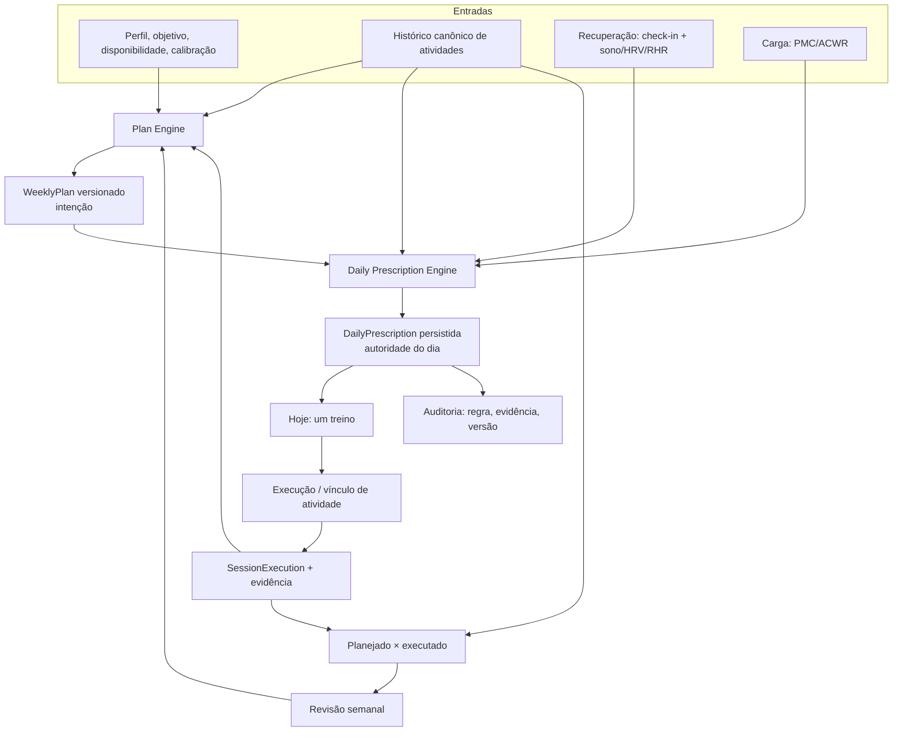

# Revisão e Direcionamento do Produto

**Versão:** 1.1 · **Data:** 06/11/2026 · **Commit base:** `56085fc`
**Documento revisado:** `docs/PRD_COACH_CORRIDA.md` (v1.0)
**Status:** revisão crítica concluída; **D2, D3 e D6 aprovadas com condições em 06/11/2026**. Demais direcionamentos aprovados registrados no Anexo C. **Nenhuma implementação realizada.**
**Natureza:** documento de decisão. As recomendações abaixo são propostas do responsável técnico de produto e aguardam aprovação explícita antes de virarem requisitos ou código. O Anexo C registra o que foi aprovado, sem reescrever o histórico da revisão original.

**Histórico de revisão**

| Versão | Data | Mudança |
|---|---|---|
| 1.0 | 06/11/2026 | Revisão crítica do PRD e primeiro ciclo proposto. |
| 1.1 | 06/11/2026 | Adendo de aprovação (Anexo C): D2, D3, D6 e direcionamentos do MVP; encaminhamento da Etapa 3. |

**Sumário**
1. Resumo executivo
2. Descobertas confirmadas e descobertas que precisam de validação
3. Revisão das prioridades
4. Avaliação da visão estratégica
5. Matriz de decisões de produto
6. Arquitetura funcional recomendada
7. Primeiro ciclo de desenvolvimento
8. Riscos e dependências
9. Decisões que aguardam aprovação
- Anexo A: rastreabilidade PRD → revisão → ciclo
- Anexo B: evidências consultadas
- Anexo C: adendo de aprovação (06/11/2026)

---

## 0. Método e limites desta revisão

### 0.1 O que foi feito

- Releitura integral do PRD e confronto com o código do commit `56085fc`.
- Verificação direta dos arquivos citados como evidência, não apenas da documentação.
- Execução de testes-alvo para confirmar que a base atual está verde:
  - `./gradlew :core:domain:test --tests "*WeeklyPlanGeneratorTest" --tests "*TrainingLoadEngineTest" --tests "*WorkoutRecommenderTest" --tests "*CalibrationCalculatorTest" --tests "*ReadinessCalculatorTest"` — **verde**.
  - `./gradlew :app:testDebugUnitTest --tests "com.meucoach.app.ui.today.*" --tests "com.meucoach.app.ui.activities.*" --tests "com.meucoach.app.ui.checkin.*"` — **verde**.
- Contagem estática de `872` anotações `@Test`, `0` diretórios `androidTest`, `46` goldens.

### 0.2 O que não foi feito

- Não foram executados build completo, lint, Kover, Roborazzi, emulador, aparelho real, Health Connect real, WorkManager real, permissões, MediaCodec ou Macrobenchmark.
- Não foram abertos dados de saúde reais nem fixtures privadas.
- Não foi medido consumo de memória, tempo de import, jank ou bateria.
- Não foi feito teste com usuários.

### 0.3 Classes de evidência usadas neste documento

| Classe | Significado | Consequência |
|---|---|---|
| **A — Confirmado no código** | O comportamento decorre diretamente da implementação lida; não depende de execução. | Pode virar requisito de correção. |
| **B — Confirmado por cálculo ou regra** | A inconsistência é matemática ou contradiz uma regra/ADR escrita. | Pode virar requisito, com decisão científica explícita. |
| **C — Requer validação em execução** | Depende de aparelho, plataforma, volume de dados ou medição. | Não deve virar requisito definitivo antes do teste. |
| **D — Hipótese de produto** | Inferência sobre uso, retenção ou valor. | Não deve entrar no primeiro ciclo como requisito. |

> Regra desta revisão: **não preservar a prioridade do PRD por inércia**. Um item só continua P0 se o impacto no fluxo essencial e na confiança do usuário justificar bloqueio de entrega.

> Em resumo: **A e B** são problemas comprovados pela implementação ou por cálculo/regra; **C** é um achado estático que ainda precisa de validação em execução; **D** é hipótese de produto e não entra no ciclo 1 como requisito.

---

## 1. Resumo executivo

### 1.1 Veredito

O diagnóstico do PRD está, em sua maioria, correto. O produto tem um problema real e bem localizado: **o ciclo de coaching não está fechado**. O app analisa, planeja e explica, mas não conduz a execução, não prova a adesão e não adapta o plano ao que aconteceu. As três apostas do PRD — uma decisão por dia, registrar sem fricção, adaptar com segurança — continuam válidas.

A revisão, porém, muda três coisas importantes:

1. **O primeiro ciclo deve ser menor e mais defensável.** Não são três frentes amplas; são cinco correções coesas: tempo determinístico, guardrails de carga, prescrição única, conclusão com evidência e exclusão efetiva. Captura via Health Connect, backup/restauração, sessão guiada e periodização vêm depois, porque dependem de decisões e de validação externa.
2. **Algumas prioridades do PRD estão infladas.** `PERF-01` foi descrito de forma imprecisa; `BUG-07` é mais estreito do que parece; `BUG-11` não é tão amplo; `UX-03` e `DEBT-02` são riscos não medidos, não defeitos comprovados. `BUG-06` deve ser dividido em “honestidade do rótulo” (barato) e “algoritmo Tier B” (caro e arriscado).
3. **Há descobertas que o PRD não fez e que mudam a ordem.** As mais relevantes:
   - o plano gerado no meio da semana inclui sessões em dias já passados, que não podem ser concluídas nem puladas e penalizam a adesão para sempre;
   - o taper não reduz a duração da qualidade e não existe evento de prova nem recuperação pós-prova;
   - o ACWR trata ausência de dados como carga zero e, pior, **ACWR desconhecido libera qualidade** no plano, contrariando o princípio “sem dados, não aumentar carga”;
   - `PlannedSession` não tem alvos de pace/FC, nem vínculo com atividade ou execução — a unificação da prescrição é maior do que o PRD estimou;
   - o Health Connect só lê 30 dias na primeira sincronização e não importa exercícios; o histórico automático começa 30 dias antes da instalação, não na vida do corredor (arquivos podem ir mais atrás, mas dependem de exportação manual).

### 1.2 O que muda em relação ao PRD

| Tema | PRD | Esta revisão |
|---|---|---|
| Foco do primeiro ciclo | BL-001, BL-002, BL-003 + vários P1 | C1-01 a C1-06, com gate entre cada um |
| Prescrição única | “M” | “M”, mas com migração e modelo de alvos que o PRD não previu |
| Conclusão auditável | Exige execução guiada ou vínculo | Aceita três níveis de evidência; sessão guiada não é pré-requisito |
| Volume recente | Tratado como bug | Tratado como **decisão de produto** que contradiz o ADR 0010; exige ADR novo |
| Health Connect exercícios | P1, quase certo | P1, mas **condicionado** a validar o comportamento do Zepp no aparelho |
| Backup | P1 | P1, porém fora do ciclo 1; depende de schema e de política de retenção |
| Tier B | P1 | P1 apenas para parar de prometer; algoritmo em P2 |
| Performance | PERF-01 P1 | P2 e hipótese; medir antes de reescrever parser ou cálculo |
| Acessibilidade | UX-03 P1 | P2; é lacuna de teste, não falha observada |
| Story | P3 | Congelado; não investir até o loop ter métrica de sucesso |

### 1.3 As três decisões que destravam o restante

1. **Aprovar “plano é intenção, prescrição diária é autoridade”.** Sem isso, o ciclo 1 não começa.
2. **Aprovar a definição de treino concluído com níveis de evidência.** Sem isso, a adesão continua sendo opinião.
3. **Aprovar exclusão com lixeira curta e reset com época de dados.** Sem isso, “apagar” continua sendo uma promessa que o código não cumpre.

### 1.4 Respostas diretas

| Pergunta | Resposta curta |
|---|---|
| Quais problemas realmente precisam ser corrigidos? | **Obrigatórios no ciclo:** BUG-01, BUG-02, SEC-01/SEC-02, N-01, N-02, N-04. **P1 em seguida:** BUG-09/ARCH-03, UX-01, BUG-03/04/05, DEBT-01. O resto é P2/P3 ou funcionalidade futura. |
| Quais decisões de produto preciso tomar? | D2 (evidência) e D3 (plano × prescrição) para destravar o ciclo; D6 (exclusão) para a privacidade. As demais podem ser aprovadas depois. |
| Qual arquitetura funcional devemos seguir? | Plano = intenção; prescrição diária = autoridade; execução com evidência; comparação/revisão derivadas. Um componente decide por camada, não três. |
| Qual deve ser a sequência? | Tempo → guardrails de carga → prescrição única → conclusão com evidência → exclusão/reset → verdade documental. |
| Como saberemos que cada entrega terminou? | Critérios de aceitação testáveis + testes que falham no código antigo + `./gradlew check` verde + roteiro manual no aparelho + docs atualizados. |

---

## 2. Descobertas confirmadas e descobertas que precisam de validação

### 2.1 P0 e P1 do PRD, reclassificados

| ID | O que o PRD afirma | Evidência verificada | Classe | Impacto revisado | Prioridade PRD → revisão |
|---|---|---|---|---|---|
| BUG-01 | Treino do dia contradiz o plano | `TodayViewModel.kt:335-345` recomenda sem plano; `WorkoutRecommender.kt:58-169` só produz EASY/REST; `TodayScreen.kt:155-172` mostra dois cards | A | Alto: quebra a promessa central de “uma decisão” | **P0 mantido** |
| BUG-02 | Conclusão sem execução e em descanso/doença | `TodayScreen.kt:803-823, 1108-1200`; `TodayViewModel.kt:190-194`; `PlannedSessionEntity` não tem `activityId` nem evidência | A | Alto, mas escopo menor: em dia sem sessão planejada não há “Concluir”; o risco real é dia com sessão planejada e recomendação REST | **P0 mantido, com escopo corrigido** |
| BUG-03 | PMC enviesado por janela de 42 dias | `TrainingLoadEngine.kt:52-90`; `TrainingLoadCalculator.kt:52-66`; EMA inicia em 0 | B | Médio: afeta números exibidos, não o gate atual (ACWR) | **P1 mantido** |
| BUG-04 | HRV mistura média bruta com desvio de log | `DailyMetricsReadiness.kt:39-58`; `ReadinessCalculator.kt:110-114` | B | Médio: 25% da prontidão | **P1 mantido** |
| BUG-05 | Semana de prova prescreve depois da prova e não há recovery | `WeeklyPlanGenerator.kt:129-203, 317-324` | A | Alto, mas condicional a quem tem prova; o taper também não reduz a qualidade | **P1 mantido, escopo ampliado** |
| BUG-06 | Tier B não calcula VDOT/LTHR/pace | `CalibrationCalculator.kt:168-193` | A | Médio e dependente do segmento: usuário com prova/TT não é afetado | **P1 só para honestidade; algoritmo P2** |
| BUG-07 | Alternate após soft delete gera duplicado invisível | `ImportService.kt:54-61`; `ActivityAlternateDao.kt:25-26`; `ActivityRepository.kt:74-90` | A | Baixo-médio: o caminho por SHA canônico **já restaura**; só o alternate falha | **P2 (era P1)** |
| BUG-08 | Meta de prova sem data desliga taper | `OnboardingForm.kt`; teste `accepts a race goal without a target date`; `WeeklyPlanGenerator.kt:317-323` | A | Baixo-médio: é decisão de UX, não falha de cálculo | **P2 mantido** |
| BUG-09 | Fuso e data congelados em ViewModels | `TodayViewModel.kt:67, 95, 154`; `CheckInViewModel.kt:60`; `ReminderScheduler.kt:21-33` | A | Médio-alto: check-in no dia errado e plano da semana anterior | **P1 mantido (fundação)** |
| BUG-11 | Falha inesperada deixa job em `PARSING` | `ImportWorker.kt:19-32`; `ImportService.kt:39-110`; `ImportStaging.kt:139`; `ImportCoordinator.kt` | C | Baixo-médio: o `ImportService` já marca `FAILED` na maioria dos erros; “PARSING eterno” exige falha de banco, e arquivo staged ilegível gera retry silencioso **sem** job | **P3 (era P2/P1)** |
| UX-01 | Check-in salva “neutro” sem resposta | `CheckInViewModel.kt:18-24, 86-93`; teste `starts with neutral answers` | A | Médio-alto: até 35% da prontidão é subjetiva e pode ser fabricada | **P1 (era P2)** |
| UX-02 | Onboarding não captura volume atual | `OnboardingForm.kt:37-58`; `AthleteProfile.kt:64-110` | A | Médio: bloqueia progressão baseada em histórico | **P2 mantido** |
| UX-03 | Acessibilidade não verificada | `@Config(qualifiers=...)`; só tutorial usa `fontScale = 2f` | C | Médio, mas não há falha observada | **P2 (era P1)** |
| UX-06 | Sem feedback pós-treino nem revisão semanal | `ActivityDetailScreen`; `TrendsScreen`; `PlanCompletionCalculator` | A | Alto para o produto, mas é funcionalidade, não bug | **P2 mantido** |
| UX-07 | Uma permissão negada bloqueia tudo | `HealthConnectDailySource.kt:83-86`; `HealthSyncService.kt:85-89` | A | Médio | **P2 mantido** |
| ARCH-01 | Documentação descreve arquitetura inexistente | `settings.gradle.kts:19-23`; `ARCHITECTURE.md:57-74` | A | Médio | **P2 mantido** |
| ARCH-03 | Tempo não é dependência explícita | 28 ocorrências de `LocalDate.now()`/`LocalTime.now()`/`ZonedDateTime.now()` em `app/src/main` | A | Médio-alto | **P1, fundido com BUG-09** |
| ARCH-04 | Modelo documentado não existe | `MeuCoachDatabase.kt:29-44`; `DATA_MODEL.md:16-35` | A | Médio | **P2 mantido** |
| DEBT-01 | Backup incompleto e sem restauração | `UserDataRepository.kt:44-95, 114-228`; `StagedImportProcessor.kt:14-25` | A | Alto para “dados para sempre” | **P1 mantido** |
| DEBT-02 | Import lê arquivo inteiro em memória | `ImportStaging.kt:75`; `MAX_IMPORT_BYTES = 64 MB`; `TcxParser`/`GpxParser` DOM | C | Médio; OOM plausível, não medido | **P2 (era P1)** |
| PERF-01 | Agregação de 28 dias no Main | `TrendsViewModel.kt:71-148`; `Database.withTransaction` executa fora da Main; `IntensityDistributionCalculator` roda no `viewModelScope` | C, com descrição imprecisa | Não comprovado | **P2 (era P1)** |
| SEC-01 | Soft delete sem expurgo nem lixeira | `ActivityRepository.kt:300-303`; `ActivityDao.kt:20-54`; `UserDataRepository.kt:83-95`; sem job de expurgo | A | Alto | **P0 mantido** |
| SEC-02 | Reset pode ser desfeito por workers | `UserDataRepository.kt:58-79`; `HealthSyncService.kt:61-97`; `HealthSyncWorker.kt`; `MeuCoachApplication.kt:32-33` | A | Alto | **P0 mantido** |
| TEST-01 | Sem instrumentados/E2E | `0` diretórios `androidTest`; CI sem emulador | A | Alto **se houver distribuição**; baixo se uso pessoal | **P1 condicional** |
| TEST-03 | Cenários críticos sem regressão | Lista do PRD confirmada por busca | A | Alto: os bugs não são pegos pela suíte | **P1 mantido** |

### 2.2 Correções de escopo: onde o PRD concluiu rápido demais

1. **Plano por disponibilidade não é “bug”; é uma decisão registrada.**
   O ADR 0010 (`docs/adr/0010-availability-hard-cap-progression.md`) decide explicitamente que disponibilidade é teto rígido e que a progressão da versão é de qualidade, não de km. O PRD trata isso em FR-004/BL-004 como “plano não parte do volume recente”, mas a mudança exige **substituir uma decisão**, não corrigir um defeito. A inconsistência real é outra: `R-PLAN-01` (5–8%) é citada em `WorkoutRecommender.kt:91` e em `SPORTS_SCIENCE.md:469`, mas nunca é executada. Isso é dívida de promessa e de ciência, e precisa de ADR novo.

2. **“Concluir em dia de descanso” é parcialmente verdadeiro.**
   Em um dia sem nenhuma sessão planejada, `hasPlannedSession` é falso e o diálogo não oferece “Concluir treino” (`TodayScreen.kt:1122-1195`). O risco real é: existe sessão planejada, mas a recomendação do dia é REST por doença/prontidão vermelha; aí o diálogo ainda oferece “Concluir treino” e o botão “Concluir” do plano continua ativo. A correção é a mesma, mas o critério de aceitação deve ser escrito com precisão.

3. **O caminho de reimportação por SHA já foi corrigido.**
   `ActivityRepository.saveImportedActivity` restaura a atividade soft-deleted quando o SHA é o mesmo (`ActivityRepository.kt:80-86`). O BUG-07 permanece apenas para o caminho de **alternate**: `ImportService.kt:59-61` consulta `ActivityAlternateDao.findBySha256` sem verificar o `deletedAt` do pai. É um caso de borda, não um fluxo central.

4. **O `ImportService` já trata a maior parte das falhas.**
   `import()` envolve parsing e persistência em `try/catch` e grava `FAILED` com código (`ImportService.kt:75-110`). O “job preso em `PARSING`” exige uma falha de banco entre o insert e o update; é raro e catastrófico. O caso mais realista é outro: um arquivo staged ilegível faz `staging.read` lançar `ImportStagingException` (que estende `IOException`) **antes** de o job existir, e o worker entra em `Result.retry()` silencioso sem linha de job. O problema é de retry/feedback, não de “qualquer exceção de runtime”.

5. **`PERF-01` descreve o dispatcher errado.**
   `listActivitySummaries()` e `openActivity()` usam `database.withTransaction`, que a Room executa no seu executor de transação, não na Main. O que roda na Main é o `IntensityDistributionCalculator.calculate` sobre as amostras já decodificadas (`TrendsViewModel.kt:127-148`). O custo é O(nº de amostras) e plausivelmente pequeno para 28 dias; não há medição. É hipótese de jank, não fato.

6. **`BUG-06` não “calcula errado”; ele não calcula.**
   `withoutPerformance` rotula Tier B mas devolve `vdot = null`, `thresholdPace = null`, `lthr = null` e recomenda um teste de 30 min (`CalibrationCalculator.kt:168-193`). O usuário não recebe um número errado; ele recebe a promessa de um método que não existe. Isso permite uma correção barata de honestidade antes do algoritmo caro.

7. **`UX-03` e `DEBT-02` são riscos, não defeitos comprovados.**
   Não há evidência de layout quebrado em 200% ou de OOM em arquivo real. A matriz de acessibilidade é lacuna de teste; o cap de 64 MB é risco arquitetural. Ambos merecem P2 e medição, não bloqueio de entrega.

### 2.3 Novas descobertas desta revisão

| ID | Descoberta | Evidência | Classe | Impacto | Prioridade sugerida |
|---|---|---|---|---|---|
| **N-01** | `PlannedSession` não tem alvos de pace/FC, distância, `activityId` ou `executionId`. A prescrição única precisa enriquecer o modelo, não só unir duas telas. | `WeeklyPlanEntity.kt:35-52`; `PlannedSession` em `WeeklyPlanGenerator.kt:25-41` | A | Alto: o esforço do PRD para FR-001/FR-003 está subestimado | **P0 (dependência)** |
| **N-02** | O plano gerado no meio da semana inclui sessões de dias já passados; elas não podem ser concluídas nem puladas e entram na adesão como pendentes. | `WeeklyPlanGenerator.kt:106-131` gera a semana inteira; `TodayScreen.kt:803-823` só age em `date == today`; `PlanCompletionCalculator.kt:42-44` conta passadas | A | Alto: quem instala/abre na quinta já começa com adesão impossível | **P0** |
| **N-03** | O taper reduz duração de fácil/longão, mas **não** reduz a qualidade; não existe evento de prova nem recuperação pós-prova. | `WeeklyPlanGenerator.kt:186-192`; `SPORTS_SCIENCE.md:286-290, 332-337` | A | Alto para quem tem prova; pode manter estímulo forte na semana da prova | **Resolvido em 12/11/2026:** recuperação pelo ADR 0037 e qualidade no taper pelo N-03 (`weekly-plan-v4`) |
| **N-04** | ACWR ausente libera qualidade; dias sem dado entram como carga zero no cálculo. | `WeeklyPlanGenerator.kt:111-115` (`acwr == null || ...`); `TrainingLoadEngine.kt:70-89`; `TrainingLoadCalculator.kt:68-77` | A | Alto: contraria “sem dados, não aumentar carga” e pode liberar progressão sem base | **P0** |
| **N-05** | O Health Connect lê apenas 30 dias na primeira sincronização e não faz backfill de histórico anterior. | `HealthSyncService.kt:78-80` | A | Médio: o “acompanhar ao longo do tempo” automático começa 30 dias antes da instalação, não na vida do atleta | **P2** |
| **N-06** | Não há registro manual de corrida; `ActivitySource.MANUAL` só aparece em formatador. | `ActivityFormatters.kt:46`; ausência de UI | A | Médio-alto para esteira/sem arquivo; depende da decisão de captura | **P1/P2** |
| **N-07** | `R-PLAN-01` é citada para “sem disponibilidade”, mas a regra 5–8% não é implementada em lugar nenhum; o catálogo também não tem esse ID. | `WorkoutRecommender.kt:80-94`; `SPORTS_SCIENCE.md:469`; `ExplanationCatalog` | A | Médio: quebra auditabilidade | **P2** |
| **N-08** | O plano é gerado na primeira abertura da semana e persistido; não há revisão intra-semana nem prévia da semana seguinte. | `TodayViewModel.kt:111-141`; `TrainingPlanRepository.saveWeek` | A | Médio: o coach não replaneja quando a vida muda | **P2** |
| **N-09** | O PMC mistura TRIMP e rTSS na mesma série, sem conversão explícita. | `TrainingLoadEngine.kt:70-89`; `TrainingLoadCalculator.kt:52-66` | C | Médio: escalas são próximas, mas não equivalentes | **P2 (validar)** |
| **N-10** | A conclusão `DONE` existente não tem evidência; ao introduzir evidência, é preciso migrar o passado como “não verificado”, não como verdade. | `PlannedSessionEntity.kt:47-49`; `PlanCompletionCalculator.kt:30-38` | A | Médio: sem backfill, a nova regra muda números silenciosamente | **P1 (dependência do C1-04)** |

### 2.4 O que ainda precisa de validação em execução

| Pergunta | Por que importa | Como validar |
|---|---|---|
| O Zepp Balance escreve `ExerciseSession` no Health Connect? Com quais campos (distância, FC, rota)? | Decide se a captura “sem trabalho manual” é real ou depende de arquivo | Teste no aparelho do usuário 0, com Health Connect real; comparar com export FIT |
| Qual o tempo e a memória reais de importar FIT de 5 MB e 20 MB? | Sustenta ou derruba DEBT-02 | Macrobenchmark + arquivos sanitizados |
| `IntensityDistributionCalculator` causa jank em 100 atividades? | Sustenta ou derruba PERF-01 | Macrobenchmark e trace de frame |
| Fonte 200% quebra as 5 abas? | Sustenta ou derruba UX-03 | Matriz de screenshots + aparelho |
| O WorkManager roda o sync diário em Samsung/Xiaomi? | Afeta a confiança no HC | Teste de bateria/background |
| A prontidão corrigida (HRV em log) muda de nível em dados reais? | Evita mudança silenciosa de comportamento | Reprocessar 60 dias de dados sanitizados antes/depois |
| O plano baseado em volume recente gera semanas aceitáveis para o usuário 0? | Evita “correção” que piora a experiência | Comparar plano atual vs. proposto em 8 semanas simuladas |

---

## 3. Revisão das prioridades

### 3.1 Critério usado

Uma iniciativa é P0 se **o produto mente, perde dado ou impede o loop central**. É P1 se **prejudica a confiança ou a qualidade da decisão, mas o usuário ainda consegue usar**. É P2 se **é dívida importante, porém não bloqueia o ciclo atual**. É P3 se **é conveniência**.

### 3.2 Mudanças propostas

| Item | PRD | Revisão | Motivo |
|---|---|---|---|
| BUG-01, BUG-02, SEC-01, SEC-02 | P0 | **P0** | Mentira sobre o treino, adesão sem evidência e exclusão que não exclui |
| N-01, N-02, N-04 | não listados | **P0** | São dependências ou falhas de segurança do ciclo central |
| UX-01 | P2 | **P1** | Dado subjetivo fabricado alimenta até 35% da prontidão |
| BUG-07 | P1 | **P2** | Só o caminho alternate; o SHA canônico já restaura |
| BUG-11 | P2 | **P3** | Falha real, mas estreita: o serviço já marca `FAILED`; o caso principal é retry silencioso de staging |
| BUG-06 | P1 | **P1 honestidade / P2 algoritmo** | Parar de prometer é barato; estimar bem é caro e arriscado |
| DEBT-02 | P1 | **P2** | Sem medição de OOM; típico arquivo é pequeno |
| PERF-01 | P1 | **P2** | Descrição imprecisa; cálculo no Main não medido |
| UX-03 | P1 | **P2** | Lacuna de teste, não falha observada |
| TEST-01 | P1 | **P1 condicional / P2 se uso pessoal** | Só vale o custo se houver distribuição |
| DEBT-01 | P1 | **P1** | “Seus dados para sempre” é promessa de marca |
| BUG-03, BUG-04, BUG-05, BUG-09 | P1 | **P1** | Afetam confiança e segurança, mas não bloqueiam o loop |
| UX-06, FR-010/011/012 | P2 | **P2** | São o “aprender” do coach; vêm depois de executar/registrar |
| Story, widgets, social, GPS | P3 | **P3/congelado** | Não fortalecem o loop agora |

**P0 final (revisado):** BUG-01, BUG-02, SEC-01, SEC-02, N-01 (dependência), N-02, N-04. **P1 final:** BUG-03, BUG-04, BUG-05, BUG-06 (honestidade), BUG-09/ARCH-03, UX-01, DEBT-01, N-10, TEST-01 (condicional), TEST-03. Tudo o mais é P2/P3 ou funcionalidade futura.

> C1-01 entra no ciclo como **P0 por dependência**: sem “hoje” confiável, a prescrição P0 não é determinística. O achado BUG-09 continua classificado como P1.

### 3.3 O que **não** é P0 (e não deve entrar no ciclo 1)

- Periodização completa (Base/Build/Peak).
- Tier B.
- Backup/restauração completo.
- Sessão guiada persistente com áudio/GPS.
- Revisão semanal narrativa.
- Health Connect exercícios (grande valor, mas depende de validação externa).
- Acessibilidade em tablet.
- Testes instrumentados/E2E.

### 3.4 Ordem recomendada

```text
Tempo determinístico
   ↓
Guardrails de carga (ACWR ausente/zero)
   ↓
Prescrição única do dia
   ↓
Conclusão com evidência
   ↓
Exclusão/reset efetivos
   ↓
Verdade documental + regressões
```

A ordem não é arbitrária: a prescrição precisa de “hoje” confiável e de guardrails corretos; a evidência precisa de uma prescrição à qual se vincular; o reset precisa de época de dados e de clock; a documentação precisa do modelo novo para não mentir de novo.

---

## 4. Avaliação da visão estratégica

### 4.1 O ciclo prometido vs. o ciclo implementado

| Etapa do ciclo | O que o PRD promete | O que o código entrega | Lacuna |
|---|---|---|---|
| Acompanhar ao longo do tempo | Histórico crescente e comparável | Import FIT/TCX/GPX, métricas HC, tendências, PMC | Captura incompleta (HC exercícios, manual); HC sem backfill além de 30 dias; sem RPE |
| Entender o histórico | Volume, consistência, eficiência, 80/20 | Tendências e gráficos | “Recordes” são médias de treino inteiro; sem melhores esforços; sem comparação com plano |
| Planejar | Semana + prova + periodização | Semana por disponibilidade; taper simples | Sem volume recente; sem blocos; sem recuperação; prova não é evento |
| Acompanhar a execução | Sessão guiada + vínculo | Cronômetro em memória; DONE por clique | Sem estado, sem alvo, sem vínculo, sem evidência |
| Usar os resultados | Adaptar a próxima semana | Só libera 2ª qualidade por conclusão | Não aprende com volume, intensidade, RPE ou resposta individual |
| Explicar a mudança | rationale + regra + evidência | Explicação do dia e do plano | Não persiste a decisão; não mostra “o que mudou e por quê” |

**Conclusão:** o PRD contempla o ciclo no diagrama, mas o subdimensiona em duas etapas: **captura** e **replanejamento**. O primeiro ciclo deve fechar a parte de decisão/evidência; a captura e o replanejamento vêm em seguida, nessa ordem.

### 4.2 Lacunas estratégicas

1. **Não há estado do atleta ao longo do tempo.** O perfil é estático: experiência, disponibilidade e objetivo. Não há “fase da temporada”, “semanas até a prova”, “volume de base”, “histórico de lesão”. Sem isso, o plano não é um coach; é uma calculadora semanal.
2. **Não há revisão intra-semana.** O plano é salvo uma vez e não muda. A vida real (doença, viagem, filho doente, chuva) não entra. A prescrição diária resolve o dia, mas não a semana.
3. **Não há decisão persistida.** A recomendação é recalculada em memória; não se sabe qual foi a decisão de ontem, com qual versão do motor e com quais dados. Isso impede auditoria e “aprender” de forma reprodutível.
4. **Não há evidência de execução.** A adesão é um booleano. Sem vínculo, o coach não consegue comparar planejado × executado.
5. **Não há feedback pós-treino.** O usuário vê gráficos, mas não uma leitura curta: “foi mais forte que o planejado”, “o alvo era X”, “o próximo passo é Y”.
6. **A prova é um fator de volume, não um evento.** Não há dia de prova, pace alvo, semana de recuperação, nem “não treine depois da prova”.
7. **A captura é o gargalo do histórico.** Sem HC exercícios e sem entrada manual, o usuário que não exporta arquivo simplesmente não existe para o coach.
8. **A medição de sucesso é fraca.** O PRD propõe métricas, mas o app não mede “a recomendação foi compreendida?”, “o usuário seguiu o alvo?”, “a prontidão bateu com a sensação?”. Para um produto de coaching, isso é mais importante que retenção bruta.

### 4.3 Contradições a resolver

| Promessa | O que o código faz | Consequência |
|---|---|---|
| “Uma decisão por dia” | Dois motores, dois cards | O usuário escolhe; o coach perde autoridade |
| “Dado ausente não é zero” | ACWR trata dia sem dado como 0; ACWR nulo libera qualidade | O plano pode aumentar carga sem base |
| “Seus dados para sempre” | Export incompleto, sem restore; soft delete sem expurgo | A promessa de portabilidade e eliminação não se sustenta |
| “Determinismo” | `LocalDate.now()` em 28 pontos; motor sem `engineVersion` persistida | Mesmo input pode gerar decisão diferente por fuso/data; não há auditoria |
| “Plano semanal” | Plano é gerado uma vez e não revisado | O coach não reage ao que acontece na semana |
| “Local-first” | Health Connect e mapa são dependências externas; story envia tiles | Aceitável, mas a UI precisa declarar o que sai e o que não sai |
| “Sem culpa” | Adesão conta clique; plano pode gerar sessões passadas impossíveis | O usuário é penalizado por algo que não podia fazer |

### 4.4 O que tornaria o produto um coach de verdade

1. **Uma decisão por dia, com evidência e explicação.**
2. **Um histórico que começa antes do app** (HC/arquivo/manual) e não depende de exportação.
3. **Uma semana que nasce do realizado**, não só da disponibilidade.
4. **Uma execução que sobrevive ao processo** e se vincula à corrida.
5. **Uma revisão semanal curta** que diga o que mudou e o que fazer.
6. **Uma prova tratada como evento**, com taper e recuperação.
7. **Uma decisão persistida**, para que o usuário (e o agente) possam auditar por que o treino mudou.

O PRD acerta ao dizer “fechar o loop antes de abrir novas superfícies”. Esta revisão acrescenta: **fechar o loop exige captura e replanejamento, não só prescrição e conclusão**.

---

## 5. Matriz de decisões de produto

> Formato: decisão necessária → alternativas → vantagens/desvantagens → consequências técnicas e funcionais → recomendação → justificativa → critérios que mudariam a escolha. Todas as recomendações estão **sujeitas à sua aprovação**.

**Resumo das recomendações**

| # | Tema | Recomendação |
|---|---|---|
| D1 | Captura | Import-first: Health Connect + manual + arquivo; sem GPS nativo agora |
| D2 | Treino concluído | Níveis `ACTIVITY` > `GUIDED` > `MANUAL`; REST/doença bloqueia |
| D3 | Plano × prontidão | Plano é intenção; prescrição diária é a autoridade do dia |
| D4 | Iniciante | Elegibilidade conquistada (4 semanas, evidência, volume, verde, ACWR) e qualidade introdutória |
| D5 | Backup | Pacote `.zip` versionado com JSON + samples + avatar; restore transacional |
| D6 | Exclusão | Lixeira de 7 dias para atividade; “apagar tudo” imediato com época de dados |
| D7 | Objetivos | Um objetivo ativo; geral + 5K/10K/meia/maratona; data no modo prova |
| D8 | Distribuição | Play interno → fechado → produção, se distribuir |
| D9 | Perfis | Perfil único; documentar a suposição |
| D10 | Servidor | Sem backend no MVP; futuro só backup/sync opt-in e cifrado |

### D1 — Estratégia de captura de corridas: importação ou GPS nativo

**Decisão necessária:** o app deve gravar corridas com GPS próprio ou continuar importando de relógio/Health Connect/arquivo?

| Alternativa | Vantagens | Desvantagens | Consequências |
|---|---|---|---|
| A. Import-first (FIT/TCX/GPX + HC + manual) | Sem permissão de localização, sem foreground service de atividade, sem bateria; foco no coaching; menos risco de Play | Depende do relógio/app de origem; HC pode não ter rota; usuário sem dispositivo precisa de entrada manual | Captura via adapters; dedup; UI de vínculo; manual entry |
| B. GPS nativo | Independência de dispositivo; rota própria; controle de amostras | XL; permissões, FGS, bateria, precisão, ciclo de vida, export FIT, Play policy; concorre com relógios melhores | App vira também rastreador; desvia do loop |
| C. Híbrido agora (HC + manual) e GPS depois | Entrega valor sem o custo do GPS; valida demanda | Ainda depende de HC para automático | Fases claras; decisão futura baseada em dados |

**Recomendação:** **A, operacionalizado como C** — import-first com três portas: (1) Health Connect `ExerciseSession`; (2) entrada manual (esteira/sem arquivo); (3) arquivo FIT/TCX/GPX. **Não implementar GPS nativo agora.** Reavaliar apenas se a validação mostrar que o público-alvo não tem relógio/Health Connect e que a fricção de captura é a principal causa de abandono.

**Justificativa:** o diferencial do produto é decidir, não rastrear. O relógio já é o sensor; o app deve ser o coach. GPS nativo adiciona um custo desproporcional (bateria, permissões, Play, testes em aparelho) e não melhora a decisão se o usuário já tem um dispositivo que grava melhor.

**Consequências técnicas:** mapear `ExerciseSessionRecord` + distância/FC/calorias quando disponíveis; origem `HEALTH_CONNECT`; dedup com arquivos; amostras podem ser grossas; sem permissão de localização; sem FGS de atividade. **Consequências funcionais:** promessa “sem trabalho manual” só é real se o HC tiver exercícios; caso contrário, a entrada manual é o fallback honesto.

**Critérios que mudariam a escolha:** (a) validação no aparelho mostrar que o Zepp não escreve exercícios no HC; (b) maioria dos usuários-alvo não tiver arquivo nem HC; (c) fricção de captura for a principal causa de abandono. Nesses casos, a entrada manual sobe de prioridade e o GPS nativo entra em avaliação — nunca antes do loop.

### D2 — Definição oficial de “treino concluído”

**Decisão necessária:** o que permite marcar uma sessão planejada como `DONE`?

| Alternativa | Vantagens | Desvantagens | Consequências |
|---|---|---|---|
| A. Só execução guiada no app | Evidência forte de tempo | Exclui quem usa relógio; exige timer persistente; não cobre corrida importada | Forte acoplamento à sessão guiada |
| B. Só atividade vinculada | Evidência forte de corrida | Exclui esteira sem arquivo e quem esqueceu o relógio | Depende de captura |
| C. Só confirmação manual | Simples | Volta à auto-declaração; não é evidência | Não resolve o problema |
| D. Níveis de evidência (atividade > guiada > manual) | Cobre todos os casos; transparência; permite medir confiança | Modelo e UI mais complexos; exige matching | `SessionExecution` + `completionEvidence` |

**Recomendação:** **D.** `DONE` só existe com uma das três evidências:
1. **`ACTIVITY`** — atividade importada/HC/manual vinculada, com confirmação do usuário; confiança alta.
2. **`GUIDED`** — sessão executada no app com início/fim (mesmo sem distância); confiança média-alta para duração, baixa para distância.
3. **`MANUAL`** — confirmação explícita “fiz sem registro”, exigindo duração e RPE (1–10); confiança baixa, exibida como tal.

Dia de descanso prescrito ou doença/lesão **bloqueia** `DONE`. Quando a prescrição do dia é REST, a sessão planejada é encerrada como `SKIPPED` com motivo (“descanso prescrito” ou “doença/lesão”), em vez de ficar pendente para sempre; se o usuário correr mesmo assim, a corrida fica como treino livre, não como cumprimento do plano. Não existe “clique e pronto”. A adesão passa a mostrar o tipo de evidência; a progressão pode usar `ACTIVITY`/`GUIDED` e tratar `MANUAL` como conclusão de confiança menor (não como mentira).

**Justificativa:** o produto precisa funcionar para quem usa relógio, para quem usa esteira e para quem esqueceu o dispositivo. Recusar o manual pune o usuário; aceitar o clique pune o coach. Níveis de evidência são a única solução que preserva ambos.

**Consequências técnicas:** `session_executions` (início, fim, pausas, duração, distância, RPE, `activityId`), `planned_sessions.completionEvidence`, `activityId`/`executionId`; migração; matching por data local + esporte + tolerância; uma atividade só pode ser vinculada a uma sessão; `DONE` derivado da evidência. **Funcionais:** UI de vínculo após importação; confirmação manual com duração/RPE; explicação da diferença entre “feito” e “feito com evidência”.

**Critérios que mudariam a escolha:** se o teste com usuários mostrar que o manual é usado de forma indiscriminada, exigir `ACTIVITY` para qualidade/longão e permitir manual só em fácil; ou introduzir `PARTIAL` para sessões incompletas. Não recomendado no MVP.

### D3 — Relação entre plano semanal e prontidão diária

**Decisão necessária:** quem manda no treino de hoje?

| Alternativa | Vantagens | Desvantagens | Consequências |
|---|---|---|---|
| A. Plano manda; prontidão só rebaixa | Seguro, previsível, auditável | Pode ser conservador demais em dia verde | Precisa de plano com alvos |
| B. Recomendação diária independente | Reage ao dia | Contradiz o plano; dois motores | É o estado atual |
| C. Plano é intenção; prescrição diária é autoridade | Uma decisão; explica mudança; preserva plano | Exige modelo e persistência | `DailyPrescription` |
| D. Plano e recomendação negociam | Mais “inteligente” | Imprevisível, difícil de explicar | Não recomendado |

**Recomendação:** **C.** O `WeeklyPlan` é a **intenção** (tipo, duração, distribuição, prova). O `DailyPrescription` é a **única autoridade do dia** e pode: manter, reduzir duração, rebaixar qualidade para fácil/descanso e, quando existir replanejamento, mover a sessão dentro da semana com guardrails. **Não pode aumentar** tipo/volume nem “inventar” um treino melhor que o plano. Ajustes são explicados com regra, evidência e confiança. O plano continua visível como contexto, com selo “ajustado hoje”, não como segunda ordem.

**Justificativa:** é a única forma de ter “uma decisão por dia” sem perder a semanal. Também permite que o plano permaneça estável e auditável, enquanto a realidade do dia é respeitada.

**Consequências técnicas:** `DailyPrescriptionEngine` puro; `DailyPrescription` persistida com `engineVersion`; `PlannedSession` enriquecida com alvos ou prescrição derivando alvos do perfil; `TodayViewModel` deixa de chamar `WorkoutRecommender` diretamente; `PlanCompletionCalculator` passa a olhar evidência. **Funcionais:** um card principal; o plano vira “a semana”; o “por quê” mostra “planejado → ajustado”.

**Critérios que mudariam a escolha:** se o usuário reclamar que o plano é conservador demais, permitir um “upgrade explícito” apenas com confirmação (“estou bem, quero o treino planejado”), nunca automático. Isso é uma decisão de produto separada.

### D4 — Progressão de treinamento para iniciantes

**Decisão necessária:** quando um iniciante pode receber qualidade?

| Alternativa | Vantagens | Desvantagens | Consequências |
|---|---|---|---|
| A. Nunca (atual) | Seguro | Estagnação; promessa de coach não cumprida | Iniciante fica eterno no fácil |
| B. Só tempo (4 semanas ≥80%) | Simples | Pode liberar qualidade sem base de volume | Risco de lesão |
| C. Volume + consistência + recuperação | Mais seguro | Critérios mais complexos | Exige histórico e elegibilidade dinâmica |
| D. Usuário decide | Autonomia | Pode se machucar | Não é coach |

**Recomendação:** **C, combinado com B**, em modo conservador:
- 4 semanas consecutivas de plano;
- ≥80% de conclusão **com evidência** (ver D2);
- ≥3 corridas/semana;
- volume semanal ≥15–20 km **ou** ≥120 min (o que fizer sentido para o histórico);
- prontidão verde no dia da qualidade, sem dor/doença;
- ACWR conhecido e dentro de 0,8–1,3;
- 1 qualidade/semana, nunca consecutiva, nunca adjacente ao longão;
- a qualidade inicial é **introdução** (fartlek/strides ou tempo curto em RPE 6–7), não intervalado VO2 máximo;
- máximo ~10–15% do volume semanal.

Além da qualidade, **a progressão de volume** deve partir da base das últimas 2–4 semanas e aplicar +5–8% somente com prontidão verde, ACWR conhecido e 0,8–1,3, sono ≥6,5 h, dor ≤2/10 e semana anterior ≥80% concluída; caso contrário, manter ou reduzir. Sem histórico, usar base conservadora por experiência e declarar confiança baixa. A disponibilidade é **teto**, não base. O longão de iniciante continua limitado a 150 min.

> Os números de 15–20 km/120 min, 4 semanas e 10–15% são **proposta para validação científica**, não requisito definitivo. A decisão de aprovar os critérios é sua; a calibração fina deve ser revisada contra `SPORTS_SCIENCE.md` e, se possível, com um profissional de educação física.

> Enquanto a entrada manual não criar uma atividade (ciclo 2), execuções `MANUAL` contam adesão, mas não volume; a elegibilidade de iniciante deve declarar essa limitação em vez de fingir que o volume existe.

**Justificativa:** a experiência declarada é um rótulo estático; a elegibilidade deve ser conquistada. O maior ganho do iniciante é volume fácil consistente (`SPORTS_SCIENCE.md` §2), mas negar qualquer estímulo para sempre é subestimar o atleta. A introdução gradual é o meio-termo defensável.

**Consequências técnicas:** substituir `experience != BEGINNER` por `QualityEligibility` calculada de histórico/conclusão/carga; persistir a elegibilidade e o motivo no plano; testes de limite. **Funcionais:** o app explica “por que ainda não” e “o que falta”; o usuário pode recusar a qualidade.

**Critérios que mudariam a escolha:** revisão científica dos thresholds; se a evidência para iniciantes for fraca, usar apenas strides/fartlek e adiar tempo. Se o teste com usuários mostrar lesão ou fadiga, aumentar a janela para 6–8 semanas.

### D5 — Estratégia de backup e restauração

**Decisão necessária:** o que entra no backup e como restaurar?

| Alternativa | Vantagens | Desvantagens | Consequências |
|---|---|---|---|
| A. JSON completo com samples | Portabilidade real | Arquivo grande; memória no export | Escrita/leitura em streaming |
| B. JSON + arquivos originais | Reprocessável | Arquivos originais já são apagados; storage; privacidade | Precisa mudar retenção |
| C. Só JSON de metadados | Pequeno | Perde séries; tendências/zonas degradam | Não cumpre “dados para sempre” |
| D. Pacote `.zip` com manifesto + JSON + samples + avatar | Versionado, verificável, portátil | Implementação maior; SAF | Melhor equilíbrio |

**Recomendação:** **D.** Pacote `.meucoach.zip`:
- `manifest.json` com `schemaVersion`, versão do app, `engineVersion`, contagens e checksums;
- `data.json` com perfil (incluindo nome e referência à foto), check-ins, métricas, planos/sessões/execuções, jobs, `firstRun`;
- `samples/<activityId>.bin` com o blob comprimido existente (bytes exatos);
- `avatar.jpg` com os bytes da foto;
- restauração transacional, com validação de versão/checksum e política “substituir” ou “mesclar” escolhida pelo usuário; idempotente por IDs/SHA;
- **não** guardar arquivos FIT/TCX/GPX originais por padrão; o blob de samples é a história canônica e é suficiente para tendências/zonas;
- exportação por SAF, aviso de conteúdo sensível, sem nuvem.

**Justificativa:** é a única opção que cumpre a promessa de portabilidade sem transformar o app em um arquivo de arquivos brutos. O blob já é comprimido e versionado; restaurá-lo preserva a análise.

**Consequências técnicas:** writer/reader de zip em streaming; checksums; restauração em uma transação; testes export→wipe→restore; compatibilidade com exports antigos; possibilidade de package grande (avisar tamanho). **Funcionais:** “backup completo”, “restaurar de arquivo”, resumo antes de confirmar.

**Critérios que mudariam a escolha:** se o pacote típico passar de ~100 MB, tornar samples opcionais com aviso; se o usuário pedir backup automático, rejeitar nuvem sem opt-in e criptografia. Não usar Android Auto Backup (privacidade).

### D6 — Política de exclusão de dados

**Decisão necessária:** exclusão imediata ou lixeira? Por quanto tempo? O que “apagar tudo” faz?

| Alternativa | Vantagens | Desvantagens | Consequências |
|---|---|---|---|
| A. Imediata, com confirmação | Simples, privacidade máxima | Sem recuperação de erro | Sem UI de lixeira |
| B. Lixeira de 30 dias | Recuperação | Retenção longa de dado sensível | Expurgo + UI + export |
| C. Lixeira de 7 dias | Equilíbrio | Ainda é retenção | Expurgo + UI |
| D. Undo de 10 s e hard delete | Sem retenção | Erro depois de 10 s é irreversível | Simples |

**Recomendação:** **C** para atividade individual (lixeira de **7 dias**, explícita, com “apagar definitivamente” e restauração) e **A** para “apagar tudo” (imediato, transacional, sem lixeira). Expurgo automático por worker/clock; exportação **não** inclui lixeira por padrão; “apagar tudo” cancela trabalhos, limpa staging/cache/preferências de dados, reseta o HC e grava uma **época de dados** para invalidar workers em voo.

**Justificativa:** 30 dias é retenção excessiva para dados de saúde e contradiz a marca de privacidade. 7 dias cobre o erro humano típico sem virar arquivo morto. O reset total precisa ser absoluto; lixeira ali seria uma promessa falsa.

**Consequências técnicas:** DAO `purgeDeletedBefore`; worker; UI de lixeira; filtro no export; `DataEpochStore`; guards em `HealthSyncService`/`ImportWorker`; testes com clock fixo e worker simulado. **Funcionais:** texto claro “isto vai para a lixeira por 7 dias”; “apagar tudo” explica o que será apagado e que não há volta.

**Critérios que mudariam a escolha:** se o suporte a usuários não técnicos exigir mais recuperação, 14 dias; se a prioridade legal for minimização, exclusão imediata. O importante é **nunca** prometer 30 dias e expurgar nunca.

### D7 — Suporte a diferentes objetivos e distâncias de prova

**Decisão necessária:** quais objetivos e distâncias o plano suporta?

| Alternativa | Vantagens | Desvantagens | Consequências |
|---|---|---|---|
| A. Só saúde geral | Simples | Ignora objetivo já cadastrado | Perde valor |
| B. 5K/10K/meia/maratona + geral | Cobre o público | Exige periodização | Macroplanador |
| C. Múltiplos objetivos simultâneos | Flexível | Conflito de periodização | Complexo |
| D. Ultra/trail | Amplia | Modelo e segurança diferentes | Fora de escopo |

**Recomendação:** **B**, com **um objetivo ativo por vez**: `GENERAL_FITNESS`, `5K`, `10K`, `HALF`, `MARATHON`. Meta de prova exige data; sem data, o app pode manter o objetivo, mas declara “sem data, sem taper”. Tempo-alvo é opcional; se informado, usar VDOT/Riegel de forma conservadora. Blocos Base/Build/Peak/Taper conforme distância e semanas disponíveis; se houver menos de 6 semanas, não inventar bloco: manter volume, afinar e avisar. Recuperação pós-prova: 1–2 semanas conforme distância, sem qualidade. Dia da prova é evento explícito, sem sessões depois dele na semana.

**Justificativa:** o objetivo já existe no perfil e hoje é subutilizado. Um objetivo por vez evita planos contraditórios. Ultra/trail exigem outro modelo (terreno, elevação, duração) e não são o público inicial.

**Consequências técnicas:** `TrainingGoal` com data obrigatória no modo prova; `RacePlanPolicy`/`MacroPlan`; `RACE` como tipo de sessão ou evento; recuperação no gerador; testes de 5K–maratona, prova no meio da semana, menos de 6 semanas. **Funcionais:** countdown da prova, bloco atual, taper, recovery.

**Critérios que mudariam a escolha:** se usuários pedirem múltiplos objetivos, adicionar “objetivo secundário” sem periodização própria; se trail entrar no escopo, criar modelo de elevação/terreno e evidência própria.

### D8 — Distribuição e publicação do produto

**Decisão necessária:** o app será publicado? Onde?

| Alternativa | Vantagens | Desvantagens | Consequências |
|---|---|---|---|
| A. Só pessoal (APK) | Sem política, sem custo | Sem Vitals, sem feedback, sem distribuição | TEST-01 pode esperar |
| B. Play interno → fechado → produção | Feedback real, Vitals, atualização | Conta, review, política de saúde, privacy policy | Release assinada, R8, data safety |
| C. F-Droid/direto | Open-source, sem Play | Menos alcance; atualização manual | Empacotamento |
| D. Play + F-Droid | Alcance | Dobro de manutenção | Só se open-source |

**Recomendação:** **B**, em etapas: interno (você + 5–10 usuários) → fechado → produção, **se** a decisão for distribuir. Se o objetivo imediato for uso pessoal, **A** e adiar todo o trabalho de publicação.

**Justificativa:** o app usa Health Connect, o que exige declaração de saúde e política de privacidade na Play. O Vitals dá crash-free/ANR sem SDK de analytics, alinhado ao local-first. O teste fechado é a forma mais barata de validar o coach com usuários reais.

**Consequências técnicas:** `signingConfig` fora do repo; `versionCode`/`versionName`; R8/minify; baseline profile; CI de release; privacy policy hospedada; formulário de segurança de dados; ícone 512; screenshots; requisitos atuais de teste fechado da Play (ex.: 12 testadores por 14 dias) precisam ser confirmados antes do plano. **Funcionais:** onboarding e textos precisam ser claros sobre o que sai do aparelho (mapa/story).

**Critérios que mudariam a escolha:** se não houver intenção de distribuir, não gastar tempo com Play agora; se o projeto for open-source e a comunidade pedir, F-Droid depois. A decisão também define a prioridade de TEST-01 e NFR-013.

### D9 — Necessidade de múltiplos perfis

**Decisão necessária:** o app precisa suportar mais de um corredor no mesmo aparelho?

| Alternativa | Vantagens | Desvantagens | Consequências |
|---|---|---|---|
| A. Perfil único (atual) | Simples; modelo e DAOs atuais | Aparelho compartilhado mistura dados | Nenhuma mudança |
| B. Multi-perfil local | Família/testadores | Migração em todas as tabelas; UI; privacidade | `profileId` em tudo |
| C. Multi-perfil com conta | Sync | Backend, auth, LGPD | XL |

**Recomendação:** **A** agora. Não adicionar `profileId` especulativamente. Documentar a suposição e corrigir `ARCHITECTURE.md`/`DATA_MODEL.md`, que hoje sugerem multi-usuário. Se houver demanda real de aparelho compartilhado, implementar **B** com seletor de perfil e, se necessário, bloqueio por biometria; **C** só se houver sync.

**Justificativa:** o custo de migrar todas as tabelas e DAOs é alto e não há demanda validada. O usuário 0 é único. A prioridade é o loop, não a multipersona.

**Consequências técnicas:** nenhuma agora; se B, migração ampla, backup por perfil, workers por perfil. **Funcionais:** nenhuma agora; se B, seletor e onboarding por perfil.

**Critérios que mudariam a escolha:** mais de um corredor usando o mesmo aparelho, ou testadores que precisam de contas separadas. Nesse caso, B é preferível a C.

### D10 — Integrações futuras com servidores externos

**Decisão necessária:** o produto aceitará sync/backend? Com qual escopo?

| Alternativa | Vantagens | Desvantagens | Consequências |
|---|---|---|---|
| A. Nunca; local-only | Privacidade máxima; simples | Sem multi-dispositivo; perda do aparelho = perda | Nenhuma |
| B. Backup/sync opcional auto-hospedado (Dokploy) | Continuidade; controle | Auth, TLS, custo, LGPD, operação | XL; ADR 0008 parked |
| C. Conta e sync completo | Multi-dispositivo | Backend, suporte, segurança, ads/analytics | Muito maior |
| D. Integrações com Strava/Garmin | Alcance | Termos, dependência, privacidade | Adapters, não decisão de treino |

**Recomendação:** **A** no MVP. Se houver sync no futuro, **B** apenas: opt-in explícito, TLS, criptografia em repouso, região declarada, export/delete de servidor, e o motor continua **no aparelho**. Nunca LLM/decisions no servidor; nunca social/ads.

**Justificativa:** o local-first é o diferencial e reduz risco legal/operacional. Sync é útil para backup e multi-dispositivo, não para decidir treino. ADR 0008 já registra uma intenção de backend; ela deve permanecer **estacionada** até haver demanda e maturidade de segurança.

**Consequências técnicas:** se B, autenticação, API, criptografia, resolução de conflito (não last-write-wins cego), migração, observabilidade, resposta a incidentes. **Funcionais:** consentimento granular, “funciona sem conta”, exclusão remota.

**Critérios que mudariam a escolha:** perda de dados por troca de aparelho, uso em 2+ dispositivos, ou oferta paga que exija conta. Mesmo assim, começar por backup cifrado, não por sync de decisões.

### D11 — Decisões secundárias (para registro)

| Tema | Recomendação | Justificativa |
|---|---|---|
| Aparelho mínimo/tablets | Phones 360–412 dp; API 26–36; tablets best-effort; sem 32-bit | Consistente com o stack atual e o custo de teste |
| Story | Congelar em P3; não investir até o loop ter métrica | Já é um protótipo sofisticado e não fortalece o coach |
| Idioma | pt-BR apenas no MVP; i18n depois | Público inicial e custo de tradução |
| Criptografia em repouso | Manter ADR 0006 (sem SQLCipher) no MVP; reavaliar se distribuir/sync | Custo/benefício e risco aceito documentado |
| Notificações | Check-in 18h, treino 7h, no fuso do perfil; sem tom passivo-agressivo | Alinhado ao princípio “sem culpa” |

---

## 6. Arquitetura funcional recomendada

### 6.1 Princípio central

**Um componente decide; os demais calculam, registram ou apresentam.** Hoje, `TodayViewModel` decide, `WorkoutRecommender` decide e `WeeklyPlanGenerator` decide — três centros. A arquitetura recomendada reduz isso a **dois**: o plano decide a **intenção semanal**; a prescrição decide o **dia**. Todo o resto é derivado.

### 6.2 Diagrama



### 6.3 Responsabilidades

| Componente | Decide? | Responsabilidade | Não pode |
|---|---|---|---|
| Perfil do corredor | Não | Identidade, objetivo, disponibilidade, calibração, preferências | Prescrever treino |
| Histórico de atividades | Não | Registro canônico, proveniência, samples, dedup | Decidir carga ou treino |
| Recuperação/prontidão | Não | Calcular `ReadinessResult` a partir de check-in + métricas | Prescrever tipo/volume |
| Carga | Não | TRIMP/rTSS, CTL/ATL/TSB, ACWR, cobertura | Decidir sozinha |
| Plan Engine | **Sim (semana)** | Volume, tipos, distribuição, prova, taper, recuperação | Decidir o dia |
| Daily Prescription Engine | **Sim (dia)** | Manter/reduzir/rebaixar/mover a sessão planejada | Aumentar além do plano |
| Execução | Não | Registrar início/fim/pausas/distância/RPE; validar evidência | Marcar `DONE` sem evidência |
| Comparação planejado × executado | Não | Calcular diferenças e leitura curta | Prescrever |
| Revisão semanal | Não | Consolidar adesão, volume, intensidade, prontidão, alertas | Reescrever o plano sozinha |
| UI | Não | Apresentar uma decisão, explicar, coletar input | Calcular regra de treino |

### 6.4 Fontes de verdade e conflitos

| Pergunta | Fonte única | Como evitar conflito |
|---|---|---|
| Qual é o treino de hoje? | `daily_prescriptions` (última versão do dia) | UI nunca recalcula; plano é contexto |
| Qual era a intenção da semana? | `weekly_plans` (última versão) | Plano não vira segunda prescrição |
| O que aconteceu? | `activities` + `session_executions` | Uma atividade por corrida; vínculo 1:1 |
| Como estou recuperando? | `ReadinessResult` calculado de `daily_metrics` + `daily_check_ins` | Persistir snapshot do dia para auditoria |
| Quanto estou carregando? | `LoadSnapshot` derivado de atividades | Não persistir como verdade independente |
| O treino foi concluído? | `session_executions` + `completionEvidence` | Status derivado; nunca setado por clique |
| Que horas/dia são? | `Clock` + `ZoneId` do perfil | Nenhum `LocalDate.now()` em ViewModel/UI |
| Por que mudou? | `DailyPrescription` com regra/evidência/versão | Catálogo único de explicações |

**Conflitos previstos e regra de resolução:**
1. **Plano vs. prescrição:** prescrição vence no dia; plano mostra “ajustado”.
2. **FIT vs. HC vs. manual para a mesma corrida:** uma atividade canônica; FIT/TCX/GPX com samples ricos têm precedência; HC entra como alternate/fonte; manual só se não houver melhor. Dedup por tempo/esporte/duração; se ambíguo, o usuário escolhe — nunca dois treinos de carga.
3. **Check-in editado:** recalcular a prescrição e **acrescentar versão**, não sobrescrever o histórico.
4. **Reset vs. worker:** época de dados; worker que começou antes do reset não grava depois.
5. **Documentação vs. código:** doc atualizado no mesmo commit; ADR para decisão.

### 6.5 Camadas e onde colocar o código

| Camada | O que entra | Exemplos |
|---|---|---|
| `core:model` | Tipos canônicos e IDs | `DailyPrescription`, `SessionExecution`, `CompletionEvidence` |
| `core:domain` | Cálculo puro, sem Android | `DailyPrescriptionEngine`, `WeeklyPlanGenerator`, `SessionMatcher`, `RacePlanPolicy`, `WeeklyReviewCalculator` |
| `core:data` | Room, repositórios, adapters | `DailyPrescriptionRepository`, `SessionExecutionRepository`, `HealthConnectExerciseSource`, `BackupPackage` |
| `:app/application` (novo pacote `com.meucoach.app.application`, não módulo) | Casos de uso que orquestram repositórios | `GetTodayPrescription`, `CompleteSession`, `ResetAllData`, `ExportBackup` |
| `:app/ui` | ViewModels + Compose | `TodayViewModel` só coleta estado e chama caso de uso |

**Não criar módulos por feature agora.** O `:app` monolítico não é o problema imediato; o problema é a ausência de casos de uso. Extrair módulos sem gatilho objetivo só adiciona custo. Gatilho para extrair: build > 8 min, mais de 2 desenvolvedores, ou uma feature precisar de isolamento real.

### 6.6 Evolução mínima do modelo de dados

| Entidade/tabela | Campos essenciais | Por que |
|---|---|---|
| `daily_prescriptions` | `id`, `date`, `plannedSessionId?`, `type`, `durationMin`, `distanceKm?`, `targetsJson?`, `adjustment`, `rationale`, `ruleIdsJson`, `evidenceIdsJson`, `confidence`, `engineVersion`, `inputsHash`, `createdAt` | Auditoria e estabilidade da decisão do dia |
| `session_executions` | `id`, `plannedSessionId?`, `activityId?`, `startedAt`, `endedAt`, `pausesJson?`, `durationSec`, `distanceM?`, `rpe?`, `source` | Evidência de execução |
| `planned_sessions` | `completionEvidence`, `executionId?`, `activityId?` | Status derivado e vínculo |
| `weekly_plans` | `version`, `revisionReason?`, `revisedAt?` | Replanejamento auditável |
| `data_epoch` (prefs ou tabela singleton) | `epoch`, `resetAt` | Invalidar workers em voo |

> Recomendo **uma migração por entrega**: `10 → 11` em C1-03 (prescrição) e `11 → 12` em C1-04 (execução), cada uma com teste de migração e backfill explícito. Se as duas forem entregues no mesmo commit, uma única `10 → 11` com ambas é aceitável; o importante é não editar o schema sem migração testada.

### 6.7 O que **não** mudar

- O motor determinístico e a exigência de `ruleId`/`evidenceId`/`confidence`.
- O domínio puro (`core:model`, `core:domain`) sem Android.
- O design system e a regra de uma pergunta por gráfico.
- A importação FIT/TCX/GPX e o dedup existente.
- A privacidade local-first e a ausência de analytics.
- O story como P3 congelado.

---

## 7. Primeiro ciclo de desenvolvimento

### 7.1 Regras do ciclo

- **Cinco iniciativas + uma entrega de verdade documental.** Nada de “fazer o app inteiro”.
- Cada iniciativa termina com gate próprio; a próxima só começa com o gate anterior verde.
- Nenhuma superfície nova de produto neste ciclo, exceto o registro de execução/evidência, que é parte da correção.
- Toda mudança de regra/ciência ganha ADR e atualização de `SPORTS_SCIENCE.md` no mesmo commit.
- Toda correção de bug ganha teste que falha antes.
- Nenhum dado real no diff.

### 7.2 Visão geral

| ID | Tipo | Iniciativa | Prioridade | Esforço | Depende de | Gate |
|---|---|---|---|---|---|---|
| **C1-01** | Correção crítica | Tempo determinístico e virada de dia/semana | P0 | S | — | Testes com clock fixo 23:59/00:01 e segunda-feira |
| **C1-02** | Correção crítica | Guardrails de carga: ACWR ausente/zero e gate de qualidade | P0 | S/M | C1-01 | Testes de cobertura e de “sem dado, sem qualidade” |
| **C1-03** | Correção crítica | Prescrição única do dia | P0 | M | C1-01, C1-02 | Contrato de prescrição + um card no Hoje |
| **C1-04** | Correção crítica | Conclusão com evidência e vínculo atividade ↔ sessão | P0 | M | C1-03 | Impossível `DONE` sem evidência; migração testada |
| **C1-05** | Correção crítica | Exclusão, lixeira e reset efetivos | P0 | M | C1-01 | Reset sem ressurreição; expurgo com clock |
| **C1-06** | Enabler | Verdade documental, ADRs e regressões | P1 | S | C1-01..C1-05 | Docs = código; suíte verde |

**Esforço:** S = dias; M = 1–2 semanas; L = 2–4 semanas. É ordem de grandeza, não compromisso.

**Classificação do ciclo**

| Categoria | Itens | Observação |
|---|---|---|
| Correção crítica | C1-01, C1-02, C1-03, C1-04, C1-05 | Mentira, perda de dado ou loop impossível |
| Melhoria funcional pequena | C1-04 (confirmação manual com duração/RPE), C1-06 (verdade documental) | Embutidas nas correções; não abrem nova superfície |
| Nova funcionalidade | Nenhuma no ciclo 1 | Captura HC, backup, sessão guiada, revisão semanal e periodização ficam nos ciclos 2–3 (7.9) |

### 7.3 C1-01 — Tempo determinístico e virada de dia/semana

**Objetivo:** uma única noção de “hoje”, derivada do fuso do perfil, que reaja à meia-noite e à mudança de fuso.

**Problema que resolve:** BUG-09/ARCH-03; check-in no dia errado, plano da semana anterior, lembretes fora de hora, testes dependentes de data.

**Prioridade:** P0 · **Esforço:** S · **Dependências:** nenhuma.

**Escopo:**
- `Clock` injetável no domínio/`core:data` e `TimeProvider` no `:app`.
- `ZoneId` do perfil como fonte única; fallback explícito para o sistema quando não houver perfil.
- Fluxo de “dia atual” que emite na virada da meia-noite e no resume.
- Substituir `LocalDate.now()`/`LocalTime.now()`/`ZonedDateTime.now()` em ViewModels, telas, scheduler e gerador.
- `WeeklyPlanGenerator`/`WeeklyPlanInput` sem default `LocalDate.now()`.
- `TodayScreen`/`CheckInScreen` recebem a data do estado, não do relógio.
- Reagendar lembretes quando o fuso do perfil mudar.

**Fora de escopo:** UI de viagem/fuso, DST exótico, mudança de copy do lembrete.

**Arquivos/módulos prováveis:**
`app/di/AppModule.kt` ou `DataModule.kt` (providers), `app/time/TimeProvider.kt` (novo), `TodayViewModel.kt`, `CheckInViewModel.kt`, `CheckInScreen.kt`, `TrendsViewModel.kt`, `ReadinessHistoryViewModel.kt`, `CalibrationViewModel.kt`, `MetricsImportViewModel.kt`, `FirstRunChecklistViewModel.kt`, `TutorialViewModel.kt`, `ReminderScheduler.kt`, `ReminderContent.kt`, `WeeklyPlanGenerator.kt`, `WeeklyPlanInput`, `TodayScreen.kt`; testes correspondentes.

**Critérios de aceitação:**
1. Com clock fixo em 23:59, o check-in é salvo na data corrente; às 00:01, o Hoje mostra o novo dia e observa o novo check-in sem reiniciar o processo.
2. Na virada de domingo para segunda, o plano da nova semana é exibido; nenhuma sessão da semana anterior aparece como “hoje”.
3. O lembrete é agendado no fuso do perfil quando existe perfil; antes do onboarding, usa o fuso do sistema e é reagendado ao concluir o perfil. Ao mudar o fuso no perfil, o próximo agendamento é recalculado.
4. `WeeklyPlanGenerator` não tem default de data; todos os testes injetam `weekStart`.
5. Nenhum `LocalDate.now()`/`LocalTime.now()`/`ZonedDateTime.now()` permanece em `ui/` ou em ViewModels; exceção documentada apenas em `SystemClock`/provider.
6. Testes de 23:59/00:01, segunda-feira e mudança de fuso passam.

**Testes necessários:**
`TimeProviderTest` (virada, fuso, resume), `TodayViewModelTest` (novo dia, nova semana, check-in), `CheckInViewModelTest` (data), `ReminderContentTest`/`ReminderSchedulerTest` (fuso), `WeeklyPlanGeneratorTest` (weekStart obrigatório). Atualizar goldens que dependem de “hoje”.

**Risco de regressão:** **Médio.** Muitos ViewModels e goldens; notificações e WorkManager. Mitigação: provider injetável, defaults de teste, commits pequenos por tela.

### 7.4 C1-02 — Guardrails de carga: ACWR ausente/zero e gate de qualidade

**Objetivo:** impedir que ausência de dados vire permissão para aumentar carga.

**Problema que resolve:** N-04; o plano libera qualidade com `acwr == null` e o ACWR trata dias sem dado como zero. Contraria `AGENTS.md` §7 e `SPORTS_SCIENCE.md`.

**Prioridade:** P0 · **Esforço:** S/M · **Dependências:** C1-01 (data/fuso para a janela de carga).

**Escopo:**
- Expor no `LoadSnapshot` três sinais distintos: dias com carga, dias sem carga e **frescor** da última importação/sincronização de atividades. “Sem corrida” só é descanso quando a fonte está atualizada; caso contrário, é “sem dado”.
- `acwr` deve ser `null` quando não houver base suficiente; o plano deve tratar `null` como **não elegível**, não como “sem restrição”.
- `qualityAllowed` exige ACWR conhecido, pelo menos 8 dias com carga nas últimas 4 semanas (valor a validar; cobre 2×/semana) e fonte de atividades atualizada nos últimos 14 dias (valor a validar). Ausência/frescor ruim bloqueia qualidade e progressão, com explicação.
- `WorkoutRecommender` deixa de usar `acwr ?: 0.0` para “sem alerta”; se desconhecido, declara dado ausente e mantém conservador.
- Adicionar teste de carga constante, carga zero, cobertura insuficiente, dados desatualizados e semana sem importação.
- Documentar a regra em `SPORTS_SCIENCE.md` e ADR 0026 (cobertura de carga e gate de qualidade).

**Fora de escopo:** corrigir a janela de 42 dias/EMA (BUG-03), HRV (BUG-04), mistura TRIMP/rTSS (N-09). Esses ficam no ciclo 2.

**Arquivos/módulos prováveis:**
`core/domain/load/TrainingLoadEngine.kt`, `TrainingLoadCalculator.kt`, `core/domain/prescription/WeeklyPlanGenerator.kt`, `WorkoutRecommender.kt`, `core/domain/load/*Test`, `WeeklyPlanGeneratorTest`, `SPORTS_SCIENCE.md`, ADR.

**Critérios de aceitação:**
1. Sem nenhuma atividade com carga nas últimas 4 semanas → ACWR `null`; plano **não** inclui qualidade e explica “dados de carga insuficientes”.
2. ACWR conhecido, mas com menos de 8 dias de carga em 28 → qualidade bloqueada, com confiança reduzida.
3. Fonte de atividades sem atualização há mais de 14 dias → carga tratada como desatualizada; qualidade bloqueada e texto “dados desatualizados”, não “você descansou”.
4. Cobertura adequada e ACWR 0,8–1,3 → qualidade elegível, como hoje.
5. ACWR > 1,3 ou < 0,8 → qualidade bloqueada.
6. Testes de carga constante, carga zero, cobertura insuficiente e dados desatualizados passam (o viés da EMA/TSB fica para o ciclo 2).

**Testes necessários:**
`TrainingLoadEngineTest` (cobertura, zero, constante, frescor), `WeeklyPlanGeneratorTest` (ACWR nulo/insuficiente bloqueia), `WorkoutRecommenderTest` (ACWR desconhecido conservador), golden de plano com “dados insuficientes”.

**Risco de regressão:** **Baixo/Médio.** Pode reduzir qualidade para usuários com dados parciais; é o comportamento desejado. Atualizar goldens e a explicação.

### 7.5 C1-03 — Prescrição única do dia

**Objetivo:** uma única decisão diária que parte da sessão planejada e a ajusta por prontidão, carga, calor e execução.

**Problema que resolve:** BUG-01; N-01; N-02; dois treinos concorrentes, plano com sessões passadas impossíveis e falta de alvos.

**Prioridade:** P0 · **Esforço:** M · **Dependências:** C1-01, C1-02.

**Escopo:**
- `DailyPrescriptionEngine` puro, com contrato explícito:
  - `KEEP`: mantém tipo, duração e alvos do plano;
  - `REDUCE`: reduz duração (ex.: 20–30%) mantendo tipo;
  - `DOWNGRADE`: qualidade → fácil; longão → fácil reduzido; qualquer tipo → REST em doença/vermelho;
  - `REST`: sem treino;
  - `NO_PLAN`: fácil conservador, com confiança baixa.
- Nunca aumentar tipo/volume/duração.
- Alvos de pace/FC derivados do perfil (zonas) quando calibrado; sem calibração, RPE e “—”, nunca número inventado.
- Persistir `daily_prescriptions` com `engineVersion`, regra/evidência, confiança, `inputsHash`.
- `TodayViewModel` passa a chamar `GetTodayPrescription`; `WorkoutRecommender` deixa de ser a fonte do card.
- UI: **um** card principal; o plano da semana vira contexto, com selo “ajustado hoje” e sem CTA de conclusão próprio.
- Plano gerado no meio da semana não cria sessões antes de `today`; adesão não conta dias anteriores à criação do plano.
- Expor a data de criação do plano no modelo (`WeeklyPlan` hoje não a carrega; a entidade tem `createdAt`), para que o corte de adesão seja determinístico e testável.
- Explicação: “planejado → ajustado → por quê”.

**Fora de escopo:** sessão guiada persistente, áudio, GPS, periodização, revisão semanal, alvos ao vivo.

**Arquivos/módulos prováveis:**
`core/domain/prescription/DailyPrescription.kt`, `DailyPrescriptionEngine.kt`, `PrescriptionPolicy.kt` (novos), `WeeklyPlanGenerator.kt` (não gerar passado), `PlanCompletionCalculator.kt` (corte por criação), `core/data/db/entity/DailyPrescriptionEntity.kt`, DAO, `DailyPrescriptionRepository.kt`, `MeuCoachDatabase.kt` (migração 10→11), `app/application/GetTodayPrescription.kt` (novo), `TodayViewModel.kt`, `TodayScreen.kt`, `TodayExplanation.kt`, `ExplanationCatalog.kt`, `TodayUiState`/`TodayDemoData`; testes e goldens.

**Critérios de aceitação:**
1. Verde + “Tempo” planejado → card principal = “Tempo”, com a mesma duração e os alvos derivados da sessão/perfil; não existe segundo card com treino diferente.
2. Vermelho/doença + “Tempo” → `REST`; “Iniciar”/“Concluir” desabilitados; explicação cita doença/prontidão.
3. Âmbar/sono curto + “Tempo” → “Fácil” (ou descanso), com duração reduzida e motivo.
4. Âmbar + “Longão” → fácil com duração reduzida; não vira qualidade.
5. Sem plano → fácil conservador, confiança baixa, sem alvo inventado.
6. Plano gerado na quinta não contém segunda–quarta; `PlanCompletionCalculator` não conta dias anteriores à criação.
7. A prescrição é persistida uma vez por data/versão; mudar o check-in gera nova versão, não apaga a anterior.
8. A explicação cita ao menos uma regra e uma evidência; o catálogo tem todos os IDs emitidos.
9. Teste de contrato cobre fácil, longão, qualidade, descanso, dia sem plano, doença, calor e sem calibração.

**Testes necessários:**
`DailyPrescriptionEngineTest` (tabela de decisão), `TodayPlanTest` (um card), `TodayViewModelTest` (persistência/versão), `PlanCompletionCalculatorTest` (corte por criação), `WeeklyPlanGeneratorTest` (meio de semana), `ExplanationCatalogTest` (varredura de IDs), goldens de Hoje.

**Risco de regressão:** **Alto.** É o coração da tela Hoje e dos goldens; pode mudar a expectativa do usuário 0. Mitigação: implementar em commits pequenos, manter o recomendador como fallback até o contrato estar coberto, comparar planos antigos/novos com dados sanitizados.

### 7.6 C1-04 — Conclusão com evidência e vínculo atividade ↔ sessão

**Objetivo:** tornar `DONE` uma consequência de execução/atividade, não de um clique.

**Problema que resolve:** BUG-02; N-10; a adesão e a progressão passam a ter evidência.

**Prioridade:** P0 · **Esforço:** M · **Dependências:** C1-03.

**Escopo:**
- `SessionExecution` (início, fim, pausas, duração, distância, RPE, `activityId?`, `source`).
- `planned_sessions.completionEvidence` (`ACTIVITY`, `GUIDED`, `MANUAL`, `LEGACY_UNVERIFIED`) e `executionId`/`activityId`.
- `CompleteSession` use case: valida a sessão planejada (data, status) e a prescrição vigente para aquela data; permite concluir hoje ou um dia passado da mesma semana (com aviso), nunca futuro; bloqueia REST/doença; exige uma evidência.
- Encerrar a sessão planejada como `SKIPPED` com motivo quando a prescrição do dia for REST, para não deixar pendências eternas nem distorcer a adesão.
- Vínculo: `SessionMatcher` puro (mesma data local, esporte corrida/esteira, duração/distância dentro de tolerância; nunca automático, sempre confirmação).
- UI: ao concluir, escolher “vincular corrida” ou “fiz sem registro” (duração + RPE obrigatórios); uma atividade só pode ser vinculada a uma sessão.
- **Limite explícito:** “fiz sem registro” cria apenas uma execução, não uma atividade; ela conta para adesão, mas **não** entra em volume/carga/zonas neste ciclo. A UI deve dizer isso. A entrada manual de corrida com volume é o ciclo 2.
- Backfill: `DONE` existente vira `LEGACY_UNVERIFIED`; aparece como “concluído sem evidência”, não conta para progressão até ser revalidado.
- `PlanCompletionCalculator` conta evidências por tipo e expõe “verificado vs. não verificado”.
- Sessão guiada persistente **não** entra aqui; `GUIDED` fica preparado para o ciclo 3.

**Fora de escopo:** timer persistente, foreground service, áudio, GPS, criação de atividade manual completa (só execução manual), auto-vínculo sem confirmação.

**Arquivos/módulos prováveis:**
`core/domain/prescription/SessionMatcher.kt`, `CompletionEvidence.kt` (novos), `core/data/db/entity/SessionExecutionEntity.kt`, `PlannedSessionEntity.kt`, DAO, `SessionExecutionRepository.kt`, `MeuCoachDatabase.kt` (migração), `app/application/CompleteSession.kt`, `TodayViewModel.kt`, `TodayScreen.kt`, `ActivityDetailViewModel.kt`/`ActivitiesScreen.kt` (sugestão de vínculo), `PlanCompletionCalculator.kt`; testes.

**Critérios de aceitação:**
1. “Concluir” sem evidência → não salva; oferece vincular atividade ou “fiz sem registro”.
2. “Fiz sem registro” exige duração > 0 e RPE 1–10; salva `MANUAL`, confiança baixa; a UI mostra “sem evidência de atividade” e deixa claro que a corrida **não** entrou no histórico/volume.
3. Corrida importada compatível → sugestão de vínculo com dados do plano e da atividade; confirmar → `DONE` com `ACTIVITY`; rejeitar → sessão continua `PLANNED` e a corrida fica livre.
4. Duas atividades não podem ser vinculadas à mesma sessão; uma atividade não pode ser vinculada a duas sessões.
5. Dia de descanso/doença → conclusão bloqueada com explicação; “Iniciar” também bloqueado; a sessão planejada é encerrada como `SKIPPED` com motivo, não fica pendente para sempre.
6. `LEGACY_UNVERIFIED` aparece separado; não conta para o gate de progressão.
7. Migração 11→12 (ou 10→11, se C1-04 for entregue antes de C1-03) preserva status, `completedAt` e planos; teste de migração com banco sanitizado.
8. Testes de match, rejeição, duplicidade, dia de descanso, atividade sem plano e manual inválido.
9. Concluir uma sessão de ontem (mesma semana) com atividade compatível é permitido com aviso; uma sessão futura é bloqueada.

**Testes necessários:**
`SessionMatcherTest` (match, tolerância, ambíguo, esporte errado), `CompleteSessionTest` (evidências/bloqueios), `PlanCompletionCalculatorTest` (verificado/não verificado), `TodayViewModelTest` (fluxo), `TodayScreenTest` (diálogo), migração Room.

**Risco de regressão:** **Alto.** Schema + semântica de adesão + dados antigos. Mitigação: backfill explícito, feature de leitura tolerante, testes de migração com banco v10 real sanitizado.

### 7.7 C1-05 — Exclusão, lixeira e reset efetivos

**Objetivo:** “apagar” significa apagar; “apagar tudo” não pode ser desfeito por workers.

**Problema que resolve:** SEC-01, SEC-02.

**Prioridade:** P0 · **Esforço:** M · **Dependências:** C1-01 (clock/época); independente de C1-03/04.

**Escopo:**
- Lixeira de 7 dias para atividade: soft delete vira “mover para lixeira”, com restauração e “apagar definitivamente”.
- Expurgo automático por clock + worker; cascade em laps/blobs/alternates; export exclui lixeira por padrão.
- “Apagar tudo”: transação + cancelamento de trabalhos (Health, Import, Reminder, Story), limpeza de staging/cache/preferências de dados, reset do HC, `DataEpochStore`.
- `HealthSyncService`/`HealthSyncWorker`: no-op sem perfil; checar época antes de salvar.
- `ImportWorker`/`StagedImportProcessor`: sem perfil ou época inválida → limpar staging e falhar/cancelar sem recriar atividade.
- `MeuCoachApplication`: não reagendar lembretes/health após reset sem perfil; ou reagendar apenas quando onboarding concluir.
- UI: confirmação clara, lista da lixeira, texto de retenção.
- Vínculo com atividade na lixeira: a sessão deixa de contar como evidência enquanto a atividade estiver excluída; ao restaurar, o vínculo volta; ao expurgar, o vínculo é removido e a sessão vira `LEGACY_UNVERIFIED`.

**Fora de escopo:** criptografia, biometria/PIN, backup/restore, exclusão por métrica.

**Arquivos/módulos prováveis:**
`ActivityDao.kt`, `ActivityRepository.kt`, `UserDataRepository.kt`, `DataManagementViewModel.kt`, `DataManagementScreen.kt`, `ActivitiesScreen.kt`/`ActivityDetailScreen.kt`, `HealthSyncService.kt`, `HealthSyncWorker.kt`, `ImportWorker.kt`, `StagedImportProcessor.kt`, `ImportStaging.kt`, `ReminderScheduler.kt`, `StoryExportCoordinator`/cache, `DataEpochStore.kt` (novo), `MeuCoachApplication.kt`, `MeuCoachApp.kt` (gate); testes.

**Critérios de aceitação:**
1. Apagar atividade → sai da lista/uso; lixeira mostra; restaurar volta; “apagar definitivamente” remove linha e filhos.
2. Com clock fixo, após 7 dias o expurgo remove; export não contém lixeira por padrão.
3. “Apagar tudo” → perfil, atividades, check-ins, métricas, planos, execuções, jobs, staging, cache e preferências de dados apagados; onboarding volta.
4. Health sync sem perfil não grava; worker simulado após reset não recria métricas.
5. Import em fila após reset não recria atividade; staging é limpo.
6. Lembretes/story/health cancelados; nenhuma notificação órfã.
7. Teste com clock fixo + `WorkManagerTestInitHelper` + fake de Health Connect.
8. Apagar atividade vinculada remove a evidência da sessão enquanto estiver na lixeira; restaurar devolve o vínculo; expurgar remove o vínculo e marca a sessão como `LEGACY_UNVERIFIED`.

**Testes necessários:**
`ActivityRepositoryTest` (soft/hard/purge), `UserDataRepositoryTest` (reset + epoch), `HealthSyncServiceTest` (sem perfil), `ImportWorkerTest` (época/perfil), `ReminderSchedulerTest` (cancelamento), `DataManagementViewModelTest`, UI de lixeira.

**Risco de regressão:** **Médio.** Exclusão errada é irreversível; cancelar trabalho pode afetar usuários ativos. Mitigação: testes com clock, transação, confirmação dupla, purge só após prazo, logs locais sem dados sensíveis.

### 7.8 C1-06 — Verdade documental, ADRs e regressões

**Objetivo:** impedir que a documentação volte a descrever um app que não existe.

**Problema que resolve:** ARCH-01/ARCH-04/DEBT-04; agentes e humanos implementando contra premissas falsas.

**Prioridade:** P1 · **Esforço:** S · **Dependências:** C1-01..C1-05 (para documentar o modelo final).

**Escopo:**
- Atualizar `ARCHITECTURE.md` (5 módulos reais + planejados), `DATA_MODEL.md` (entidades reais + novas), `README.md` (testes, Detekt), `TESTING.md` (contagens, ausência de instrumentados), `PRODUCT.md` (HC exercícios como “não implementado” até o ciclo 2), `PROGRESS.md`, `ROADMAP.md`.
- ADRs: 0022 tempo/fuso; 0023 prescrição única (plano=intenção); 0024 conclusão com evidência; 0025 exclusão/retenção; 0026 cobertura de carga e gate de qualidade. Se D4/D7 mudarem ciência, ADR específico.
- Testes de regressão dos bugs corrigidos.
- Atualizar `SPORTS_SCIENCE.md` quando a regra mudar (ACWR/qualidade, volume, prova).
- Checklist de DoD: doc no mesmo commit.

**Critérios de aceitação:**
1. Nenhum documento afirma módulo, entidade, teste ou capacidade inexistente.
2. `DATA_MODEL.md` bate com `MeuCoachDatabase.VERSION` e entidades.
3. ADRs 0022–0026 aceitos e linkados no `DECISIONS.md`.
4. `./gradlew check`, `:app:assembleDebug` e `:app:verifyRoborazziDebug` verdes.
5. `PROGRESS.md` com sessão, evidências e próximo passo.

**Testes:** não é código; é revisão de documentos + suíte completa. Adicionar um teste simples que compare a lista de entidades do `MeuCoachDatabase` com a documentada? Recomendado se barato; caso contrário, revisão manual no gate.

**Risco de regressão:** **Baixo.**

### 7.9 Fora do ciclo 1 (e por quê)

| Item | Ciclo sugerido | Motivo |
|---|---|---|
| Health Connect `ExerciseSession` + leitura parcial | 2 | Depende de validar Zepp/HC; precisa de dedup e proveniência |
| Entrada manual de corrida | 2 | Complementa captura; pode reusar `ImportedActivity` |
| Backup/restauração em pacote | 2 | Depende do schema de execução e da política de retenção |
| Volume recente + elegibilidade de iniciante | 2 | Depende de C1-04 (evidência) e de ADR que substitua 0010 |
| Semana de prova + recuperação | 2 | Depende de D7 e de modelo de evento |
| Sessão guiada persistente | 3 | Depende de C1-03/04; é a maior superfície nova |
| Comparação planejado × executado + RPE | 3 | Depende de execução |
| Revisão semanal | 3 | Depende de comparação e de plano revisável |
| Periodização Base/Build/Peak | 3 | Depende de volume/qualidade/prova |
| Tier B | 3 | Precisa de validação científica e de dados reais |
| PMC/HRV | 2/3 | Correções independentes, mas não bloqueiam o loop |
| Acessibilidade/tablets | 3 | Depende de distribuição e matriz de teste |
| Testes instrumentados/E2E | 3 | Depende de decisão de distribuição |
| Import robusto (retry/feedback, memória) | 3 | BUG-11/DEBT-02 são P3/P2; medir antes de reescrever parser |
| Story/widgets/social/GPS | Congelado | Não fortalece o loop |

### 7.10 Gates e definição de “concluído”

Cada entrega só é aceita quando:

- [ ] `./gradlew check` verde (testes, Spotless, lint, Kover de `core:domain`, parser FIT).
- [ ] `./gradlew :app:assembleDebug` verde.
- [ ] `./gradlew :app:verifyRoborazziDebug` verde quando houver UI.
- [ ] Testes novos cobrem o bug/regra e falham no código antigo.
- [ ] Migração testada quando houver schema.
- [ ] Nenhum dado real no diff.
- [ ] Documentação e `PROGRESS.md` atualizados.
- [ ] Validação manual no aparelho do roteiro da iniciativa.
- [ ] Nenhum novo P0 escondido.

**Roteiro manual mínimo por gate:**
1. **C1-01:** mudar a data do aparelho para 23:59, abrir check-in, salvar, avançar para 00:01; conferir Hoje e plano.
2. **C1-02:** perfil sem atividades → Hoje/plano não oferecem qualidade e explicam “dados insuficientes”.
3. **C1-03:** plano com “Tempo” em dia verde → um card “Tempo”; simular doença → card “Descanso” e sem CTA.
4. **C1-04:** tentar concluir sem evidência → bloqueio; vincular corrida → DONE; tentar duplicar → bloqueio.
5. **C1-05:** apagar corrida → lixeira → restaurar; apagar tudo → onboarding; esperar worker → nada volta.
6. **C1-06:** revisar docs contra o banco e a árvore de módulos.

---

## 8. Riscos e dependências

| Risco | Tipo | Probabilidade | Impacto | Mitigação |
|---|---|---|---|---|
| Decisões D2/D3 não aprovadas | Produto | Alta | Alto | Bloqueiam C1-03/C1-04; aprovar antes de começar |
| Migração Room com dados reais | Técnico | Média | Alto | Teste 10→11 e 11→12 com banco sanitizado; backfill explícito |
| `DONE` legado vira “não verificado” e muda adesão | Produto | Alta | Médio | Comunicar; manter leitura histórica; não punir |
| Golden tests quebram em massa | Técnico | Alta | Médio | Atualizar por iniciativa; revisar diff visual |
| Zepp não escreve exercícios no HC | Externo | Média | Alto | Validar antes de prometer captura automática |
| HC com dados grossos (sem samples) | Externo | Alta | Médio | Proveniência/confiança; FIT como fonte rica |
| WorkManager cancelado tarde | Técnico | Média | Alto | Época de dados + check antes de gravar |
| Purge apaga dado antes do prazo | Técnico | Baixa | Alto | Clock fixo, teste, confirmação, transação |
| Exclusão total deixa cache/staging | Técnico | Média | Alto | Checklist de limpeza + teste |
| Mudança de ACWR reduz qualidade | Produto | Alta | Médio | Explicação clara; comparar planos |
| HRV/PMC mudam números exibidos | Científico | Média | Médio | `engineVersion`; comparar antes/depois |
| Falta de instrumentados deixa regressão passar | Qualidade | Alta | Médio | C1-06 + roteiro manual; TEST-01 se distribuir |
| Story continua consumindo esforço | Escopo | Alta | Médio | Congelar; não abrir novas frentes |
| Documentação volta a divergir | Manutenção | Alta | Médio | Doc no mesmo commit; gate C1-06 |
| Play policy/health data | Legal | Média | Alto | Se distribuir: privacy policy, data safety, consentimento |
| n=1 e ausência de cohort | Produto | Alta | Médio | Teste moderado; métricas locais; não generalizar |
| Viagem/DST | Técnico | Baixa | Médio | `ZoneId` do perfil; testes de mudança de fuso |

**Dependências externas:**
- Comportamento real do Health Connect no Amazfit Balance.
- Disponibilidade de SDK 37/AGP 9.4 no ambiente (já usado).
- Play Console, se houver distribuição.
- Fixtures sanitizadas para testes; nenhuma fixture privada no CI.

---

## 9. Decisões que aguardam aprovação

> **Atualização de 06/11/2026:** esta lista foi respondida. Ver **Anexo C** para as decisões aprovadas, condições e encaminhamento. O conteúdo abaixo é preservado como histórico da revisão original.

> Nenhuma implementação começa antes desta lista. As recomendações estão na seção 5; aqui está o que precisa de “sim/não” e o impacto de cada resposta.

| # | Decisão | Recomendação | Se não aprovar |
|---|---|---|---|
| 1 | Estratégia de captura | Import-first (HC + manual + arquivo); sem GPS agora | GPS nativo vira XL e atrasa o loop; captura manual sobe |
| 2 | Definição de treino concluído | Níveis `ACTIVITY`/`GUIDED`/`MANUAL`; REST/doença bloqueia | C1-04 não pode começar; adesão continua opinião |
| 3 | Plano vs. prescrição | Plano = intenção; prescrição diária = autoridade; só rebaixa/reduz/move | C1-03 bloqueado; dois motores continuam |
| 4 | Iniciante e qualidade | 4 semanas, ≥80% com evidência, 3 corridas, volume mínimo, verde, ACWR conhecido; 1 qualidade introdutória | FR-004/005 adiados; iniciante continua sem qualidade |
| 5 | Backup | Pacote `.zip` com manifesto + JSON + samples + avatar; sem arquivos brutos; restore transacional | DEBT-01 permanece; “dados para sempre” segue frágil |
| 6 | Exclusão | Lixeira de 7 dias para atividade; “apagar tudo” imediato + época de dados | Escolher imediata (A) ou 30 dias (B); C1-05 muda |
| 7 | Objetivos/provas | Um objetivo ativo; geral + 5K/10K/meia/maratona; data obrigatória no modo prova; blocos e recovery | Só correção de taper/recovery; sem periodização |
| 8 | Distribuição | Play interno → fechado → produção, se distribuir | Uso pessoal/APK; TEST-01 e política adiados |
| 9 | Multi-perfil | Perfil único; documentar a suposição | Migração ampla em todas as tabelas; não recomendado |
| 10 | Servidor futuro | Sem backend no MVP; futuro só backup/sync opt-in e cifrado, motor local | Se exigir sync agora: XL, LGPD, operação e segurança |
| 11 | Story | Congelar em P3 | Consome esforço e desvia do loop |
| 12 | ADR 0010 | Substituir por nova decisão de volume (quando D4/D7 forem aprovadas) | Plano continua citando `R-PLAN-01` sem executá-la |
| 13 | Ciclo 1 | Aprovar C1-01..C1-06 nesta ordem | Sem aprovação, não há implementação |

**Perguntas objetivas para destravar o ciclo 1:**
1. Você aprova D2 (evidência) e D3 (plano=intenção, prescrição=autoridade)? São as duas que bloqueiam C1-03/C1-04.
2. Você aprova D6 com lixeira de 7 dias e reset imediato com época de dados?
3. Você quer que eu prepare os ADRs 0022–0026 e os testes de regressão antes de qualquer código de produção?

**Próximo passo recomendado (se aprovado):** produzir um plano de execução detalhado apenas do **C1-01 + C1-02**, com os ADRs 0022/0026, os testes que falham no código atual e o roteiro de validação no aparelho. Nenhuma linha de produção antes disso. Depois do gate, seguir para C1-03.

---

## Anexo A — Rastreabilidade PRD → revisão → ciclo

| PRD | Revisão | Ciclo |
|---|---|---|
| BUG-01, FR-001, BL-001 | 2.1, 5.D3, 6.2 | C1-03 |
| BUG-02, FR-003, FR-002, BL-002/BL-009 | 2.1, 2.2, 5.D2 | C1-04 (v0); sessão guiada no ciclo 3 |
| SEC-01/SEC-02, FR-009, BL-003 | 2.1, 5.D6 | C1-05 |
| BUG-09/ARCH-03, NFR-005, BL-010 | 2.1, 7.3 | C1-01 |
| N-04, BUG-03/04, NFR-001 | 2.3, 7.4 | C1-02 (gate); PMC/HRV no ciclo 2 |
| BUG-05, FR-012, N-03 | 2.1, 2.3, 5.D7 | Ciclo 2 |
| DEBT-01, FR-008 | 2.1, 5.D5 | Ciclo 2 |
| FR-004, FR-005, UX-02 | 2.1, 5.D4 | Ciclo 2 (após C1-04) |
| FR-007, UX-07, N-05 | 2.1, 2.3, 5.D1 | Ciclo 2 (após validar Zepp) |
| FR-010/011/013, UX-06 | 2.1, 4.2 | Ciclo 3 |
| BUG-06, FR-006 | 2.1, 2.2 | Honestidade no ciclo 2; algoritmo no ciclo 3 |
| TEST-01/02/03/04/05 | 2.1, 3.2 | TEST-03 no ciclo 1; demais conforme distribuição |
| ARCH-01/04, DEBT-03/04 | 2.1 | C1-06 |
| GPS, story, widgets, social | 5.D1, 5.D8, 5.D11 | Congelados |

## Anexo B — Evidências consultadas (principais)

**Código:**
`app/src/main/kotlin/com/meucoach/app/ui/today/TodayViewModel.kt`, `TodayScreen.kt`, `TodayExplanation.kt`, `TodayDemoData.kt`;
`app/src/main/kotlin/com/meucoach/app/ui/checkin/CheckInViewModel.kt`, `CheckInScreen.kt`;
`app/src/main/kotlin/com/meucoach/app/ui/activities/ActivitiesScreen.kt`, `ActivitiesViewModel.kt`;
`app/src/main/kotlin/com/meucoach/app/ui/trends/TrendsViewModel.kt`;
`app/src/main/kotlin/com/meucoach/app/ui/data/DataManagementViewModel.kt`;
`app/src/main/kotlin/com/meucoach/app/importer/ImportWorker.kt`, `ImportService.kt`, `ImportStaging.kt`, `StagedImportProcessor.kt`;
`app/src/main/kotlin/com/meucoach/app/health/HealthSyncWorker.kt`, `HealthSyncService.kt`;
`app/src/main/kotlin/com/meucoach/app/reminder/ReminderScheduler.kt`, `ReminderContent.kt`;
`core/domain/src/main/kotlin/com/meucoach/core/domain/prescription/WorkoutRecommender.kt`, `WeeklyPlanGenerator.kt`, `PlanCompletionCalculator.kt`;
`core/domain/src/main/kotlin/com/meucoach/core/domain/load/TrainingLoadEngine.kt`, `TrainingLoadCalculator.kt`;
`core/domain/src/main/kotlin/com/meucoach/core/domain/readiness/DailyMetricsReadiness.kt`, `ReadinessCalculator.kt`;
`core/domain/src/main/kotlin/com/meucoach/core/domain/calibration/CalibrationCalculator.kt`;
`core/data/src/main/kotlin/com/meucoach/core/data/repository/UserDataRepository.kt`, `ActivityRepository.kt`, `TrainingPlanRepository.kt`, `DailyMetricsRepository.kt`;
`core/data/src/main/kotlin/com/meucoach/core/data/db/MeuCoachDatabase.kt`, `dao/ActivityDao.kt`, `dao/ActivityAlternateDao.kt`, `entity/WeeklyPlanEntity.kt`;
`core/data/src/main/kotlin/com/meucoach/core/data/health/HealthConnectDailySource.kt`, `HealthSyncService.kt`.

**Documentos:**
`docs/PRD_COACH_CORRIDA.md`, `docs/PROGRESS.md`, `docs/ARCHITECTURE.md`, `docs/DATA_MODEL.md`, `docs/PRODUCT.md`, `docs/SPORTS_SCIENCE.md`, `docs/TESTING.md`, `docs/ROADMAP.md`, `docs/adr/0010-availability-hard-cap-progression.md`, `docs/adr/0006-no-sqlcipher.md`, `docs/adr/0008-backend-dokploy.md`.

**Configuração:**
`settings.gradle.kts`, `app/build.gradle.kts`, `core/domain/build.gradle.kts`, `gradle/libs.versions.toml`, `.github/workflows/ci.yml`.

---

*Fim do documento. Nenhuma alteração de código, configuração, dependência, banco ou infraestrutura foi realizada nesta revisão.*

---

## Anexo C — Adendo de aprovação (06/11/2026)

> Este anexo registra as decisões aprovadas depois da revisão 1.0. Ele **não reescreve** as seções anteriores; onde houver conflito, este anexo prevalece. O detalhamento técnico, os testes e a sequência revisada estão em [`docs/PLANO_TECNICO_CICLO_1.md`](PLANO_TECNICO_CICLO_1.md).

### C.1 Decisões aprovadas

| # | Decisão | Status | Encaminhamento |
|---|---|---|---|
| D2 | Definição de treino concluído | **Aprovada com condições** | ADR 0024; C1-04 (ACTIVITY/MANUAL/vínculo); GUIDED no ciclo 3 |
| D3 | Plano × prescrição | **Aprovada com condições** | ADR 0023; C1-03 |
| D6 | Exclusão e retenção | **Aprovada com condições** | ADR 0025; C1-05 |
| D1 | Captura import-first | **Aprovada como direção do MVP** | ADR 0003/0005; sem GPS nativo; manual no ciclo 2 |
| D4 | Iniciante e qualidade | **Direção aprovada; limiares propostos** | ADR 0026 (Proposed); depende de C1-04 e validação científica |
| D5 | Backup versionado | **Direção aprovada; ciclo posterior** | Não entra em C1; FR-008 permanece planejado |
| D7 | Um objetivo ativo por vez | **Aprovada** | Refletir em PRODUCT/ARCHITECTURE no C1-06 |
| D9 | Perfil único por instalação | **Aprovada** | Sem `profileId`; documentar a suposição no C1-06 |
| D10 | Sem backend obrigatório | **Aprovada** | ADR 0002/0008; motor local; sync só futuro e opt-in |
| D11 | Determinismo e sem LLM no caminho crítico | **Mantida** | ADR 0004; nenhuma decisão de treino por IA generativa |

### C.2 Condições da D2 — evidência de conclusão

- `ACTIVITY` é uma atividade real registrada/importada e **vinculada** à sessão.
- `GUIDED` é uma execução realizada pelo app, com persistência e recuperação adequadas; o contrato fica pronto em C1-04, a implementação completa no ciclo 3.
- `MANUAL` é declaração do usuário e **não** pode gerar métricas fisiológicas fictícias.
- Adesão ao planejamento e execução comprovada são indicadores **distintos**.
- Descanso, doença e treino não realizado têm **estados próprios**; não são “pulado” genérico.
- Uma indicação de doença **não impede** o registro fiel de uma atividade que aconteceu, mas **não estimula** sua realização.

### C.3 Condições da D3 — plano e prescrição

- O plano semanal representa a **intenção** de treinamento.
- A prescrição diária representa a **recomendação efetiva** e é a **única decisão do dia** consumida por todas as telas.
- Alterações na recomendação **preservam o planejamento original**.
- O app registra os **motivos das adaptações**, permitindo auditoria e comparação planejado × recomendado × executado.
- N-01 (alvos/vínculos da sessão) e N-02 (plano no meio da semana) são resolvidos na mesma camada (C1-03).

### C.4 Condições da D6 — exclusão e retenção

- Lixeira de **7 dias** para atividades individuais, com restauração e exclusão permanente antecipada.
- Exclusão **imediata** de todos os dados locais no comando de reset; **sem lixeira** e **sem recibo**.
- Época de dados (ou mecanismo equivalente) para impedir que workers antigos repovoem dados.
- Cancelamento de tarefas pendentes e limpeza de arquivos, caches, preferências e demais armazenamentos do app.
- Dados originais de plataformas externas (Health Connect) **não** são apagados sem autorização específica; o reset remove apenas a cópia local e a marca d’água.
- O prazo de 30 dias do FR-009 original fica **substituído por 7 dias**; a reconciliação documental foi concluída no C1-06 (06/11/2026).

### C.5 Direcionamentos do MVP

- Arquitetura **import-first**.
- **Perfil único** por instalação.
- **Um objetivo ativo** por vez.
- **Sem backend obrigatório**.
- Preparação para integração externa futura, **sem antecipar** sua implementação.
- **Backup versionado e restaurável** como funcionalidade de ciclo posterior.
- **Motor determinístico preservado**; nenhuma dependência desnecessária de IA generativa para decisões de treinamento.

### C.6 Cuidados de treinamento

- Ausência de ACWR ou de histórico suficiente é **informação desconhecida**, nunca carga zero.
- ACWR **não** é usado isoladamente como indicador de segurança nem como diagnóstico de risco de lesão.
- Progressão considera qualidade e quantidade dos dados, consistência, histórico recente, experiência, recuperação e informações subjetivas.
- Requisitos de segurança impedem progressão automática sem evidências suficientes, mas **não** viram regras universais arbitrárias.
- Elegibilidade de qualidade, principalmente para iniciantes, tem critérios **documentados e justificáveis** (ADR 0026, proposto).

### C.7 N-01 a N-05 no ciclo revisado

| Achado | Tratamento | Onde |
|---|---|---|
| **N-01** — sessão sem alvos/vínculos | Enriquecer `PlannedSession` e derivar alvos na prescrição; vínculo em C1-04 | C1-03/C1-04; ADR 0023/0024 |
| **N-02** — plano no meio da semana | Gerar somente de hoje até domingo; adesão cortada pela criação do plano | C1-03; ADR 0023 |
| **N-03** — taper não reduz qualidade; sem recovery | Concluído em 12/11/2026: recuperação pelo ADR 0037 e qualidade no taper pelo N-03 | ROADMAP/P1; `weekly-plan-v4` |
| **N-04** — ACWR nulo libera qualidade; ausência vira zero | `LoadDataState`, cobertura e frescor; gate de qualidade | C1-02; ADR 0026 |
| **N-05** — HC sem backfill além de 30 dias | Registrado no ciclo de integração Health Connect; não antecipar | Ciclo 2; ROADMAP |

### C.8 ADRs e testes

- ADRs criados: **0022** (tempo/fuso), **0023** (plano × prescrição), **0024** (evidência), **0025** (exclusão/retenção), **0026** (carga/qualidade, proposto).
- Estratégia de testes de C1-01 a C1-06, cenários, resultados esperados, critérios de aceitação, falhas esperadas e dependências: `docs/PLANO_TECNICO_CICLO_1.md` §7.
- Testes executáveis preparados em `core/domain/src/test/.../Cycle1RegressionTest.kt`; os cenários que dependem de contratos futuros estão documentados e os que representam bugs atuais estão marcados como falha esperada (`@Ignore`).

### C.9 O que permanece pendente

1. Validar cientificamente os limiares de cobertura (8 dias/28), frescor (14 dias) e elegibilidade de iniciante (4 semanas, 80%, 3 corridas, 15–20 km/120 min) — ADR 0026.
2. Decidir a substituição do ADR 0010 para progressão de volume baseada no realizado; não é pré-requisito do C1.
3. Planejar o ciclo 2 de Health Connect (`ExerciseSession` + backfill N-05) após validar o comportamento do Zepp.
4. Planejar o ciclo 2 de prova/recuperação (N-03/BUG-05/FR-012).
5. Implementar backup/restauração versionado (D5/FR-008) depois do schema de execução.
6. Validar no aparelho os roteiros manuais de C1-01 a C1-05.
7. Iniciar C1-01 somente com autorização explícita.

### C.10 Restrições desta etapa

Nenhum código de produção, schema, dependência, migração ou refatoração foi alterado. A entrega é exclusivamente documental e de preparação de testes.
